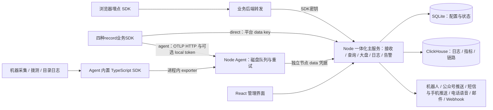

# LightMoni 整体方案

状态：2026-10-10 初稿；2026-10-17 更新为 Node.js / TypeScript 中心和 Agent；2026-10-19 依 [SDD 015](../specs/015-data-access-management/spec.md) 整理接入、凭据与数据管理；2026-10-29 依 [SDD 038](../specs/038-registered-host-agent-onboarding/spec.md) 统一主机登记与 Agent 身份接入。系统级现行基线见 [system-design.md](system-design.md)。初稿中的 Go 运行时选型由 [SDD 007](../specs/007-node-runtime-migration/spec.md) 取代；历史任务与证据保留当时上下文，当前迁移验证见 [quickstart](../specs/007-node-runtime-migration/quickstart.md) 和 [领域验证](../specs/007-node-runtime-migration/domain-validation.md)。设计条款本身不表示性能已验证。用户约束见 [brief.md](brief.md)，模块共同遵守 [contracts.md](contracts.md)，派发顺序见 [任务索引](tasks/README.md)。

## 1. 产品定位与技术选择

让个人和小团队在一台机器上启动主服务，安装 Agent，接入 SDK，即可看机器、业务指标、日志、拨测和告警。配置入口围绕 service、table、Agent、大盘和通知渠道，不要求先创建项目。

当前采用 **React + TypeScript 前端、Node.js / TypeScript 主服务与 Agent、SQLite 管理数据、ClickHouse 监控数据**。UI 使用共享 React 控件，图表采用 AntV。前端构建文件位于 `runtime/public`，由中心提供；默认 Compose 只运行中心并连接外部 ClickHouse，随附数据库配置运行中心与 ClickHouse 两个容器。

| 部分 | 当前实现 | 运行与发布 |
| --- | --- | --- |
| 中心与公共能力 | `runtime/src/server`、`shared`、`domains`、`assistant` | `node runtime/dist/server/main.js`；镜像使用 Node 24.15.0 bookworm-slim |
| 执行节点 | `runtime/src/agent`，复用 TypeScript SDK 的指标与导出能力 | 独立进程/systemd；Linux amd64、arm64 包自带 Node 24.15.0，要求 glibc ≥ 2.28 |
| AI 模型执行 | `ai-runtime` 中的 Mastra worker | 由中心通过私有管道启动和取消，无额外端口 |
| 业务 SDK | Go、TypeScript/Node.js、Rust、Python | 四语言五参数record与七档固定窗口；其他历史语言源码兼容 |

Node 版本与 npm 依赖锁定。Agent 安装包包含运行时和依赖，目标主机无需预装 Node/npm；中心与 Agent 不依赖 Go 可执行文件。旧 Go 方案不再作为新开发的推荐。当前 SDK 发布无需 Go/Rust 工具链，最终平台镜像使用 Node。打包/构建配置与 Linux 实机运行验收分别记录，本机 macOS 验证未包含 Docker 镜像构建或 systemd 实机安装。

## 2. 部署与数据链路



SDK 和接入页默认 direct，直接连接平台；用户也可明确选择 agent，经 LightMoni Agent 的磁盘队列转发。两种显式路径不自动互相改投；direct 使用进程内缓冲，agent 收到持久化 ACK 后由独立 Agent 补传。Agent 的主机采集、拨测和目录日志独立于业务路由，安装 Agent 不是 direct 的前置条件。两种方式仍分别需要连接地址及对应凭据，中转不等于免配置或已减少请求数。完整边界见 [SDD 012](../specs/012-sdk-reporting-choice/spec.md)。浏览器通过业务后端转发采集，业务后端持有同一套SDK密钥；不额外引入公开凭证类型。

主服务内部为模块化单体：统一 HTTP server、认证、SQLite、ClickHouse writer、查询执行器和后台任务生命周期。大盘、日志、告警是模块；不拆成独立微服务。中心端不需要 Redis、Kafka、Grafana 或 Kibana。ClickHouse 是整体资源占用的主要候选，需要实测后发布小机器的推荐配置，不能把“小团队”直接等同于固定的内存承诺。

## 3. 接入与组织模型

用户接入示意：

```ts
// TypeScript SDK；在业务退出时 flush/shutdown。
const moni = createLightMoni({service: 'order-api', env: 'prod'});
moni.record('business', 'db.query.duration_ms', {key1: 'mysql', key2: 'select'}, 128, 1);
await moni.shutdown({timeoutMs: 5000});
```

主机是唯一受管资产，每台主机最多关联一个 Agent。新接入由主机部署流程内部签发预绑定主机的 enrollment，兑换/激活后使用独立 control/data 凭据，分别承担控制与遥测；内部安装器从 SSH stdin 接收 token，不进入 URL、argv、环境或日志。注册/心跳只关联已有预约，不创建资产，也不回退共享 SDK Key。业务 SDK 可独立直报中心；显式使用 Agent 本地接收时，local token 由目标 Agent 管理，不是平台主机或中心控制身份。

主服务SDK密钥只按名称创建，所有有效启用密钥可写任意业务表；缺失Authorization只允许管理员启用的豁免表。SDK 使用上报 Key，Agent 强制独立 control/data 用途隔离并记录实际凭据 ID。业务指标用key1…key16固定槽，默认30秒UTC窗口；每表可选择七档周期，查询按实际窗口对齐。主机、拨测、目录日志使用固定host/probe/files表，任务标签与主机管理逻辑采用main版本。

登录区分管理员与成员，所有成员看到整个实例的数据。管理员管理用户、Key、登录供应商和外部渠道凭证；成员创建大盘、检索、告警与组目标，可以引用渠道但不能读取秘密。支持本地账号、微信、QQ、GitHub 和通用 OAuth 2.0 登录；外部身份绑定本地用户，禁用用户同时撤销会话。OAuth 回调与账号绑定由主服务处理，供应商密钥不进入前端。通用 OAuth 2.0 必须配置用户身份端点与稳定 ID 映射；OAuth 协议本身不定义用户资料格式。大盘全局保存，可以查询任意已发现表、多个 service。首个管理员在初始化时创建，私有写入 Key 与网页登录会话分开。

## 4. 存储：一库、多类型表、系统维护结构

ClickHouse 支持数据库与表。首版只建一个数据库 `lightmoni`，不按机器、service 或项目分库。业务 table 经过校验，再由系统映射为公开可查询的名称：

| SDK 类型与 table | 公开 SQL 名称 | 保存内容 |
| --- | --- | --- |
| log + business | `log_business` | 时间、service、级别、正文、trace/span ID、资源与自定义属性 |
| counter + business | `metric_business_sum` | Delta 窗口的开始/结束、名称、维度、增量值 |
| gauge + host | `metric_host_gauge` | 观测时间、名称、维度、最后观测值 |
| histogram + business | `metric_business_histogram` | 窗口、边界、桶计数、count、sum |
| trace + business | `trace_business` | trace/span/parent ID、开始/结束、状态、属性与事件 |

前缀和指标类型后缀由系统处理，SDK 仍只传业务名。日志与指标永远不混用同一 schema；一个指标逻辑集合在界面中显示为一组，SQL 编辑器展示各类型表及示例。公开 SQL 名称首版实际是去重视图，底层写入表隐藏，详见公共契约。

自定义维度保存在可查询属性字段，固定保留类型信息；首次出现字段不自动 ALTER TABLE。同一张表允许多个 service。表目录自动记录类型、字段、单位、已发现服务和 schema 版本；建表请求经单一主干入口去重、限量，防止把标签、日期或用户 ID 当作新表名。

SQLite 保存用户/外部身份、SDK Key 摘要与使用统计、Agent 接入令牌摘要与状态、节点 control/data 凭据摘要与元数据、大盘及版本快照、检索、告警组/表绑定/规则/状态、通知渠道/outbox、联系人/值班/响应/静默/回执/响应统计、Agent 身份/任务标签/任务配置、表目录和有限批次元信息。监控正文只存 ClickHouse。默认日志/trace 保留 7 天、metrics 保留 30 天作为初始配置建议，可全局或按表修改；TTL 删除存在后台执行延迟。真实资源评估前这些值不是容量保证。

## 5. Metric：在 SDK 聚合，在服务端查询

一次窗口按 `(service实例, table, 指标名称, 类型, 单位, 完整属性元组)` 聚合。属性顺序不改变元组身份。示例中 region 与 payment 的每一种组合是独立序列；查询时可按 region 汇总。

- Counter 首版只允许非负增量，发送 Delta；主服务求和后得到次数，除以查询窗口秒数得到该窗口平均速率。窗口跨查询边界时不假装可以还原窗口内每个事件，图表应说明桶粒度。
- Gauge 保存最后一次观测；CPU/内存可用 Gauge。跨机器求和/平均/最后值由指标语义与查询显式决定，不能把它们当计数器累加。
- Histogram 发送显式边界、每桶计数、count 和 sum。只合并相同边界与单位的点，分位数从合并后的分布估算，不能平均各实例 P95。
- trace_id 关联日志和 trace，不作为普通指标维度。SDK 默认限制属性数与活跃序列数，超限有本地可观测计数和溢出策略，不静默合并到任意正常序列。

Agent 机器采集、进程状态和拨测使用同一 TypeScript SDK，通过进程内 exporter 写入自己的持久队列。Agent 独立运行，不随业务实例启停。Agent 只转发业务 SDK 已聚合的 Delta，不再次聚合或改写为累积值。各进程保留实例 ID，避免多个进程的 Gauge、Counter 重置和采样时间混淆。

## 6. 可靠性与正确性边界

链路采用至少一次传输。官方 [OTLP 规范](https://opentelemetry.io/docs/specs/otlp/) 明确存在重试造成重复的可能，因此可靠传输与幂等查询必须一起设计。

SDK 冻结一个批次后生成稳定 ID；失败重试保持相同 ID、内容和原始时间。Agent 校验、补充固定资源后将批次持久化，再向 SDK ACK；Agent 重启继续发送原批次，只有主服务确认 ClickHouse 持久写入后才回收队列。主服务部分写入后失败也可以重试，查询不能把同一批次内的同一事件或指标点累计两次。

首版基线是稳定记录 ID、内部 ReplacingMergeTree 表和执行 FINAL 的公开视图；所有大盘、日志与告警查询经过这些视图。后台合并并不保证实时去重，这是 ClickHouse [官方说明的边界](https://clickhouse.com/docs/reference/engines/table-engines/mergetree-family/replacingmergetree)。开发第一阶段必须验证丢 ACK、部分写入和重启时计数准确，以及 FINAL 的成本。不能仅凭 SQLite 标记“已处理”宣称两个数据库原子提交。

SDK 到 Agent 之前的数据默认只在有界内存，业务进程崩溃可能丢失；磁盘满、队列满和凭证错误均要可见。队列满时优先拒绝新接收并返回可重试背压，不能已经 ACK 再偷偷删除。按数据保留期拒绝过期补传并明确记录丢弃原因。外部普通 OTLP exporter 未采用稳定批次 ID 时兼容接入，但可能重复，不能套用自有 SDK 的幂等承诺。

## 7. 用户可见功能与首版边界

| 模块 | 首版核心能力 | 后续扩展 |
| --- | --- | --- |
| SQL 大盘 | 多大盘、多面板/查询、图表配置、布局、变量、时间、刷新、跨表/服务、日志跳转 | 任意变换、面板插件、原版格式导入 |
| 日志探索 | 关键词与字段过滤、分布图、列配置、详情/堆栈、同来源上下文、保存搜索、实时增量、trace 联动 | 完整 KQL/Lucene、大规模长期快照 |
| 告警与通知 | 人员责任组、多主多备、固定/周期排班、分级窗口与升级、接手统计、日志/Trace现场、常见渠道及回执，保留规则求值/恢复 | 企业组织权限、依赖抑制 |
| SDK | 三种当前发布业务语言、log/metric/trace、上下文、维度聚合、批量与重试、轻量浏览器入口 | 完整自动埋点矩阵、会话回放 |
| Agent | 机器/进程采集、HTTP/TCP 拨测、SDK 接收、磁盘缓存、心跳、配置轮询、安装脚本 | 更多操作系统、无缝在线升级 |
| 主干 | 部署、用户管理、四类第三方登录、多 Key 管理与追踪、目录、存储、共享查询、只读 SQL、SDK/Agent 接入页、日志 Trace ID 筛选、自监控 | 多租户、HA 集群、PromQL 兼容 |

日志页不使用大盘图表编辑器代替检索。历史翻页用有界短时查询会话冻结已返回结果，避免补传改变后续页面；超过会话容量明确截断，过期重查。实时模式单独查询接收时间并按 event_id 去重，不宣称跨重启或超出重叠窗口永不漏读。

告警共享查询执行器，规则保存自己的窗口和已绑定变量；查询错误、无数据、数值 0 是三种情况。通知渠道包括飞书、钉钉、企业微信、Webhook、SMTP、公众号推送服务、短信、电话语音和移动推送适配器。短信/电话/公众号需要用户已有供应商账号和配置，接口受理与实际送达分别记录；所有调度与 outbox 在主服务内，不能因为通知失败阻塞采集。

## 8. 页面与部署交付

告警组声明用户成员、排班、系统接入引用与分级策略；表目录配置默认 `alert_group_id`。规则显式登记来源表，跨表规则取得多个责任组，每组按episode独立接手和升级。SQLite持久化响应及有效时钟，停用/恢复/变更路由取消旧代次；现场取证独立有界执行。实际数据与操作契约见[告警响应](alert-response.md)。配置总览列出全部表、告警组、规则、启用状态，联查事件与发送记录；不靠解析任意 SQL 文本猜来源。

UI 禁止原生 `<select>` 及 `window.alert/confirm/prompt`。选择、确认、输入、日期与时间使用共享 React 组件，键盘与焦点行为一并验收。AntV 绘制图表，共享表格展示无损数值。详细决定见 [UI 设计说明](ui-design.md)，核心交互对标与全流程验收见 [acceptance.md](acceptance.md)。

侧栏按监控和运维能力分类，主机管理是唯一 Agent 接入入口。登记同屏填写名称、SSH 目标地址、端口、用户名、密码或私钥与保存时长，默认密码登录、保存 6 小时，也可只登记后补凭据。主机公钥指纹独立核验远端身份，不是登录凭据，和主机 ID/名称一样不受秘密有效期影响。有限 managed 到期/撤销清除；明确选择并确认的 permanent 没有固定过期时间，直到撤销，二者均加密保存且不因 Agent 激活提前清除。建议优先短期保存。预检和审阅部署后，中心内部预绑定主机与 enrollment，平台固定安装器执行 Linux amd64/arm64 systemd 首装。无独立 token 签发、用户脚本安装、手工关联和共享 SDK Key 控制面兼容。注册/心跳不能创建主机；列表只展示真实平台资产及 Agent 通道。SDK 接入保留样例、SDK Key 和豁免表，SDK 默认独立直报，安装 Agent 不是其前置条件。当前契约见 [SDD 038](../specs/038-registered-host-agent-onboarding/spec.md) 与 [SDD 039](../specs/039-host-registration-credential-retention/spec.md)。

“管理后台 → 接入凭据”统一展示 SDK 上报密钥、Agent 接入令牌、节点凭据三类，不合并其权限或生命周期。接入令牌仅由主机部署内部产生，凭据页可查看状态并撤销未完成安装，待激活令牌撤销后不能继续激活；节点凭据只展示元数据，按节点和 control/data 用途撤销所有未撤销凭据。独立“数据管理”向成员开放数据目录，管理员设置单表保留时长与日志上报规则；全局 SDK 停报仍位于 SDK 接入页。图表模板保留在监控大盘，不再在接入页重复展示。旧接入页密钥、数据表和模板深链分别转到对应管理入口，成员访问旧密钥链接回到 SDK 接入。

中心端提供 Docker Compose、配置示例、初始化、升级/备份/恢复和数据卷说明。首次部署能够用预置样例确认“接收 → 查询 → 出图 → 检索 → 告警”链路。TLS 可由已有反向代理承担；不另外引入专用网关。SDK 与 Agent 的本机通信默认只绑定 loopback，容器场景明确如何连接宿主 Agent。

## 9. 并行实施与完成定义

六个任务分别负责大盘、日志、告警、SDK、Agent、主干。主干先交付接口、样例、应用壳和共享组件；页面开发用共同 fixture 并行，SDK 与 Agent 用相同协议样例互测。TypeScript SDK 进程内导出接口、Agent 持久化 ACK、主服务去重必须在早期实际联调。

接入验收先检查登记主机、预检与审阅部署、主机预约、独立凭据、重试幂等和越权拒绝。数据验收分别覆盖 SDK 直报与显式使用 Agent 的独立凭据路径，发送多维指标和日志，断网、重启、丢 ACK 后查询结果仍正确；不验收已移除的共享 Key 控制路径。随后验收跨服务大盘、补传日志翻页、SQL 告警与恢复通知。最后在干净机器上走部署、安装与接入步骤，并测资源占用。六条任务的精确归属、依赖与验收见 [任务索引](tasks/README.md)。

功能参考：[OpenObserve](https://github.com/openobserve/openobserve)、[Grafana 大盘](https://grafana.com/docs/grafana/latest/visualizations/dashboards/build-dashboards/create-dashboard/)、[Kibana Discover](https://www.elastic.co/docs/explore-analyze/discover/discover-get-started)。参考界面工作流和数据组织方式，LightMoni 首版不承诺完整复刻三个产品的全部功能。
