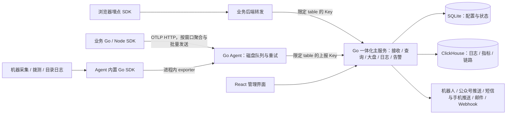

# LightMoni 整体方案

状态：设计基线，2026-10-10。本轮交付方案和六份开发任务书；本文不表示功能已经实现或性能已经验证。用户约束见 [brief.md](brief.md)，模块共同遵守 [contracts.md](contracts.md)，派发顺序见 [任务索引](tasks/README.md)。

## 1. 产品定位与技术选择

让个人和小团队在一台机器上启动主服务，安装 Agent，接入 SDK，即可看机器、业务指标、日志、拨测和告警。配置入口围绕 service、table、Agent、大盘和通知渠道，不要求先创建项目。

推荐 **React + TypeScript 前端，Go 主服务与 Agent，SQLite 管理数据，ClickHouse 监控数据**。UI 按 oil-ui 的设计流程统一，图表采用 AntV。前端构建文件嵌入主服务，中心端运行两个容器。Go SDK 和 Agent 复用指标与导出实现；首批同时提供 Node.js TypeScript SDK。

| 选择 | 对本项目的影响 | 建议 |
| --- | --- | --- |
| Go 主服务 + Go Agent | 主服务可嵌入前端产物；两者按平台发布可执行文件；共用 Go SDK、采集协议和队列接口 | 作为开发基线 |
| Node.js 主服务 + Go Agent | 全栈 TypeScript 上手可能更快，但主服务与 Agent 需要维护两套基础实现 | 团队明显更熟悉 TypeScript 时可选 |
| Node.js 主服务 + Node.js Agent | 可以实现功能，需统一处理运行时或单文件打包、宿主平台适配和发布 | 对常驻主机采集器不优先 |

这不是 Go 性能必然优于 Node.js 的结论。选择来自部署、分发和代码复用目标。Go 官方支持编译可执行文件和 [嵌入静态文件](https://pkg.go.dev/embed)；Node.js 也有 [单文件应用能力](https://nodejs.org/api/single-executable-applications.html)，需要在选择时评估其打包约束。后端语言最终确定后由主干锁定版本、驱动与工具链，不使用浮动 latest。

## 2. 部署与数据链路



SDK 默认连接本机 Agent；没有 Agent 的业务可直接连接主服务，但此时没有 Agent 的磁盘保护。浏览器通过业务后端转发采集，业务后端持有同一套限定 table 的 Key；不额外引入公开凭证类型。

主服务内部为模块化单体：统一 HTTP server、认证、SQLite、ClickHouse writer、查询执行器和后台任务生命周期。大盘、日志、告警是模块；不拆成独立微服务。中心端不需要 Redis、Kafka、Grafana 或 Kibana。ClickHouse 是整体资源占用的主要候选，需要实测后发布小机器的推荐配置，不能把“小团队”直接等同于固定的内存承诺。

## 3. 接入与组织模型

用户接入示意：

```ts
// 拟定 API，实际由 SDK 任务按公共契约实现。
const moni = createLightMoni({
  service: "order-api",
  table: "business",
  endpoint: "http://127.0.0.1:4318",
});
moni.counter("orders_created").add(1, { region: "cn", payment: "wechat" });
moni.log.info("order created", { order_id: "123" });
```

一台机器的两个服务共用一个 Agent；Agent 配置一份限定 table 的私有 Key。主服务支持多份命名 Key，每份均可上传任意 service，不做 service 绑定；table 通过显式白名单限定，或由管理员设置允许所有 table，服务端在上报入口精确校验。旧 Key 迁移为空白名单，需管理员配置后恢复写入。每条数据保存认证得到的 key_id，后台展示按 Key 的上报量、来源、最近使用和错误，方便排查。service 是数据属性，table 是业务数据集合。主机数据默认 service 为 `lightmoni-agent`、table 为 `host`，通过 host_id/agent_id 区分机器；拨测默认使用 table `probe`，目录日志默认使用 `files`；三类表均可按分组更改。同组任务统一下发，安装选择初始分组，平台保存后续改组结果。

登录区分管理员与成员，所有成员看到整个实例的数据。管理员管理用户、Key、登录供应商和外部渠道凭证；成员创建大盘、检索、告警与组目标，可以引用渠道但不能读取秘密。支持本地账号、微信、QQ、GitHub 和通用 OAuth 2.0 登录；外部身份绑定本地用户，禁用用户同时撤销会话。OAuth 回调与账号绑定由主服务处理，供应商密钥不进入前端。通用 OAuth 2.0 必须配置用户身份端点与稳定 ID 映射；OAuth 协议本身不定义用户资料格式。大盘全局保存，可以查询任意已发现表、多个 service。首个管理员在初始化时创建，私有写入 Key 与网页登录会话分开。

## 4. 存储：一库、多类型表、系统维护结构

ClickHouse 支持数据库与表。首版只建一个数据库 `lightmoni`，不按机器、service 或项目分库。业务 table 经过校验，再由系统映射为公开可查询的名称：

| SDK 类型与 table | 公开 SQL 名称 | 保存内容 |
| --- | --- | --- |
| log + business | `log_business` | 时间、service、级别、正文、trace/span ID、资源与自定义属性 |
| counter + business | `metric_business_sum` | Delta 窗口的开始/结束、名称、维度、增量值 |
| gauge + host | `metric_host_gauge` | 观测时间、名称、维度、最后观测值 |
| histogram + business | `metric_business_histogram` | 窗口、边界、桶计数、count、sum |
| trace + business | `trace_business` | trace/span/parent ID、开始/结束、状态、属性与事件 |

前缀和指标类型后缀由系统处理，SDK 仍只传业务名。日志与指标永远不混用同一 schema；一个指标逻辑集合在界面中显示为一组，SQL 编辑器展示各类型表及示例。公开 SQL 名称首版实际是去重视图，底层写入表隐藏，详见公共契约。

自定义维度保存在可查询属性字段，固定保留类型信息；首次出现字段不自动 ALTER TABLE。同一张表允许多个 service。表目录自动记录类型、字段、单位、已发现服务和 schema 版本；建表请求经单一主干入口去重、限量，防止把标签、日期或用户 ID 当作新表名。

SQLite 保存用户/外部身份、Key 摘要与使用统计、大盘及版本快照、检索、告警组/表绑定/规则/状态、通知渠道/outbox、Agent 分组/任务配置、表目录和有限批次元信息。监控正文只存 ClickHouse。默认日志/trace 保留 7 天、metrics 保留 30 天作为初始配置建议，可全局或按表修改；TTL 删除存在后台执行延迟。真实资源评估前这些值不是容量保证。

## 5. Metric：在 SDK 聚合，在服务端查询

一次窗口按 `(service实例, table, 指标名称, 类型, 单位, 完整属性元组)` 聚合。属性顺序不改变元组身份。示例中 region 与 payment 的每一种组合是独立序列；查询时可按 region 汇总。

- Counter 首版只允许非负增量，发送 Delta；主服务求和后得到次数，除以查询窗口秒数得到该窗口平均速率。窗口跨查询边界时不假装可以还原窗口内每个事件，图表应说明桶粒度。
- Gauge 保存最后一次观测；CPU/内存可用 Gauge。跨机器求和/平均/最后值由指标语义与查询显式决定，不能把它们当计数器累加。
- Histogram 发送显式边界、每桶计数、count 和 sum。只合并相同边界与单位的点，分位数从合并后的分布估算，不能平均各实例 P95。
- trace_id 关联日志和 trace，不作为普通指标维度。SDK 默认限制属性数与活跃序列数，超限有本地可观测计数和溢出策略，不静默合并到任意正常序列。

Agent 机器采集、进程状态和拨测使用同一 Go SDK。Agent 只转发业务 SDK 已聚合的 Delta，不再次聚合或改写为累积值。各进程保留实例 ID，避免多个进程的 Gauge、Counter 重置和采样时间混淆。

## 6. 可靠性与正确性边界

链路采用至少一次传输。官方 [OTLP 规范](https://opentelemetry.io/docs/specs/otlp/) 明确存在重试造成重复的可能，因此可靠传输与幂等查询必须一起设计。

SDK 冻结一个批次后生成稳定 ID；失败重试保持相同 ID、内容和原始时间。Agent 校验、补充固定资源后将批次持久化，再向 SDK ACK；Agent 重启继续发送原批次，只有主服务确认 ClickHouse 持久写入后才回收队列。主服务部分写入后失败也可以重试，查询不能把同一批次内的同一事件或指标点累计两次。

首版基线是稳定记录 ID、内部 ReplacingMergeTree 表和执行 FINAL 的公开视图；所有大盘、日志与告警查询经过这些视图。后台合并并不保证实时去重，这是 ClickHouse [官方说明的边界](https://clickhouse.com/docs/reference/engines/table-engines/mergetree-family/replacingmergetree)。开发第一阶段必须验证丢 ACK、部分写入和重启时计数准确，以及 FINAL 的成本。不能仅凭 SQLite 标记“已处理”宣称两个数据库原子提交。

SDK 到 Agent 之前的数据默认只在有界内存，业务进程崩溃可能丢失；磁盘满、队列满和凭证错误均要可见。队列满时优先拒绝新接收并返回可重试背压，不能已经 ACK 再偷偷删除。按数据保留期拒绝过期补传并明确记录丢弃原因。外部普通 OTLP exporter 未采用稳定批次 ID 时兼容接入，但可能重复，不能套用自有 SDK 的幂等承诺。

## 7. 用户可见功能与首版边界

| 模块 | 首版核心能力 | 后续扩展 |
| --- | --- | --- |
| SQL 大盘 | 多大盘、多面板/查询、图表配置、布局、变量、时间、刷新、跨表/服务、日志跳转 | 任意变换、面板插件、原版格式导入 |
| 日志探索 | 关键词与字段过滤、分布图、列配置、详情/堆栈、同来源上下文、保存搜索、实时增量、trace 联动 | 完整 KQL/Lucene、大规模长期快照 |
| 告警与通知 | 告警组与目标、表绑定、全量配置列表、SQL 定时求值、阈值/持续时间、无数据策略、恢复、静默、去重、记录、常见渠道 | 企业排班、复杂升级链 |
| SDK | Go/Node、log/metric/trace、自动上下文、维度聚合、批量与重试、轻量浏览器入口 | 更多语言、完整自动埋点矩阵、会话回放 |
| Agent | 机器/进程采集、HTTP/TCP 拨测、SDK 接收、磁盘缓存、心跳、配置轮询、安装脚本 | 更多操作系统、无缝在线升级 |
| 主干 | 部署、用户管理、四类第三方登录、多 Key 管理与追踪、目录、存储、共享查询、只读 SQL、SDK/Agent 接入页、日志 Trace ID 筛选、自监控 | 多租户、HA 集群、PromQL 兼容 |

日志页不使用大盘图表编辑器代替检索。历史翻页用有界短时查询会话冻结已返回结果，避免补传改变后续页面；超过会话容量明确截断，过期重查。实时模式单独查询接收时间并按 event_id 去重，不宣称跨重启或超出重叠窗口永不漏读。

告警共享查询执行器，规则保存自己的窗口和已绑定变量；查询错误、无数据、数值 0 是三种情况。通知渠道首版包括飞书、钉钉、企业微信、Webhook、SMTP、公众号推送服务、短信和移动推送适配器。短信/公众号需要用户已有供应商账号和配置，接口受理与实际送达分别记录；所有调度与 outbox 在主服务内，不能因为通知失败阻塞采集。

## 8. 页面与部署交付

告警组声明渠道与接收目标，表目录配置默认 `alert_group_id`；规则显式登记来源表，跨表规则合并来源表的组目标并去重。配置总览列出全部表、告警组、规则、启用状态，联查事件与发送记录；不靠解析任意 SQL 文本猜来源。

UI 禁止原生 `<select>` 及 `window.alert/confirm/prompt`。选择、确认、输入、日期与时间使用共享 React 组件，键盘与焦点行为一并验收。AntV 绘制图表，共享表格展示无损数值。详细决定见 [UI 设计说明](ui-design.md)，核心交互对标与全流程验收见 [acceptance.md](acceptance.md)。

共用侧栏：概览、大盘、日志、链路、告警、Agent、数据接入、设置。接入页提供服务器安装命令、Go/Node/浏览器 SDK 样例、数据到达状态和对应预置大盘。管理员选择分组并填入上报连接后生成自动配置的 Agent 安装命令；安装脚本有固定发布版本与校验和，Linux amd64/arm64 和 systemd 作为首批目标。

中心端提供 Docker Compose、配置示例、初始化、升级/备份/恢复和数据卷说明。首次部署能够用预置样例确认“接收 → 查询 → 出图 → 检索 → 告警”链路。TLS 可由已有反向代理承担；不另外引入专用网关。SDK 与 Agent 的本机通信默认只绑定 loopback，容器场景明确如何连接宿主 Agent。

## 9. 并行实施与完成定义

六个任务分别负责大盘、日志、告警、SDK、Agent、主干。主干先交付接口、样例、应用壳和共享组件；页面开发用共同 fixture 并行，SDK 与 Agent 用相同协议样例互测。Go SDK 内嵌接口、Agent 持久化 ACK、主服务去重必须在早期实际联调。

第一道验收门是同一台机器两个 service 共用 Agent/Key，发送多维指标和日志，断网、重启、丢 ACK 后查询结果仍正确。随后验收跨服务大盘、补传日志翻页、SQL 告警与恢复通知。最后在干净机器上走部署、安装与接入步骤，并测资源占用。六条任务的精确归属、依赖与验收见 [任务索引](tasks/README.md)。

功能参考：[OpenObserve](https://github.com/openobserve/openobserve)、[Grafana 大盘](https://grafana.com/docs/grafana/latest/visualizations/dashboards/build-dashboards/create-dashboard/)、[Kibana Discover](https://www.elastic.co/docs/explore-analyze/discover/discover-get-started)。参考界面工作流和数据组织方式，LightMoni 首版不承诺完整复刻三个产品的全部功能。
