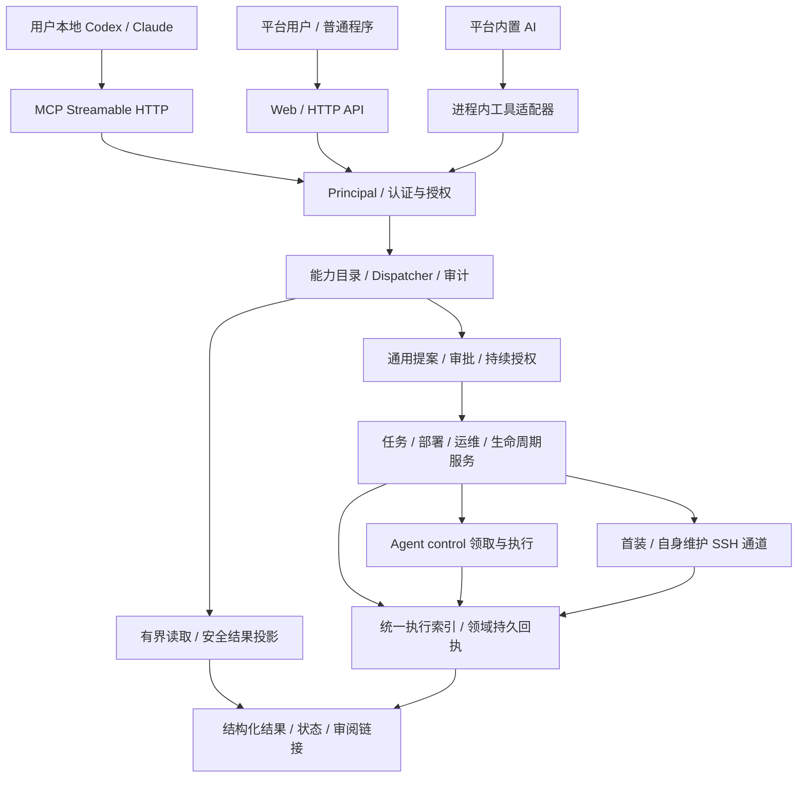
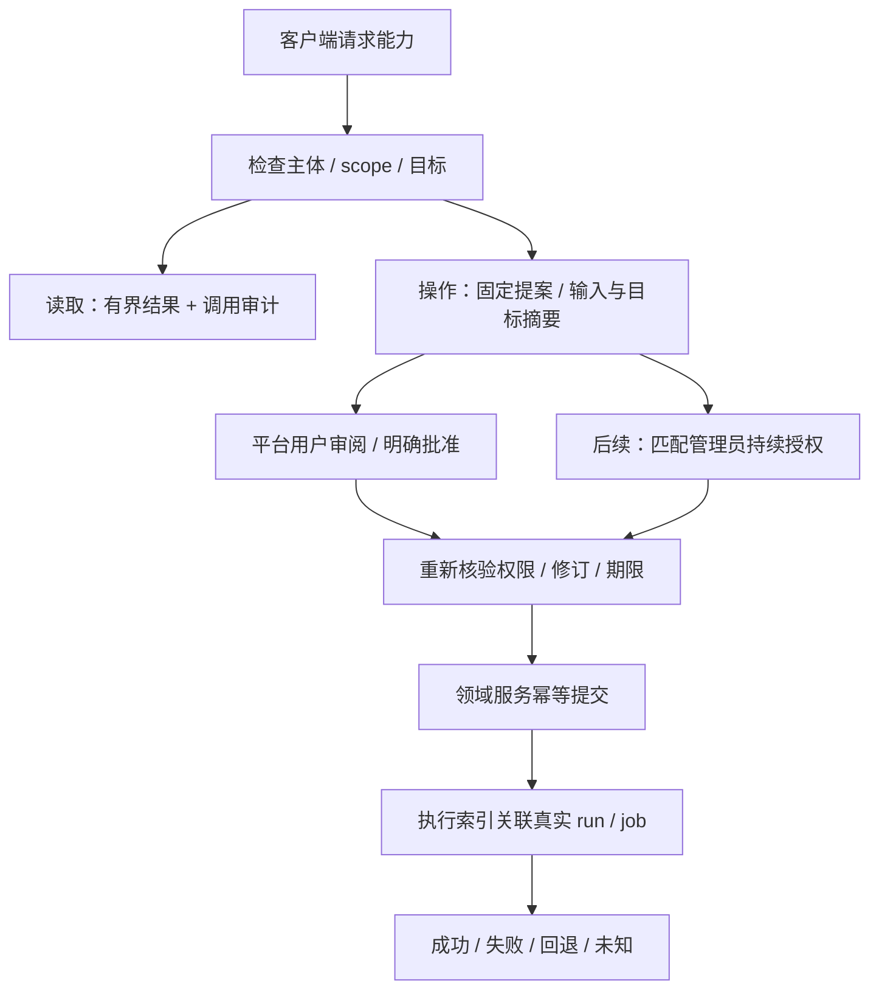
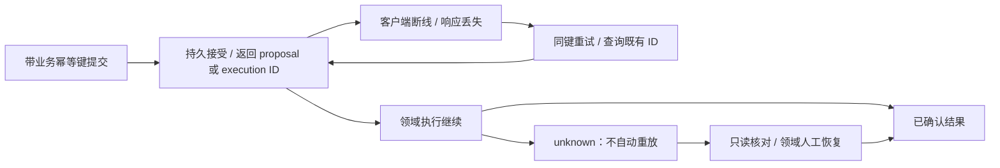

# LightMoni 平台开放能力与 MCP 架构

状态：SDD 046 总体目标架构；[SDD 047](../specs/047-platform-mcp-service/spec.md) 已实现首批统一能力、MCP、PAT 与 OAuth，范围见第 16 节和 [接入指南](mcp.md)。本文补充 [系统设计 14.4](system-design.md#144-平台开放能力与-mcp目标架构sdd-046)，未列入首期的能力仍为目标设计。

## 1. 驱动目标与设计结论

LightMoni 开放的是整个平台能力，任务下发只是其中一部分。用户可选择本地 Codex、Claude 等 MCP 客户端，也可使用平台内置 AI。外部用户自己的客户端负责模型调用和计费，LightMoni 负责能力、授权、执行与审计，不要求外部客户端再调用平台模型。

采用“一套应用能力层、三个入口”：MCP 面向 AI 客户端，Web HTTP 面向页面及普通程序，内置 AI 使用进程内适配器。三者复用 Dispatcher 和领域服务。平台 AI 不必绕公网 MCP 请求自己；共享能力与约束比强制使用同一网络协议更重要。HTTP 继续承担浏览器审批、文件传输和自动化集成，MCP 不替代全部 API。

首期与现有部署相同，MCP、能力层、授权和领域服务作为 Node.js/TypeScript 中心内的模块运行，共用 SQLite 和已有生命周期；不为接入引入新的消息队列或微服务。Agent 出站 control/data、SDK 独立直报保持现有职责。

## 2. HLD：统一能力与执行路径

所有主机主动操作先经过能力层和领域服务，再进入统一执行记录；MCP 无直连 Agent、任意 SSH 或数据库写入旁路。读取中心元数据记调用审计，不创建虚假的远端执行。持续指标和日志按配置 revision 管理，不为每个采样生成任务实例。

## 3. 当前事实与待建设部分

SDD 046 调研时，`assistant/types.ts` 的 Tool 只有 name/schema/effect/execute，传入登录用户和助手 session。SDD 047 新增基于平台用户的 MCP 入口、OAuth/PAT、role/scope 与主机范围授权及 Dispatcher，并迁移首批任务工具及通用任务提案，任务提案复用平台审批；服务主体尚未支持。其余告警、运维和源码工具尚未整体迁移，不能把原助手工具直接对外导出；中心代码工作区也没有变成用户本地工作区。

现有 TaskRunStore、Agent job、运维 run、部署计划和生命周期操作继续负责真实状态、租约、取消和恢复。Agent 升级/回退已随 [PR #21 / SDD 045](https://github.com/workhold/lightmoni/pull/21) 合入主干，维护继续使用独立审批与 SSH 生命周期协议；首期 MCP 不开放维护写工具。统一执行索引是关联和投影，不是另建一个取代所有领域的队列，跨领域完整统一执行读模型仍待后续建设。

## 4. LLD：能力描述符与调用链

能力定义归属拟新增 `runtime/src/capabilities/`，从 assistant 目录中分离。每个描述符声明稳定 ID/版本、输入输出 JSON Schema、所需 scope、资源解析、read/propose/execute 影响、执行策略、审批、幂等、投影、审计与时间/结果上限。模型不能动态注册服务器任意代码。

调用链固定为：认证主体 → 校验 schema → 解析真实资源 → 检查当前 role/scope/资源授权 → 限流及幂等 → 领域服务 → 安全结果投影，全链路由统一审计包围。拒绝、schema 失败、取消及幂等命中也写安全摘要；认证失败记录网关安全事件，不记录原始令牌。发现、直接调用、资源读取和分页都执行授权；工具隐藏只是使用体验，不能代替服务端检查。

内置 AI 与 MCP 工具名称可由同一描述符生成。规范能力如 `hosts.list@v1` 映射为 `lightmoni_hosts_list`；破坏性升级产生新 major，旧工具在明确弃用期后移除。保留逐工具 schema，不用一个接受任意 name/args 的万能执行工具覆盖全部能力。`clientInfo.name`、来源会话和模型生成的 user_id 都不能成为授权依据。

## 5. 身份、资源与授权

Principal 记录服务端识别的主体类型/ID、当前账户状态与角色、凭据 ID、scope、资源授权和安装实例 ID。Web 来自现有登录会话，内置 AI 继承当前用户及工具策略，MCP 来自专用 OAuth token 或 PAT。三者进入相同策略；“共用能力”不表示它们自动拥有相同权限。

有效权限是当前账户角色 ∩ 凭据 scope ∩ 资源授权 ∩ 执行/审批策略。目标授权显式绑定主机 ID；若允许标签授权，必须由管理员选择动态标签策略，并在提交与执行前重解析。审批仍固定当时目标集合，新增同标签主机不能静默加入已批准执行。当前平台没有多租户隔离，首期按单安装实例授权；未来 workspace/tenant 需端到端对象、查询、索引、缓存和幂等隔离，不能仅添加 tenant_id 字段就宣称完成。

scope 按领域和动作区分，例如 hosts.read、tasks.propose、tasks.source.read、telemetry.query、agents.maintain.propose。scope 不能把普通成员提升为管理员；现有管理员写规则继续生效。令牌不能调用身份管理、读取 SSH/Agent/SDK/模型秘密、批准自己的提案或人工结束 unknown。

遥测查询必须独立授权。默认只开放安全目录与经授权数据；任意 SQL 只对拥有完整相关查询范围的主体开放。主机范围令牌不能仅靠往 SQL 追加 WHERE 就获得隔离；无法证明 AST/视图覆盖资源范围时拒绝通用 SQL，后续用受限查询接口或受权视图实现。脚本源码读取也独立于任务元数据读取。

## 6. 客户端接入与凭据

推荐用户授权使用 OAuth 2.1 Authorization Code + PKCE S256。MCP 是资源服务器，发现元数据指向授权服务器；授权服务器可与中心同进程，复用平台登录验证身份。现有 `server/oauth.ts` 是平台对第三方身份提供者的登录客户端，不能直接视为已具备签发 MCP token 的授权服务器。

授权界面展示客户端、请求能力、目标主机/数据范围和期限。access token 绑定精确 MCP resource/audience、主体和 grant；短期 access token，刷新轮换及重放检测，用户可查看、撤销授权。持久计划绑定稳定 grant_id 及授权修订，access token 自然过期只影响新 HTTP 请求，不让已批准长任务因短期 token 到期失效；grant/PAT 撤销或过期、主体停用/降权则阻止尚未开始项，已开始项按既有协议完成。首期采用显式预注册客户端，精确校验 redirect URI；原生客户端 loopback 端口变化按原生 OAuth 规则单独校验，不放开任意 host/path。Client ID Metadata Documents/DCR 需专门的 SSRF、配额与注册治理。

个人访问令牌 PAT 作为支持自定义 Bearer 的客户端、调试和早期试验的补充，不能代替 OAuth 互操作验收。每个客户端单独创建、默认有限期限、一次展示、中心仅存散列、前缀/末尾摘要及授权元数据；本地使用客户端受保护凭据存储或环境引用。token 不在 URL、源码、命令参数示例或聊天中传递。SDK data Key、Agent enrollment/control/data、维护下载票据、登录 cookie、SSH 密码/私钥、模型 Key 均不接受为 MCP Bearer。

服务账户为后续独立主体，绑定授权管理员与资源范围，不伪装成个人。计划执行前重新检查授权状态；管理员失效时暂停其持续授权，已开始操作按既有协议完成并保留回执。

## 7. Streamable HTTP 与协议边界

入口 `https://<平台域名>/api/v1/mcp`，使用官方 SDK 的受支持 Streamable HTTP。协议适配器与业务 Dispatcher 分开：SDD 047 固定官方 TypeScript SDK 1.32.2，以 MCP 2025-11-25 为测试基线；它不是当前最新协议。2026-07-28 已移除 initialize/initialized 与协议会话，改为 server/discover 和每请求 _meta，要求独立适配与验收，不能把新旧握手混写。2026 适配器尚未实现；后续升级不等于无条件接受任意版本。

2025-11-25 兼容实现：POST 接收单个标准 JSON-RPC 消息，按协议返回 JSON 或 SSE，通知接受后返回 202。采用无状态请求处理，不颁发 MCP-Session-Id，不声明持久 SSE 恢复；GET 无独立事件流时返回该版本允许的 405，DELETE 不支持会话管理时同样明确处理。2026-07-28 实现单独处理 Mcp-Method/Mcp-Name、每请求版本/能力元数据、resultType 和授权相关缓存语义；事件流使用 subscriptions/listen，不复用旧 GET 或 Last-Event-ID。实际支持集合由适配器声明，业务执行契约不随传输变化。

对应版本的发现/协商、tools/list、tools/call 为首期必需。资源如 `lightmoni://executions/<id>` 与提案只读视图可后续增加，必须与工具相同授权、限制大小且不能伪装成本地文件。prompts 仅为可选工作流模板，不携带秘密或授予权限。首期不要求客户端支持 roots、sampling、elicitation 或协议任务扩展；客户端模型能力和本地工作区不被服务器暗中调用。

每个 HTTP 请求独立认证。验证 Origin：有 Origin 且不在明确允许列表时 403；允许原生客户端省略 Origin，但仍必须 Bearer 认证。Cookie 不作为 MCP 认证替代，Web 审批仍按现有 CSRF/Origin 规则。限制请求体、schema 深度、每主体并发、调用/查询频率、输出大小与执行期限。反向代理保持 Authorization、正确响应类型与有界超时；外部地址来自可信配置，不从用户 Host/Forwarded 生成。

首期不依赖长连接承载任务寿命，重启也不依赖粘性 MCP 会话。若为旧版兼容另行启用会话，须绑定主体与凭据并每请求重验；不能把该机制带入已移除会话的新协议。通知/SSE 流关闭不撤销业务执行，任何协议关联 ID 都不是访问令牌。工具/资源缓存按授权主体、scope、资源授权修订隔离，权限变化后旧缓存不能维持访问；不能用跨主体公共缓存泄露工具或对象。

## 8. 任务中心与统一执行记录

任务定义描述“做什么”，平台默认任务和用户脚本共用真实任务目录，不另设任务模板目录；执行实例固定这一次的能力/源码版本、参数、主机/Agent 与授权。自定义任务支持已有 Node.js/POSIX shell，并逐步增加参数 schema、默认值、枚举、秘密引用、超时/输出上限和一次/周期调度。用户改代码或参数生成新 revision，不能改写正在执行的快照。脚本仍具有 Agent 运行用户权限，MCP 不提供操作系统沙箱；秘密不写入源码或模型参数。秘密引用按主体、用途、目标和固定能力校验 use 权限，由受控执行器临时解析；仅持有 secret_id 不能让任意脚本取得秘密。

统一 execution 关联 task_run、agent_job、deployment、operation_run 或 agent_lifecycle 的真实记录，保留 native_state、phase 和回执引用。中心配置变更记录 revision 与应用状态，有限命令记录租约与退出，部署记录阶段与健康，Agent 自身维护记录独立确认/恢复。MCP 层不自行判定主机成功。

统一展示 awaiting_approval/queued/running/succeeded/failed/cancelled/rolled_back/unknown，另保留领域状态。rolled_back 表示目标意图失败、恢复已确认，不能展示成升级成功；原本停止的服务恢复到停止也要明确。交互式终端使用单独会话协议，关联授权、开始/结束和退出状态，不将每次按键拆成任务或将原始终端输出发送给模型。

## 9. 审批与后续自动执行

首期 read 可按授权直接调用；propose 保存可审阅提案并返回平台链接，外部工具没有 approve/apply/commit。客户端弹窗确认、模型“用户说同意”和 MCP elicitation 都不能替代平台审批凭据。审批由登录用户或服务器保存的持续授权产生，复验真实权限，不从工具输入信任 actor。

后续允许管理员预授权固定 template/action、版本、目标、参数界限、时间窗、次数与并发。符合持续授权的低影响操作可直接提交并记录 grant；超出范围重新审阅。任意新脚本、代码/目标扩大、权限提升、凭据变更、销毁或人工核对 unknown 不能依靠普通自动化授权放行。AI 无法创建自己的 grant。

告警/静默、任务、部署等提案从 assistant 会话服务迁到通用提案服务，owner、客户端、来源会话分开。外部提案不伪造助手 session，原助手历史 owner/审批检查不能因迁移放宽。涉及主机的提案被批准后才产生远端执行，不能把“计划已创建”报告为“主机已执行”。

## 10. 幂等、断连、取消与未知结果

JSON-RPC request ID 只用于本次协议响应关联，MCP 会话只用于协议，均不能作为业务去重或授权。提交时的 idempotency_key 绑定安装实例、principal 和 capability；规范化输入、目标集合与版本形成 hash。同键同内容返回已有可见结果；不同内容返回冲突。令牌轮换不改变主体或去重域。默认至少 30 天且不少于最长执行/重试窗口，未结束/unknown 的键不提前淘汰。

客户端取消 RPC 可中止尚未接受的读取/计算；一旦持久接受，业务执行不随 MCP 断连停止。task cancel 是独立授权能力，queued 可直接取消，running 等待远端停止回执；对 Agent 升级或部署不能承诺取消即无副作用。结果未知不得自动重试；显式重试须经领域检查、重新审阅并创建关联新执行。

## 11. 工具目录与首期开放矩阵

所有名称为规划示例，不能当作当前可调用接口。只对已授权主体发现相应工具，调用时再次授权。

| 领域 | 规划工具/能力 | 首期边界 |
| --- | --- | --- |
| 主机 | hosts_list/get、hosts_check_propose | 安全目录；SSH 预检为有记录的只读主机操作，仍需管理员批准 |
| 任务 | tasks_list/get、tasks_plan、executions_get/list | 元数据默认不含脚本和原始输出；定义/派发/取消/重试生成提案 |
| 监控 | telemetry_tables/describe/query | 数据权限单独授权；有界只读；资源隔离不足时拒绝任意 SQL |
| 告警 | alerts_list/get、silences_list、alerts_plan | 修改生成带 revision 的提案 |
| 部署 | deployments_list/get/plan | 固定已登记服务、目标和制品；不隐式构建未知代码 |
| 运维 | operations_list/get/plan | 网站、证书、Compose、备份等结构化计划；秘密经引用使用 |
| Agent | agents_releases/get、agents_update_plan | 以对应生命周期能力实际落地为前提，升级/回退生成计划 |
| 大盘 | dashboards_read/draft | 草稿与保存分开，仍需用户审阅 |

首期没有任意 exec/SSH、读取凭据、全库管理员透传、远程任意路径读取、apply/commit、unknown resolve 或代码工作区写入工具。原有 get_task、run_query 等不能不经审查原样导出，因为它们可能带脚本、遥测敏感字段或宽范围权限。

## 12. 本地源码与部署的分工

本地 Codex/Claude 使用用户授予的本地文件权限添加 LightMoni SDK 和打点，运行本地检查并生成用户可审阅改动；它通过 MCP 查询平台接入参数、服务/主机和准备部署提案。远程 MCP 收到 `/Users/...`、相对路径或 roots 不表示平台获得该目录访问权。

正式部署使用明确提交的代码版本或已上传校验的制品及登记目标。后续远程源码编辑必须单独登记仓库/工作区、授权与隔离任务，不允许任意 clone URL、任意文件路径或隐式读取用户笔记本。平台 code_task 仍只访问中心明确配置 workspace；部署秘密通过引用注入，不返回给本地或平台模型。SDK 继续独立直报，Agent 管理主机，两者凭据各自独立。

## 13. 持久化、审计与资源限制

规划新增 access_grants/personal_access_tokens、OAuth clients/codes/refresh grants、capability_invocations、execution_index/execution_links。已有 proposal/run/job 是领域事实来源；统一索引、接受审计与事件在同一 SQLite 事务写入，无法持久接受记录时不得派发主机动作。跨边界通过持久 outbox 幂等投影，重启可修复索引或完成摘要，不因投影/响应丢失再次执行主机操作。

调用审计记录可信 principal/credential/source、capability/version、目标与参数摘要、决策、trace/invocation、proposal/execution/native_ref、幂等摘要、时序与错误。client 名称/版本和会话只标为客户端声明。参数正文按字段分类，秘密不记录；脚本/提案必要正文加密并限制访问。审计和幂等墓碑有明确保留期，执行摘要可长期保留，原始输出按策略清理，不能删除后让未知操作再次执行。

默认 MCP 结果仅安全结构化字段，文本与 structuredContent 生成自同一投影。分页游标绑定主体、筛选与快照，输出上限显式 truncated，后续页重新检查权限。无权限的错误不泄露隐藏对象是否存在。用户上传日志、工具说明、脚本输出都视为数据，不授予权限或改变系统提示。

## 14. 迁移顺序与验收

先抽取应用能力/通用提案/执行索引并让现有助手和页面走同一服务，再提供 MCP 与独立授权，最后扩展服务主体和持续授权。读取工具逐领域迁移，不一次原样暴露全部助手工具；写入口在领域适配器落地前不对外宣传。

发布必须记录具体 Codex/Claude 版本及真实握手、发现、授权、读取、提案、平台审阅和结果查询的实际覆盖程度。PAT-only 调试成功不等于 OAuth 通用互操作。协议/权限/幂等/断连/撤销与领域回归验收门见 [实施计划](../specs/046-platform-mcp/plan.md)。SDD 046 为设计交付；SDD 047 的实现及客户端验收以其独立记录为准，不能把局部通过表述为全部完成。

## 15. 协议依据

设计核对 MCP 2025-11-25 官方 [Transports](https://modelcontextprotocol.io/specification/2025-11-25/basic/transports)、[Authorization](https://modelcontextprotocol.io/specification/2025-11-25/basic/authorization)、[Tools](https://modelcontextprotocol.io/specification/2025-11-25/server/tools)，以及 [2026-07-28 破坏性变化](https://modelcontextprotocol.io/specification/2026-07-28/changelog)。协议允许的选项由实际实现声明；不得把 MCP 注解、旧版可选会话或协议任务扩展当作 LightMoni 的权限和持久执行保证。

## 16. 首期落地范围（SDD 047）

`runtime/src/capabilities/` 已实现 Principal、描述符、严格输入校验、role/scope/主机范围、调用审计、安全投影与任务提案幂等。MCP、HTTP 能力接口及内置助手首批任务工具共用 Dispatcher；助手其余工具保持原领域实现且不自动对外开放。外部查询包括主机、平台默认与用户任务、执行、提案、遥测表目录和告警规则目录；告警启用时共 10 个工具。遥测行、任意 SQL、告警修改、部署与运维写工具尚未开放。表和告警没有主机级数据隔离，目录工具只允许全主机范围授权。

外部任务操作仅创建已有任务的派发、取消与重试提案。TaskProposalService 保存真实来源、凭据与稳定 grant，不伪造助手 session；既有 owner 和人工审批边界保留。审批前与 Agent 领取排队项前分别复验外部授权，撤销、过期、降权或主机范围缩小后不得开始新项。新脚本/任务定义、持续授权和服务主体不属于本期。短期 OAuth access token 到期不使已批准项失效，稳定 grant 到期/撤销才阻止尚未开始项。若 MCP 配置失效、Dispatcher 未创建或审批前/后的授权适配器缺少任一项，尚未完成的 MCP 来源提案拒绝应用，不能由助手 fallback 降级为内部操作。排队项和自动重试保留稳定授权，缺少领取前校验器时 fail closed；主干的计划、并发、队列及任务版本校验继续生效。

主机资产名称与系统观测分别展示：`name` 由用户配置，`observed_hostname` 只读取当前绑定且未移除的 Agent；替换后尚未注册或旧缓存没有来源时返回空值。

统一索引本期仅关联真实 task run，在接受和查询时投影；不声称已覆盖全部领域或实时维护所有投影。查询始终读取原生 run 状态。提案读取不隐含 executions.read：缺少该权限时仅返回执行 ID 引用。默认输出省略源码、配置、原始主机输出与租约；源码须 tasks.source.read 显式请求。

`runtime/src/mcp/` 实现无状态 SDK 传输、专用 PAT 与 OAuth 授权码/PKCE/刷新轮换；用户可在 `/mcp-access` 管理自己的令牌、授权与预注册公共客户端。`/mcp/authorize` 明确选择主机与期限，复用平台登录及 SSO。固定 externalURL 须为 HTTPS origin 或本机 HTTP origin；不满足时禁用 MCP，原平台继续运行。请求有体积、深度、频率、并发及时间上限；协议请求与业务幂等分离，断连后同业务键重试不会重新派发。

实现契约、测试结果、实际客户端覆盖及剩余工作见 [SDD 047](../specs/047-platform-mcp-service/spec.md) 与 [接入指南](mcp.md)。总体设计中尚未落地的部分不构成当前服务能力。
