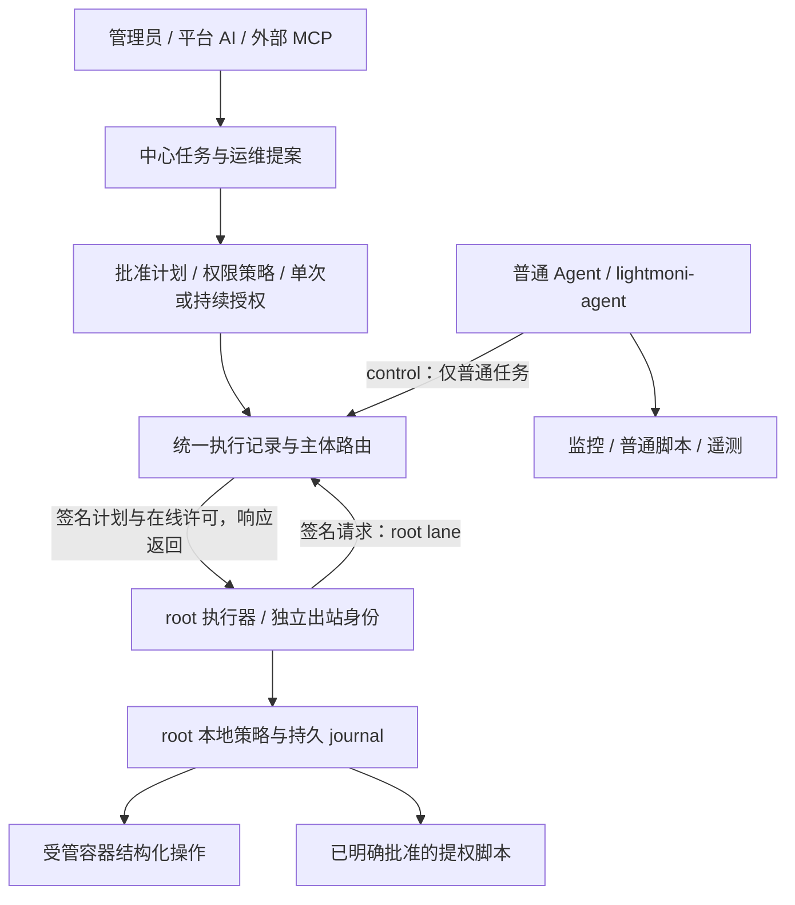
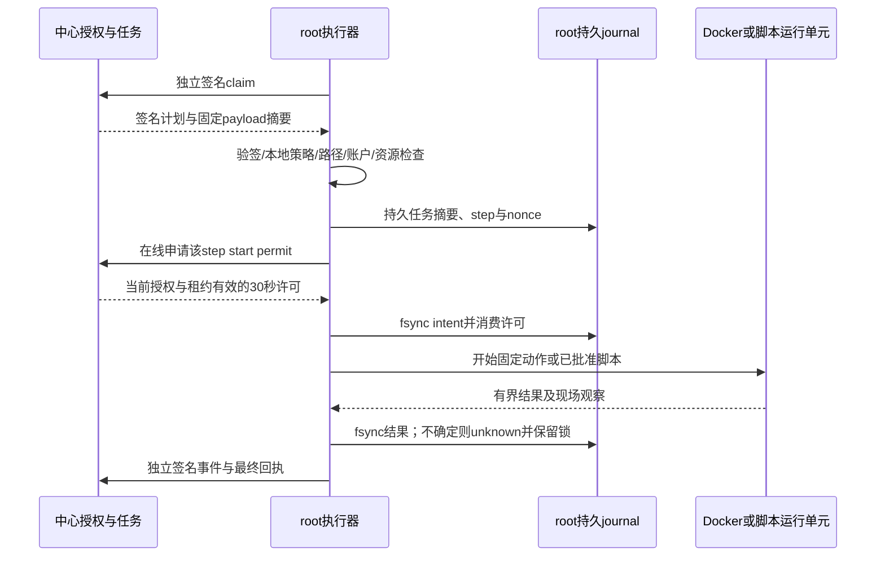

# 主机执行权限：普通 Agent 与独立运维执行器

> SDD060 设计提案，尚未实现。当前发行仍以普通 `lightmoni-agent` 用户运行，没有 root 执行器，默认不能管理 Docker。本文不表示已修改线上权限。

规格、接口与实施顺序分别见 [spec](../specs/060-privileged-executor/spec.md)、[contracts](../specs/060-privileged-executor/contracts.md)、[tasks](../specs/060-privileged-executor/tasks.md)；系统联动入口见 [系统设计第 60 章](system-design.md#第60章-主机执行权限与独立运维执行器sdd-060目标)。

## 1. 结论与驱动目标

保留普通 Agent，新增按需安装的 `lightmoni-executor` root 服务。前者负责监控、拨测、日志、普通脚本和遥测；后者用独立身份接收中心授权的高权限任务。两者都主动出站，不要求主机开放入站端口。

高权限任务分成两种：受限结构化操作（例如受管容器重启）和显式提权脚本。结构化操作由执行器限定参数、资源和路径；提权脚本由管理员审阅确切代码和运行身份，授权其以 root 或指定账户执行。任意 root 脚本有整机权限，不能把它包装成安全的容器管理动作。

需要 root 的是引导安装和特权执行器。登记主机不必强制 root 用户名；实际 UID 为 0，或具备所需免交互 sudo 权限的 SSH 账户均可。SSH 账户不会成为普通 Agent 的日常运行账户。

用户只登记一套 SSH 登录账户。安装器自动创建普通 `lightmoni-agent` 系统账户；独立执行器使用系统已有的 root，不创建另一套 root 登录账户，也不要求用户登记第二份密码。它通过独立平台身份工作，日常运行不依赖保存的 root SSH 密码。

## 2. 开源参考与 ADR

| 参考 | 已核对的官方行为 | 借鉴与取舍 |
| --- | --- | --- |
| 1Panel v2 | [安装器检查 EUID=0](https://github.com/1Panel-dev/installer/blob/aa4a6bbf24ae0fd938b32294672f5086f940e483/install.sh#L427-L432)，[Agent unit 无 User/Group](https://github.com/1Panel-dev/installer/blob/aa4a6bbf24ae0fd938b32294672f5086f940e483/initscript/1panel-agent.service#L6-L22)，[默认直接连接 Docker Unix socket](https://github.com/1Panel-dev/1Panel/blob/7f4c5039820343b1bfb28b9ffbbce004a10e7ac8/agent/utils/docker/docker.go#L29-L35) | 参考完整主机运维覆盖；不照搬整个 Agent 常驻 root，因为 LightMoni 普通任务允许用户脚本 |
| Cockpit | [普通/特权 bridge](https://docs.cockpit-project.org/cockpit-guide/latest/guide/privileges.html)，[root bridge 与私有 IPC](https://github.com/cockpit-project/cockpit/blob/f00c23a2b067d0dbdc63140867e1887b84115655/src/cockpit/superuser.py#L72-L112)，[提权路径](https://github.com/cockpit-project/cockpit/blob/f00c23a2b067d0dbdc63140867e1887b84115655/pkg/shell/manifest.json#L38-L70) | 借鉴分进程、UID 和显式提权生命周期；它主要在建立特权 bridge 时授权，允许通用 root 进程，不是逐任务有限授权的现成实现 |
| Docker Socket Proxy | [按 API 区段及方法过滤](https://github.com/Tecnativa/docker-socket-proxy#grant-or-revoke-access-to-certain-api-sections) | API 过滤可减少暴露，但不能证明某次 create 的 mount、namespace 和资源归属安全，不能替代业务级参数授权 |

决定不采用以下捷径：普通 Agent 加 Docker 组、给 socket ACL、将 socket 只读挂载后当成只读 API、开放 `sudo docker *`、对整个 Agent 改 root。Docker daemon 权限通常可转为宿主 root；上述做法还会把权限传给同 UID 的普通脚本。rootless Docker 是另一种运行环境，不等于能接管现有 rootful Docker，本期不混用。

## 3. 当前实现与必须迁移的接缝

当前安装器支持 root 或 `sudo -n` 引导，创建 nologin 专用账户。systemd 设置 `User/Group=lightmoni-agent`、`NoNewPrivileges=true`、`ProtectSystem=strict`，写入范围以 Agent 数据目录为主。当前没有默认 Docker 组、sudoers、Polkit 或 root broker。

普通脚本和 Agent 同 UID，可读取 Agent 自身配置/凭据，环境变量清理不是操作系统沙箱。当前 jobs claim 依据普通 control 与自报 capability，私有 payload、事件和结果也沿该身份。仅加 root socket、只校验 peer UID 或只让 Agent 转交签名引用，都不能让这些接口继续安全地承载 root job。

| 接缝 | 后续实现要求 |
| --- | --- |
| `server/agent-jobs.ts`、`server/task-center.ts` | 执行主体强制分流，所有 root job 数据接口独立 audience，保留租约/序号/幂等/unknown |
| `server/service-deployments.ts` | 受保护预检、制品、current、systemd 和回退转专用结构化适配器 |
| `server/operations.ts`、`ops/store.ts` | 人工、自动协调、换证和恢复均走统一授权，不只迁移页面按钮 |
| `agent/jobs.ts`、`agent/executor.ts`、`agent/operations.ts` | 移除特权 capability；普通 control 不能兜底执行 root job |
| `operations/platform.ts` 与 containers/websites/certificates/backups | 逐动作拆分权限；不能整体把平台运维函数提为 root |
| 安装、SSH 维护、更新/回退、卸载器 | 将执行器身份/策略/服务/journal纳入完整事务与只读核对 |

现有 `hook.run` 是任意脚本，不能被结构化证书/网站操作顺带提权；它继续在普通账户执行，或显式转成提权脚本并重新审阅。未迁移操作显示权限未就绪，不能静默换成 SSH、Docker 组或 root Agent。

## 4. HLD：执行主体独立，授权与记录统一

图中双向交互通过执行器主动 HTTPS 请求及响应完成，不表示中心入站连接主机。没有普通 Agent 到 root 的通用本地命令入口，首期也不设置本地 UDS。root 执行器没有 SDK Key、模型 Key 或 SSH 凭据；遥测仍由普通 Agent 独立上报，SDK 直报不变。

中心仍是模块化单体。根追踪采用既有 task run；旧 ops run/deployment 与 agent job 关联 `task_run_id`。根记录保存发起者（人工/AI/MCP/调度）、批准者、计划快照、执行主体和结果。复用现有 Agent job 状态机，不为 root 创建脱离任务中心的隐藏命令队列。

root 执行器使用独立 audience 与自己生成的 Ed25519 私钥。它自行领取、下载、验签、取许可和提交签名回执；普通 Agent 的 control/data credential 对上述 root 接口无权。中心将 capability 作为观测，实际准入同时要求当前主机绑定、执行器身份、安装代次、服务端授权和本地策略。

## 5. 登记、预检与界面

登记表单用户名旁使用简短说明：**“安装 Agent 需要 root，或支持免交互提权的 sudo 账户。登录账户用于安装和恢复，Agent 使用独立账户运行。”** 不添加永久保存凭据的大段警告，不改变已有保存期限选择。

| 位置 | 行为 |
| --- | --- |
| 登记主机 | 填地址、名称、SSH 账户和凭据；可先保存。高级能力“容器管理”“允许提权脚本”默认关闭，选择只进入安装计划，不当场授予 |
| SSH 预检 | 返回 root / sudo_noninteractive / unavailable / unknown；核验 UID、实际 sudo 执行、Linux/systemd、架构、依赖、绑定与现有安装 |
| 安装审阅 | 列出普通 Agent 账户、是否新增 root 执行器、所开能力、固定文件/服务及变更范围，管理员明确确认 |
| 主机管理通道 | 分别显示 Agent 在线、执行器在线、容器管理授权/就绪、提权脚本授权/就绪、最后验证时间 |
| 已有主机开启能力 | 新建权限计划，通过 SSH 引导安装/修复；有可用执行器时可用其固定策略管理动作，新增能力仍需管理员审批 |
| 权限不足 | 主机登记和普通 SSH 终端可用；安装/开启按钮显示具体阻塞原因，不把 SSH 可登录等同可安装 |

预检绑定 endpoint、host key、machine/credential revision 和有效期；引导前再次检查，字段变化废弃旧计划。免交互 sudo 必须覆盖固定引导/维护所需命令；不能只用 `sudo -n true` 推断整个安装可提权。首期沿用现有受控安装器的实际 root/sudo 引导边界，不自动写 sudoers；只允许少量命令的 sudo 策略若不覆盖安装器，则明确不支持。需要密码的 sudo 首期不支持，不能暗中使用 SSH 登录密码。

SSH 凭据可按既有 6h 等期限保存或用户选择永久；到期不停止已运行 Agent/执行器，但再次 SSH 安装/恢复需要有效凭据。权限开关不是保存 root 密码。执行器不可用时也不自动重用长期 SSH。

## 6. LLD：引导、目录和信任根

首次启用通过已登记主机的 SSH 固定安装器执行：审批冻结机器、Agent 安装代次、发行摘要、能力与策略；安装器以 root 写入 root 所有程序/配置，生成 executor key，使用一次性、短期、预绑定的独立 enrollment 注册公钥。enrollment 仅 stdin/FD 传递，不用 Agent control 换取 executor 身份，不复用 Agent enrollment。

| 路径/状态 | 所有者与用途 |
| --- | --- |
| `/opt/lightmoni-executor/releases/`、root launcher与 unit | root:root，版本化程序与固定入口；普通 Agent 不可写 |
| `/etc/lightmoni-executor/` | root:root 0700；中心实例/HTTPS origin、Ed25519 信任公钥、executor 私钥和本地策略，秘密文件 0600 |
| `/var/lib/lightmoni-executor/` | root:root 0700；身份、最高 policy generation、防重记录、journal、writer fence与资源清单 |
| 独立 stage/work/config/release 目录 | root 控制全部路径祖先与入口，不使用 Agent 数据目录或任务自报本地路径 |
| 普通 Agent 目录 | 继续仅供普通任务/采集，不放 root 的锁、凭据、Compose/Nginx/证书配置 |

执行器只访问固定中心实例与允许的 HTTPS origin，拒绝重定向、URL 凭据、任意下载目标和调用者 Docker context。信任根由审批过的 SSH 引导安装；执行器密钥轮换要持有旧 key 或重新 SSH 引导，普通 control 不能替换。中心签名 key 的增加须由旧受信 key 签署，丢失旧 key 则 SSH 恢复；更换中心实例不自动接受旧票据。中心恢复备份必须轮换执行器授权代次/重建可证明的防重水位，不能把恢复前消费过的许可重新当新许可。

systemd 使用独立 root 服务，收紧文件写入范围、网络、进程与资源限制；结构化适配器不执行任意 shell。提权脚本单独启动每次运行的受管子单元，不能把 root 脚本注入长期执行器主进程。系统沙箱选项按实际能力验证，不用一份虚假的严格模板宣称能阻止已授权 root 脚本影响主机。

## 7. LLD：计划签名、在线许可和回执

中心签名不可变执行计划；签名覆盖完整目标、执行主体、能力、资源 revision、请求及制品摘要、授权与安装代次、租约、期限和最大运行时间，具体字段见 contracts。使用固定 Ed25519 JWS 验证原始 payload 字节，禁止算法协商、远端 key URL、重复 JSON 字段及未知参数。

执行器请求另由本机私钥签名 method/path/body digest/request_id/时间/安装代次。中心对请求 ID 与摘要持久去重；重放相同 claim 返回相同结果，不能获取新租约。身份绑定、私有 payload、制品、events/result、reconcile 都执行同样的主体校验，不能只保护 claim。

每个新副作用步骤开始前在线兑换单次、最长 30 秒的 start permit；默认执行租约 45 秒、每 15 秒续租。中心在兑换时重查授权者、具体批准、主机绑定、策略代次、有效期和互斥。许可有最多 30 秒的撤权启动窗口，不能承诺断网后即时收回已签发许可。失联不开始新步骤；已经进入 Docker daemon 或已启动脚本的副作用可能继续，超时不等于撤销完成。

为保证上述上限，请求签名的 60 秒时差容忍不用于 permit。发出该 nonce 请求前，执行器按包含系统挂起时间的 Linux 单调时钟设置最长 30 秒 deadline，收到响应只能缩短而不能重新开始计时；过迟响应、无法证明时间、重启或新 boot 废弃未消费许可。租约/运行截止也用单调计时，不能通过墙钟回拨或慢钟扩窗。

先持久 intent 再产生副作用，结果先落 journal 再回传。相同 job/摘要返回原记录，不同摘要拒绝；重启、daemon 超时、丢确认进入 unknown，保留写 fence，先只读核对后解除。不能用 PID 消失、Agent 空闲或 lease 到期证明外部副作用未发生。最终结果通过执行器身份提交，旧代次/迟到回执不能覆盖 unknown 或新 revision；根任务同时展示执行器声明和独立健康观察，二者不是同一证据。

互斥由中心 machine/lifecycle/resource 冲突域和 root 本地持久 fence 共同实现。提权脚本首期独占整机写 fence，排除受管容器/部署/维护并发；普通脚本仍非可信沙箱，不宣称能阻止其自行制造外部并发副作用。

## 8. 容器管理：有限能力，而非原始 Docker 权限

启用 `container.managed.v1` 需要中心授权、本地 root 策略、执行器在线、固定 Docker daemon/socket 与依赖全部就绪。普通 Agent 不获得 Docker 组、socket ACL 或 proxy。执行器直接使用固定 Unix socket 的 Docker Engine API；Compose 使用受信固定插件、洁净环境与私有工作目录，源文档先编译成完全展开的受限计划，root 端再次校验。

首期支持清单/状态的脱敏读取，以及受管资源的 pull-by-digest、create/start/stop/restart/remove、日志尾读与受限 Compose；删除默认保留数据，不允许任意 exec、build、plugin、volume prune 或 system prune。镜像固定不可变 digest/架构，注册表秘密由 executor audience 下载，不交普通 Agent。

容器计划按字段白名单拒绝 privileged、host PID/IPC/network、设备、cap_add、特权 security_opt、任意 runtime、任意 socket及宿主目录挂载、外部未归属网络/卷。限制端口、资源、日志和输出；默认移除 capabilities，设置 no-new-privileges。Compose 禁止 build、include、extends、外部 env_file、变量插值、宿主脚本和未知字段；不能只按 HTTP method/API prefix 判断安全。

白名单同时封闭间接路径：禁止用户提供 volume driver/driver_opts/plugin 或 VolumeOptions.DriverConfig，首期卷由 root 使用固定受信 local driver 创建并登记，不能把 `device=/` 的 bind 伪装成 named volume；禁止 `container:<id>`、Compose `service:...` 等 namespace 借用，不只拒绝字符串 host。不能用 userns_mode/security_opt 关闭默认 seccomp/AppArmor/隔离，缺少 profile 要求的宿主支持则阻塞，不自动降级。

宿主绑定只可引用 root 清单中的平台受管目录/文件，路径所有祖先不可由普通 Agent 或业务用户替换，拒绝符号链接与竞态；内容可按用途交给业务用户，绑定入口仍由 root 保管。私钥/网关配置与 root 执行输入不能来自 Agent 可写文件。root 自行下载按签名摘要验证的制品，不接受“本地文件已校验”的口头保证。

资源归属以 root 清单中的 daemon identity、Docker 不可变 ID 和平台 resource/revision 为准，不能只信标签/名称。首期对既有非受管容器只返回脱敏清单，不接管、不删除。后续接管必须检查实际安全配置、冻结当前摘要并独立审批。已有高风险容器不因贴标签变成受限资源。

现有网站网关使用 host network、证书发布及部分发布器需要更广权限，不能在首期容器 profile 下默认可用；后续单独 `gateway.managed`、`service.managed` 等 profile 明确开放、单独验收。受管 systemd 服务须固定 unit 和非 root 业务 User；部署可修改 root ExecStart 的服务等同任意 root 脚本，不能冒充普通发布。

## 9. 提权脚本：由用户批准确切代码与身份

普通任务默认“以 Agent 账户执行”。用户选择“提权执行”后，展示 root 或本主机允许的系统账户、完整代码/上传文件、解释器、参数、工作目录、显式环境与秘密引用、目标主机、超时和输出限制。提示一句：**“此脚本将以 root（或指定账户）执行，请确认代码及目标主机。”** root 模式额外说明它可修改整台主机；不使用反复弹窗代替清晰审阅。

需要同时满足主机启用 `script.elevated.v1`、当前管理员有批准权、精确单次计划获批和执行器在线。容器管理开关不隐含授予脚本提权。MCP/平台 AI 可生成草稿和解释变更，但不能替用户点击批准，不能通过普通任务写 `sudo` 自动升级；执行失败也不自动换身份。

批准冻结代码原始字节 SHA-256、解释器固定 ID、参数、环境/秘密版本摘要、cwd profile、固定 machine/executor、UID/GID/补充组、超时/输出上限与策略代次。实际 UID 为 0 才是 root，不能只看账户名；执行前核对账户映射及组变化。指定其他系统用户也要显示其真实附加组，docker 组等可拥有接近整机权限。执行器只允许 root 本地登记的账户 profile，不接受模型自由传 UID、组或任意 shell 路径。

root 自有 staging 保存代码，专用运行单元以核对过的 User/Group/补充组启动固定解释器，先清理继承环境、设置工作目录和资源限额，避免继承 SSH/执行器/中心密钥。执行器不把自身私钥放入子进程 FD/env。非 root 指定账户只能按只读方式读取脚本快照，不能在启动前替换代码。读取秘密经执行器专属载荷、固定版本与授权，不写普通日志/模型上下文。

stdout/stderr 和容器日志可能包含未知秘密，按独立敏感正文加密保存，合计每运行最多 256 KiB，仅显式授权管理员查看，不自动进入普通日志、遥测或 AI/MCP 上下文。元数据回执只含固定白名单字段；已知秘密尽力脱敏，不能保证任意脚本输出不含秘密。

每台主机的 grant 在中心事务中从 reserved(run_id) 到 consumed，不可复制到另一运行；enqueue、claim、start、renew 都要求有效 grant。执行器先持久消费再启动，失败、超时或 unknown 不因换 nonce 自动重跑。批量审阅枚举每台主机，各自生成一次性授权。默认清除 NODE_OPTIONS、BASH_ENV、LD_PRELOAD 和用户 PATH 等隐式启动环境；解释器/运行时版本摘要列入计划。相同脚本文本仍可能调用已变化的程序、依赖或网络内容，代码摘要不能保证全部行为可复现。

指定非 root 账户不能靠放宽整个 root 状态目录读取脚本：执行器预先打开已验证的只读、封存代码 FD，只向运行单元传递该 FD；清除其他继承 FD，root 密钥/策略/journal目录保持私有。运行工作目录使用单独的账户 profile，不把 root staging 变成其可写目录。

**批准 root 脚本就是信任这段代码有整机权限。** 它仍可能读取主机秘密、改变 root 文件、Docker、systemd、执行器和审计。cgroup、超时和签名不能阻止恶意 root 逃逸、派生后台副作用或伪造现场证据；平台记录批准与已有回执，但不能保证被批准脚本破坏后的主机可信。结构化容器操作的限制不适用于此模式，不能对两者作同等安全承诺。

首期只支持立即一次性提权任务，拒绝 at/interval/cron 和自动重试；再次执行需要新尝试和明确批准，unknown 必须先核对。有日历计划的需求在后续阶段增加“持续提权授权”：绑定不可变代码、固定主机/账户、允许动作、时间表、有限有效期和最大次数，每次执行在线重验；代码/环境/身份/目标变化即暂停并重新审批，标签新增主机不自动进入授权。关闭能力、授权者失效或到期立即停止新派发，不能把普通定时任务静默转成 root。

## 10. 开关状态、撤权与生命周期

`requested/authorized` 表示用户意图和中心许可，`effective` 表示最近执行器验证结果。ready 必须是当前身份/代次/策略的签名新鲜观察；失联、过期、daemon 更换、文件被外部修改等分别为 unavailable/blocked/unknown，UI 不能仅凭开关为“开”显示可用。

首次启用或执行器缺失时为计划→审批→SSH安装/修复→独立注册→写入策略→执行器验证→ready。已有可信执行器时，经管理员审批的固定策略管理动作应用更高代次策略并验收，不重新 enrollment，也不需要仍有效的 SSH 凭据；仅修复/失去信任时重新走 SSH。一次更新不自动启用新 capability。关闭先提升中心 policy generation、停止新派发并取消未开始任务，再等待执行器持久应用新策略、处理在途结果后回执；未确认显示 disabling/unknown。已签许可有前述短期窗口，已运行任务不能假定已停止。

关闭容器权限不停止/删除业务容器，不重启 Docker；关闭提权脚本不强杀未知副作用。已运行任务按固定停止/超时协议请求取消，未核实完成则保留 unknown/fence。策略关闭后执行器可保留仅用于身份/状态/策略和恢复的出站循环，没有通用命令入口；之后启用仍需新审批。单独移除执行器通过生命周期计划，需确认无在途未知任务并保留必要审计。

安装/更新/主动回退/失败自动回退覆盖执行器程序、unit、静态配置兼容性与持久状态保护。切换前冻结并核对在途/unknown；回退只恢复程序/unit及兼容静态配置，不能恢复旧 journal/fence、防重、已完成运行、已消费授权、身份/密钥撤销水位或最高策略代次。上述持久状态可备份但不得随程序回退回滚；状态缺失或恢复旧备份必须重新建立中心 fencing 代次并核对现场，不能正常模式自动初始化后继续写。旧版本不理解当前状态/策略则 fail closed，不能降级授权。普通 Agent 更新不无故重启执行器，执行器更新也不重启业务容器；不兼容协议先停派，再升级。

标准、SSH恢复和离线卸载器只清理平台拥有的服务/入口/权限与密钥；保留遥测/身份数据选项不等于保留宿主权限。手动离线卸载不能声称中心身份已撤销，中心失联时状态 unknown，管理员后续撤销。默认不删除业务容器/卷/发布数据，清理业务资源必须另列精确目标审批；root journal有未知写入时不得无声丢弃证据。外部管理员添加的组/ACL标记 external，不自动删除，也不能宣称平台关闭已移除全部外部权限。

## 11. 分期与完成定义

第一阶段完成 root/sudo 预检、独立身份、全接口主体隔离、计划/许可/防重、root journal/fence和完整 lifecycle。第二阶段分别交付受限 Docker 与一次性提权脚本的完整链路；每台主机只有实际验收通过才显示 ready。第三阶段逐一迁移网站、证书、systemd发布、备份、自动协调和有期限的定时提权授权。

中心升级不能让旧 Agent 自动获得权限。已有主机显式启用/升级后才能进入新 lane；未迁移旧高级操作 fail closed，不保留普通 control 领取特权 payload 的旁路。普通监控继续运行。

验收包括 root/免交互sudo/交互sudo/无提权、凭据期限、默认关闭、伪造普通control/UID/capability、请求/签名重放、计划篡改、旧代次、危险Compose、外部容器、脚本身份与快照变化、断网/重启/daemon超时、关闭/升级/回退/保留数据卸载。真实 Linux 与 Docker 实测独立记录；本轮只有设计评审和文档结构检查。
