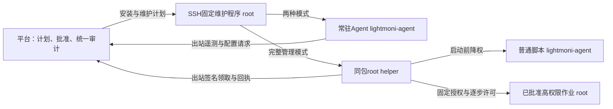

# 主机执行权限与受管 root helper

当前设计以 [系统设计第 87 章](system-design.md#87-agent-统一普通账号与受控高权限能力sdd-087) 和 [SDD087](../specs/087-agent-permission-boundaries/spec.md) 为准。旧 root 常驻 Agent、独立发行的 lightmoni-executor 与独立 lightmoni-task 账号方案均已取代；历史决策保留在 SDD060、080、083。

## 账号与职责

| 行为 | 系统身份 | 来源与约束 |
| --- | --- | --- |
| 安装、更新、回退、模式切换、卸载 | root | 已登记 root SSH，或支持 `sudo -n /bin/sh` 的管理账号，运行固定维护计划 |
| 常驻监控、日志、拨测、心跳 | lightmoni-agent | 安装器创建的无登录普通账号，两种模式均保持非 root |
| 普通脚本 | lightmoni-agent | helper 降权执行，清空附加组和 capabilities，启用 NoNewPrivileges |
| 已批准的高权限作业 | root helper | 独立签名身份、固定计划、能力策略与每次执行审计 |

主机可以登记多个 SSH 账户。账户自动选择只发生在生命周期计划的预检阶段；批准后冻结账户、凭据版本、目标和发行摘要，派发后结果未知先核对原操作。SSH 用户不会成为 Agent 或脚本的运行账号，日常任务不需要持久保存 root SSH 密码。

首次登记的 SSH 用户名默认 root，登记与新增账户界面推荐 root 用于安装维护，也允许填写具备免交互系统管理 sudo 的账号。推荐只影响录入建议，既不修改已有账号或服务器 SSH 策略，也不替代真实权限检查。安装器只新增 `lightmoni-agent` 一个无登录系统账号，用户无需为其设置密码或登记凭据；root 使用主机已有身份。

无合格安装账号时，当前主机的安装页显示失败原因，并提供“添加 SSH 账号”“管理账号”“重新检查”。无凭据、凭据失效、认证/连接失败与缺少管理权限分别处理。添加或更新后保留当前安装设置，重新检查并审阅新计划，不自动安装或修改远端 sudo 策略。

## 两种安装模式

- **完整管理**：安装 `lightmoni-agent.service` 和同包、同版本的 `lightmoni-agent-helper.service`。普通脚本与高权限作业都由 helper 领取，分别使用普通任务身份和已批准的 root 身份执行。
- **仅监控**：只安装非 root Agent，提供指标、日志、只读拨测与配置同步；不领取用户脚本，不连接 Docker socket。

持久配置 `runtime_mode=root|user` 表示是否启用 helper，不能据此判断 Agent 进程的 UID。安装完成需要新鲜的非 root Agent 心跳；完整管理另外核对独立 helper 身份、权限代次和相同发行。升级保持原模式，切换模式需要单独审阅计划。

## 任务协议

普通脚本使用既有 TaskRun 队列、计划快照、租约、取消和结果记录。领取、续租、回执经 `/api/v1/privileged-executors/:id/task-runs/...` 签名端点处理。中心从验签心跳获取 `lightmoni-agent` 的 UID/GID，派发时冻结 helper ID、安装代次及权限代次；Agent bearer 不再提供脚本执行通道。普通任务记录中的 `execution_principal=agent` 是既有队列分类，实际执行身份以快照和签名 helper 为准。

helper 保存私有领取请求与运行恢复记录。请求重试使用同一请求 ID 和相同正文，领取响应丢失不领取另一份作业；回执先持久化再重试。进程重启不重放脚本，无法证明结果时保留 unknown，由管理员核对。运行中或回执未确认时，维护流程不得删除任务恢复证据。

普通脚本使用独立任务目录与最小环境，不注入 SSH 凭据或 helper 私钥；但与常驻Agent共用UID，能够读取该账号可读的Agent凭据和修改可写状态，因此只用于受信任的运维代码。审批、审计和清空环境不能隔离同UID文件访问。它仍可访问系统允许普通用户访问的文件和网络，同一任务账号也不是多租户沙箱。需要 root 的代码必须使用高权限任务，普通脚本失败不会自动改用 root。

高权限作业复用既有 Ed25519 签名计划、能力策略、在线单步许可、私有 journal、敏感输出及 unknown 栅栏。授权绑定目标、代码或资源摘要、实际身份、期限与代次；变更计划需要重新审阅。`container.managed.v1`、`script.elevated.v1` 和 `operations.managed.v1` 继续分别授权。普通与高权限作业都保留发起者、计划、目标、实际身份、状态和结果记录；AI/MCP 调用复用中心的同一任务与授权边界。

批准任意 root 脚本意味着允许该代码操作整台主机；签名和审计不把它变成沙箱。其他业务账号执行尚未开放。

## 目录与生命周期

| 路径 | 所有者与用途 |
| --- | --- |
| `/opt/lightmoni-agent/releases/`、current、launcher、两个 systemd unit | root 管理；daemon/helper 共用不可变发行 |
| `/etc/lightmoni-agent/config.json` | root 管理，Agent 组只读；不含 helper 私钥 |
| `/var/lib/lightmoni-agent/` | lightmoni-agent 私有状态，不作为 root helper 的权威配置 |
| `/etc/lightmoni-agent-helper/` | root 0700；helper 配置、签名身份和激活记录 |
| `/var/lib/lightmoni-agent-helper/managed/` | root 0700；journal、请求及任务恢复状态 |
| `/var/lib/lightmoni-agent-helper/tasks/` | root 控制父目录；每个工作目录归 lightmoni-agent |

helper 数据根与 tasks 父目录为 root 所有的 0711，仅允许任务账号遍历到自己的工作目录；身份、配置和 journal 位于 0700 私有子目录。常驻 Agent 无 Docker 组、通用 sudo 或 capabilities；helper 不加载 Agent 可写插件，不开放本机通用命令转发入口。

安装、升级、回退、模式切换与卸载统一维护两个组件。仅监控不保留受管 helper，完整管理不允许两个组件独立版本漂移。离线卸载脚本也检查任务恢复状态，并处理两个 unit 和受管目录，不维护额外task账号；未知状态保留证据，先核对再继续。

旧 root 常驻安装不提供自动迁移，需先用原版本维护流程完成卸载，再安装当前架构；不可直接对旧运行态套用新卸载器。旧普通 Agent 也不会自动获得脚本能力。

## 当前限制与验证

- 生命周期仍通过 SSH 固定维护计划完成，尚未切换为 Agent 自更新。
- 免交互 sudo 需要覆盖完整维护流程，需要交互输入 sudo 密码的账号暂不支持。
- 安装 root helper 不自动信任新增或变化的 Docker daemon；Docker 依赖验证和身份绑定继续独立处理。
- 平台管理员仍按现有范围管理全部主机，本轮未增加按主机细分的 RBAC。
- 当前实现、检查结果、Doca 回读与未覆盖的实机范围统一记录在 [SDD087 验收记录](../specs/087-agent-permission-boundaries/validation.md)。

参考设计：[1Panel 安装器](https://github.com/1Panel-dev/installer)、[Cockpit 权限分离](https://docs.cockpit-project.org/cockpit-guide/latest/guide/privileges.html)。LightMoni 采用同发行包、一个普通账号与独立root授权通道，并复用自身逐任务授权及审计协议。
