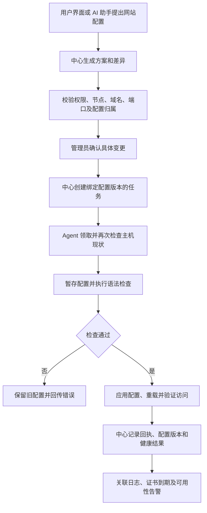

# LightMoni 运维能力扩展调研：参考 1Panel

调研日期：2026-10-27。

> 本文保留基于 `main` 提交 `0735d26` 的调研快照。网站、证书、Compose、备份和计划任务的首批受限能力后来通过 [SDD 026](../../specs/026-operations-platform/spec.md) 与 [PR #6](https://github.com/workhold/lightmoni/pull/6) 合入；当前实现、限制和验收以[运维手册](../operations.md)、[SDD 026 验收](../../specs/026-operations-platform/validation.md)及[系统设计第 26 章](../system-design.md)为准。下文缺口与路线描述调研时状态，不代表当前主干仍全部缺失；未覆盖的建议仍须独立 SDD，不能把候选流程直接当作系统设计基线。

## 1. 调研结论与基准

LightMoni 适合借鉴 1Panel 的网站、证书、容器、备份、计划任务和部署模板，扩展为监控、部署、运维和 AI 协同的平台。最值得借鉴的是一个服务从安装、发布、对外访问，到监控、备份和恢复的完整生命周期。

建议第一批围绕两个用户场景开展：**把已有服务接上域名和 HTTPS；把 Compose 应用纳入统一部署与观测。** 网站可以先反代现有 systemd 或外部 HTTP 服务，无需等待完整应用商店。现有部署闭环的验收和执行权限仍需先补齐，不能把增加菜单当成能力完成。

| 对象 | 本次基准 | 证据范围 |
| --- | --- | --- |
| 1Panel | 稳定版 [v2.4.1][s1]，2026-10-22 发布，commit `f9f9169a4d8cba736b0761e828b3df574e242918` | 官方 README、路由、Core/Agent 实现与文档 |
| 1Panel 官方文档 | `1Panel-dev/docs` commit `bd6538915493a7b8dee4b4665baf5e7d4cd70aa0` | 固定快照，避免文档站跳转与后续版本变化 |
| LightMoni | `main` commit `0735d26fd29ff54b956e7a30d5b988a30bef9d17` | 调研时源码、SDD 021、系统设计第 22 节 |

这是源码和文档调研，未安装运行 1Panel，未验证其性能、商业版实际行为或迁移兼容性；LightMoni 的“已有”表示有对应实现，具体实机验收边界仍以相关 SDD 为准。

## 2. 能力对照

| 能力 | 1Panel 提供的参考 | LightMoni 调研基线现状（0735d26） | 建议 |
| --- | --- | --- | --- |
| 主机与终端 | 文件、进程、SSH、终端、磁盘和主机设置 [S9][s9] | 已有主机、指纹确认、加密凭据、Agent 引导安装、人工网页 SSH 终端；自动 SSH 只支持私钥 | 复用现有主机身份；先补诊断和受控服务操作 |
| 网站与入口 | 静态站、运行环境、反代、应用绑定、子网站、TCP/UDP 代理 [S2][s2] | 无网站对象、域名绑定、网关配置生成、检测和回滚 | 第一批：静态站、HTTP 反代、关联已有服务 |
| 证书 | ACME、HTTP/DNS 验证、上传、续期和 HTTPS 绑定 [S3][s3] | 无证书管理 API/UI 和自动续期 | 与网站一起提供，证书独立管理、网站引用 |
| 容器与 Compose | 容器、镜像、卷、网络、仓库及 Compose 生命周期 [S4][s4] | 业务部署实际只注册 systemd；没有 Docker/Compose 执行器 | 第一批：发现、日志、状态、受控启停和 Compose 发布 |
| 应用商店 | 安装参数、版本、升级、备份恢复、卸载、本地应用 [S5][s5] | 无应用目录和模板安装流程 | 先做少量版本固定的部署模板，再评估商店 |
| 运行环境 | PHP、Node.js、Python、Java、Go、.NET 等 [S10][s10] | systemd 可运行预配置服务；无语言环境安装管理 | 先支持制品/镜像运行，不一次覆盖全部语言环境 |
| 数据库运维 | MySQL/MariaDB、PostgreSQL、Redis、MongoDB 等 [S6][s6] | 使用 SQLite/ClickHouse 保存平台数据；没有用户数据库运维 | 后续独立领域，先选少量数据库、补备份恢复再开放升级 |
| 备份恢复 | 网站、数据库、应用、目录、日志、面板快照 [S7][s7] | 只有人工备份平台数据的运维说明 | 第二批：本地/S3、计划、保留、恢复验证 |
| 计划任务 | Cron、脚本、URL、备份、清理和执行记录 [S8][s8] | 无面向用户的通用作业调度；采集间隔不等于计划任务 | 复用任务执行内核，增加调度触发器和历史 |
| 远程文件 | 浏览、编辑、上传下载等主机操作 [S9][s9] | 有代码工作区、制品和目录日志能力，无通用远程文件管理 | 后续先开放受管目录，关联 diff、版本与恢复 |
| 主机安全 | 防火墙、基础 WAF 等；部分高级功能收费 [S0][s0] | 有权限、凭据、审批和动作白名单；无防火墙/WAF 产品能力 | 后置；先完善执行权限、审计与秘密边界 |
| 多节点与编排 | Pro/Ent 多节点管理 [S0][s0] [S12][s12] | 已有多机器、节点身份、标签、任务领取；没有滚动/批次发布与 K8s 控制 | 保留现有中心/Agent 模型，后续增加编排策略 |
| 监控与 AI | 面板监控、日志及按版本提供的 AI 能力 [S0][s0] | 已有 SDK、指标/日志/告警、Mastra 和受限 Pi 代码任务；没有网站/容器/数据库领域工具 | 把运维结果接入已有监控，让 UI 与 AI 使用相同领域 API |

调研基线的实现证据（固定提交 `0735d26`，不代表后续主干）：

- [部署适配器注册](https://github.com/workhold/lightmoni/blob/0735d26fd29ff54b956e7a30d5b988a30bef9d17/runtime/src/deployment/index.ts)：仅注册 `systemdDeploymentAdapter`；[部署目标校验](https://github.com/workhold/lightmoni/blob/0735d26fd29ff54b956e7a30d5b988a30bef9d17/runtime/src/server/service-deployments.ts)也明确拒绝其他适配器。`docker_compose` 类型或界面选项、平台自己的 `compose.yaml` 均不能作为已支持用户容器管理的证据。
- [Agent 执行器](https://github.com/workhold/lightmoni/blob/0735d26fd29ff54b956e7a30d5b988a30bef9d17/runtime/src/agent/executor.ts)：可执行能力限于制品、受控 systemd、健康检查和只读预检，没有通用 Docker、网关、备份、文件或 cron 动作。
- [主机管理](https://github.com/workhold/lightmoni/blob/0735d26fd29ff54b956e7a30d5b988a30bef9d17/runtime/src/server/managed-machines.ts)、[网页终端](https://github.com/workhold/lightmoni/blob/0735d26fd29ff54b956e7a30d5b988a30bef9d17/runtime/src/server/machine-terminal.ts)、[Agent jobs](https://github.com/workhold/lightmoni/blob/0735d26fd29ff54b956e7a30d5b988a30bef9d17/runtime/src/server/agent-jobs.ts)和[AI 工具](https://github.com/workhold/lightmoni/blob/0735d26fd29ff54b956e7a30d5b988a30bef9d17/runtime/src/assistant/tools.ts)：有可复用的身份、审批、领取、事件、结果和提案底座；人工终端不是 AI 任意 shell 工具。
- [SDD 021 任务](https://github.com/workhold/lightmoni/blob/0735d26fd29ff54b956e7a30d5b988a30bef9d17/specs/021-ai-sdk-instrumentation-deployment/tasks.md)与[系统设计](https://github.com/workhold/lightmoni/blob/0735d26fd29ff54b956e7a30d5b988a30bef9d17/docs/system-design.md)：源码构建 worker、Docker/Kubernetes 适配器、自动补偿、job 签名、完整 Linux/ClickHouse 实机验收等仍未完成。当前部署成功与 SDK 遥测核验也是两个独立结果。

## 3. “网站”具体应该补什么

网站应表示域名和访问入口，服务部署表示版本及进程/容器生命周期。同一个网站可以指向已有服务，也可以直接反代用户已有 HTTP 地址；一个服务也可能被多个入口引用。创建反代不应该重新安装业务或要求业务先接入 SDK。

### 建议的首期范围

| 用户操作 | 必需能力与完成标准 |
| --- | --- |
| 创建网站 | 选择节点，选择静态站或反向代理；填写域名、监听端口、静态制品/目录或上游地址；展示冲突、网络和网关依赖预检 |
| 关联业务 | 可以引用已有服务/部署目标，或明确填写外部上游；分开记录网站配置版本与业务发布版本 |
| 启用 HTTPS | 支持上传证书及 ACME HTTP 验证、自动续期；显示证书域名、有效期和绑定关系；通配符及 DNS 验证后续扩展 |
| 修改配置 | 生成配置差异，检测语法和当前版本；管理员确认后应用、重载、验证；检测失败保留旧配置，重载/验证失败记录明确结果并支持恢复 |
| 观察运行 | 网站列表显示域名、节点、上游、HTTPS、可用性和最近变更；详情串联访问/错误日志、指标、发布和告警 |
| 停用与删除 | 区分关闭入口、删除配置、删除业务制品；列出共享证书/服务依赖；禁止顺手删除外部上游或共享数据 |

首期只支持一种网关适配器，Nginx/OpenResty 选型在网站 SDD 中通过安装、升级和兼容性验证确定。已有网关先做发现和归属检查：端口 80/443 已占用时提示现有进程，不能自动覆盖；已有 1Panel 管理的站点也不能直接接管。

首期暂不覆盖完整 DNS 托管、邮件服务器、任意 Nginx 指令编辑、复杂流量策略、全语言运行环境和 WAF。DNS 验证凭据用于证书挑战，不等于完整域名/DNS 产品。基础站点上线后，再根据真实使用补重定向、CORS、限流和缓存等策略。

下面是**调研时拟议流程**，保留用于比较；当前已采纳的架构以系统设计第 26 章为准：

例如用户说“把这台机器上的订单服务挂到 api.example.com，开 HTTPS”：助手读取现有服务、节点与端口，生成上游、域名和证书方案；管理员看到差异并确认；Agent 执行检查和应用；最后分别展示入口连通性、业务健康及可用的 SDK 数据。没有 SDK 数据时应显示未接入/未验证，不能判定网站部署失败，也不能虚构遥测成功。

## 4. 其他值得借鉴的完整流程

### 容器与 Compose

先提供只读发现、状态、资源、日志，再支持受管项目的启动、停止、重启和更新。Compose 内容先校验，再展示服务、镜像、端口、卷及危险权限差异。已有项目必须由管理员明确选择接管；只读发现不能取得写权限。

Compose 发布继续关联已有 service、target、release、deployment 和事件，避免另建一套应用发布历史。镜像以 digest/明确版本记录，仓库秘密从凭据引用注入，不进入 AI 上下文和配置预览。失败回滚需要区分镜像/配置与数据卷；切回旧镜像不能保证数据库迁移可逆。

### 备份、恢复与计划任务

先支持受管网站目录/配置、Compose 声明和明确选定的数据目录，本地与 S3 兼容目标覆盖第一批需求。数据库在线文件复制不能直接称为一致性备份，数据库备份须采用各引擎认可的导出或快照流程。

统一记录备份对象版本、存储位置、校验值、加密/密钥依赖、保留策略和恢复历史。恢复前展示影响、目标和现有数据保护方案；先验证备份可读和依赖，再执行恢复、健康和数据检查。远端同故障域内的一份副本不能代替异地备份，单纯上传成功也不等于恢复可用。

计划任务负责“何时触发”，沿用同一执行、权限和事件体系；首期优先调度备份、HTTP 检查与已登记动作。需定义时区、错过执行、重复触发、超时、重试和并发策略；一次批准的计划要明确限定动作、目标和参数范围。不要为了覆盖 1Panel 的所有任务类型，先开放任意 root 脚本。

### 部署模板与数据库

先做少量经过验证的模板，描述固定来源/版本、参数 schema、秘密引用、端口、存储、健康检查、升级和备份要求。运行结果仍进入服务部署，不建立独立安装执行器。模板与所用镜像分别检查许可和来源，不默认继承面板仓库的许可证。

数据库管理可从 MySQL/PostgreSQL/Redis 中选择首批目标，补实例发现、连接验证、数据库/用户授权、备份恢复及升级前检查。平台的监控“数据管理”继续只负责遥测数据；新增的“数据库服务”管理用户数据库，二者不能混为一页。

## 5. 如何与现有 LightMoni 联动

1. **沿用中心控制、Agent 执行。** 中心保存领域配置、提案、审批、任务、结果和审计；Agent 声明具体能力，在受管范围执行并回传证据。SSH 保留首次安装/救援职责，新增功能通过具体工具实现。
2. **界面与 AI 调用同一能力。** 先提供网站/容器/备份等领域 API，再接 Mastra 工具。AI 能读状态、生成方案、解释错误；写操作需要与 UI 相同的权限、差异、确认和版本检查，不能由模型自行批准。
3. **逐步增强公共执行机制。** 复用现有租约、幂等和有序回执；增加动作前的目标版本/归属检查、取消边界与未知结果处理。配置租约、签名、能力授权和权限隔离仍需独立设计与验证，不能声称已有。
4. **控制配置归属。** 每个受管对象记录节点、来源和管理者；发现、接管、导入、迁移是不同操作。已有 1Panel、Nginx 或 Compose 只能在明确授权后接管，不能两个控制器同时改同一目录、端口或服务。
5. **形成观测闭环。** 发布记录关联网站、服务、容器、版本、健康和告警；复用现有日志、SDK、拨测与通知。Agent 不需要模型 Key，SDK 仍默认直接上报中心，业务无需为打点强制安装 Agent。
6. **按实际能力展示菜单。** 后续“运维工具”可包含主机管理、节点助手、服务部署、网站与入口、容器与 Compose、证书管理、备份与恢复、计划任务；先实现再开放入口。详情页内展示相关日志/监控，避免再造独立的日志与告警体系。

1Panel v2 的实现不能直接套用：其 Core 负责前端、会话和 API 代理，同机 Agent 经 `/etc/1panel/agent.sock` 提供接口；商业远程节点通过 HTTPS/mTLS 访问，要求管理端能连通节点。社区构建的多节点 provider 存在空实现，接口存在不代表完整开源多节点可用。[S11][s11] [S12][s12] LightMoni 已有 Agent 主动领取任务的方式，本次建议不要求改成中心直接代理所有节点接口，也不要求所有节点安装 1Panel。

对已经使用 1Panel 的主机，可后续调研官方 API 连接器，在用户明确授权范围内查询/操作，由 1Panel 继续拥有配置；连接器需要单独验证鉴权、版本兼容、幂等和审计，不能直接把网页登录 Cookie 当成集成凭据。新管理对象优先由 LightMoni 自身适配器提供完整生命周期。

## 6. 推荐实施顺序与验收门槛

| 阶段 | 交付范围 | 完成标准 |
| --- | --- | --- |
| 0：现有闭环 | 收敛 SDD 021 未验收项、执行权限、Linux 实机部署/回滚与遥测验证 | 确认成功依赖真实回执；取消、断线、重启、重复任务、未知结果可复核；能明确列出 MVP 约束 |
| 1A：网站 | 静态/反代、关联现有服务、域名、单网关、HTTPS/续期、日志和告警 | 测通创建→预览→审批→应用→访问验证→日志/到期告警；配置冲突、失败恢复和已有网关共存有证据 |
| 1B：容器 | 发现、日志、状态、受控操作、Compose 发布/接管 | 与现有部署历史联动；秘密和危险挂载可控；升级及失败恢复不误删卷 |
| 2：恢复能力 | 本地/S3 备份、计划触发、保留策略、恢复演练 | 可在独立目标恢复并核验；能处理失败、错过执行和重试；不能只验上传成功 |
| 3：模板/数据库 | 少量部署模板、数据库实例/授权/备份恢复 | 安装、升级、卸载、数据保留、凭据轮换和恢复均有契约及实机证据 |
| 4：扩展 | 受限文件、主机安全、批次/滚动发布、更多网关/运行环境/K8s | 每项独立评估权限与故障范围，再建 SDD；不承诺一次覆盖 1Panel 全量能力 |

1A 可以直接管理已有 HTTP 服务，不依赖 1B 全部完成；采用容器化网关时，仅依赖 1B 必需的容器基础。网站 SDD 可先交付“已有服务反代＋上传证书”，再分别验收静态站、ACME 签发和自动续期，避免首个切片过大。每个切片先有领域 API 和人工可用界面，再开放给 AI；首次远程写操作开放前，要确定其权限、归属、并发、秘密和恢复边界。

## 7. 许可与版本范围

1Panel v2.4.1 使用 [GPL-3.0][s13]；LightMoni 自有代码采用 [Apache-2.0](../../LICENSE)。可以参考功能、工作流和公开协议并独立实现；复制或改写 GPL 代码通常带来 GPL 合规与再分发义务，不能将这些代码仅按 Apache-2.0 发布。商店模板、依赖和第三方应用各自的许可也需单独检查。

固定版本 README 将多节点、网站防篡改、网站可用性监控等列为 Pro/Ent，将 AI Gateway 等列为 Ent；基础 WAF 和部分 AI 能力在社区版可用，不能把所有安全/AI 功能都写成收费。[S0][s0] 网站创建的基本类型在官方文档中列为各版本可用；计划任务失败告警等高级功能存在版本限制。[S2][s2] [S8][s8]

这些是本次调研的范围说明，不是 LightMoni 定价建议，也不代表商业能力的源码已公开。推荐借鉴产品能力并独立实现，已有面板用户可选择后续 API 集成方案。

## 8. SDD 与架构同步判断

本报告的资料整理不改变运行时代码、API、组件职责、数据/控制路径、存储、凭据、协议或部署拓扑。**本报告的架构双端同步：不适用；现行仓库设计和 Doca 均未改动，不声称已同步。**

采用上述建议时，按网站、Compose、备份等用户闭环分别建立 `spec.md`、`plan.md`、契约、`tasks.md` 和验证记录，明确支持矩阵、升级/接管、失败/恢复与 AI 审批边界。凡改变架构，须在同一 SDD/PR 更新 [docs/system-design.md](../system-design.md) 与 [Doca 系统设计](https://doca.heyphp.com/#/r/2902a80f-c592-414e-9aed-64fe19f2ed53)，并回读确认；不能把本次提案图直接视为已采纳的系统基线。

## 9. 官方来源

- S0：[1Panel v2.4.1 README 与版本矩阵][s0]。
- S1：[v2.4.1 发布记录][s1]。
- S2：[创建网站官方文档][s2]、[网站路由][s2api]、[网站配置][s2config]、[OpenResty 生命周期][s2gateway]。
- S3：[证书申请与验证文档][s3]、[SSL 路由][s3api]。
- S4：[容器与 Compose 路由][s4]。
- S5：[应用商店文档][s5]、[已安装应用生命周期][s5installed]、[应用路由][s5api]。
- S6：[数据库路由][s6]。
- S7：[备份/存储与快照文档][s7]、[备份恢复路由][s7api]。
- S8：[计划任务文档][s8]、[计划任务路由][s8api]。
- S9：[主机路由][s9]、[文件操作路由][s9file]。
- S10：[运行环境路由][s10]。
- S11：[Core 路由][s11]、[节点代理选择][s11proxy]、[Unix socket 代理][s11socket]、[Agent listener][s11agent]。
- S12：[多节点部署与版本范围][s12]、[社区 provider 选择][s12provider]、[社区多节点 stub][s12stub]。
- S13：[GPL-3.0 LICENSE][s13]。

[s0]: https://github.com/1Panel-dev/1Panel/blob/v2.4.1/README.md
[s1]: https://github.com/1Panel-dev/1Panel/releases/tag/v2.4.1
[s2]: https://github.com/1Panel-dev/docs/blob/bd6538915493a7b8dee4b4665baf5e7d4cd70aa0/v2/user_manual/websites/website_create/index.html
[s2api]: https://github.com/1Panel-dev/1Panel/blob/v2.4.1/agent/router/ro_website.go
[s2config]: https://github.com/1Panel-dev/docs/blob/bd6538915493a7b8dee4b4665baf5e7d4cd70aa0/v2/user_manual/websites/website_config_basic/index.html
[s2gateway]: https://github.com/1Panel-dev/docs/blob/bd6538915493a7b8dee4b4665baf5e7d4cd70aa0/v2/user_manual/websites/openresty/index.html
[s3]: https://github.com/1Panel-dev/docs/blob/bd6538915493a7b8dee4b4665baf5e7d4cd70aa0/v2/user_manual/websites/certificate_create/index.html
[s3api]: https://github.com/1Panel-dev/1Panel/blob/v2.4.1/agent/router/ro_website_ssl.go
[s4]: https://github.com/1Panel-dev/1Panel/blob/v2.4.1/agent/router/ro_container.go
[s5]: https://github.com/1Panel-dev/docs/blob/bd6538915493a7b8dee4b4665baf5e7d4cd70aa0/v2/user_manual/appstore/appstore/index.html
[s5installed]: https://github.com/1Panel-dev/docs/blob/bd6538915493a7b8dee4b4665baf5e7d4cd70aa0/v2/user_manual/appstore/installed/index.html
[s5api]: https://github.com/1Panel-dev/1Panel/blob/v2.4.1/agent/router/ro_app.go
[s6]: https://github.com/1Panel-dev/1Panel/blob/v2.4.1/agent/router/ro_database.go
[s7]: https://github.com/1Panel-dev/docs/blob/bd6538915493a7b8dee4b4665baf5e7d4cd70aa0/v2/user_manual/settings/index.html
[s7api]: https://github.com/1Panel-dev/1Panel/blob/v2.4.1/agent/router/backup.go
[s8]: https://github.com/1Panel-dev/docs/blob/bd6538915493a7b8dee4b4665baf5e7d4cd70aa0/v2/user_manual/cronjobs/index.html
[s8api]: https://github.com/1Panel-dev/1Panel/blob/v2.4.1/agent/router/ro_cronjob.go
[s9]: https://github.com/1Panel-dev/1Panel/blob/v2.4.1/agent/router/ro_host.go
[s9file]: https://github.com/1Panel-dev/1Panel/blob/v2.4.1/agent/router/ro_file.go
[s10]: https://github.com/1Panel-dev/1Panel/blob/v2.4.1/agent/router/ro_runtime.go
[s11]: https://github.com/1Panel-dev/1Panel/blob/v2.4.1/core/init/router/router.go
[s11proxy]: https://github.com/1Panel-dev/1Panel/blob/v2.4.1/core/init/router/proxy.go
[s11socket]: https://github.com/1Panel-dev/1Panel/blob/v2.4.1/core/init/proxy/proxy.go
[s11agent]: https://github.com/1Panel-dev/1Panel/blob/v2.4.1/agent/server/server.go
[s12]: https://github.com/1Panel-dev/docs/blob/bd6538915493a7b8dee4b4665baf5e7d4cd70aa0/v2/user_manual/xpack/node/index.html
[s12provider]: https://github.com/1Panel-dev/1Panel/blob/v2.4.1/core/utils/xpack/community.go
[s12stub]: https://github.com/1Panel-dev/1Panel/blob/v2.4.1/core/utils/xpack/helper/multi_node_helper.go
[s13]: https://github.com/1Panel-dev/1Panel/blob/v2.4.1/LICENSE
