# LightMoni 系统设计基线

> 状态：当前主干的 HLD/LLD 设计基线；2026-10-20 建立。本文是系统联动的总入口，特性变更仍必须通过 SDD（spec、plan、tasks、validation）交付。
>
> 配套变更：[SDD 019：系统设计基线](../specs/019-system-design-baseline/spec.md)。

当前主机登录账户以第84章（SDD084）为准，Agent服务/脚本/高权任务身份及生命周期以第87章（SDD087）为准：常驻Agent始终以 `lightmoni-agent` 非root运行；完整管理模式以同一发行包安装受管root helper，监控模式不安装helper且不领取自定义脚本。普通脚本只在helper中执行，并降权至与常驻进程相同的 `lightmoni-agent` 账号；高权作业复用签名逐步许可、人工批准、审计和领域核验。SSH root或免交互sudo管理账号只用于固定生命周期维护，不作为常驻或任务身份。第83章的root常驻/user常驻拓扑为历史设计，由第87章取代；第60、71、80章分离发行/维护方式亦为历史，但签名主体和高权授权语义继续复用。

## 1. 文档定位与事实来源

LightMoni 是面向个人和小团队的一体化监控工作台。它把业务 SDK、独立 LightMoni Agent、中心服务、Web 工作台、AI 助手、告警和主机接入放在一套可独立部署、可追踪和可恢复的系统里。本文件回答四个问题：系统为什么这样设计、组件如何联动、请求和数据怎样流动、当前实现与未来目标分别是什么。

本文件是跨模块设计的权威入口，但不是每个模块的唯一契约。字段、状态码和验收步骤以更细的 SDD 和公共契约为准。出现冲突时，采用以下优先级并开新 SDD 修正旧文档：

1. 当前可运行代码和公开 API 的实际行为。
2. 当前主干中最新的特性 SDD 契约和验证记录。
3. `docs/contracts.md`、`docs/architecture.md`、`docs/brief.md` 等共享设计。
4. 历史任务说明、早期 Go 实现和未完成的规划文字。

“当前”表示代码或验证证据已经存在；“兼容”表示为了已部署版本保留；“目标”表示设计方向，必须经过新的 SDD 和验证才能变成当前能力。本文不以规划代替测试。

### 1.1 仓库设计维护

本文以仓库中的 [`docs/system-design.md`](system-design.md) 为唯一持续维护的设计基线。任何影响组件职责、数据或控制路径、凭据边界、存储、协议、部署拓扑或 AI/工具边界的架构变更，都必须在同一个 SDD 和 Pull Request 中更新本文件。按用户于 2026-11-06 的要求，不再同步 Doca 或其他在线副本。

Pull Request 记录架构影响判断、仓库文档章节和验证结果。历史在线文档及同步回读记录仅供追溯，不构成后续交付条件。不影响架构的改动填写“不适用”及理由即可；凭据不得写入仓库、日志、URL、Pull Request 或文档正文。

## 2. 驱动目标

### 2.1 产品目标

- 让用户在一台中心服务上完成主机、业务指标、日志、Trace、拨测、告警、通知和 AI 分析。
- 让业务服务用少量代码记录结构化数据，不需要先设计复杂的指标注册表。
- 让 Agent 独立运行并成为节点级执行平面，承接主机采集、拨测、文件日志、任务配置、心跳和离线补传。
- 让 AI 助手基于真实目录、查询、告警、模型和主机状态工作，并在产生副作用前给管理员清晰的可审阅回执。
- 让小团队在不引入 Redis、Kafka、Grafana、Kibana 或专用网关的情况下完成部署；ClickHouse 专注遥测数据，SQLite 专注管理状态。

### 2.2 工程目标

- **可恢复**：网络中断、进程重启、丢 ACK、部分写入和 Agent 离线时，系统能说明哪些数据仍可重试、哪些已丢失。
- **可演进**：中心、Agent 和 SDK 共享公共协议；新的功能通过 SDD 增量加入，不把页面实现当作协议。
- **可审计**：凭据、主机、AI 提案、告警响应、部署计划和模型用量都有结构化状态和操作者。
- **可控成本**：SDK 在端侧有界聚合，AI 有输入、输出和步数限制，ClickHouse 查询和日志浏览有资源上限。
- **安全默认**：最小权限、凭据分用途、不把秘密交给模型；中心 SSH 主动运维需要人工批准、主机身份核验、固定动作、审计与未知结果围栏。
- **可理解**：一个请求、一个批次、一个任务和一个提案都能追溯到发起者、目标、结果和下一步。

### 2.3 非目标

首版不承诺多租户、逐表 ACL、完整 PromQL/KQL/Lucene、完整 IDE、自动发布、Agent 任意远程 shell、节点侧模型调用、跨文件崩溃事务、无限期离线补传或高可用集群。需要这些能力时必须先新增或修订 SDD。

## 3. 设计原则

1. **独立上报、路径显式**：业务 SDK 仅直连中心，Agent 独立上报自身任务数据；两者复用同一套 SDK 包，业务上报不依赖安装 Agent。SDK与Agent独立使用中心地址发现，内网优先、公网备用。
2. **Agent 是一等节点**：业务退出不会停止 Agent；Agent承担独立采集、节点控制与任务执行，不接收业务SDK。
3. **控制面和数据面分离**：控制凭据用于心跳和配置，数据凭据用于遥测；SDK Key、Agent local token、enrollment token 不能混用。
4. **中心是配置权威**：任务、标签、告警、模型、密钥和部署计划在中心保存；Agent 只缓存可执行配置，SDK 只缓存端侧规则。
5. **写入先确认边界再确认成功**：Agent 先持久化再 ACK，中心等待目标 ClickHouse 写入完成再 ACK；未知结果保留原批次。
6. **AI 提案优先于 AI 副作用**：查询可以直接读，保存大盘、修改告警、部署 Agent、应用代码 diff 必须回到用户确认接口。
7. **结构化回执优先于原始输出**：页面和模型收到固定状态、错误码、ID 和摘要；私钥、密码、令牌、原始 SSH 输出和上游秘密永不进入上下文。
8. **共享模块而非隐式耦合**：HTTP、SQLite、ClickHouse、目录、查询、凭据和时间由公共服务注入，模块不能自己重建权限或 SQL 规则。

## 4. 系统边界与核心概念

### 4.1 核心对象

| 对象 | 定义 | 生命周期拥有者 |
| --- | --- | --- |
| 用户 | 登录中心的管理员或成员 | 中心 SQLite |
| SDK Key | 业务直连中心的数据上报凭据 | 中心凭据管理 |
| Agent enrollment token | 绑定已登记主机的一次性短期安装凭据 | 主机部署内部签发，中心兑换 |
| Agent control credential | 节点心跳、配置和控制通道凭据 | 中心签发，Agent 保存 |
| Agent data credential | 节点遥测上报凭据 | 中心签发，Agent 保存 |
| Agent local token | 本机Agent诊断鉴权令牌 | 目标 Agent 本地配置 |
| 执行节点 | 一个独立运行的 LightMoni Agent 实例 | Agent 身份与中心节点记录 |
| 任务 | 指标采集、服务拨测或目录日志配置 | 中心任务仓储 |
| 任务标签 | 把任务分发给节点的标签集合 | 中心标签仓储 |
| 业务表 | SDK 记录的逻辑表名 | 中心目录与 ClickHouse |
| 批次 | 一个 signal、table、service 和稳定批次 ID 的发送单元 | SDK/Agent/中心链路 |
| 告警规则 | 对查询结果进行求值并产生 episode 的配置 | 告警域 |
| 提案 | AI 产生但尚未应用的变更或代码结果 | 中心 SQLite |
| 业务服务 | 用户希望被打点、构建和部署的逻辑服务 | 中心 SQLite |
| 服务目标 | 服务在一台登记主机上的运行实例及适配器配置 | 中心 SQLite |
| 制品版本 | 带版本、来源和 SHA-256 的不可变发布输入 | 中心 SQLite/受控制品存储 |
| 业务部署 | 将一个制品激活到一个服务目标的可审阅计划 | 中心 SQLite，Agent 执行 |

### 4.2 系统边界

LightMoni 中心管理身份、配置和可查询数据，但不拥有业务代码、用户主机的全部权限或供应商账单。业务 SDK 可在不安装 Agent 的后端中运行。Agent 可部署在主机、虚拟机或容器中；业务是否与它同机不是身份判断条件。当前 SSH 用于首次接入、Agent 维护、人工文件与终端及受管应用等中心主动操作；受管领域由 SSH 固定命令唤起单次进程，并通过原签名/作业接口获取计划和提交回执，详见第123章。Agent 保留上报、采集与定时任务。

## 5. HLD 总体架构

总览分为两个视图，避免把遥测、节点控制和浏览器入口混成一条链路。第一张图展示业务 SDK 与 Agent 各自上报中心：两个 SDK 节点表示同一套 SDK 包在不同进程中的实例。Agent 的采集和任务执行通过内嵌 SDK 打点，使用进程内 exporter 写入自己的持久队列，再由 Agent 发送。业务 SDK 的数据不经过 Agent。

**独立数据上报与节点控制：**

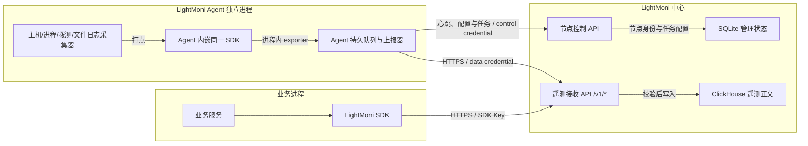

图中的箭头表示调用或发送方向；心跳、拉配置与部署任务的 claim/events/result 使用 control credential，响应沿原请求返回，遥测上报使用 data credential。任务配置由中心持有，节点主动拉取；这里没有新增中心主动连接 Agent 的入站要求。SDK→Agent转发已移除；两条中心连接均按第50章同步入口。

**用户入口与中心内部模块：**

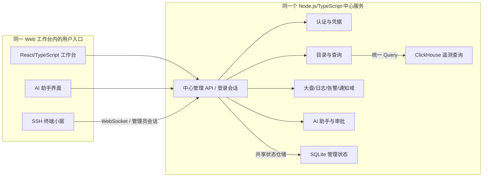

图中拆开的 API 和领域模块是同一中心进程内的逻辑职责，不是新增的独立服务。鉴权先于领域处理；内部模块复用统一目录、查询与状态仓储，不在图中逐条展开依赖。AI 助手界面和 SSH 终端是两个用户入口，不相互调用；模型没有任意 SSH 终端权限。

### 5.1 部署拓扑

默认部署是一个中心容器加一个可访问的 ClickHouse；SQLite、加密主密钥和 Agent 包/队列使用持久卷。Agent 作为独立进程或容器运行，使用自己的数据目录、身份和队列。SDK 与业务服务一起运行，不要求和中心同机，也不要求 Agent 必须存在。

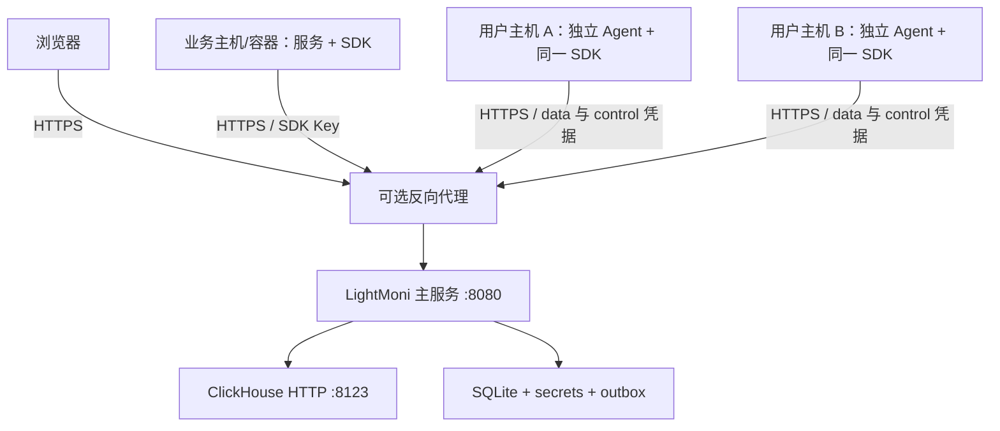

图中反向代理是可选的：不部署时，这些 HTTPS 请求直接到可访问的中心入口。Agent 的 data 凭据仅用于遥测；control 凭据用于心跳、配置和部署任务的 job claim/events/result。业务主机与 Agent 主机可以是同一台，也可以分别部署；图中分开表示进程与凭据独立，不要求业务先找到 Agent 的本地端口。TLS 可以由已有反向代理承担。中心外部地址必须能被 Agent 和直连 SDK 访问；容器中 `localhost` 只表示当前容器。发布的 Agent 包为 Linux amd64/arm64，并自带固定 Node 运行时；目标主机不需要另装 Node/npm。

## 6. 组件职责和依赖方向

| 组件 | 主要职责 | 不应承担 |
| --- | --- | --- |
| `runtime/src/server` | HTTP、认证、模块装配、管理 API、接收和后台任务 | 不把业务查询散落到 Web 或 AI |
| `runtime/src/domains` | 大盘、日志、告警、通知和领域状态机 | 不直接绕过公共 Query/目录 |
| `runtime/src/agent` | 节点身份、采集、拨测、文件日志、接收、持久队列、上报、心跳 | 不持有中心模型 Key；不执行任意远程命令 |
| `sdk/*` | 轻量记录、端侧窗口聚合、OTLP、重试和上下文传播 | 不保存磁盘队列；不决定平台权限 |
| `ai-runtime` | Mastra worker、provider 适配、流式事件和工具 loop | 不拥有中心权限或秘密存储 |
| `runtime/src/assistant` | 会话、工具、审批、Pi 代码任务、模型用量 | 不直接让模型写数据库或 SSH |
| `web` | 用户交互、展示、草稿和确认 | 不持有 API Key、私钥或模型供应商秘密 |
| SQLite | 管理配置、身份、状态、摘要、凭据摘要、队列元数据 | 不保存大量遥测正文 |
| ClickHouse | 日志、指标、Trace 及查询视图 | 不成为管理权限的唯一来源 |

中心是模块化单体，不拆为运行时微服务。模块通过 `Dependencies` 使用共享 DB、目录、查询、认证、路由、加密、时钟和日志；启动和关闭由 `runtime/src/server/app.ts` 管理。

目标权限拆分见第60章（SDD060，分期实现）：普通 Agent 保持非 root，按需新增独立出站的 root 执行器。后者具有独立身份、root 自有策略/journal和完整任务授权；受限容器操作与用户明确批准的提权脚本分别授权，普通 control 不授予这些能力。

## 7. 端到端数据流

### 7.1 业务 SDK 直连中心

1. 业务初始化 SDK，必填 `service` 和 `env`，可选版本和实例 ID。
2. SDK 按 `record(table, metric_name, dimensions, value, count)` 写入内存窗口；日志和 Trace 捕获调用时的上下文。
3. SDK 在 UTC 固定窗口结束后冻结批次，生成稳定批次 ID、创建时间和 OTLP payload。
4. SDK 向中心 `/v1/metrics`、`/v1/logs` 或 `/v1/traces` 发送 Bearer SDK Key。
5. 中心验证逻辑表、Key、批次头、OTLP schema、时间和容量，写入 ClickHouse 物理表。
6. 写入确认后返回 OTLP ACK；SDK 释放同一批次。失败保留原批次并按策略重试。

直连是 SDK 的默认目标，适合普通服务器、容器和 Serverless。安装 Agent 不是直连的前置条件。

### 7.2 SDK独立直报与中心地址选择

SDK仅连接中心，删除Agent接收与配置代理；默认本机4318地址和agent/auto模式均不再提供。SDK在业务进程内聚合与缓冲，中心确认后释放批次。Agent不承担业务SDK持久队列；其自身采集通过进程内exporter进入原有持久队列。

管理员在上报地址簿登记内网IP及端口和公网引导入口，SDK与Agent从所在网络查询清单、验证中心身份并优先使用可达内网。地址变更30秒同步；Agent心跳、配置、任务通道和上报共用入口。协议、兼容和验收见第50章。

### 7.3 Agent 节点任务流

1. 管理员在“节点助手”创建任务和任务标签。
2. 节点通过 control credential 心跳并拉取按标签合并的 `RemoteConfig`。
3. Agent 先校验并缓存完整配置，再原子替换当前有效 revision；冲突配置整体拒绝。
4. 采集器按配置产生 host/process/probe/files 数据，使用 Agent 内嵌的同一 TypeScript SDK，经进程内 exporter 写入 Agent 队列。
5. Agent 上报并维护心跳、队列、采集器状态和有限运行事件。
6. 节点无匹配任务时暂停内部采集和拨测，继续维护自身控制通道。

任务标签只负责分发，不是租户、权限或业务 service。一个节点可以有多个标签，一个任务也可以关联多个标签，命中任一标签即可下发且不会重复执行。

### 7.4 AI 分析与变更流

1. 浏览器通过中心创建/恢复会话，中心在私有 stdin/stdout 管道中启动 Mastra worker。
2. Mastra 使用管理员保存的模型连接配置调用协议 SDK；Key 只在后端和 worker 内存中存在。
3. AI 读取目录、描述表、执行有界只读 SQL、检索日志和读取告警状态。
4. 大盘、告警、静默、代码和 Agent 部署以 draft/proposal/plan 形式返回。
5. 用户在独立页面查看完整变更、影响、版本和回执，再由中心重新校验权限和 revision 后应用。
6. 每次实际模型请求写入幂等用量账本；模型目录刷新不发送生成请求，测试连接才发送最小真实请求。

### 7.5 SDK 插桩与业务部署流

1. 管理员为业务服务提供已授权的源码 workspace；AI 先调用只读 `scan_sdk_instrumentation`，识别语言、框架、LightMoni SDK、中心直连配置及需迁移的历史Agent配置和候选请求/错误边界。
2. 扫描不导入或执行业务代码，也不写文件。对于可以明确定位的 TypeScript/JavaScript 多行请求边界，AI 调用只读 `propose_sdk_instrumentation` 生成结构化 unified diff、风险、手动步骤和验证命令；Python、Go、Rust、Ruby 或歧义边界只给手动步骤。复杂改写才交给隔离 workspace 的 `code_task`，同样只产生可审阅 diff；所有 diff 都必须经过管理员确认后才应用。
3. 已确认的 revision 目标上由隔离构建器生成带版本、架构、来源 revision 和 SHA-256 的 release；构建器尚未实现前，systemd MVP 允许管理员上传预构建的 `lightmoni-release-v1.tar.gz`。Manifest 至少包含 `schema_version`、`service_id`、`version`、`architecture`、`source_revision` 和固定 `entrypoint:"run"`。中心上传与 Agent 暂存都会拒绝常见私密凭据路径，以及扫描窗口内匹配到的私钥、知名 token、URL/DSN userinfo、凭据查询参数、Basic Auth 和有值凭据字段；错误不回显匹配内容。该启发式检查不能保证检测所有秘密，bundle 仍只能包含运行文件，运行凭据须由目标主机的独立秘密管理注入。中心只保存元数据与私有 digest-addressed 正文，不能从静态下载路由取到业务制品；生产 Agent 不接收源码仓库凭据或模型密钥。
4. 管理员为 service 创建一个或多个 service target，登记 systemd unit 与受控 release directory。release 根目录由 root 持有并属于 Agent systemd unit 配置的 `lightmoni-agent` 主组（建议 `0775`，业务服务用户只读且可遍历，并且不得属于 Agent 组）；Agent 的 `ProtectSystem=strict` 沙箱需把该精确目录加入 `ReadWritePaths`。Agent 预检检查根目录 UID/GID 与 POSIX mode 位，要求 root 所有、Agent 有效主组可写、其他用户仅可读/遍历。MVP 不检查扩展 POSIX ACL，也不解析 systemd unit 的业务进程 User/Group/附加组；管理员必须确保业务用户不属于 Agent 组且无 ACL 写权限。unit 必须预先配置稳定入口 `ExecStart=<release_directory>/current/run`；LightMoni Agent 不编辑任意 unit、环境文件或服务用户。release bundle 只放运行所需文件，不能放密钥或环境凭据。MVP 的 `systemd` 适配器覆盖 Node、Python、Go、Rust、二进制和解释器服务；语言不是部署协议。Docker Compose、Kubernetes/Helm 和 CI/GitOps 作为后续适配器。
5. 管理员可请求目标 Agent 执行 `systemd.probe` 只读预检。Job 仅检查绑定的 unit 与 release directory，通过固定参数读取 systemd 属性和版本指针；输出限定为状态枚举、布尔值、安全版本标识、观测时间、一次性请求 ID、目标配置 revision 和固定错误码，不回传原始命令输出，也不创建目录或改变服务。Agent 确认 `ExecStart` 精确使用登记路径下的 `current/run`；中心校验请求 ID/revision 与观测时间，阻止跨 job 快照重放；路径含符号链接、unit 不符合入口、被 masked 或处于启动/停止过渡态时不标记 ready。文件系统检查仅在支持通过固定目录句柄拒绝符号链接的平台启用；当前实现为 Linux Agent，其他平台报告 `filesystem_check_supported=false` 且不就绪。中心按 target/operation 保存快照，部署计划可附最近 10 分钟且 ready 的预检结果。没有预检、预检过期或快照未就绪都不能得到可执行动作。
6. 中心执行 `probe → plan → apply → verify → rollback` 的受控计划层，生成 `awaiting_approval` 部署计划。计划只包含 typed actions，不包含 shell 字符串；管理员审批前中心要求 release ready、目标快照新鲜且 ready、manifest 与目标匹配，以及带能力授权的 health_check，随后原子写入不可变 Agent job 并把部署推进到 `agent_ready`。制品上传只允许管理员认证的有界接口；Agent 下载只允许 control credential、当前 lease 和 action 绑定的 agent/release/digest 同时匹配，不接受任意 URL，秘密不进 URL。
   - 中心 bundle 上传以进程级单槽门限制并行收件与同步校验；槽位占用时不排队并返回 `503 artifact_upload_busy`。管理员可通过 `POST /api/v1/admin/release-artifacts/gc` 先 dry-run 再确认清理超过 24 小时且未被任一 release 引用的私有对象；每轮最多扫描 10,000 项并删除 500 项，且与上传互斥。达到上限时用当前进程内最多有效 5 分钟的不透明游标续扫，游标绑定扫描模式和初始保留期截止时间；每轮重新读取引用。新扫描、进程重启或超时会使旧游标失效。存储祖先必须通过与读取一致的 UID/写权限校验，内部符号链接和硬链接不参与回收。这允许回收旧孤儿，但不消除单个最大 bundle 的解析内存峰值，也不提供硬磁盘配额或集群级协调。
7. Agent executor 通过 control credential 拉取短时租约 job。中心后台定期处理过期任务，按单调序号接收阶段事件，并将 staging/activating/verifying/final receipt 映射到脱敏部署时间线。只有 verifying 后的最终回执包含 `health.healthy=true` 才标记业务 deployment `succeeded`；未领取 job 可以安全取消或过期取消。普通部署若执行结果未知或成功回执不完整，保留最后确认的部署阶段并将 receipt 标为 `unknown`，要求检查目标主机，不推断为部署失败；回滚操作的未知结果或不匹配回执则结束本次操作，将 deployment 标为 `failed`、receipt 标为 `unknown`，管理员完成新的安全预检后才能显式重试。此状态仅表示 Agent 报告计划内健康检查通过，中心遥测结论独立保存，由管理员显式发起 ClickHouse 核验，不能仅靠健康回执标记遥测成功。
8. 管理员若要回滚，先为目标执行新的只读 preflight。仅当快照新鲜且结构安全（允许 unit 为 `active`、`inactive` 或 `failed`）、current 仍指向本次部署版本、previous version 是同一 service 下登记的 ready release、Agent 在线时，中心才创建受限 rollback job。Agent 通过 current-pointer CAS 恢复 previous version，随后 restart 并执行 systemd health check；中心同时核对 `health.healthy=true` 和回报的 current version 才转为 `rolled_back`。首次部署、CAS 冲突或旧版本未登记时拒绝创建任务。执行结果未知或回执不匹配会结束当前操作并将部署标为 `failed`、receipt 标为 `unknown`，提示人工检查；系统不自动重试，只有管理员再次执行新鲜安全预检且 current 仍是本次部署版本后，才可显式创建新的回滚操作。

9. 管理员可在 target 的可选 `config.telemetry` 中绑定规范业务公开表、SDK `service.name` 和稳定 `service.instance.id`；绑定进入目标 revision 与不可变部署快照，配置变更会使既有预检/计划和旧核验结果过期。SDK 必须自行设置 `service.version=release.version`；平台随机 service ID 不能用于推断 SDK 服务名。只有普通 deploy 已有有效 Agent 健康成功回执、目标配置仍匹配且没有后续已批准操作时，管理员才能通过 `POST /api/v1/deployments/:deploymentId/verify-telemetry`（严格 `{}`）发起一次核验。
   - 观察窗口固定为 `[finished_at, finished_at+5min)`，查询时仅观察到 `min(now, window.to)`，并限制 `ingested_at` 在完成时间至核验时刻之间；接收等待截止为完成后 6 分钟。SDK 服务、实例和发布版本均须精确匹配，最多读取 1000 条身份/时间样本。该证据只证明部署完成后的匹配遥测已入库，不证明部署因果关系或 SDK 身份不可伪造，启动及健康检查前的数据不算入本窗口。
   - 中心从目录验证非系统、规范公开业务表和必需列，使用 ClickHouse reader 参数化值查询；不读取遥测正文或接收任意 SQL。单次最多执行 3 秒、5 秒取消、64 MiB 查询内存和 100 万扫描行；单进程只允许一个核验请求，不排队。查询前后校验状态/operation、完成时间、目标 revision、计划/快照、release 和后续批准 job 顺序，变化时丢弃结果。
   - SQLite `deployments.telemetry_json` 单独保存脱敏摘要和上下文指纹；GET 与 AI 只读工具显示 `verified/waiting/timed_out/unavailable/invalid/unconfigured`，未核验为 null，过期结论标记 `stale`。查询失败、超时或无配置均不改部署健康状态，不触发自动回滚。Web 仅提供手动核验/重试，无自动查询轮询。

部署的执行、健康结果和独立遥测核验通过以下通道联动：

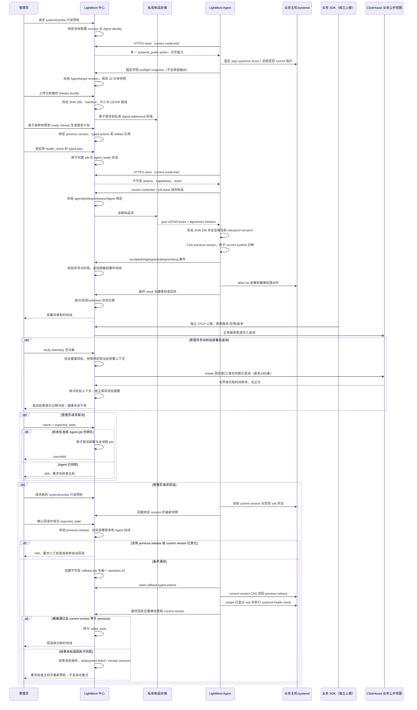

当前代码已持久化 service、target、release、deployment 元数据及脱敏 `deployment_events`，提供 `awaiting_approval` 计划、管理员 approve、Agent 回执状态映射、事件查询和受限人工 systemd 回滚 job。回滚仅在新鲜且结构安全的 preflight 显示 current version 仍为本次部署、previous version 有同 service ready release 记录且 Agent 在线时入队；即使 unit 处于 failed，只要目标路径和入口安全也允许尝试恢复。Agent 执行 current-pointer CAS、systemd restart 和 health check，并核对回执 current version 后才标记 `rolled_back`。Agent 的只读 `systemd.probe` job 将目标配置 revision 与一次性 preflight ID 绑定，有效期最多 10 分钟；Agent 校验 `ExecStart=<release_directory>/current/run`，并以受控 bundle 的相对 symlink 维护 `current`。本轮已接入制品私有存储、管理员上传、control credential + job lease 绑定下载、USTAR 校验、安全解包和 systemd typed actions；digest 对象可被多个 release 共享，校验失败的上传不会立即按 digest 删除对象，管理员可在保留期后用有界 GC 清理无引用对象；没有 ready bundle、预检或 typed actions 的计划仍被审批 API 拒绝。

本轮将 bundle 限定为 gzip USTAR，要求 manifest 与可执行 `run`，只允许普通文件和目录；中心私有保存 digest 正文，Agent 下载须经 control credential + 当前 job lease + release/digest 匹配。Agent 在摘要验证后安全解包，并通过 CAS 与原子相对 symlink 将 `current` 指向 `releases/<version>`；目标 unit 由管理员预先配置为 `current/run`。管理员确认的受限回滚闭环及有保留期、引用检查和分批上限的手动孤儿 GC 已实现；手动、显式身份绑定的 ClickHouse 核验已接入；自动补偿、真实 ClickHouse/业务主机验收、生产签名与硬存储配额仍待后续切片。页面与 AI 不得把“预检通过”“已批准”或“已入队”当作业务已部署；`succeeded` 仅说明 Agent 报告计划内 health_check 通过，不能代表遥测已验证。

## 8. 中心服务 HLD/LLD

### 8.1 启动和模块装配

中心入口是 `runtime/src/server/main.ts`，创建配置、SQLite、ClickHouse、认证、路由和模块。模块在构造时直接创建最终结构，`start()` 启动后台任务，`close()` 取消定时器、等待任务并关闭连接。健康检查 `/healthz` 不需要登录；其他 API 由统一 Router 注入 `Context.user`。

模块分层：

```text
HTTP Router / Auth
        ↓
server modules (nodes, machines, settings, ingest, query, install)
        ↓
domains (dashboards, logs, alerts, notifications)
        ↓
shared (SQLite, ClickHouse, OTLP, crypto, JSON, time)
```

### 8.2 认证和用户

本地账号、GitHub、微信、QQ 和通用 OAuth2 由中心处理。会话 cookie 只在同源请求中使用；OAuth state 一次性且绑定会话与用途，支持 PKCE 时启用 PKCE，OIDC 使用 nonce 和 token 校验。外部身份以 `(provider, subject)` 稳定绑定，不按昵称或未经验证的邮箱自动合并。管理员和成员共享实例数据，但凭据、用户管理、供应商配置、Agent enrollment、SSH 和 AI 变更只能由管理员执行。

### 8.3 接收和查询

接收端支持 OTLP HTTP JSON/Protobuf：`POST /v1/logs`、`/v1/metrics`、`/v1/traces`。统一请求头为 `X-Lightmoni-Table`、`X-Lightmoni-Batch-ID`、`X-Lightmoni-Batch-Created-At`。Query 使用 `POST /api/v1/query`，只允许已验证公开表上的有界只读 SELECT/WITH，参数绑定而非字符串插值。

查询统一使用 UTC 半开时间范围、正的 `interval_ms` 和带类型的 Frame。服务端限制查询数量、时间、行数、内存和 SQL 表集合；取消必须传入 ClickHouse。页面、告警和 AI 使用同一查询执行器，但各自有更小的结果和并发上限。

### 8.4 数据接入 API 族

| API | 用途 | 角色 |
| --- | --- | --- |
| `/api/v1/keys` | SDK Key 创建、启停和事件 | 管理员 |
| `/api/v1/sdk-config` | SDK 动态规则和窗口 | SDK/Agent |
| `/api/v1/catalog/tables` | 逻辑表目录 | 登录成员；修改管理员 |
| `/api/v1/metric-windows/:table` | 业务表聚合周期 | 管理员 |
| `/api/v1/agent-enrollments` | 列出、撤销接入会话；独立创建接口停止使用 | 管理员 |
| `/api/v1/agents/enroll` | Agent 兑换 enrollment | 安装器 |
| `/api/v1/agents/:id/activate` | Agent 激活 | Agent |
| `/api/v1/agent-credentials` | 凭据元数据 | 管理员 |
| `/api/v1/agents/:id/heartbeat` | 节点心跳/配置通道 | Agent control credential |
| `/api/v1/machines/*` | 受管主机、SSH、部署计划 | 管理员 |
| `/api/v1/services/*` | 业务服务、服务目标、制品版本和审核计划 | 管理员 |
| `/api/v1/services/:serviceId/releases/:releaseId/artifact` | 有界上传预构建 release bundle；正文进入私有存储 | 管理员 |
| `/api/v1/admin/release-artifacts/gc` | 预览或确认清理有保留期的未引用私有制品 | 管理员 |
| `/api/v1/agents/:agentId/jobs/:jobId/artifacts/:releaseId` | lease 与 release/digest 绑定的私有制品下载 | Agent control credential + job lease |
| `/api/v1/deployments/:id` | 脱敏部署计划/状态/回执查询 | 管理员 |
| `/api/v1/deployments/:id/events` | 脱敏部署状态事件时间线 | 管理员 |
| `/api/v1/deployments/:id/verify-telemetry` | 固定身份、版本与时间窗的独立遥测核验；严格 `{}`，单进程单槽 | 管理员 |
| `/api/v1/deployments/:id/cancel` | 取消未审批部署或尚未领取的 Agent job；已领取任务拒绝取消 | 管理员 |
| `/api/v1/deployments/:id/approve` | 管理员确认并推进到 `agent_ready` | 管理员 |
| `/api/v1/deployments/:id/rollback` | 新鲜预检、旧版本登记、CAS/健康回执满足时创建回滚 job | 管理员 |
| `/api/v1/agents/:id/jobs/claim` | Agent 拉取一个能力受限且带租约的部署 job | Agent control credential |
| `/api/v1/agents/:id/jobs/:jobId/events` | Agent 上报幂等阶段事件和脱敏快照 | Agent control credential |
| `/api/v1/agents/:id/jobs/:jobId/result` | Agent 提交成功、失败、取消或未知回执 | Agent control credential |
| `/api/v1/agent-jobs/:jobId/cancel` | 管理员取消尚未完成的 Agent job | 管理员 |
| `/api/v1/assistant/*` | 会话、模型、提案、用量和 AI 工具 | 登录/管理员按接口 |

## 9. 存储设计

### 9.1 SQLite

SQLite 保存低体量、强一致的管理状态：用户和外部身份、会话、SDK Key 摘要与事件、enrollment 状态、Agent 身份和凭据摘要、节点/任务/标签、主机和 SSH 凭据密文、业务 services/service_targets/releases/deployments、`agent_jobs`/`agent_job_events` 及其脱敏回执、部署计划、告警规则/episode/静默/outbox、仪表盘和草稿、模型配置/用量账本、表目录、窗口历史和有限队列元数据。

明文 secret 只在创建/兑换/轮换响应的单次边界出现，随后使用加密存储或不可逆摘要。SQLite 不保存大量日志、指标或 Trace 正文。

### 9.2 ClickHouse

单库 `lightmoni` 保存遥测。逻辑表名匹配 `[a-z][a-z0-9_]{0,47}`，不能自带 `log_`、`metric_`、`trace_` 前缀。公开视图按类型生成：`log_<table>`、`metric_<table>_sum`、`metric_<table>_gauge`、`metric_<table>_histogram`、`trace_<table>`。系统表使用 `lightmoni_*` 并用 `component=center|agent|sdk` 区分来源。

共用身份列包含 `event_id`、`event_time`、`ingested_at`、`service`、`instance_id`、`host_id`、`agent_id`、`key_id`、资源和类型保持信息。日志保存 severity、body、trace/span；指标按 sum/gauge/histogram 各自 schema；Trace 保存 parent、duration、状态、事件和 links。

底层使用稳定排序键和 ReplacingMergeTree 兼容重试，公开视图以 `FINAL` 去重。后台 merge 尚未完成不能被当作实时去重保证；读账号只能访问公开视图，写/迁移账号分开。

### 9.3 批次与幂等

一个自有 SDK 批次只有一个 signal、table 和 service。相同 batch ID 必须拥有相同创建时间和 payload；同 ID 不同正文返回冲突。中心用 batch ID、signal 和原记录位置生成稳定 event ID。重试、Agent 转发和凭据轮换不修改批次正文、原始时间或首次归因。

## 10. SDK 设计

### 10.1 公共 API

业务初始化必须提供 `service` 和 `env`，可选 `service_version`、`instance_id`；实例 ID 缺省自动生成。推荐入口为：

```ts
const moni = createLightMoni({ service: "order-api", env: "prod" });
moni.record(
  "business",
  "db.query.duration_ms",
  { key1: "mysql", key2: "select" },
  128,
  1,
);
await moni.shutdown({ timeoutMs: 5000 });
```

`dimensions` 只允许 `key1`～`key16` 字符串；`value` 是 `count` 个样本的总和。Counter、Gauge、Histogram、日志和 Span 保留旧 API 兼容，但新代码使用统一 record/上下文接口。W3C `traceparent`/`tracestate` 用于跨服务传播，日志在调用时捕获上下文，不在发送时读取另一个请求的上下文。

### 10.2 聚合和远程规则

SDK 默认使用 30 秒 UTC 固定窗口；每张业务指标表可选 10、30、60、300、600、1800、3600 秒之一。SDK 通过 `GET /v1/sdk-config`、停报和日志采样规则轮询；配置先验证后原子替换，失败保留上一份有效配置。查询步长须为实际窗口的整数倍，切换历史取公倍数对齐。

Go、Node/TypeScript、Python 等已接入的语言可按各自 SDD 使用动态停报、UID 排除、QA/VIP 保留比例；未接入某规则的语言必须在发布矩阵中明确标注，不能通过中心入库后补过滤来假装支持。

### 10.3 中心直报与地址同步

| 客户端 | 引导配置 | 接收端 | 凭据 | 缓冲 |
| --- | --- | --- | --- | --- |
| 业务SDK（仅直报） | LIGHTMONI_ENDPOINT、LIGHTMONI_KEY | 中心/v1/*（内网优先） | SDK Key / 已启用豁免表 | 进程内有界缓冲 |
| 独立Agent | config.endpoint + 中心地址发现 | 中心控制/数据/任务API（共用入口） | 独立control/data凭据 | 自身采集SQLite队列 |

SDK仅使用中心endpoint与SDK Key；删除agent/auto模式及LIGHTMONI_AGENT_ENDPOINT、LIGHTMONI_LOCAL_TOKEN入口。SDK保留进程内有界缓冲，中心ACK后释放批次。管理员登记内网IP/端口和公网入口，客户端查询清单、验证身份、内网优先、公网备用，详见第50章。

AI插桩仅允许direct，生成LIGHTMONI_ENDPOINT和LIGHTMONI_KEY环境配置。检测历史SDK→Agent设置只提示迁移，不能继续生成该模式或向未迁移客户端自动插入调用。

## 11. LightMoni Agent 设计

### 11.1 定位

LightMoni Agent 是独立运行的系统级执行节点。它使用同一套TypeScript SDK为自身主机采集和任务执行打点，产物通过进程内exporter入队；业务 SDK 不必安装或经过 Agent。Agent 的进程由 systemd、容器编排或其他进程管理器负责，业务服务的启停不会影响 Agent。

### 11.2 模块

| 模块 | 职责 |
| --- | --- |
| `config.ts` | 地址、凭据、容量、任务和本地令牌校验 |
| `agent.ts` | 本地诊断、中心统一选路、上报、心跳、运行状态和进程内SDK exporter |
| `queue.ts` | SQLite durable queue、receipt、重试、容量和日志 cursor |
| `collect.ts` | CPU、内存、磁盘、网络、负载和进程采集 |
| `probe.ts` | HTTP/TCP 拨测和超时 |
| `file-logs.ts` | 目录日志增量读取、轮转、截断和分片 |
| `task-runner.ts` | 通用脚本任务出站领取、租约、独立工作目录、有界子进程及结果回传（SDD 043） |
| `main.ts` | `run --config`、信号、启动和优雅关闭 |

### 11.3 节点控制协议

节点通过 control credential 注册/心跳并拉取 `RemoteConfig`，其中包含 revision、基于平台主机标签与单机覆盖合并后的指标/拨测/日志配置和控制间隔。标签归属主机 ID，Agent 不得通过心跳自行选择可触发脚本的标签。Agent 先校验、写入本地缓存，再应用 revision。中心不接受 Agent 在心跳请求体中自行声明的 `agent_id` 作为授权依据。有限脚本任务通过独立的 task-runs 出站领取协议执行，不与部署 job 的健康验证状态机混用，见第 27 节。

Agent 上报使用 data credential 和 `X-Lightmoni-Agent-ID`。队列至少一次交付；`receipts` 防止同一 batch 重复入队，队列满或磁盘不足时返回背压而不是 ACK 后删除。重启后继续发送原 ID；超过最大补传年龄的批次进入明确的过期/隔离状态。

## 12. Agent enrollment 与凭据

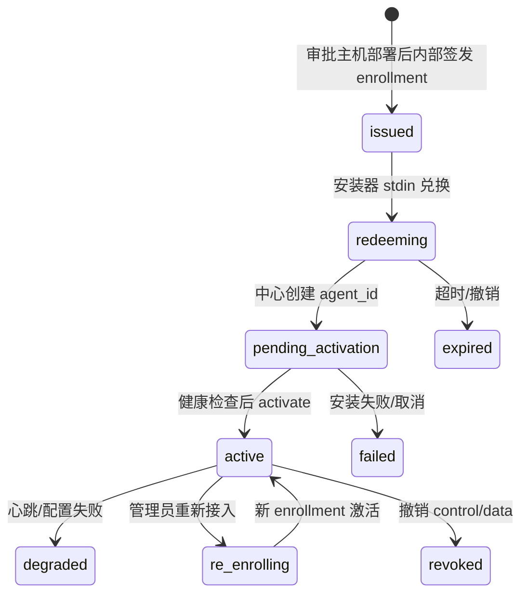

流程如下：

1. 管理员在已登记主机完成 SSH 预检并审阅部署计划；中心内部签发绑定主机、版本/架构和初始任务标签的短期 enrollment。
2. 页面只展示部署计划与回执，不提供独立 token/安装命令入口；中心通过受保护 SSH stdin 将 token 传入固定安装器。
3. 安装器提交 token、install nonce、版本、架构和最小信息；中心核验预绑定主机仍存在且未被其他身份占用，同 nonce 重试幂等，不同 nonce 重放拒绝。
4. 中心创建待激活身份并返回 bootstrap；安装器仅用它发起激活，不写入运行配置。激活前暂存配置只做离线预检，不能运行 Agent；取得独立双凭据后再次严格校验配置，再启动服务并确认启动结果。
5. Agent 激活后取得 control/data credential，使用 fsync 和原子 rename 落盘；中心只保存摘要。
6. 撤销立即拒绝新请求；凭据自动轮换与有限 grace 窗口仍是后续能力，当前不能声称已自动轮换。

`control_credential` 只用于心跳、配置和控制；`data_credential` 只用于 Agent 遥测。Agent 不再接受旧 config.key 或共享 SDK Key 的运行/控制面降级；SDK Key 仍供业务 SDK 独立上报。SDK本地接收器与配置代理已移除，业务SDK仅直连中心。

## 13. 主机、SSH 和 Agent 引导

主机是唯一机器资产，Agent 是它的管理通道；在主机或容器中安装并接入 LightMoni Agent、取得身份后才具备节点能力。登记主机本身不会创建在线 Agent；Agent 必须先登记主机，再通过平台部署并关联，不提供独立脚本接入。主机资产、Agent 身份、SSH 凭据和 control/data 凭据仍分别保存、授权和审计，登记资产不产生 SSH 权限或秘密。

平台自动安装默认在宿主机运行独立的 systemd Agent 服务，不与业务服务的启动、休眠或停止绑定。后续容器部署可选择独立 Agent 容器、Kubernetes DaemonSet，或在用户部署业务时显式注入 sidecar；本轮不实现自动 sidecar 注入，不默认改写用户业务镜像。容器内 Agent 的执行范围取决于真实挂载、命名空间和运行权限，不能仅因登记为节点就声称具备宿主机操作能力。业务 SDK 与 Agent 均可独立上报中心，SDK 不依赖 Agent 安装、不强制经 Agent 转发；Agent 需要自监控打点时复用同一公开 SDK。

前端统一“主机”入口，将主机列表、任务中心和主机标签放在同一工作区。所有列表行使用真实平台主机 ID，Agent 仅补充通道状态和任务；不再拼接无主机资产的独立节点行。主机展示 Agent 在线/离线、未接入、已卸载、已移除与 SSH 是否配置/恢复可用。旧 /machines、/agents 路由和任务深链继续可用。普通成员通过不含 SSH 秘密的主机目录与任务接口只读访问，不获取管理员 SSH 凭据或生命周期操作能力。通用任务模型见第 27 节。

Agent 接入只有“先登记主机、再由平台部署”路径。已认证 Agent 按已有绑定或服务端安装预约确定所属主机，注册/心跳不创建资产；enrollment 由中心预绑定已登记主机，兑换、激活和控制面均核验预约与关联。独立签发及手工主机关联入口移除，共享 SDK Key 不再用于控制面降级。不能按 hostname、出口 IP 或 Agent 本地 host_id 合并或认领主机。SQLite 事务防止提前注册造成重复资产或抢占其他 Agent；MVP 一条主机最多一个 Agent，容器 Agent 的执行范围不等于物理宿主机。

“移除节点”是中心侧归档操作：管理员二次确认后，在同一 SQLite 事务保存移除时间、操作者和原因，撤销该身份全部 control/data 凭据，并保留身份、凭据墓碑、遥测历史和审计。移除不停止或卸载远端程序，不删除主机，不撤销共享 SDK Key。未结束、已派发或结果未知的节点任务，以及待审批、执行中或结果未知的卸载流程阻止移除；重复请求幂等。默认节点列表排除已移除身份，管理员可查询历史；控制鉴权、数据鉴权和任务派发均拒绝已移除节点，禁止回退共享 Key 或由后续心跳复活。共享 SDK Key 不用于 Agent 控制面；旧无预约身份需从主机管理重新部署，不能通过撤销全局 SDK Key 实现 Agent 移除，也不恢复旧秘密。

节点承担周期指标、日志、拨测、受限运维任务和管理员授权的有限脚本。任务中心支持 Node.js/POSIX shell 的手动派发、指定时间一次、固定间隔和带时区的日历 Cron，脚本具有 Agent 用户权限，边界详见第 27 节与 SDD 048。AI 助手通过中心工具查询或生成行动提案，用户审阅批准后才保存或启用计划；Agent 通过出站控制通道领取并回传有界结果。SSH 保留为首次安装、固定身份核验、卸载及离线恢复通道。Agent 自卸载、Agent 本地模型决策和操作系统脚本沙箱仍是后续能力。

登记须填写主机名称和 SSH 目标地址、端口及登录用户；连接凭据可稍后添加，Agent 可稍后部署。主机公钥及指纹在首次 SSH 握手时自动记录，无需用户填写或确认。观测 hostname 不自动成为可信 SSH 地址，管理员可编辑同一主机名称和目标连接。秘密提交后由服务端使用 AES-256-GCM 加密，主密钥独立于数据库保存，页面永远不回显；模型只能看到主机元数据、凭据 ID 和结构化检查结果。主机删除是管理员操作：先移除仍有效的 Agent 身份，并结束终端、检查、部署/卸载和未结束计划、解绑有效连接凭据后才可删除，避免后续心跳自动重建。移除/卸载 Agent 不删除主机资产，删除记录不等于远端程序已卸载。

SSH 已用于首次接入、主机维护及人工文件操作。以下为 SDD039 历史期限策略；机器页面的新凭据以第123章为准，永久保存且不设置期限。登记在单一表单中展示连接信息、登录方式、秘密输入；登录方式为密码或 SSH 私钥。主机公钥和指纹不在表单输入，首次 SSH 握手自动记录，详情只读可见；后续连接自动核验已记录身份。密码与私钥统一默认按期限保存 6 小时（managed），到期或撤销后清空；可显式确认永久保存（permanent），无固定过期时间，直到管理员撤销。有限托管和永久凭据均不因 Agent 激活提前清除；建议优先短期保存。凭据保存失败保留原主机 ID，就地重试不重复登记。主机名称、ID、指纹是资产元数据，不随登录凭据期限过期。已有凭据期限不自动改变；显式 temporary/one_time 仍沿用短期/使用后清除语义。

SSH 预检是只读固定命令集合，检查网络、指纹、Linux、架构、systemd、权限、HTTPS 可达性及已有 Agent 安装。私钥或明确选用 temporary/managed/permanent 的可复用密码可用于预检、终端、固定身份核验和 Agent 安装/卸载；one_time 密码只用于一次预检或终端，结束即清除，无论成功、失败或取消。密码和私钥均经 ssh2 内存参数认证，不进入命令行、环境、进程 stdin、模型上下文或原始日志；enrollment token 单独经 SSH exec channel stdin 传递。密码不保存秘密摘要，历史密码指纹启动时清空；同一主机各类 SSH 操作互斥。

预检通过后生成持久化部署计划；管理员明确确认后，后端先保存 enrollment 与目标主机的服务端预约，再使用固定安装模板、有效凭据、stdin enrollment token 及版本/架构白名单执行。下载脚本和包需要鉴权，0600 curl 配置暂存 token；不进入 URL、argv、环境、日志或回执。生成计划、执行前和安装锁内拒绝覆盖既有安装。计划绑定主机名称及连接 revision，执行前改名使旧计划失效，派发前再次核对实际架构。Agent 注册早于安装回执时仍通过预约关联原主机，不另建资产；确认成功后完成回执与凭据清理，清除 temporary/one_time 秘密并保留有效 managed/permanent 凭据。安装派发前的明确失败取消本次未激活 enrollment；派发后 SSH 断开或平台重启保留 unknown 和核对所需的有效凭据，不自动重放。人工结束才精确撤销本次新身份，不影响原 Agent 或其他主机；恢复边界见 13.8。日常管理优先走 Agent。

卸载使用独立的持久化计划和回执，支持标准卸载及管理员明确选择的 SSH 恢复卸载，详细边界见 13.9。标准模式固定只读探测核对远端独立身份、主机关联、受管服务及未结束任务；卸载与有限任务按主机 ID 和实际 agent_id 双维互斥。计划绑定主机名称、地址、端口、用户名、可信指纹、有效私钥或可复用密码、节点身份及 15 分钟预检有效期；目标或授权变化不能复用。网页提供预览、确认、取消和历史，AI 不能绕过确认执行卸载。

确认卸载后仅执行平台版本受控的固定脚本：核对标准路径受管 systemd unit，拒绝其他来源的同名服务，再停止并禁用独立服务，确认停止后移除服务文件、启动器和 Agent 运行目录；停止失败不得删除程序。默认保留 /etc/lightmoni-agent、/var/lib/lightmoni-agent、专用服务用户，以及业务部署、制品、容器和卷。保留配置与队列用于核查和数据恢复，不代表保留文件中的旧凭据仍有效，也不保证尚未送达的数据可自动补传。

标准保留数据模式的成功核验要求程序路径已移除、服务 not-found 且未运行、远端身份一致、两个持久目录保留并且没有未完成任务标记。显式清除数据及恢复模式按 13.9 验证批准策略。中心在同一 SQLite 事务中仅撤销核验归属的 control/data 凭据并完成卸载记录；已登记节点不能回退为 legacy Key 认证。保留主机、节点和卸载历史，重新接入需要新的 enrollment。运行中、已派发或结果未知的节点任务必须先完成或核对。卸载的 awaiting_approval、running、succeeded、failed、unknown、cancelled 分别记录审批、执行和结果边界；SSH 断连或结果不确定进入 unknown，不报告成功且不盲目重跑。管理员可触发固定只读 reconcile，原临时私钥到期后可以添加新的有效私钥用于核对；完全移除且身份和保留数据核验通过才补做凭据撤销并成功，完整程序仍在且服务状态明确、无生命周期锁或任务标记时记录失败并保留凭据，部分移除或不确定则继续 unknown。待审批或未知结果仍允许管理员用终端人工核查，但禁止改主机、删除或新建部署；实际执行与核对期间同主机终端和检查互斥。

凭据到期或撤销时同样清空当前记录的 `secret_encrypted`，保留 ID、策略来源、有效期、清除时间/原因和不含秘密的事件。有限凭据在启动时、读取/使用前和每 30 秒统一清理；永久凭据仅在明确撤销时清除，不以空期限计算为到期。统一有效性判断要求未撤销、秘密未清除，且永久策略无固定期限或有限期限在未来；关闭模块时释放定时器；清理幂等，并取消引用失效凭据的待审批计划，不改写正在运行的计划。终端租约在到期或撤销后失效。清空当前记录不等于擦除 SQLite WAL/free pages、备份、已进入有界操作的进程副本或远端 authorized_keys。

主机能力由后端按连接方式、忙状态及有效凭据计算 terminal、ssh_check、deploy_agent、uninstall_agent、recovery_uninstall_agent、update_agent、rollback_agent。active_reusable_ssh_credential_count 只统计私钥及 temporary/managed/permanent 密码，安装、卸载和升级不能用含一次性密码或手动脚本的总数推导。界面展示能力及置灰原因；所有操作后刷新状态。未记录主机身份不会置灰，首次 SSH 操作自动记录。实现契约见 SDD 031、032、034、037、038、039、040、045。

网页终端是管理员本人使用的临时 PTY：同源 Origin、登录 cookie、首次自动记录且后续比对的主机公钥、单次 WebSocket 入口、输入/输出上限、10 分钟空闲和 30 分钟总时长。终端输出不持久化、不写日志、不发送给 AI。终端不是 AI 任意 shell 工具。

### 13.1 目标：主机接入状态与 SDK 归属（SDD 036，设计提案）

本节是待评审和实现的目标设计，不代表当前主机页面已具备 SDK 归属查询。“主机与节点”拟统一为“主机”，原管理通道改为接入状态，分 Agent、SDK、SSH 三项；不设置由任一通道推导的整机在线状态。旧路由、监控任务、任务标签和批量计划确认保留。

SDK 归属是后续显式资产绑定设计，不要求 SDK 安装 Agent。当前主机可先登记后配置 SSH，Agent 统一走 SDD 038 的登记主机部署流程，不再规划独立 Agent-only 资产入口；不能把容器 Agent 当作已核实物理宿主机。

SQLite 拟保存 SDK 归属的 host_ref、服务器认证得到的 key_id、service、instance_id、生效区间、revision、来源和审计。同一有效选择器最多关联一个目标；管理员从已观察到的候选明确确认，或在服务部署审批中确认准确 Key ID 和实例配置。客户端 host.id、hostname、来源 IP 和 SDK Key 不能单独证明主机归属；SDK 不发现本机 Agent，不增加注册或凭据签发协议。

SDK 心跳汇总使用 component=sdk 的规范化系统目录，按本页明确选择器有界查询。中心时钟计算 90 秒新鲜窗口与最多 30 秒未来偏差，同一条样本的 event_time、ingested_at 均须满足策略，且事件/接收时间属于当前归属生效后的范围；历史补传不能点亮新主机。查询失败、截断或时钟异常给出未知/原因，不能按 0 个在线处理；默认仅显示近期上报实例数，不以全部历史实例计算健康率。

Agent 显示未接入、在线、心跳超时、已移除或已验证卸载；没有绑定不等于未安装，受管安装不存在只由带时间的 SSH 检查证明。SDK 显示未关联、尚无可用心跳、近期上报、心跳超时或未知；自监控关闭/匿名/断网不直接推断业务停止。SSH 显示配置、指纹、有效凭据与最近检查，不声称持续在线。SDK 和 Agent 独立直报中心，任一通道状态不替代另一通道。

实例随机 ID 变化、新 Key、服务迁移和主机聚合不能静默继承归属。解除、迁移和删除需要明确确认、revision 守卫及事务审计，生效区间保留历史；卸载或移除 Agent 不解除已登记主机的 SDK 关系，不撤销共享 SDK Key。删除主机先预览 SDK 关系影响，旧删除/关联接口不能绕过新守卫；归属只用于观测展示，不授予 SSH 或 Agent 执行权限。

MVP 新主机资产与 SDK 归属/摘要接口仅管理员可用，成员保留原有 Agent/任务只读权限。AI 只可读取脱敏摘要和提出归属提案，不能批准。先交付命名及状态语义，再实现仅资产登记、归属与心跳查询，最后接入部署审批；每阶段以 SDD 036 的需求、HLD/LLD、拟议契约和验收清单为准，不把设计草图当已实现能力。

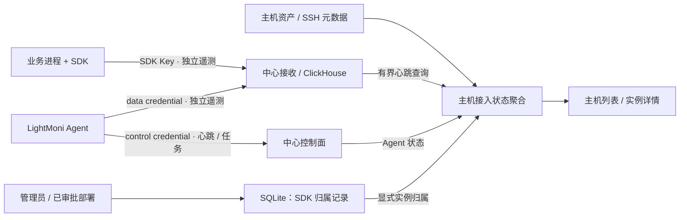

### 13.2 当前：登记接入与平台主机标识（SDD 037）

主界面统一称“主机”，移除“脚本接入节点”按钮，主路径是登记主机、保存所选期限的凭据、SSH 预检、审阅确认后自动安装宿主机 Agent。此节记录 SDD 037 的登记改动；单屏表单与默认保存时长以 SDD 039 后续修订为准。SDD 038 进一步移除独立脚本接入与旧身份兼容，不删除用户数据库历史记录。登记资产本身不执行 SSH 或远端写入。

平台通过 managed_machines.id 和 name 标识主机资产。ID 在登记时由中心自动生成，作为不可变主键；名称由用户填写和修改，是展示名称而非唯一键。同名主机通过不同 ID 区分，改名不改变资产 ID、凭据归属或已有 Agent 关联，界面详情保留稳定 ID 供核对。

本轮不创建或展示 SDK 主机环境变量，不扩展 SDK 读取能力，不在安装参数、Agent 配置或 SDK 遥测中注入平台资产 ID/名称。SDK 与 Agent 各自独立上报的既有路径保持；主机与 Agent 的绑定继续走已认证身份和现有受管关联流程。

SDD 036 的完整 SDK 归属表、显式绑定和双时间心跳汇总仍是目标设计。当前仅完成平台内主机身份、凭据有效期和登记安装主路径，不从主机名称、地址或 SDK 声明自动认定归属。

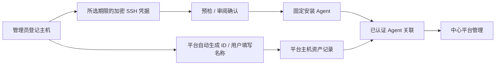

### 13.3 当前：登记主机与 Agent 身份一体化（SDD 038）

主机是唯一资产入口：先登记平台 ID / 用户名称，再按需保存指定期限的 SSH 凭据、预检、审阅确认并安装 Agent。中心内部签发 enrollment 必须预绑定已登记主机，公共独立签发接口停止创建新 token。兑换、激活及注册/心跳核验预约和独立凭据，首次注册与绑定在 SQLite 事务内完成；注册早于安装回执仍关联原主机。客户端提交资产 ID 不具有关联效力。

注册/心跳不建档、不修改归属，不回填旧独立 Agent，不支持手工关联与历史协议降级；无主机预约的 token/身份拒绝接入，不能通过 SDK Key 控制面 fallback。旧数据库记录保留，不自动删除用户资产。重新部署保留原主机 ID：旧身份须已移除或全部凭据失效、没有未完成任务，新的有效 SSH 预检确认远端无 Agent，再由新安装预约的旧身份快照完成原子替换，保留旧身份历史。移除或卸载 Agent 后保留主机，主机有有效 Agent 身份时不可直接删除；旧身份卸载回执不能决定新身份的状态或删除权限。

用户名称与 observed_hostname 分离，心跳不覆盖名称或 SSH 配置。登记须填写名称与 SSH 目标地址、端口；登录用户在主机的 SSH 账户中独立管理，可稍后添加账户及凭据，详见第84章。主机公钥与指纹首次 SSH 握手自动记录；管理员可编辑名称及目标连接，凭据按用户选择的期限保存。Agent 本地 host_id 保留遥测资源含义，不作为平台主机 ID；同名、共享出口或容器身份不能自动识别同一物理宿主机。成员只获取主机 ID/名称与原有 Agent 可见信息，不获 SSH 元数据。SDK 独立直报，不增加 SDK 环境变量、主机发现或 Agent 依赖。


### 13.4 历史：单屏登记与统一凭据保存时长（SDD 039）

登记界面展示主机名称、地址、端口，可接着创建第一个 SSH 登录账户并填写密码或私钥；后端分别保存资产、账户和账户凭据授权，登录用户名不再是主机字段。后续可在同一主机添加多个账户，详见第84章。主机公钥/指纹由首次 SSH 握手自动记录，无需填写或确认。默认登录方式为密码，机器页面新凭据永久保存且不设置期限；显式有限期限仅供原 API 客户端兼容。公钥/指纹在详情只读显示并用于后续 SSH 服务端自动核验，既不是 SSH 登录公钥，也不能替代密码/私钥；指纹与平台 ID/用户名称作为资产元数据保留。管理员仍可明确选择仅登记、稍后添加账户及凭据，登记本身不执行 SSH。

API 有限策略为 managed，默认 expires_in_seconds=21600；永久策略为 permanent，必须显式 confirm_permanent=true，且不得同时提交有限秒数。数据库以 expires_at 空字符串表达无固定期限，仅在 retention=permanent 时有效；不使用虚构的远期时间戳。此节的早期实现将秘密加密绑定主机和凭据 ID；集中连接凭据及共享绑定以第 13.6 节为准，秘密仍不回显、不进入 AI、日志或审计正文。

统一有效性用于计数、终端、SSH 检查、安装/卸载、批量及 AI 脱敏凭据选择：未撤销、秘密未清除，且永久无固定期限或有限期限晚于当前时间。Agent 激活保留 managed/permanent；撤销清空密文、终止引用终端并使待执行计划失效。永久凭据不代表终端会话或部署计划无限期；原空闲/总时长、固定目标指纹、预检 TTL 和人工审批继续生效。

登记表单用原主机 ID 重试秘密保存，失败不重复建档、不执行 SSH；关闭窗口或更换登录方式清理秘密输入。已有凭据保持其既定期限，旧 temporary/one_time 行为明确独立，不改变统一主机登记和 SDK 独立直报架构。

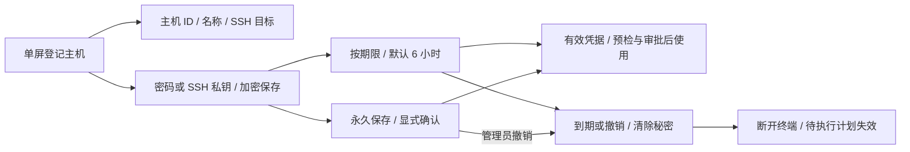

规格、契约与验收见 [SDD 039](../specs/039-host-registration-credential-retention/spec.md)。

### 13.5 当前：自动记录 SSH 主机身份（SDD 040）

登记和编辑只接收用户名称、SSH 地址、端口和用户名；登录密码或私钥按 SDD 039 的时长独立保存。主机公钥、SHA256 指纹及首次记录时间由中心产生并只读返回，API 拒绝客户端写入。主机页不再展示连接凭据安全提示横幅，登记和编辑也不展示身份输入或确认。

SSH 固定命令和网页终端统一使用 ssh2，在同一实际连接的 hostVerifier 中处理服务端公钥；不依赖单独 ssh-keyscan 后无条件信任另一条连接。首次握手在认证前，以主机 ID 和 SSH 端点原子固定公钥及指纹；已有指纹只允许匹配后补全公钥。重复连接匹配已记录身份，变化则拒绝连接，不覆盖旧身份、不执行远端命令。首次使用信任（TOFU）不包含带外首次身份核验，也不把自动记录描述为人工验证。

保存身份时重新核对活动操作、凭据状态、主机端点与当前指纹，阻止过时或竞争结果。首次记录后终端租约和预检使用更新的 revision，安装及卸载计划继续绑定该身份、有效凭据、目标与预检期限；生成计划不执行程序，人工执行审批保持。影响 SSH 目标的编辑以单调递增的 ssh_target_generation 纳入 revision，同时删除旧检查、取消待审批计划，避免端点 A→B→A 复用旧结果。地址或端口修改额外清空公钥/指纹/记录时间；仅改用户名称或登录用户名保留同一端点身份。认证完成后、执行命令前仍重新验证授权与目标；已经开始执行的操作按真实回执收敛，不因中途凭据到期伪造失败。

管理员在详情只读查看和复制主机公钥/指纹及记录时间；未连接显示“首次 SSH 连接后自动记录”。成员与 AI 的可见范围保持原有脱敏边界。没有指纹不阻塞首次预检、终端或批量操作，缺少有效凭据、互斥、权限和既有计划约束仍由后端能力决定。

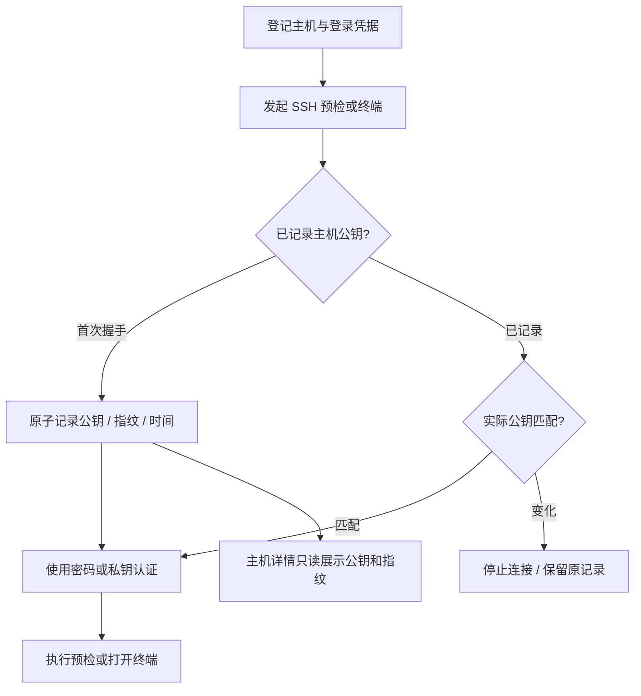

规格与验收见 [SDD 040](../specs/040-automatic-ssh-host-identity/spec.md)。

### 13.6 集中连接凭据与主机默认绑定（SDD 050）

运维工具提供独立“连接凭据”页，统一管理 SSH 私钥和密码。主机登记可选择已有有效凭据，也可直接填写新秘密并保存到凭据库；主机自身保存名称、SSH 地址和端口；登录用户名属于主机下的 SSH 账户，账户可绑定多个独立授权的凭据（当前模型见第84章）。机器页面新凭据永久保存且无期限输入，原 API 显式有限期请求保持兼容。页面展示名称、类型、状态、有效期、关联主机与私钥公钥指纹；服务端不返回秘密或密文。此设计更新第 13.4 节的按主机保存实现，保留原期限和主机身份语义。

中央 connection_credentials 加密保存秘密；machine_credentials 保留稳定 ID 作为 SSH 账户绑定并引用中央项。managed_machines.default_account_id 指向默认账户，machine_ssh_accounts.default_credential_id 指向该账户的默认绑定。SSH 检查、终端、部署和卸载省略凭据 ID 时只使用这两个显式默认项；默认过期、撤销或解绑后明确提示更新，不自动换用其他凭据。检查和审批计划始终绑定当时的凭据 ID，不因修改默认值而更换已审阅授权。

SSH 私钥以实际公钥 SHA256 指纹识别，同一私钥可关联多台主机；重复提交复用已有有效项并返回其真实期限，不隐式延长或改名。密码不生成可离线猜测的秘密散列。手工新增同钥时，本主机绑定仍遵守本次请求期限并受中央期限约束；明确选择已有库项时才继承库项期限，不因去重扩大本主机授权。旧单用户名和主机级绑定已移除；旧开发数据库明确拒绝启动，不迁移秘密、不提供旧字段回退。绑定的有效性同时受中央项和自身期限限制，不因合并其他主机的永久私钥而延长旧授权。

解绑仅清除本主机绑定，取消对应待审批计划并关闭引用终端，不撤销其他主机共用的中央项。全局撤销需要明确确认并展示关联主机，清除中央密文并使所有绑定、终端和待审批计划失效。中央过期也统一清除秘密。临时绑定仍按 Agent 激活清除，仅影响该绑定；一次性密码仅允许单主机绑定，使用结束同时清除其独占中央秘密，不能再次绑定复用。删除主机不删除共享中央项；AI 只获得公开元数据和绑定 ID，不能读取或取回秘密。

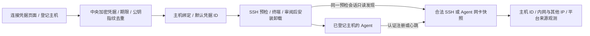

### 13.7 主机网络地址与可信来源观测（SDD 050、051）

主机列表的“主机”栏在用户名称下标记 SSH 连接地址、内网 IP、其他网卡地址与平台观测来源 IP；详情显示观测主机名、网卡、地址族、地址分类、发现方式和最近观测时间。支持多网卡、多 IPv4/IPv6 和纯内网环境。登记时的 SSH 连接地址仍由用户提供；平台不能从私钥、浏览器所在电脑或机器名称推导它。IP 和观测主机名是可变元数据，平台生成的主机 ID 才是唯一身份，不按 hostname、内网 IP 或共享 NAT 出口自动合并资产，也不覆盖用户名称、SSH 地址、端口和登录用户名。

安装 Agent 前，管理员主动执行 SSH 安装检查即可发现网络。平台复用同一次已验证服务端主机密钥、凭据和目标的 SSH 会话，追加固定、有界的只读 hostname/网卡采集区块；不额外连接、不安装依赖、不执行用户脚本。核心安装条件与可选发现分别解析。缺少 ip 工具、非法数据或超过字节/条数上限时，发现返回 unavailable，不降低已通过的核心 ready，也不保存原始 stderr 或擦除先前成功快照。核心安装条件未通过但发现成功时仍可展示和保存结果；取消、身份变化或授权失效的过时结果不得写入。

Agent 通过系统网卡接口采集 network_addresses，每次注册/心跳提交最多 64 条规范地址。SSH 与 Agent 共用 IP 规范化及服务端分类，支持 RFC1918、CGNAT、IPv6 ULA、链路本地和回环；超量或非法 Agent 输入仍整体拒绝，不能部分刷新心跳状态。主机 summary 的 network 保留 addresses、private_ips、public_ips、observed_at、source_ip、source_observed_at 和 source_kind，新增 observed_via（ssh、agent 或 unavailable）及 hostname。hostname 仅表达该成功快照的观测主机名，observed_at 使用服务端接收该成功快照的采样时间，不信任远端时钟；没有合法快照时显示可执行 SSH 安装检查或等待 Agent 上报。

machine_network_observations 原位保存规范快照及观测身份。SSH 快照绑定当前 ssh_target_generation 和实际服务端主机密钥指纹，提交前重新验证；修改 SSH 地址、端口或登录用户名使旧 SSH 快照失效，A→B→A 也不能复用。Agent 快照由 snapshot_agent_id 约束当前认证绑定；旧 agent_id 独立约束平台来源 IP。读取时分别验证网卡快照和平台来源的身份，不因其中一个失效而抹掉另一个仍合法的观测。Agent 重装不能沿用上一 Agent 的网卡或来源，合法 SSH 快照也不因旧 Agent 失效而丢失。

同一主机按服务端采样时间保存最新合法的成功网卡/主机名快照，SSH 与 Agent 没有固定优先级。新的成功空快照清空当前网卡；失败保留先前成功数据。旧 Agent 未提交 network_addresses 时不伪造或覆盖网卡，也不擦除独立 SSH 快照，来源 IP 仍可在认证请求中单独更新。更新网卡不刷新 source_observed_at；SSH 永远不填充 source_ip。

source_ip 仅由平台根据该 Agent 请求连接观测，不从正文接收，不调用第三方公网 IP 查询服务。平台观测来源可以是内网、NAT、代理或 VPN 地址，只代表 Agent 到平台这一条连接；网卡公网范围也不代表公网可达。两者都不推导 NAT 映射、全局出口或公网入站地址，不自动改写 SSH 连接配置。

默认忽略 X-Forwarded-For，只采用 socket 对端。反向代理部署可通过 LIGHTMONI_TRUSTED_PROXIES 显式设置 IP/CIDR；仅在直连对端可信时，从右向左剥离可信代理链，采用第一个非可信来源。可信代理缺失或提供非法转发链时显示来源不可确定，不能将代理地址当成已发现的主机出口。未配置可信代理时显示的来源可能是代理本身，界面明确注明平台观测依据。

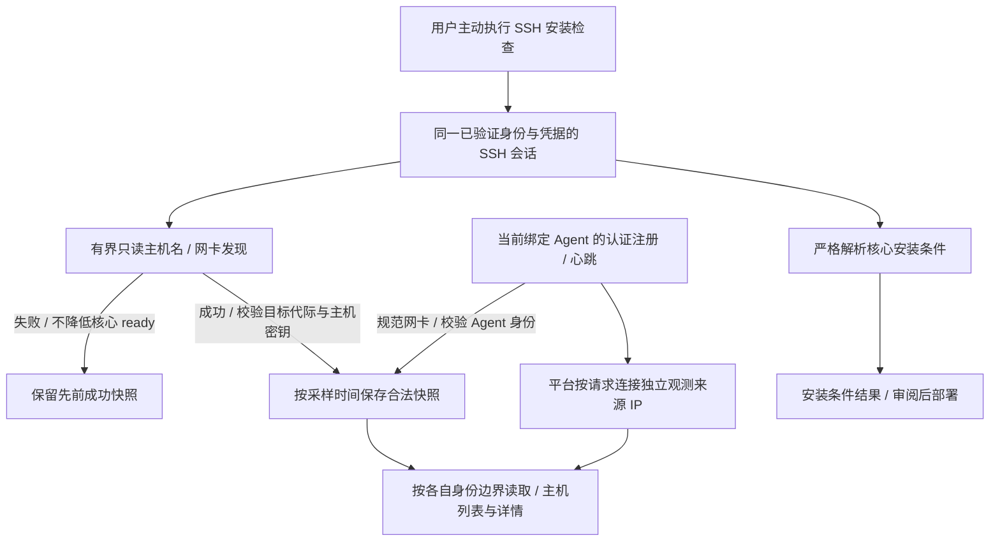

规格与契约见 [SDD 051](../specs/051-ssh-host-network-discovery/spec.md)。

### 13.8 首装结果未知、只读核对与人工结束（SDD 053）

主机首装持久化非秘密的 enrollment ID、执行阶段和人工结束元数据。阶段区分旧记录未知、计划、预检、签发中、已签发与 bootstrap 已派发，在副作用前保存；不能把旧记录缺少关联解释为没有执行。平台启动将仍在 running 的安装改为 unknown，派发后 SSH 断连同样进入 unknown。未知结果保留原目标、身份、阶段和回执，禁止自动重试、重新 enrollment 或静默覆盖远端安装。

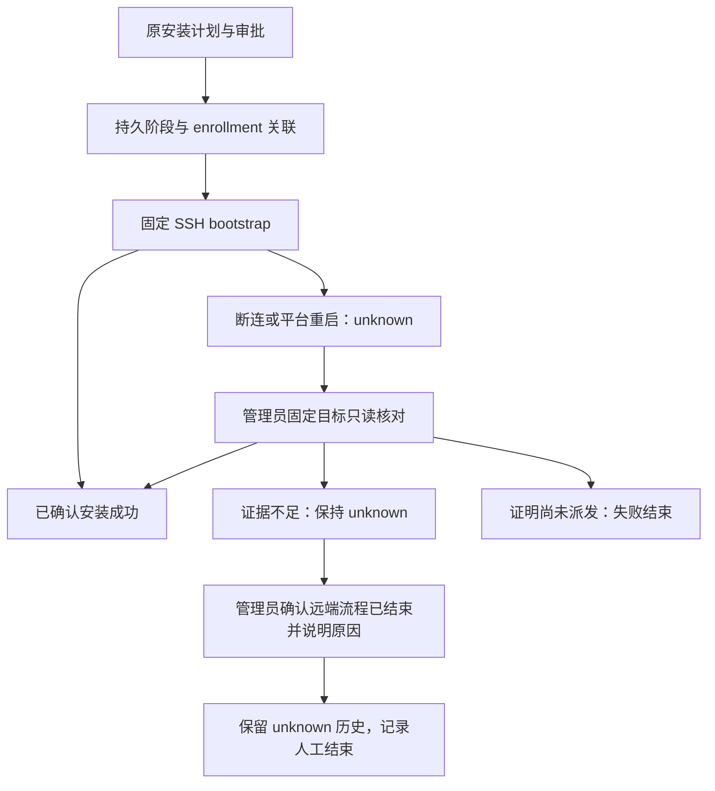

管理员通过 `/api/v1/machines/:id/deployments/:deploymentId/reconcile` 选择当前有效 SSH 凭据，在原主机连接 revision 和身份边界内只读核对。成功需要本次 enrollment 已激活、当前主机关联同一 Agent、有效 control 凭据、远端完整且运行的受管服务、无生命周期锁，以及安装开始后的新鲜心跳；仅允许有限未来时钟容忍。确认尚未派发的阶段可取消未使用票据并失败结束。旧记录、部分安装、身份冲突或证据不足保持 unknown，不执行安装或修复脚本。

无法自动证明时，管理员可通过同路径 `/resolve` 明确确认远端安装流程已结束并提供原因；中心保留 unknown 状态，记录 resolved_at/by/reason，解除该安装记录的阻塞。该操作不停止或卸载远端程序，不恢复或覆盖数据；取消本次未激活 enrollment，仅撤销该 enrollment 新 Agent 的独立 control/data 凭据，不影响原 Agent 或其他身份。有未结束有限任务时拒绝人工结束，不能借此绕过任务恢复。

running 与未人工结束的 unknown 安装阻止冲突生命周期动作、目标编辑、删除、重绑定及新的有限任务派发/领取；已开始的任务按原协议完成。心跳和持续遥测保留为观测证据，SSH 终端与只读检查用于人工核查。网页始终提供原计划的审阅/历史入口，丢失创建或执行响应时先恢复持久记录或只读刷新，不盲目重放；人工结束不能显示为已成功安装或已卸载。

首装失败仅清理本次创建且已为空的程序目录，不删除之前存在的配置、身份或状态。正常卸载后保留的数据仍须管理员核查，fresh 安装保护不因此放宽。卸载与维护的本地任务保护同时识别 Agent job、通用 script task 和运维锁；即使中心尚未收到任务回执，也不能直接删除程序或 purge 数据。

### 13.9 Agent 恢复卸载与离线维护（SDD 058）

标准卸载核对本平台登记身份；SSH 恢复卸载由管理员显式选择并填写原因，用于凭据登记丢失、未绑定、身份文件缺失或损坏、程序部分残留。恢复仍固定已登记主机的 SSH 端点、指纹、连接 revision 和有效凭据，实际有效 Agent 若已绑定其他主机则拒绝。平台记录有界远端观察，包括身份状态与文件摘要、程序摘要、受管 unit、固定目录状态和任务/生命周期锁；不读取或返回原始配置与秘密。计划前、apply 前及远端锁内复验，证据变化要求重新审阅。

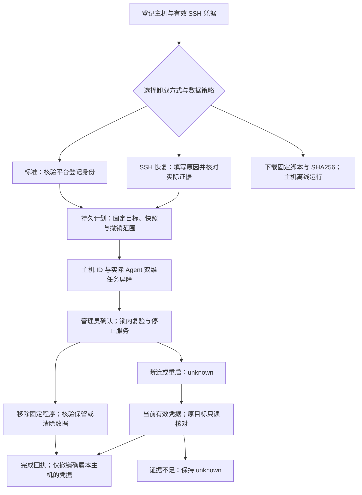

默认保留 /etc/lightmoni-agent 与 /var/lib/lightmoni-agent；生成计划前可明确选择 purge，审阅两个 Agent 目录将被清除，含身份、队列及未送达遥测。成功必须证明服务和固定程序已移除，保留策略下原数据目录状态与身份摘要不变，清除策略下两个目录均不存在；不会删除服务用户、业务目录、容器或卷。fresh 保护保持，显式清除后才能从主机登记流程重新 enrollment；保留模式不承诺直接重装。

恢复不自动反向绑定实际 Agent。只有有效实际身份等于本主机原绑定且 enrollment 归属核验通过，才撤销该身份的 control/data 凭据；缺失、损坏或未绑定身份不凭旧记录猜测。回执分别记录远端移除、数据策略、撤销资格与实际撤销数量，不把外部平台凭据描述为已撤销。主机和历史记录保留；删除平台记录仍是独立操作。

卸载 awaiting_approval、running、unknown 对主机 ID 与实际 Agent 建立持久屏障，覆盖有限任务提交、领取、定时派发和自动重试；已有未结束任务阻止卸载，持续遥测与心跳继续。脚本在停服务前及停后复验本地任务标记，损坏或不安全标记拒绝删除；固定 Agent 路径和关键祖先拒绝符号链接。派发后失败或平台重启进入 unknown，使用原 SSH 目标与当前显式选择的有效凭据只读核对，不重放移除；不能证明完成时继续 unknown，迟到结果不能覆盖已结束记录。

管理员通过 GET /api/v1/agent-maintenance/uninstaller 获取固定无秘密脚本、文件名和 SHA256，不依赖 enrollment 下载票据。新发行包携带同一脚本并安装到 /usr/local/sbin/lightmoni-agent-uninstall，管理员可在平台不可用时以 root 本机运行；默认保留数据，显式 --purge 才清除。手动脚本使用相同固定路径、任务与服务归属保护，不调用中心，不能证明平台凭据已经撤销。网页创建计划或执行响应失联时先恢复持久记录，不盲目重复请求。旧待审批计划若缺少快照须取消重新计划；旧 unknown 仅按原标准模式的固定目标、同一有效身份、完整移除与保留目录证据只读核对，记录旧协议证据，不能伪造此前不存在的摘要快照。升级/回退保持第 28 节受管身份、固定发行与健康确认协议，不提供强制升级未知安装。新发行切换与主动回退同时同步包内离线卸载器，失败时恢复原脚本内容与权限；旧包没有卸载器则保留现有文件，并明确记录未同步。

规格、接口与隔离验收见 [SDD 058](../specs/058-agent-maintenance-recovery/spec.md)。

### 13.10 目标：安装权限提示与独立运维执行器（SDD060，分期实现）

登记 SSH 用户名旁提前说明：“安装 Agent 需要 root，或支持免交互提权的 sudo 账户。登录账户用于安装和恢复，Agent 使用独立账户运行。”普通账户仍可登记和登录终端；预检按真实 UID/所需 sudo 能力返回 root、sudo_noninteractive、unavailable 或 unknown，不按用户名猜测，不把 SSH 密码自动当 sudo 密码。

基础监控仍用普通 Agent；容器管理与允许提权脚本默认关闭、独立审批，启用时按计划引导独立 root 执行器。主机分别显示普通 Agent、执行器及能力授权/实际就绪状态。保存凭据、root 安装成功或开关打开都不等于能力已就绪；日常不自动回退到 SSH。详细权限、任务和生命周期见第60章与 [专项设计](privileged-executor.md)。

## 14. AI 助手设计

### 14.1 运行时分层

Mastra 是 LightMoni AI 助手的主对话和工具编排运行时。中心每轮通过私有 stdin/stdout 管道启动 Node worker；模型连接由 provider 适配 OpenAI Chat Completions、OpenAI Responses、Anthropic Messages 和 Google Gemini。Pi Agent 不是另一个平台入口，而是 Mastra 在 `code_task` 中调用的受限代码执行器，负责“读取 → 修改 → 检查 → 修复”的多轮循环。

模型接入只维护助手需要的基本契约：配置与连接测试、流式文本、工具调用、多轮历史、取消/超时、安全错误和真实用量。现有四种协议作为兼容能力保留，不以继续补全所有供应商特性为目标；未来供应商路由、协议适配、故障切换、配额和成本治理由独立模型网关承担，中心通过一种明确支持的具体协议接入，不复制第二套网关。

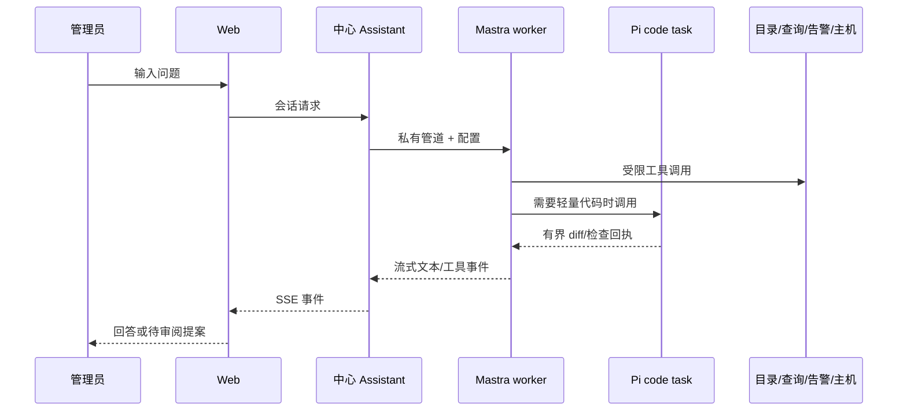

### 14.2 工具分级

| effect | 示例 | 应用方式 |
| --- | --- | --- |
| `read` | list/describe tables、run_query、日志、告警读取、主机状态、业务部署事件 | 有界执行，可直接返回 |
| `draft` / `propose` | dashboard draft、alert change、task/deployment/operation plan、SDK 插桩和 Agent 首装计划 | 保存或返回原生提案，管理员审阅 |
| `code` | Pi `code_task` | 隔离副本、检查、diff，用户确认应用 |
| `execute` | 通用 apply/approve、任意 SSH/命令 | 不向模型或 MCP 开放 |

写操作是允许的产品能力：AI/MCP 可创建结构化提案，管理员确认后由原领域服务执行真实写入或动作。审批绑定目标、参数/diff/digest、revision、owner、来源、稳定授权和期限；审批与尚未开始项领取前按原领域协议复验。模型不能直接修改目标、批准自己的提案或获得通用执行工具；提案接受、进入队列和最终业务成功必须分别表达。

AI 的查询必须走目录和统一 Query，SQL 只读、有时间范围和结果上限。告警规则和静默的修改使用 revision/版本检查和 15 分钟提案有效期；应用时重新检查权限、版本和对象状态。代码任务只在管理员配置的 workspace 中运行，限制路径、符号链接、文件大小、白名单检查命令、步数和时长；Pi 不 commit、push、PR、merge 或 deploy。

### 14.3 模型管理与用量

管理员在“模型管理”保存 Base URL、协议、模型和输入/输出单价。自动识别只给地址和目录依据推荐；第三方 OpenAI 兼容目录无法区分 Chat/Responses 时必须人工选择。各协议独立规范化 `/v1`、`/v1beta`、目录鉴权和生成接口；修正后的地址回填输入框并说明原因。目录刷新不产生生成费用；连接测试发送一次最小真实请求。

每个真实模型请求使用稳定 request ID 幂等写入账本，记录 started、usage 和终态，区分 complete、partial、unpriced、failed、cancelled。缺失 token 不能猜成零，模型输入、Key 和回复正文不写入用量统计。未来网关只返回真实可获得的用量与价格事实；网关没有提供时仍保持未知，中心不重复计费。

### 14.4 平台开放能力与 MCP：目标架构（SDD 046）

平台开放能力的总体目标覆盖完整业务，任务只是其中一个领域。采用“统一应用能力层 + MCP/Web HTTP/内置 AI 三种适配器”：外部 Codex、Claude 通过 Streamable HTTP MCP 调用，平台助手在进程内调用相同 Dispatcher，页面和普通程序通过 HTTP 复用同一领域服务。MCP 负责协议与工具发现，能力层统一真实主体、role/scope/资源交集、参数校验、审批、幂等、审计和安全结果；不直接包装助手 execute 并伪造 session/admin。首期同进程模块部署，不新增微服务或队列。SDD 047 已实现首批主机/任务工具、专用 PAT、OAuth 与接入管理；SDD 134～151 已扩展多领域读取以及任务、告警、部署、运维和 Agent 首装提案，但不等于全部目标已完成。

用户客户端授权采用 OAuth 2.1 授权码 + PKCE，独立 PAT 只作为支持 Bearer 配置客户端的补充；二者均不复用 SDK/Agent/SSH/模型凭据。AI/MCP 入口进行安全读取并创建提案，管理员在平台审阅后允许原领域执行真实写操作；客户端弹窗或模型确认不代替审批。通用提案把 owner 与来源会话分开，已有助手历史权限保持。后续自动执行仅限管理员固定能力/版本、主机、参数界限与期限的持续授权。

所有主机主动操作关联统一 execution ID，复用真实 task run、Agent job、部署、运维和生命周期回执；不同领域保留真实状态与恢复策略，unknown 不自动重放。遥测查询记调用审计，持续采样不逐条建任务；交互按独立会话协议留痕。长任务返回 ID，连接中断不等于取消。远端 MCP 不读取用户本地源码，本地 AI 负责本地文件，平台部署使用明确提交的版本/制品。任意 SQL 和脚本源码须额外数据授权，不能由主机范围 token 绕过资源隔离。

SDD 047 首期只开放安全目录、任务/执行状态及已有任务派发、取消、重试提案；不开放任意 SQL、任务定义修改、直接执行或自动批准。外部提案审批和排队项领取前复验稳定授权；OAuth 短期 access token 自然过期不取消已批准项。执行索引本期仅关联真实 task run，在接受/查询时投影，状态以原生记录为准。`/mcp-access` 管理自己的令牌、OAuth 授权与预注册客户端，`/mcp/authorize` 明确授权。使用官方 SDK 1.32.2 的 2025 协议；2026 适配尚未实现。externalURL 不满足 HTTPS origin/本机 HTTP origin 时仅禁用 MCP，不阻止原平台运行。尚未完成的 MCP 来源提案在审批授权适配器缺失时拒绝应用，不能通过内部助手 fallback 绕过原授权；外部排队项和自动重试保留稳定授权，领取前无校验器时拒绝开始。首期告警启用时共 10 个工具，平台默认任务与用户任务共用 list/get，移除独立模板目录。MCP 主机名称区分用户资产 name 与当前 Agent 的 observed_hostname，替换、移除或尚未上报时不回退旧缓存。

SDD 134 将能力核心生命周期与外部 MCP 接入解耦：CapabilityAccess、Dispatcher、通用能力 HTTP 和内部助手首批共享工具始终装配；McpAccess、PAT/OAuth 管理及 MCP Transport 仍受固定 externalURL 约束。Web/助手 Principal 由核心会话访问模块刷新，外部 Principal 和稳定 grant 仅委托已配置的 MCP Access 校验。外部接入关闭时，历史 MCP 提案继续 fail closed，不能因核心可用而跳过授权复验。

SDD 135 为既有能力补齐稳定 ID/version、data 输出 Schema、风险/操作类型、入口曝光、目标解析、审批/幂等、安全投影、digest-only 审计和每主体每能力限制。Dispatcher 对直接调用再次检查曝光与 Host 目标，并执行大小、超时、频率、并发、投影和输出校验。MCP 广告成功或安全错误的完整 structuredContent Schema，annotations 由描述符生成；tools/list 使用绑定主体和目录摘要的 opaque cursor，每页重新鉴权。错误保留原 code 分类并增加 detail_code，避免细化错误时破坏既有客户端。

SDD 136 以遥测为首个领域垂直切片：共享 TelemetryService 同时承接内部助手与 MCP/HTTP 的目录、表结构和只读查询，旧助手工具名仅作适配器。telemetry.query 与目录权限分离，所有遥测能力均为安装级授权；查询复用既有 SQL/Query 防护、10 秒领域期限，最多 1000 行并有显式字节采样。成员只保留内部既有遥测读取，外部 PAT/OAuth 仍仅向管理员授予 Scope。

SDD 137 以 AlertReadService 迁移告警读取：规则筛选/分页、完整规则、静默、责任组和 owner-bound 提案共用内部助手与 MCP/HTTP 路径。alerts.read 与 alerts.detail.read 分离，完整 SQL 和提案内容仅属后者；所有告警读取仍为安装级授权。内部旧工具名保留，告警写入继续使用原提案和人工审批，外部只读不获得 apply。

SDD 138 将日志冻结检索抽为 Logs.searchRead，Web 与 LogReadService 共用真实 owner、会话和查询；模型投影裁剪只影响当前响应，后续游标可读取被裁剪行。TraceReadService 复用原 HTTP 的表、范围、span 和缺父节点语义。logs.read/traces.read 独立且仅安装级授权，新增内部 search_logs/get_trace 与外部 MCP/HTTP 能力，不开放保存检索或导出写入。

SDD 139 复用 ServiceDeploymentStore 开放服务、目标、Release、部署历史和事件只读能力。deployments.read 仅授予管理员安装级读取；内部旧工具由 Dispatcher 适配，新服务详情/部署历史可发现准确 ID。原生部署状态、审批、回滚、receipt、telemetry stale 和事件顺序不改写，部署及制品写操作仍未开放。

SDD 140 以 OperationsReadService 开放运维资源、Run 和 Schedule 只读能力。六个工具统一 operations.read 和管理员安装级授权，资源正文、敏感日志及大回执使用既有安全投影；内部旧工具复用 Dispatcher，Schedule fires 读取真实 Run 状态。运维提案、审批、取消、手动触发和 Schedule 写操作仍未开放。

SDD 141 保留原 hosts_list/get，新增 assistant-safe 主机详细目录/详情及 Agent Release、安装和维护回执读取。agents.read 与 hosts.read 分离，安装/维护结果复验 Host，Release 为安装级权限。内部五个旧工具由 Dispatcher 适配；Host Key、SSH 秘密、控制/数据凭据、票据和原始输出不进入结果，远程预检与生命周期写操作仍未开放。

SDD 142 以 DashboardReadService 开放自定义/系统大盘摘要、完整详情和版本历史。dashboards.read 与 dashboards.detail.read 分离，完整面板 SQL 仅属详情权限；均为安装级授权。内部新增三个读取工具，成员保留既有内部/Web 读取；保存、复制、删除和 draft_dashboard 外部化未开放。

SDD 144 以共享 InstrumentationService 开放中心受限工作区扫描和既有插桩提案读取。code.workspace.read/detail.read 分离扫描与完整 Diff，读取不返回 before 快照；内部旧扫描由 Dispatcher 适配，共享加密 Store 和 revision/审批语义不变。插桩生成、Apply、code_task 和通用源码读取未开放。

SDD 145 以 AlertReadService 补齐告警事件、值班时间线和通知投递只读能力，原 Alert API 与新能力共享筛选。alerts.incidents.read 与 alerts.notifications.read 分离高敏数据；通知联系人、payload、供应商响应和原始错误不进入模型。接手、确认、分配、重试和通知测试未开放。

SDD 146 将响应统计复用到 AlertReadService，新增 alerts.statistics.read 和内外部只读统计，保留原筛选、接手率、时长和截断。Slice 2 覆盖矩阵明确远程探针、长代码任务、恢复/卸载及后续写/服务主体边界，不把工具数量当作全目标完成。

SDD 147 开启 Slice 3 任务定义提案：lightmoni_tasks_plan 增加 create/update，内部五操作统一 Dispatcher。有限 Host 创建和审批前复验 before/after 静态目标，禁止 target_all/标签扩展；原 TaskProposalService 的脚本、调度、revision、owner、幂等和人工审批不变，不新增直接执行。

SDD 148 将告警规则/静默提案扩展到 MCP/HTTP：AlertProposalService 保存真实来源与稳定 grant，事务内幂等，审批前复验 alerts.propose/detail 和安装级权限。内部 propose_alert_change 统一 Dispatcher；外部不伪造 session，审批使用原管理员 HTTP，不提供 apply/approve 或直接执行。

SDD 149 新增部署计划提案和 ExecutionGrantRegistry：deployment 与稳定 grant 关联，审批事务及中心 SSH 派发前复验 deployments.propose/read，撤销后未开始 Job fail closed。内部 propose_service_deployment 统一 Dispatcher；proposal completed 只表示审批接受，真实执行仍以部署/Job/SSH 回执为准。回滚、取消、上传和直接执行未开放。

SDD 150 将既有运维动作计划接入统一能力层：operations.propose 与 operations.read 同时必需，外部 Run 在同一 SQLite 事务中绑定 operation/native_id 与稳定 grant。OperationsStore.approve 在创建 Job 前复验，中心 privileged SSH 派发在获取主机租约前按 agent_jobs.operation_id 再复验；授权撤销只失败关闭尚未开始项，不重放 unknown。内部 propose_operations_action 统一 Dispatcher 且保留 `{run}` 安全元数据，无外部绑定。原生 OperationsStore、审批、Agent Job 和恢复状态机保持事实来源，未开放资源/Schedule 写入、MCP 审批、取消、触发或直接执行。

SDD 151 将 Agent 首装计划接入统一能力层：agents.maintain.propose 与 agents.read 同时必需，目标 machine_id 复用主机授权。外部 machine_deployments 计划、幂等与 agent_installation 稳定 grant 在同一 SQLite 事务保存；原管理员 Apply 在任何 enrollment/SSH 安装动作前复验 grant、Scope、当前账户和主机范围。内部 propose_agent_install 统一 Dispatcher，保持原计划结构且无外部绑定。fresh 预检、目标/凭据 revision、固定版本/架构、runtime/helper、恢复和 unknown 仍由原领域实现；未开放 SSH 预检、直接安装或后续生命周期工具。

完整 HLD/LLD、三张流程图、授权、工具矩阵、执行/幂等契约、数据与代码边界以及分期验收见 [平台开放能力与 MCP 架构](platform-mcp.md)、[SDD 046](../specs/046-platform-mcp/spec.md)；当前实现及使用边界见 [SDD 047](../specs/047-platform-mcp-service/spec.md)、[SDD 134～142](../specs/134-capability-core-decoupling/spec.md)、[SDD 144～151](../specs/144-instrumentation-capability-read/spec.md)、[SDD 152](../specs/152-assistant-model-execution-boundaries/spec.md) 和 [MCP 接入指南](mcp.md)。

## 15. 告警、静默和通知

告警规则使用统一 Query 执行器，以固定窗口求值。规则显式声明来源表，目录表可提供默认责任组；多组路由按 group 独立生成响应。episode、响应、接手、升级、静默和通知 outbox 是独立状态机，通知失败不能阻塞采集。

AI 可以读取规则、静默和责任组的脱敏信息，也可以创建待确认的规则/静默提案。应用时使用对象 revision 和范围权限，重复确认返回原回执，配置冲突返回 409。通知渠道秘密只在中心保存，AI 不读取联系方式和供应商 Key。

## 16. Web 工作台设计

主侧栏包含概览、监控大盘、日志、链路、告警、节点助手、数据接入、数据管理、管理后台和 AI 助手。登录用户与身份位于右上角；颜色支持浅色、深色、跟随系统和强调色；界面支持简体中文/English。语言和外观保存在浏览器，不改变业务名称、日志、SQL、代码、凭据和模型输出原文。

页面只使用共享 React 控件，不使用浏览器原生 select、alert、confirm、prompt。SDK 接入提供独立上报说明、SDK Key 和豁免表；数据管理提供目录、保留和采样；模型管理提供连接、目录、测试、价格和用量；节点助手提供节点、任务和标签；主机管理提供预检、部署计划和终端。

前端不持久保存真实凭据。登录秘密仅在管理员填写并确认保存时提交中心，提交后不回填；后续 SSH、模型和部署请求只携带登录 cookie 与资源 ID，秘密解密及执行由中心后端完成。所有修改页面都要处理加载、失败、权限、冲突、过期和重试状态。

## 17. 安全和信任边界

### 17.1 凭据矩阵

| 秘密 | 生成/保存 | 使用位置 | 禁止位置 |
| --- | --- | --- | --- |
| SDK Key | 中心创建；密文/摘要 | SDK → 中心 | Agent control、模型、浏览器持久化 |
| enrollment token | 已登记主机部署内部签发；中心摘要 | 固定安装器 stdin/FD | URL、argv、env、日志、AI |
| control credential | 中心兑换；Agent 0600 文件 | 心跳/配置/控制 | 遥测、SDK、模型 |
| data credential | 中心兑换；Agent 0600 文件 | Agent → 中心遥测 | 控制 API、业务 SDK |
| local token | 用户在 Agent 本地配置 | SDK → Agent | 中心签发、AI上下文 |
| SSH 私钥/密码 | 中心 AES-GCM；统一默认按期限保存 6h，可显式确认永久保存；有限到期/撤销清除，永久撤销清除；主机指纹为独立元数据 | 后端固定 SSH worker/终端；Agent 激活清理临时凭据 | 浏览器持久化、模型、日志 |
| 模型 API Key | 中心加密 | 私有 Mastra worker | 浏览器、URL、模型消息 |

### 17.2 通用安全规则

- Host key 采用首次使用信任（TOFU）：同一握手先原子固定公钥再认证，首次无需用户确认；后续必须匹配，变化时停止且不自动覆盖。地址/端口改变清空该端点身份及旧预检/计划，不能关闭后续校验。
- 主机地址只接受主机名/IP，不接受 URL、用户信息、命令、控制字符或云元数据地址。
- AI 工具 schema 使用 `additionalProperties:false`；未知参数、任意 command、任意 host 和任意 key 直接拒绝。
- 凭据撤销和会话降权应在受限时间内断开终端；离线 Agent 的缓存任务不能被文档宣称为即时停止，直到配置租约实现。
- 日志、审计和错误只记录固定错误码、资源 ID、操作者、时间和脱敏摘要。

SDD060 目标另设 executor audience 与 root 私有身份，不复用 Agent control/data/local token。普通脚本与 Agent 同 UID 的现状不构成沙箱，不能按 peer UID 或自报 capability 授予 root。用户明确批准的任意 root 脚本属于受信整机管理代码，能够改变执行器与主机；不能承诺其执行后的身份、日志或主机仍可信。完整边界见第60章，首批实际范围见60.10。

## 18. LLD：关键接口与状态机

### 18.1 OTLP 请求

```text
POST /v1/{logs|metrics|traces}
Authorization: Bearer <key-or-agent-data-credential>
X-Lightmoni-Table: <logical-table>
X-Lightmoni-Batch-ID: <UUID>
X-Lightmoni-Batch-Created-At: <RFC3339Nano UTC>
Content-Type: application/json | application/x-protobuf
```

200/202 表示整批接受；400 表示永久协议错误；401/403 表示凭据问题；429/502/503/504 可按 Retry-After 重试；未知网络结果保留原批次。自有链路不使用 partial success 丢掉未知子集。

### 18.2 Agent 接收与队列状态

```text
received → persisted → forwarding → acknowledged
                     ↘ retry_wait → forwarding
                     ↘ quarantine / expired / rejected
```

`persisted` 才能向 SDK ACK；`acknowledged` 才能回收队列 payload。队列 SQLite 保存 input hash、forward hash、身份、创建时间、attempts、next time、last error 和日志 cursor。容量不足返回可重试背压。

### 18.3 告警响应状态

```text
rule evaluation → episode open → unclaimed → acknowledged → resolved
                         ↘ cancelled / silenced / escalated
```

episode 状态与业务条件状态分开；静默只抑制通知和响应计时，不删除采集数据。接手必须通过已登录确认链接或供应商回调完成，GET 不产生副作用。

### 18.4 AI 提案状态

```text
drafted → awaiting_approval → applying → applied
                           ↘ expired / rejected / conflict / failed
```

提案绑定用户和会话，应用时检查 owner、权限、对象 revision、有效期和当前连接。重复应用返回原回执，不重复写入。代码任务的 `awaiting_approval` 只代表 diff 审阅，不代表已经写回工作区。

## 19. 可靠性、容量和故障处理

系统采用至少一次传输和查询去重，不承诺 exactly-once 网络交付。SDK 内存缓冲在进程崩溃时可能丢失；需要跨重启补传时使用 Agent durable queue。队列满、磁盘满、凭据错误、永久拒绝和过期批次都必须出现在 stats、节点状态或日志中。

ClickHouse 写入前后的 SQLite 状态不是跨数据库原子事务；中心只能在写入确认后 ACK，部分写入由稳定 event ID 和公开视图 `FINAL` 抵抗重复。掉电、异步 insert、磁盘耗尽和长时间补传需真实环境验证。

查询、日志历史和 AI 工具都使用有界会话：日志冻结分页有行数/内存/TTL；实时查询用重叠窗口和 event_id 去重；AI SQL 最长 90 天、10 秒和 1000 行样本；代码任务按文件/输出/步骤/超时限制。超过边界要返回显式 truncated/error，而不是静默给出不完整结论。

## 20. 部署、升级和运维

### 20.1 中心

```sh
cp .env.example .env
chmod 600 .env
docker compose config --quiet
docker compose pull
docker compose up -d --no-build --wait
```

部署唯一入口为根 compose.yaml，同时运行中心与 ClickHouse；删除 deploy/with-clickhouse 重复入口。中心使用 docker.heyphp.com/lightmoni/lightmoni 的固定发布标签（Linux amd64/arm64），通过 LIGHTMONI_CH_URL（默认 http://clickhouse:8123）、LIGHTMONI_CH_USER/PASSWORD 接入数据库；ClickHouse 共用账号密码、不映射宿主端口，中心等待健康后启动。初始化直接创建首次发布最终结构和读账号；SQLite、主密钥、队列与 ClickHouse 数据分别持久化，备份配套保存两卷和 .env。源码构建显式 build lightmoni 后 up --no-build --pull never --wait。

### 20.2 Agent

发布脚本构建 Linux amd64/arm64 包、带源码/构建身份的发行目录和 SHA256；安装脚本校验 HTTPS、版本、架构和包完整性。平台接入使用宿主机独立 systemd 服务，`node runtime/dist/agent/main.js run --config /path/agent-config.json` 是源码运行入口。首装拒绝覆盖已有身份，受管升级采用第 28 节的独立确认与回退协议；维护保留 identity、凭据（若未撤销）、配置 revision 和队列，不能删除已有节点数据。

### 20.3 关闭顺序

中心停止接收新后台任务，等待可取消请求，关闭 AI worker、通知 outbox、目录轮询、ClickHouse writer 和 SQLite。业务 SDK 先停止生产再在截止时间内 `shutdown`；Agent 先停止采集，再等待队列尝试，最后关闭 HTTP server 和 SQLite。

### 20.4 管理员初始化与密码恢复

系统没有默认管理员或默认密码；空用户库允许网页首次设置，或由有本机/容器执行权限的运维人员运行 `lightmoni-admin init --name <name>`。运维命令直接访问 `LIGHTMONI_DATA/lightmoni.db`（容器 `/data/state`），复用中心 users/sessions 表、bcrypt cost=10 和 SQLite WAL/事务，不启动 HTTP、ClickHouse、AI worker 或主密钥初始化。此入口属于本机状态卷管理边界，不能作为 HTTP 后门或 AI 工具调用。

`reset-password --name <name>` 仅修改已有管理员的 bcrypt 密码哈希，并在同一 `BEGIN IMMEDIATE` 事务清除该用户所有登录会话；不提升成员、不创建未知用户、不改变启用状态。`init` 在事务中重查用户数，仅允许空库创建启用管理员，避免与网页初始化并发覆盖。密码由无回显终端双次输入或显式 `--password-stdin` 单行受限输入提供，至少 8 个 Unicode 字符、最多 72 个 UTF-8 字节；不进入 CLI 参数、Compose 环境、镜像层、日志或文档正文。具体命令与验收见 SDD 023。

## 21. 可观测性和审计

中心、Agent、SDK 自身使用 `lightmoni_*` 系统表记录心跳、队列、重试、丢弃、拒绝、配置 revision、采集器和模型用量。系统遥测不应递归记录原始请求、Key 或任意异常全文。每个系统级事件至少包含 component、service/agent_id、instance_id、时间、事件名和固定计数。

审计对象包括：登录和身份绑定、Key 创建/撤销、enrollment/激活/轮换/撤销、SSH 检查/部署/终端、任务和标签修改、告警提案应用、代码 diff 应用、模型连接测试和价格修改。审计只保存资源 ID、操作者、结果、版本/摘要和错误码，不保存 token、密码、私钥、提示词或生成正文。

## 22. 当前实现、兼容路径和限制

### 22.1 当前已实现或已有验证证据

- 中心和 Agent 使用 Node.js/TypeScript；Web 使用 React/TypeScript；AI runtime 使用 Mastra。
- SDK、Agent、中心共享 OTLP 和公共 TypeScript 类型；Agent 使用同一个 TypeScript SDK 做内部指标和 exporter。
- 节点标签/任务、Agent enrollment、control/data 凭据、主机 SSH 预检、部署计划和网页终端均有对应特性 SDD。
- SDD 021 已加入业务服务/目标/发布元数据、只读 SDK 插桩扫描、受限 TS/JS 结构化插桩提案、管理员确认后的安全 apply、中心部署状态迁移/审批/事件/人工回滚 job、Agent job/租约协议、MVP capability executor/runner 和 AI 部署计划工具。approve 要求带授权 capability 的 health_check 并创建不可变 job；Agent 的有序阶段回执、健康成功证据、取消和 unknown 结果已联动部署状态。Agent 可通过隔离的 `systemd.probe` job 对登记目标做只读主机预检，中心保存绑定目标配置 revision 的 10 分钟快照；它不会改变主机或推进部署状态。本轮已落地 release bundle 格式、私有存储、job-scoped 下载、有界管理员孤儿 GC、受限解包、current symlink 激活、CAS 回滚和 systemd typed actions；已加入管理员手动 ClickHouse 遥测核验与独立结果；真实 ClickHouse/业务主机验收、自动补偿、源码构建、签名、硬配额和 Docker/Kubernetes 适配器仍未完成。
- AI 具备目录、查询、日志、告警读取、可审阅草稿、SDK 插桩提案、业务部署状态/事件读取、Pi 代码任务和模型用量/连接测试设计。
- 告警规则、静默、值班、通知 outbox 和现场取证由中心域模块负责。

### 22.2 兼容路径

- `/agents` 工作区与 `group_id`/`--group-id` 标签字段仍存在；Agent 独立脚本接入、config.key 和手工关联已移除。SDK 构造 API 的版本策略与 Agent 接入分别管理。
- 旧数据视图和历史物理列不因新 record 模型删除。
- 浏览器入口和历史深链接通过重定向兼容到“数据管理”“模型管理”和“节点助手”。

### 22.3 当前必须保持诚实的限制

- SDK 发布语言矩阵仍需以目标分支的 `/api/v1/sdk-install`、发布脚本和 SDD 012 对齐；源码存在的历史 SDK 不等于当前发行包已承诺支持。PHP 不在当前发布目标；Go/Rust 若标记为后续支持，页面必须显示 deferred 而不是可下载。
- SDK 远程停报、日志采样和规则配置不是每种语言都已接入；未支持的语言不能声称平台规则已生效。
- Agent 离线时撤销不能即时停止其已缓存任务，配置租约仍是后续强化。
- SSH 终端是管理员临时工具，不给 AI 增加任意 shell 能力。
- Agent 权限与普通脚本身份以第87章为准：完整管理模式下，普通脚本由 root helper 切换到统一的 `lightmoni-agent` 账号运行；仅监控模式不领取脚本。任务工作目录、最小环境与有界子进程不构成不可信代码沙箱；不得在脚本中写入连接凭据。默认开启的拨测任务在地址未配置时为“待配置”，不产生虚构成功。SDD048支持脚本上传/编辑、单次定时、固定间隔与五段Cron/IANA时区；参数和自定义工作目录需要task.script.v2。不支持持续守护脚本、跨主机编排DAG、任意运行时/秘密注入或分布式exactly-once。
- 代码任务副本不是操作系统沙箱；白名单命令只适用于受信 workspace，不能当成不可信代码隔离。
- ClickHouse 的掉电可靠性、极端容量、Linux 实机和完整 Docker 发布需要按证据目录继续验收。

## 23. 演进路线

1. **一致性门**：统一 SDK 发布矩阵、接入页、下载 API 和验证 fixture；清理过时的 Java/C#/PHP 发布文字。
2. **Agent 强化**：配置租约、凭据持有证明、更多 OS、受限 Agent Executor；每项先建 SDD。宿主机受管 Agent 的 SSH 升级与确认/回退协议见第 28 节。
3. **服务发现**：在 K8s/sidecar/本机部署场景增加明确的 Agent endpoint 注入或服务发现协议，不凭主机猜测身份，不改变 direct 默认。
4. **AI 工具扩展**：在中心实现受审计的 Agent 操作 API 后，再让 AI 调用节点工具；不把 SSH 作为长期路径，也不让节点获得模型 Key。
5. **数据和告警**：增加更强的降采样估算、依赖抑制、事件关联和大规模查询优化，同时保留明确的截断与计价状态。
6. **规模化**：只有在小团队单体部署的资源和可靠性证据充分后，再评估多租户、HA、分布式队列或独立查询服务。

## 24. 设计决策记录

| 决策 | 结论 | 原因 |
| --- | --- | --- |
| SDK 是否必须经过 Agent | 否；默认直连，可选 agent 模式 | 直连路径简单，Agent 只在需要离线队列/节点能力时增加 |
| Agent 是否随业务启停 | 否 | 节点采集、拨测、日志和控制需要独立生命周期 |
| Agent 是否自带模型 | 当前否 | 模型 Key、计费和会话属于中心；未来节点工具另行设计 |
| SDK 与 Agent 是否用同一 SDK | 是 | 统一记录、批次、上下文和系统自监控语义 |
| Mastra 与 Pi 的关系 | Mastra 主导会话和工具；Pi 只负责受限代码任务循环 | 保持中心权限和审批单一入口 |
| SSH 是否是日常控制 | 是 | SDD123 中心通过 SSH 固定命令唤起主动操作；Agent 保留上报与定时任务，远端单次进程仍通过原 HTTPS 接口获取授权与提交回执 |
| 凭据是否合并管理 | 页面统一展示，权限和生命周期分开 | 降低操作复杂度但不扩大权限 |
| 是否自动把模型目录当协议证明 | 否 | OpenAI 兼容目录无法证明 Chat/Responses 或工具能力 |

## 25. 相关文档索引

- 产品约束：[docs/brief.md](brief.md)
- 旧架构叙述与部署摘要：[docs/architecture.md](architecture.md)
- 公共协议：[docs/contracts.md](contracts.md)
- Agent 安装与恢复：[docs/agent-deployment.md](agent-deployment.md)
- 网页 SSH 终端：[docs/machine-terminal.md](machine-terminal.md)
- UI 交互：[docs/ui-design.md](ui-design.md)
- SDK 总览：[sdk/README.md](../sdk/README.md)
- 任务索引：[docs/tasks/README.md](tasks/README.md)
- 脚本创建与日历调度：[使用与设计](task-authoring.md)、[SDD 048](../specs/048-task-authoring-schedules/spec.md)
- Mastra 助手：[SDD 001](../specs/001-mastra-assistant/spec.md)
- 平台开放能力与 MCP 目标架构：[HLD/LLD](platform-mcp.md)、[SDD 046](../specs/046-platform-mcp/spec.md)
- 平台 MCP 首期实现：[SDD 047](../specs/047-platform-mcp-service/spec.md)、[接入指南](mcp.md)
- 能力核心与外部 MCP 解耦：[SDD 134](../specs/134-capability-core-decoupling/spec.md)
- 能力描述符、输出和 MCP 分页契约：[SDD 135](../specs/135-capability-descriptor-contracts/spec.md)
- 遥测只读能力垂直迁移：[SDD 136](../specs/136-telemetry-capability-read/spec.md)
- 告警只读能力垂直迁移：[SDD 137](../specs/137-alert-capability-read/spec.md)
- 日志与 Trace 只读能力：[SDD 138](../specs/138-log-trace-capability-read/spec.md)
- 服务与部署只读能力：[SDD 139](../specs/139-deployment-capability-read/spec.md)
- 运维与计划任务只读能力：[SDD 140](../specs/140-operation-capability-read/spec.md)
- 主机与 Agent 只读能力：[SDD 141](../specs/141-host-agent-capability-read/spec.md)
- 大盘只读能力：[SDD 142](../specs/142-dashboard-capability-read/spec.md)
- SDK 插桩只读能力：[SDD 144](../specs/144-instrumentation-capability-read/spec.md)
- 告警事件与通知只读能力：[SDD 145](../specs/145-alert-operations-capability-read/spec.md)
- 告警响应统计与 Slice 2 覆盖审计：[SDD 146](../specs/146-alert-statistics-capability-read/spec.md)
- 任务创建与修改提案闭环：[SDD 147](../specs/147-task-proposal-capability-write/spec.md)
- 告警规则与静默提案闭环：[SDD 148](../specs/148-alert-proposal-capability-write/spec.md)
- 服务部署提案与稳定执行授权：[SDD 149](../specs/149-deployment-proposal-capability-write/spec.md)
- 模型发现和协议：[SDD 002](../specs/002-model-discovery/spec.md)、[SDD 003](../specs/003-multi-protocol-models/spec.md)、[SDD 005](../specs/005-model-management/spec.md)
- Agent、迁移和凭据：[SDD 006](../specs/006-execution-nodes/spec.md)、[SDD 007](../specs/007-node-runtime-migration/spec.md)、[SDD 010](../specs/010-agent-deployment/spec.md)
- SDK 数据与模式：[SDD 010 telemetry](../specs/010-telemetry-table-model/spec.md)、[SDD 011](../specs/011-aligned-metric-windows/spec.md)、[SDD 012](../specs/012-sdk-reporting-choice/spec.md)
- AI 告警、主机和终端：[SDD 009](../specs/009-assistant-alert-controls/spec.md)、[SDD 013](../specs/013-ai-alert-controls/spec.md)、[SDD 014](../specs/014-managed-machines-agent-bootstrap/spec.md)、[SDD 017](../specs/017-assistant-ssh-bootstrap/spec.md)、[SDD 018](../specs/018-machine-web-terminal/spec.md)
- 设计基线 SDD：[SDD 019](../specs/019-system-design-baseline/spec.md)
- AI SDK 插桩与业务部署：[SDD 021](../specs/021-ai-sdk-instrumentation-deployment/spec.md)
- 历史在线设计副本（不再同步）：[Doca：LightMoni 系统设计基线](https://doca.heyphp.com/#/r/2902a80f-c592-414e-9aed-64fe19f2ed53)
- 历史架构文档同步规则（已由当前本地维护规则替代）：[SDD 020](../specs/020-architecture-design-sync/spec.md)
- 镜像发布与管理员运维：[SDD 023](../specs/023-registry-admin-cli/spec.md)

## 26. 运维平台基础与备份恢复（SDD 026，网站/容器现行设计见第33章）

### 26.1 驱动目标与范围

在现有监控、主机、Agent、服务部署和 AI 助手之上，为个人及小团队提供可追溯的日常运维闭环：登记资源 → 生成方案 → 管理员批准 → 节点执行 → 真实验证 → 记录结果。第一批覆盖小型静态网站、反向代理、证书与受管 Compose；第二批覆盖目录备份、恢复和计划任务。不复制第三方面板代码，不引入第二个控制面。SDK 默认直连中心、Agent 独立运行，均不因运维功能改变。

### 26.2 HLD 与控制路径

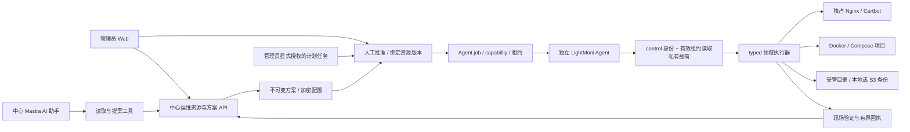

AI 工具只有 `list_operations_resources`、`get_operations_run`、`propose_operations_action`，不会批准或直接执行。所有工具重查当前用户的管理员角色。静态文件和 Compose 正文只向模型提供数量、大小、服务名与镜像等摘要；列表按上下文预算分页，提案保存后只返回 ID、状态与审阅链接，避免大正文导致已保存提案却返回失败。原始业务日志可能包含无法穷举的凭据，因此日志回执只在管理员界面展示，不自动交给模型。AI 可返回 `/operations?run=<id>` 供人审阅。读取现场状态本身也作为明确的只读任务执行，登记配置不等于节点当前状态。

### 26.3 LLD：中心数据、接口与授权

`runtime/src/operations` 按 website、certificate、compose、backup 分别定义配置校验、公开脱敏表示、动作及输入校验。`server/operations.ts` 统一登记、版本、方案和批准；`server/operation-schedules.ts` 只调度受支持的固定动作。SQLite 新增：

| 表 | 数据与边界 |
| --- | --- |
| `ops_resources` | ID、kind、name、agent_id、revision、加密 config、创建/更新时间与创建者 |
| `ops_runs` | 资源/版本、动作、加密不可变 payload、脱敏 preview、授权者、30 分钟有效期、关联 job 与状态 |
| `ops_schedules` | 资源版本、动作、加密输入、五字段 Cron、IANA 时区、启停、授权者、revision 与停止原因 |
| `ops_schedule_fires` | schedule_id＋UTC slot 唯一去重、计划版本、run_id 与触发结果 |

管理员 API 为 `/api/v1/operations/resources` CRUD、`resources/:id/plans`、`runs` 读取、`runs/:id/approve` 和未领取取消，以及 `/api/v1/operation-schedules` CRUD/运行/历史。修改配置使用 revision 乐观锁，资源执行中拒绝修改。网站须成功停用后才能移除执行过的登记；有变更历史的 Compose 保留登记和历史；证书被网站引用、资源被计划引用时拒绝删除。删除登记不销毁远端数据。

批准事务检查方案未过期、资源版本一致、没有同资源进行中任务，然后幂等创建现有 Agent job。普通 job 只含 operation ID、domain 和 capability；不保存证书私钥、S3 凭据等秘密。Agent 必须以 control 身份和 `X-LightMoni-Job-Lease` 读取 `/api/v1/agents/:id/jobs/:jobId/operations`，中心核对节点、租约/任务有效期、动作、批准与 run/job 关联，响应 `Cache-Control: no-store`。Agent 禁止重定向、限制下载 1,200,000 字节，再核对 operation、node、domain、capability 和期限。

阶段沿用 accepted → staging → activating → verifying → succeeded/failed/unknown。成功要求现场验证与绑定该 operation/resource 的回执；中心不接受错配或没有健康证据的成功。已领取任务不能当作安全取消；租约失联、进程中断或部分修改无法确认时保留 unknown，不自动重放写操作。旧 Agent claim 跳过无法提供 capability 的新任务，避免堵住原有任务。

中心以事务确保同一节点只有一个有效任务租约，但租约失效不能证明旧进程已停止。节点写动作另以持久 `<dataDir>/operations/execution.lock` 的独占创建互斥：正常已知结果释放，unknown 或崩溃保留，不按 PID 消失或超时自动解锁。只读 inspect/logs 不获取写锁，供恢复核查。管理员须先确认旧进程与 Docker daemon 等后端动作停止、检查真实状态，再人工移除锁并批准新的方案；只点击重试或 `acknowledge_unknown` 不能解锁。相同节点身份必须使用同一持久 dataDir，禁止克隆身份到多个独立目录。

### 26.4 LLD：网站与证书

网站配置绑定域名、节点、static/proxy 模式、端口、静态文件或 upstream、可选 certificate_id/service_id。默认 HTTP 8088，HTTPS 8443；不会自动抢占已有 80/443 或修改 1Panel/其他 Nginx。小型静态站最多 200 个 UTF-8 文本文件、总文本 512 KiB，并限制序列化大小；不支持任意宿主目录和 ZIP 上传。HTTPS upstream 默认校验系统 CA，管理员显式关闭时在配置中可见。

Agent 在独占目录生成 Nginx 配置、版本和日志。先校验候选，再原子切换、重载，并请求唯一配置摘要端点验证真正生效；HTTPS 另核对实际 peer 证书指纹。失败尝试恢复上版。restore 指向保存版本，disable 验证停用，logs 按行数和 JSON 字节截断。Agent 启动只恢复已有受管网关，不安装依赖或重写用户网关。每次信号操作核对 PID 对应独占 prefix/config，避免操作其他 Nginx。

Agent 私有数据目录 0700、私钥 0600；root master 的 worker 使用 nobody。公开静态资产和 ACME challenge 独立放入 `/var/lib/lightmoni-web/<数据目录摘要>`，目录 0755、资产 0644，不开放整个 Agent 数据目录。证书公开接口只返回 has_certificate/has_private_key 和元数据；私钥加密传送，节点校验私钥匹配、域名和有效期后安装，展示到期天数与指纹。

ACME 采用 Certbot webroot HTTP 验证，不停止已有 Web 服务。前提是同域名的受管 HTTP 网站已在 80 端口生效、外部 DNS/防火墙可达且 challenge 检查成功。issue/renew 为显式任务，周期续期须单独启用计划。首次签发后需将网站绑定 certificate_id 并 apply；已绑定证书的 install/renew 在替换前核对所有实际绑定网站的域名 SAN，随后重载受管网关并逐站核对新连接的实际 HTTPS 指纹，失败恢复旧文件并验证旧指纹。中心也禁止从证书登记中移除已被网站依赖的域名。证书是共享引用，网站方案固定 certificate_id 和自身配置，不能声称冻结了依赖证书文件的历史指纹。崩溃后自动恢复拒绝未与最后验证状态一致的配置/证书，必须人工检查。DNS challenge、通配符、DNS 托管及公网证书实厂商验收不在已验证范围。

### 26.5 LLD：Docker 与 Compose

管理员先登记项目名和受限 JSON Compose 文档，再 discover/inspect 观察；发现不会获得写权限。支持 1～20 服务、显式 tag/digest 镜像、项目命名卷和网络、受限端口、环境变量、启动参数与健康检查。禁止 latest/无 tag、build、宿主 bind、docker.sock、privileged、host 网络及用户指定 external 卷/驱动。环境值、command/entrypoint、healthcheck.test 在公开配置中遮蔽；编辑默认保留旧密文，替换时提交完整文档，不保存遮蔽占位符。

每个写动作带 `expected_generation`，防止基于旧状态执行。显式接管另要求现场 `inventory_sha256` 和 `acknowledge_recreate`，提醒可能短暂停机；项目名一经登记不可修改。受管文件、资源 label 与节点 registry 共同核对归属；接管已存在卷保留其精确名称和数据，不做卷删除。所有 Docker 调用显式使用 `--context default` 并剥离远程 Docker 环境，避免节点用户保存的 currentContext 把任务发到其他机器。apply/start/stop/restart/rollback 检查真正容器状态与健康，启动过程最多有界等待。配置回退使用历史 generation，只恢复配置，不恢复或删除数据卷，不承诺数据库迁移可逆。部分执行失败保留 pending/unknown；重新收敛须先按 26.3 人工核实并解除节点写锁，再以 `acknowledge_unknown` 批准新的 apply/rollback 方案。

此领域与 SDD 021 的 systemd release bundle 分开：本轮提供受管 Compose 文档生命周期，不声称源码自动构建、任意 YAML 导入、Kubernetes 或跨节点发布已经实现。

### 26.6 LLD：备份与安全恢复

备份面向受管普通文件目录，来源和本地存储必须为绝对路径、不可重叠且拒绝符号链接。Linux 全链路径要求 root 管理、不可被业务用户写入（系统 sticky 临时祖先例外）；不支持活动数据库一致性或不受信用户同时修改目录。默认最多 64 MiB/10,000 文件，可配置上限 256 MiB/20,000 文件。

归档为有界 gzip manifest，包含相对路径、模式、内容和 SHA256。创建后回读校验；本地文件以 resource ID 隔离，S3 采用 SigV4、path-style PUT/GET/LIST/DELETE，限定 bucket/prefix/resource ID，不自动创建云资源。显示归档摘要、源摘要、大小和对象版本（提供者支持时）。修改同一 S3 目标可空填复用密钥，换 endpoint/bucket/region/prefix 必须重填；读取不回显密钥。

恢复带 backup_id 与 `expected_target_sha256`，先验证归档路径/摘要及当前目标 CAS，再创建恢复前副本，最后替换与验证。prune 仅清理超出 retain_count 的常规备份，保留恢复前副本；这些副本需管理员后续单独管理，当前不自动清理。列表和清理回执最多展示 100 条并附总数/截断标记，不缩减实际清理范围；已验证恢复的旧目录清理失败只记录 cleanup_pending，不推翻成功恢复。部分写入或补偿结果不能确认时返回 unknown。文件备份有真实本机验证，S3 协议有独立验签 HTTP 验证；未声称已在 AWS/MinIO 上完成供应商验收。

### 26.7 LLD：调度、运行依赖与验证边界

计划支持五字段 Cron（分钟/小时/日/月/星期）与 IANA 时区，UTC 分钟 slot 持久去重，DST 回拨对应不同 UTC slot；中心错过的分钟跳过、不突发补跑。同一计划不重叠，同一资源审批互斥。配置 revision 变化、授权管理员停用/降权、dispatch 不确定或执行 unknown 时停止计划，管理员显式更新重新授权后才在新 slot 运行。每次触发重查 users.active 与 admin 角色。

首期允许 backup create/verify/prune、certificate renew、website inspect、compose inspect；不开放周期任意 shell、恢复、重启或发布。手动运行也使用相同边界与回执，计划启用表示管理员对固定目标/参数的持续授权，不能由 AI 代为启用。

管理员按需为 Linux Agent 准备 Nginx、OpenSSL、Certbot、Docker 与 Compose plugin；中心不需要 docker.sock，节点不能通过模型生成任意 shell。命令用参数数组、shell:false、超时/取消与合计输出限制，不继承 DOCKER_HOST 或中心秘密环境变量。POSIX 中断会终止整个子进程组，但不能据此认定 Docker daemon 的操作也已撤销，因此未知结果保留持久写锁，恢复步骤见 26.3 和 [运维手册](operations.md)。真实 Linux 隔离验证覆盖网站、反代、TLS 轮换、日志/恢复/停用、Compose 生命周期与配置回退；公网 ACME、S3 供应商、生产并发与大容量继续按验收记录说明。规格、输入契约和证据统一见 [SDD 026](../specs/026-operations-platform/spec.md) 及其 validation 文档。


## 27. 任务中心与主机标签（SDD 043）

### 27.1 驱动目标与统一概念

任务中心统一管理平台内置能力与用户自定义任务。任务定义描述做什么，目标描述哪些主机执行，派发创建配置或执行实例，执行记录说明真实结果。内置指标采集、HTTP/TCP 拨测、目录日志使用 Agent 原生处理器；自定义 Node.js/POSIX shell 使用有限脚本处理器。两者共享任务目录、主机目标和单机覆盖，不要求把持续采集改写成重复启动的脚本。

平台初始化直接持久化指标采集、服务拨测、目录日志三条默认任务，默认启用并面向所有登记主机，不再提供独立模板目录。Agent 接入后自动获得适用任务；空拨测目标或空日志目录为 waiting_config，不执行空配置。用户可调整默认任务配置、目标和启停，通过停用停止默认任务；新建任务直接编写或上传脚本。升级一次性补齐缺失默认任务，保留已有 ID、参数、目标、主机覆盖和停用选择，重启不重置。

主机工作台采用“主机 / 任务中心 / 主机标签”。主机列表只展示分类标签；实际任务、单机覆盖和执行记录放在详情与任务中心。原生任务用持续配置状态反映应用情况，不伪造 succeeded 脚本执行记录。

### 27.2 HLD：控制与执行路径

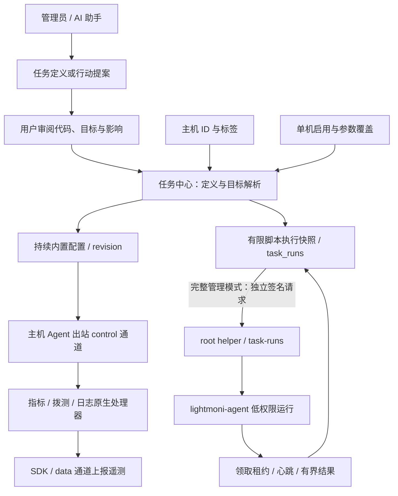

业务 SDK 继续独立直报中心。Agent control 仅用于遥测控制与配置同步；任务脚本由完整管理模式下 helper 的签名身份领取，快照固定 Agent UID/GID 与权限代次，Agent bearer 不提供脚本通道。普通脚本与常驻 Agent 共用账号，可读取该账号可读的凭据和修改可写状态；环境不注入 SSH、helper 私钥或中心模型 Key。AI仅能生成持久化提案，不能调用apply或绕过用户审阅直接执行脚本。

### 27.3 LLD：主机标签、任务定义和优先级

machine_host_labels(machine_id,label_id) 关联平台主机与标签目录；已安装 Agent 的历史标签一次性迁移到对应主机。无 Agent 的主机也可以设置标签；移除/卸载后保留，重装读取同一主机关系。Agent heartbeat.group_id 不能授予主机标签，避免持有 control credential 的节点自行扩大脚本接收范围。主机名称由用户设置，主机 ID 由平台产生；不向业务环境注入 SDK 主机变量。

Task 包括 id/name/type/enabled、origin、target_all、host_ids、label_ids、config、schedule 及脚本专用 script/execution_policy。原生持续任务类型为 host/probe/log，有限脚本为 script；来源仅由服务端初始化或既有记录决定，展示为平台默认/用户任务。新建仅允许 script，更新锁定类型和来源，默认任务不能删除；既有用户原生任务保留编辑能力。目标是全部主机、明确主机 ID 或任一相同标签的并集；空目标不广播。单机 override 覆盖启用状态及内置参数，清除后恢复继承。同一主机匹配的自定义指标任务覆盖内置指标基线；多个自定义指标任务仍需通过表名与采集间隔冲突检查。

脚本定义包含运行时 shell/node、源码、超时和输出上限，可选参数数组 args 和远端绝对工作目录 cwd。上传与直接编写最终保存同一份代码，上传文件不会作为可变路径在后续执行时读取。任务 revision 包括代码、目标、计划和执行策略；手动派发和显式重试携带 expected_task_revision，事务内拒绝已变化的旧预览。源码最多 64 KiB、超时 1–3600 秒、输出 1–256 KiB；args 最多32项/总8KiB，cwd 最多4096字节。continuous 仅用于原生采集；脚本 once 表示手动，at 为指定时间一次，interval 为10秒至30天固定间隔，cron 为五段表达式加 IANA 时区。保存时统一校验模式专属字段、目标、脚本、采集冲突及服务端来源/类型约束。

### 27.4 LLD：执行快照、租约与调度

task_runs 保存任务、主机、当时的 Agent 身份、脚本和运行参数的不可变快照，以及 trigger、requested_by、retry_of、superseded_by、状态、租约散列、有限 stdout/stderr、退出码与时间。resolved_at, resolved_by, resolution_reason 记录管理员对 unknown 的人工核对决议。执行列表只返回状态摘要，完整输出和代码通过单条记录读取，避免历史列表随着脚本和输出长度无界放大。用户执行记录接口不返回 lease_token，领取时仅向对应 Agent 返回一次原始凭证。运行记录不引用可被后续修改的源码来执行；显式重试读取当前定义，必须重新审阅，并建立关联的新记录。

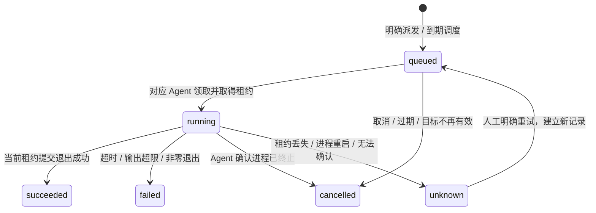

图中 unknown 到 queued 表示经审阅创建关联新执行，旧记录保持 unknown，不改写历史。领取租约有效期为60秒；新脚本队列等待默认1小时，可配置10秒至24小时，已有排队项保留原截止时间。中心按 task/host 防止重叠，单个 Agent 只领取一个脚本；每任务全局并发默认10，可配置1–100。task_schedules 持久化定义摘要和下一次时间，task_schedule_consumptions 按 task_id/run_at 保存单次消费；中心计算日历和固定间隔，不向主机安装 crontab。默认每5秒扫描，正常容差15秒；超出容差或启动前已到期的槽位不补跑，重启不重置未来计划。at 被消费或错过后不因重启、停用/启用而重放。

自动重试默认关闭，可明确设置最多3次及10秒至1小时的等待间隔；只接受 failed 且错误码为 script_failed/runtime_unavailable/timeout/output_limit 的明确回执，沿用原代码、参数及策略快照，创建独立 retry_of 记录。任务版本、有效目标、Agent 绑定或外部授权变化时停止重试；unknown、控制丢失、租约或队列过期、取消不自动重试。显式人工重试仍审阅当前定义。当前状态图只描述原运行状态，失败后允许的自动重试同样是新记录，不把 failed 改回 queued。

基础脚本接受task.script.v1或v2；非空args/cwd必须task.script.v2，旧helper显示需升级，不会静默忽略选项。中心在 `/api/v1/privileged-executors/:id/task-runs/claim`、`/:runId/heartbeat|result|reconcile` 校验helper签名、主机/Agent/安装代次及任务账号快照。仅新鲜签名helper心跳会开放脚本能力。取消queued直接终止；取消running等helper终止进程后回执。控制失败或父进程关闭终止脚本，独立监督进程保留截止时间并检测helper父进程。helper私有恢复标记和签名请求journal重交已得结果，不重执行；无法确认时保持unknown并等待人工核对，不提供分布式exactly-once。

脚本文件与监督器保存在root控制的任务目录，每次运行目录归统一的 `lightmoni-agent` 所有；可显式指定远端绝对cwd，不静默回退。仅使用固定解释器，args原样传入，不通过环境注入Agent control/data credential，但同UID脚本能够读取Agent账号可读的配置和凭据；Unix按进程组处理超时、取消和输出上限。普通任务受该账号的系统权限限制，与常驻Agent共享可读凭据和可写状态，不是虚拟机或容器沙箱。运行中或未核对unknown阻止主机删除、身份替换或Agent卸载。管理员人工核对后填写原因并确认结束，保存 resolved_at/resolved_by/resolution_reason 后解除阻塞；历史仍为 unknown，不执行、不改成功、不接受晚回执。此决议不证明远端进程已停止，AI 不提供人工核对替代工具。

### 27.5 LLD：接口与 AI 审阅边界

- /api/v1/agent-tasks：统一任务定义目录；内部旧路径不等于产品概念。
- /api/v1/task-hosts：不含 SSH 秘密的主机目录；模板目录接口已移除。任务创建仅接受脚本，默认任务删除返回409。
- POST /api/v1/task-schedules/preview：管理员预览计划规范化结果与未来最多五次时间，不保存或执行任务。
- /api/v1/host-labels 与 /machines/:id/labels：主机标签目录与归属。
- /api/v1/machines/:id/tasks 和 /task-overrides/:taskId：单机任务、覆盖与恢复继承。
- /api/v1/agent-tasks/:id/dispatch、/task-runs、/task-runs/:id/cancel|retry|resolve：明确派发、记录、取消、重试与人工核对结束。
- `/api/v1/privileged-executors/:id/task-runs/claim`、`/:runId/heartbeat|result|reconcile`：完整管理模式helper出站签名领取、租约、结果与回执核对；不再提供Agent bearer脚本路由。
- /api/v1/assistant/task-proposals/:id 和 /apply：用户查看与明确确认任务行动提案。

平台写接口仅管理员可用，普通成员通过安全主机目录和任务接口只读访问。AI 工具提供 list_tasks/get_task、list_task_runs/get_task_run、propose_task_action/get_task_proposal；没有 apply 或直接执行工具。提案支持创建/修改任务、派发、取消、重试，保存所有者、会话、前后差异、目标绑定摘要与 15 分钟有效期，正文及审计加密保存。用户批准时，在同一数据库事务中重新核对任务定义、主机/Agent/标签/单机覆盖或执行状态，再提交变更和审批回执；重复确认返回已有结果，不产生第二次派发。AI 的执行查询只提供有限状态元数据，原始主机输出与领取凭证不进入模型上下文。

### 27.6 验证与边界

验证必须覆盖真实数据库迁移与重启、未安装主机标签、重新接入继承、默认拨测待配置、成员权限、派发原子性、快照不变、领取隔离、租约失效 unknown、结果重试、取消、当前定义显式重试、周期不重叠、不追赶、真实子进程超时/输出上限/最小环境以及浏览器任务操作。仅有任务 enabled 或创建 queued 记录不能声称主机已执行成功。发布到真实用户主机需要新 Agent 包；本地受控子进程验收不等于 vchive 或生产发布验收。

### 27.7 脚本创建与日历调度（SDD 048）

任务宽抽屉的新建入口直接打开脚本编辑器，不再选择模板。UTF-8 .sh/.js/.mjs 文件经64KiB、编码和NUL检查后填入同一编辑器，用户可继续修改；替换已有内容前确认，不新增二进制执行或可变文件引用接口。Node.js 沿用 ESM 语义。表单依次展示执行内容、计划、目标与高级策略，实时预览实际匹配主机和 Agent 就绪状态；手动和 AI 创建共用 normalizeTask。

日历计划提供每天、每周、每月控件和高级 Cron，保存同一五段表达式与 IANA 时区；后端 preview 和 scheduler 共用 cron-parser 5.10.2，返回明确UTC时间并按所选时区显示。America/New_York 春季不存在的02:00转为03:00，秋季重复的01:30只取第一次；每月不存在的日期跳过。指定时间一次保存 UTC run_at。保存草稿不执行，明确启用表示授权后续按计划派发；AI 仍先保存提案，再由用户批准。重叠固定跳过、历史错过不补跑，重试需显式配置且不会自动重放 unknown。完整设计和使用说明见 [脚本任务创建与调度](task-authoring.md) 及 [SDD 048](../specs/048-task-authoring-schedules/spec.md)。


### 27.8 平台默认任务与统一目录（SDD 049）

默认任务是持久化的真实 Task，与用户任务共用目标、启停、单机覆盖和状态目录；不再保留 template_id 或独立模板 API。新库创建三条默认任务，旧库通过 platform-default-tasks-v1 一次性事务补齐，已有默认定义和运行历史不重写。主机尚无 Agent 时等待接入，后注册或重装后按当前目标自动获取任务；停用、排除目标或单机停用后不采集。

原生持续处理器使用配置 revision 与应用状态，有限脚本使用 TaskRun、快照及租约，不为每次采样生成执行记录。Agent 心跳、鉴权、配置领取和结果回传属于基础协议，不作为可停用任务。移除模板元数据可能使旧定义 revision 变化，旧预览及旧版本自动重试按现有校验拒绝；普通已排队或运行中的执行继续沿用已审阅快照，历史和单次消费记录保持，不自动重放。平台来源仅服务端生成，新建脚本或更新任务的人工/AI路径共用校验及审批。详见 [SDD 049](../specs/049-platform-default-tasks/spec.md)。

## 28. Agent 版本、升级与回退（SDD 045）

### 28.1 驱动目标和职责

更新中心镜像只更新平台与可下载发行物，不会改变用户主机正在运行的 Agent。主机管理分别展示 Agent 报告的运行发行身份、可用发行与维护结果。管理员点击单机升级即授权本次维护：中心只读探测架构，选择该架构最新的已验证发行，固定摘要和现场指纹后直接派发；窗口按原操作 ID 展示持久阶段日志。回退和串行批次仍采用独立计划与明确审批，AI 仅可查询和准备计划。原生命周期设计见 [SDD 045](../specs/045-agent-lifecycle-updates/spec.md)，单机直达升级见 [SDD 133](../specs/133-direct-agent-upgrade/spec.md)。

Agent 常态以专用非 root 用户运行。自身程序和 systemd unit 由 root 管理；本轮维护继续使用主机的 SSH root/免交互 sudo 通道，运行独立的固定维护器。业务任务仍通过 Agent 出站 control 通道派发，无需中心入站连接 Agent。升级不重新 enrollment，不替换 Agent ID，不注入 SDK 主机变量，SDK 继续独立直报。

### 28.2 HLD：审批、独立维护与中心确认

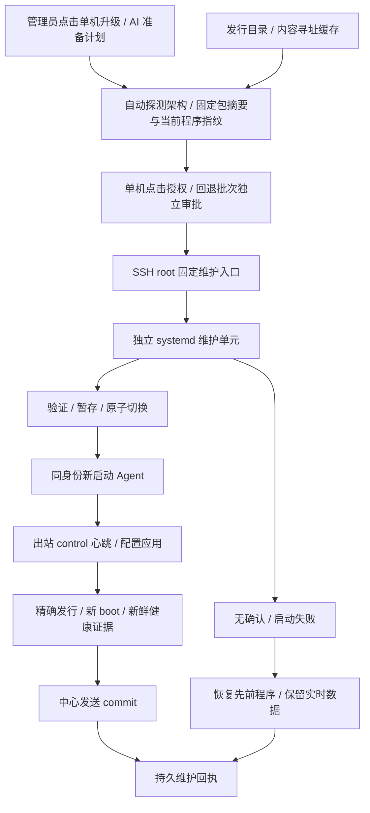

维护器生命周期独立于 SSH 会话。等待中心确认期间，平台断线不代表成功；维护器达到确认期限后自动尝试恢复原程序。掉电可能中断维护器，不能承诺系统未运行时完成恢复；远端持久事务和程序指纹供恢复后核对，平台不自动重复切换。

### 28.3 LLD：发行身份与固定下载

AgentRelease 包含 version、source_revision、build_id、state_schema、platform、arch、file、sha256。version 只是展示信息，同版本不同源码或编译内容必须具有可区别的构建身份。包内 release.json 声明源码和状态兼容域，外部清单保存整个 tar 包 SHA256，避免自身摘要循环依赖。首装和升级在对应受管发行目录保存不含秘密的安装摘要。

运行进程从自身代码所属发行目录读取 release metadata 和安装摘要；不能动态读取 current 链接后把仍在运行的旧进程误报成新程序。每次进程启动产生新的 boot_id，心跳携带 release 与 boot_id。旧 Agent 无此信息时显示未知；平台不得只靠 version=0.1.0 判断更新或升级成功。

中心生成计划时校验发行清单与包，保留不可变内容寻址副本，固定维护脚本和包摘要，避免更新平台镜像或替换 downloads 文件改变已批准内容。短期维护下载票据限定计划、目标主机和文件，中心仅保存散列，通过 SSH stdin 输入，root 私有临时文件用于 curl 鉴权；票据不放 URL、命令参数、普通环境变量或 AI 上下文。该 scope 与 enrollment、control、data 完全分离，不能用于创建节点身份或任意文件下载。

### 28.4 LLD：维护事务和数据兼容

SSH 计划核对目标主机、公钥、Agent ID、受管路径/unit、当前程序指纹、服务运行状态、发行架构和权限；冻结当前主机连接 revision、Agent 归属、当前程序指纹、服务运行状态与目标摘要，15 分钟后失效。中心执行前、远端维护器接收及切换前再次核对；不一致时拒绝旧计划，避免失败恢复采用未经审阅的运行状态。尚未领取、没有启动证据的 queued 任务保持排队，可等待维护完成；已领取、运行中、结果 unknown 或无法证明未执行的工作，以及其他生命周期计划或执行锁仍阻止维护。维护期间阻止新增/领取冲突任务、重绑定、卸载与删除。

root 私有事务目录保存请求、备份与 receipt。维护器取得固定生命周期锁，验证暂存包及配置后，保留原 launcher/unit/current 并原子切换程序；配置、control/data credential、identity、SQLite 队列、日志游标、任务回执均保持原路径和内容。普通服务保持专用非 root 用户及现有 systemd 权限边界。

维护状态包括准备、切换、等待确认、成功、已回退和失败。中心只有同时看到远端等待确认、同 Agent ID 的目标包摘要/build/schema、新 boot、新鲜心跳、已应用配置且无控制错误，才发送 commit 并记录 succeeded。本地 systemd active 只能作为存活证据，不能单独作为平台升级成功。

本轮只支持相同 state_schema=1 的程序升级和回退；受管旧 0.1.0 Node 包须经过明确识别，未知 manifest/schema 拒绝自动维护。旧包可作为升级来源及失败自动恢复目标，显式回退目标必须提供完整发行和新 boot 证明，缺少 metadata 的旧包不降级为猜测成功。回退恢复程序和 unit，保留实时队列；不恢复旧数据快照以免丢失升级后遥测或重复已确认数据。跨 schema 迁移需要独立 SDD 和恢复方案。显式回退也创建新审批计划，目标固定为保留的上一发行，重新验证指纹与健康；受管新程序已经故障停止时仍可核对身份与文件后准备回退，普通升级来源则必须健康。

### 28.5 LLD：不确定结果与批次

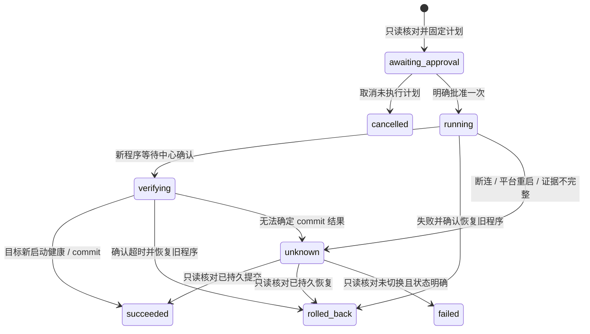

unknown 不自动重跑。核对读取原操作 receipt、真实 Agent 身份和当前程序；waiting_confirmation 不由核对自动提交，等待远端确认期限处理。原 SSH 凭据失效时可提供新有效凭据；结果证据仍须绑定同一操作和目标，不把另一次维护状态当本次成功。若远端已经持久提交但确认响应丢失，随后 Agent 又正常重启，核对以当前只读程序指纹、精确目标发行、新 boot 与新鲜心跳独立验证当前健康，在 receipt.current_verification 保存核对证据，并保留原提交 boot 历史。回退失败或部分结果保持未知并阻塞冲突操作；掉电、强杀导致 accepted/preparing 遗留且维护器已停止时同样保守保留 unknown，管理员通过外部 SSH 检查持久事务和对应 systemd 单元，不凭无锁观察自动清除。

批次最多 20 台，逐机保存不可变计划与结果，默认串行。失败、已回退或 unknown 自动暂停后续机器；继续须重新明确批准。取消只取消未启动项，已开始操作继续由自身健康/回退协议结束，历史保持真实结果。平台重启暂停批次并把未确认执行记 unknown，不自动重放。批次本身完成不替代逐机成功证明。

### 28.6 LLD：接口与 AI 边界

发行目录使用 GET /api/v1/agent-releases；管理员单机直达升级使用 POST /api/v1/machines/:id/agent-updates/start，请求 `{}`，中心自动选择目标并在同一请求中准备和派发。单机计划、历史、审批、取消、核对仍使用 /api/v1/machines/:id/agent-updates，历史回读增加固定阶段与时间事件；批次使用 /api/v1/agent-rollouts。平台写操作仅管理员；成员只读安全版本和状态。接口不接受用户任意维护脚本、远程路径或 sudo 命令；阶段事件不存储 SSH 原始输出或凭据。下载接口独立验证操作 scope，不接受 SDK Key 替代。

AI 工具 list_agent_releases、propose_agent_update、get_agent_update 只返回安全 metadata、计划、结果和审阅链接。准备计划可执行固定只读 SSH probe；助手不能 apply、commit、执行回退或读取下载票据、原始 SSH 输出和主机秘密。rolled_back 表示本次更新未成功但原程序已恢复；unknown 需要核对，不能被助手改写为完成。

### 28.7 任务中心的统一演进方向

后续将任务中心作为外部 API、平台界面与 AI 共用的任务提交和执行记录入口。任务定义描述动作及参数，执行实例固定目标主机/Agent、代码或结构化参数摘要、来源、发起人、审批、幂等键、状态和结果。自定义脚本与平台内置结构化能力并存；结构化文件、服务、部署等能力应显式声明 capability、参数 schema、影响级别和验证策略。AI、外部客户端和平台页面复用相同权限、审批、目标解析与执行服务，不能创建绕开记录的 Agent 命令通道。

统一入口和记录保留底层执行策略：持续采集使用配置 revision；有限脚本使用租约与退出结果；服务部署使用分阶段健康回执；Agent 首装/升级使用 SSH 生命周期与独立维护确认。主机检查等短操作可同步返回执行结果，耗时任务异步返回执行 ID，均记录来源、授权和目标；交互式能力另用会话协议，关联授权、开始、结束及退出状态，不把每次按键拆成任务，也不将终端原始输出持久化或发送给模型。高频采样不逐条创建任务执行记录。首次安装尚无 Agent 可接收任务，仍通过 SSH。周期任务与单次任务均归属明确主机，结果未知不会被幂等重试偷偷重放。

本轮交付 Agent 维护自身的计划、审批和完整结果 API；SDD 047 已交付用户主体的 MCP 专用 PAT/OAuth、role/scope 与主机范围授权，任务提案复用平台审批。跨脚本、业务运维、Agent 生命周期的完整统一执行读模型、服务主体及自定义 typed action 注册表仍属于后续单独 SDD，不将已有分散接口声称为完整统一外部任务 API。

## 33. 网站、DNS、证书与 Docker 服务托管（SDD 033）

2026-10-29。用户批准整体重构并明确尚未上线、无需旧模型兼容。此章描述 SDD 033 分支实现，合入和真实外部服务验收以对应 PR/validation 为准；第26章的网站、证书与容器描述由本章替代，备份/计划和恢复说明继续适用。

```mermaid
flowchart TB
  ops033_admin["管理员工作台 / 五核心能力"]
  ops033_api["中心资源与策略 API / revision / 持续授权"]
  ops033_db["SQLite + 加密版本 / 资源 / 成员 / 逐机执行"]
  ops033_reconcile["领域独立收敛 / 部署 / 续期 / 分发"]
  ops033_cloud["中心云适配器 / DNS / ACME / 三云 CDN"]
  ops033_job["逐机器 Agent job + lease / 私有载荷 / 成员守卫"]
  ops033_agent["独立 Agent / 本机执行 / 持久写锁"]
  ops033_app["Docker / Compose / 应用与托管服务实例"]
  ops033_gateway["OpenResty host 网关 / 多路径 / 静态 / 服务入口"]
  ops033_target["证书目录 / 更新脚本 / 版本去重 / 显式环境"]
  ops033_receipt["现场状态与有界回执 / 健康 / 指纹 / 负载 / unknown"]
  ops033_admin -->|配置与人工确认| ops033_api
  ops033_api -->|加密状态| ops033_db
  ops033_api -->|授权策略| ops033_reconcile
  ops033_reconcile -->|中心签名请求| ops033_cloud
  ops033_reconcile -->|逐机派发| ops033_job
  ops033_job -->|control + lease| ops033_agent
  ops033_agent -->|部署 / 探活| ops033_app
  ops033_agent -->|完整版本包| ops033_gateway
  ops033_agent -->|材料与脚本| ops033_target
  ops033_gateway -->|健康 IP + 端口| ops033_app
  ops033_app -->|状态 / 负载| ops033_receipt
  ops033_gateway -->|HTTP / TLS| ops033_receipt
  ops033_target -->|逐目标结果| ops033_receipt
  ops033_receipt -->|绑定回执| ops033_api
```

### 33.1 组件职责与资源模型

中心仍是 Node.js/TypeScript 模块化单体，SQLite 保存管理状态，ClickHouse 保存遥测；未引入 Consul、Kubernetes、第二个中心或中心 Docker socket。runtime/src/ops 统一全局 credential、dns_zone、acme_account、certificate、certificate_target、application、service、node_pool、gateway_group、website。应用描述 Docker 单容器或 Compose 声明；部署/实例绑定机器；托管服务声明资源、副本和端口；网站声明域名、HTTPS 与静态/反代/服务目标。OpenResty 是 host Docker 系统应用，多网站共享网关组内的进程。

### 33.2 存储、版本与执行

ops_platform_resources 保存 revision、加密 spec、脱敏 status 和授权者；ops_platform_revisions 保存不可变配置快照；ops_platform_runs 保存加密请求快照/输入、逻辑去重键、执行状态和脱敏结果。ops_platform_run_events 按执行 ID 和递增 sequence 保存最多 2000 条脱敏步骤；实时日志从 SQLite 读取并通过事务 outbox 投影到系统日志。ops_platform_instances、ops_platform_ports 保存实例、资源与端口预留；ops_platform_nodes 保存 Agent 只读容量观察。证书版本、ACME 账号/订单/挑战、DNS 观察/归属及云证书映射分别持久保存。配置保存与应用发布分开；发布冻结 desired_revision，托管服务同时冻结 application_revision 和 node_pool_revision。新配置需显式发布才进入持续维护。

### 33.3 鉴权、私有载荷与调度

管理员 API 为 /api/v1/ops，统一 revision、confirmed、资源引用和可用动作检查。人工动作和已启用的持续策略记录授权者，每次新派发重查管理员有效性。新建证书在资源事务内保存首轮执行意图，提交后立即建立后台执行；创建返回 201、手动申请/续期返回 202 与执行 ID，不等待 ACME/DNS。首轮执行与 auto_renew 开关独立；同一证书共享活动执行。领域各自维护 in-flight，慢 DNS/ACME 不阻塞工作负载轮次；网站 DNS 刷新另有并发上限。新 Agent 动作使用 operations.platform，复用现有 control 身份、job lease 和 /agents/:id/jobs/:jobId/operations 私有下载；普通 job 仅含 ID。成功回执必须匹配 operation/resource/node 并有现场验证；中心拒绝陈旧或撤权载荷。关闭时拒绝新动作，等待已开始的领域/云动作再关闭存储。

### 33.4 DNS 与 ACME

阿里 DNS 与 DNSPod 通过固定官方 HTTPS 端点签名请求，支持全量分页 CRUD/启停和管理 scope；五分钟有界只读同步观察外部修改。人工可管理授权范围内记录，网站/ACME 自动化只维护已记录归属和 Record ID 的记录。API 接受、平台回读和公网传播是不同状态。ACME 在中心使用持久账号密钥、订单、CSR 和 DNS-01 挑战，精确创建/清理本订单 TXT，支持同名多值与通配符；不把 DNS 凭据下发到网关。账号、订单、DNS 写入/传播、挑战提交/核验、证书下载/保存和 TXT 清理分别写步骤日志；失败保留阶段、可用的 CA problem 说明、类型/HTTP 状态/云 Request ID，敏感值过滤后才持久化。创建订单结果不确定或中心重启时记为 unknown，不自动重放。

### 33.5 证书版本与三类分发目标

证书支持 ACME、上传、自签；公私钥匹配、SAN、有效期和指纹均校验。材料与不可变版本加密保存，普通资源接口只显示元数据和 has_*。管理员通过 GET /api/v1/ops/resources/:id/certificate 按需查看当前已保存版本的公开 PEM 与元数据；POST certificate/download 按 certificate_id 与不可变 version 精确导出 cert.pem、chain.pem、fullchain.pem 或 privkey.pem。查看 JSON 只白名单返回公开材料，缺失中间链时不伪造。下载固定版本，续期切换不改变已打开版本的下载内容；失败续期仍可查看既有版本。上传证书只能提醒到期；ACME/自签可显式启用自动续期，窗口按实际有效期计算，尚未接入 ARI；失败续期可人工重新 issue/renew，不宣称完整自动退避已实现。网站首次发布 HTTPS 时，材料缺失或过期可调用同一可追踪签发流程，内部等待（或等待已有执行）取得材料后再继续部署；管理员 HTTP 创建/签发接口不等待。上传材料也在后台校验并导入；编辑既有配置不会自动签发。证书目标分别为 Agent 目录、云 CDN、更新脚本，各自记录 desired/applied 版本与结果。证书新建只接受单个域名或泛域名，规范化域名派生名称；历史 ID、材料、执行与引用不变，已有多域名保留原集合。同步任务归属对应域名证书展示。目录目标可选单机或集群：中心解析当前全部成员及 Agent 绑定，预检后按机器独立派发，以任务 revision、证书版本、机器和 Agent 去重；逐机回执均核对当前版本与指纹后才整体 applied。持续授权补齐新证书和新增成员，失败/unknown 不自动重放；显式 retry 保留成功成员，unknown 须先现场 inspect。

### 33.6 云服务、脚本与凭据边界

首批云目标覆盖阿里云、腾讯云、火山引擎 CDN HTTPS 域名。阿里 CDN 直接部署 PEM；腾讯 SSL 上传后更新 CDN；火山证书中心上传后部署 CDN。云映射保留远端证书ID，上传/绑定/逐域回读分别核实；HTTP 200、上传成功或某一域成功不替代全部目标生效。云凭据、ACME 账号密钥只由中心加密使用。证书私钥可由有效管理员显式点击独立 POST 附件下载，按请求从加密版本解密，不进入查看 JSON、普通资源、日志、URL 或 AI/工具；复用会话及同源检查，查看和下载响应 no-store，附件文件名仅使用安全 ID/版本。目录按受管版本落盘并切换指针，私钥权限受限。更新脚本由管理员固定 Agent、解释器、正文、显式环境和超时；正文与环境加密，不在普通摘要回显，也不送 AI。脚本通过证书临时文件路径及版本元数据获得材料，具有 Agent 本机权限，无沙箱承诺。集群目录私有载荷返回前，中心重查当前集群成员、机器与 Agent 绑定、Agent 未移除、证书当前版本、任务 revision 和执行授权；离群、换绑、撤权或旧版本拒绝读取。已交付节点的材料不能远程撤回，迟到的旧配置/版本/离群成员回执不覆盖当前逐机聚合。普通资源摘要不复制逐机私有材料，复用现有 control + lease 与加密快照，不新增节点协议。

### 33.7 幂等、未知结果与恢复

证书目标按目标修订＋证书版本持久去重，云上传复用已保存远端ID。unknown 不自动重放任意脚本或不确定写入；inspect 可只读核对云配置、目录指纹或脚本成功标记，未核实的 unknown 不允许 retry。核对目标不会自动清理节点持久 unknown 写锁，旧进程/daemon和现场状态仍需管理员核查。回执和错误只保存安全码、ID及有界摘要，不返回私钥、脚本环境或任意 stdout/stderr。历史中心 verifying 表示等待读回，不作为永久编辑忙锁；真正执行中的中心动作和活动 Agent lease 才阻止冲突编辑。

### 33.8 Docker 应用与轻量调度

Agent 使用本机固定 Docker context 执行单容器/Compose。平台管理配置文件、只首次写入的初始化文件、数据目录和 Docker volume；停止/移除容器不删除业务数据。资源和端口在 SQLite 事务预留，实际端口在节点复核。机器池可显式设置容量，也可经 node.inspect 获取 CPU/内存/IP/Docker 能力。调度基于在线机器、容量、端口与副本分散；现有副本按健康回执逐个更新，健康连续失败时有界重建。服务发现提供新鲜健康实例的机器可达 IP＋发布端口，要求机器之间已有可达网络；没有自动 overlay 或本地数据复制。

目标权限迁移采用第60章的独立执行器（SDD060，分期实现）：普通 Agent 不获得 Docker 组/socket，受限容器计划由 root 执行器二次校验。host network 网关、任意 hook、受保护证书/目录和 systemd 不能整体继承容器权限；未迁移入口应拒绝特权操作，不能隐式提权。

### 33.9 网站、网关与流量

网站支持静态文本文件、手工 HTTP(S) 反代和托管服务。网站仅在显式启用后进入网关完整版本包；域名在组内唯一。Agent 按版本暂存站点/证书/静态文件，检查 OpenResty 配置后切换、重载并实际验证 HTTP 内容与 TLS 指纹，失败恢复旧版。服务路径无健康后端时仅该路径返回503；多路径与Nginx可配置能力见33.11，端点变化重编译对应上游。网关在 Linux host 网络直接监听端口；已验证健康网关的公网地址进入平台拥有的 A/AAAA，关闭网站移除自身拥有记录。DNS TTL 不提供即时故障切换保证。Agent 失联不等于容器停止，不据此释放端口或静默迁移本地数据。

### 33.10 界面、验证与支持范围

网站与运维提供五核心页签和共享基础设施，应用/服务列表显示机器和现场负载，证书显示到期和逐目标结果，表单支持中英文/主题/窄屏、失败保留输入。旧 /services 用户入口转向托管服务。代码验证覆盖 SQLite/HTTP/有效 Agent 租约、真实自签/目录/脚本、协议签名/分页/ACME 生命周期及调度故障；真实 Linux Docker/Compose/OpenResty 与 UI 夹具和实际 SQLite 页面验收分别记录。真实云账号/CDN边缘传播、公网 ACME 发证和大规模生产负载未获现场验收，不由夹具代替。详见 specs/033-operations-control-plane/validation.md 和 docs/operations-platform.md。

### 33.11 Nginx多路径与站点配置

网站配置新增 nginx 站点设置与 locations 路径规则，作为加密不可变网站版本保存。中心与 Agent 共用 runtime/src/operations/nginx.ts 校验与编译；中心在组包时将每条托管服务路径解析成新鲜健康端点，只有无后端的对应路径返回503。支持精确、最长前缀、^~ 与有序正则匹配；独立上游及加权轮询/最少连接/IP哈希、URI保留/去前缀/替换、Host/SNI与TLS校验、WebSocket、超时/缓冲、请求与响应头、CORS及OPTIONS、访问控制、上传和速率/连接限制。站点提供HTTPS跳转/HTTP2/TLS、Gzip、静态索引/SPA/缓存和日志。反代缓存使用各站点路径独立临时区域，默认绕过Authorization、Cookie与升级请求。server/location补充片段按词法边界限制上下文，拒绝include、动态脚本和全局/文件越界指令；其他语法由真实nginx -t验证，失败保留活动版本。管理员 GET /api/v1/ops/resources/:id/nginx 提供保存修订的脱敏预览，隐藏自定义片段和敏感头值，只展示证书占位路径，不读取PEM、不部署、不声称现场已验证。控制/租约及完整版本检查、切换、HTTP/TLS回执通路不变。

## 第42章 集群与应用统一部署（SDD 042）

2026-10-30。本章描述codex/042-cluster-applications最终跨集群首版，替代第33章独立机器池、托管服务、网关组及单集群应用/网站模型。第33章DNS、ACME、证书、云分发、脚本和执行安全边界继续适用。分支实现与验证记录以SDD042为准，不声称已合入main。

```mermaid
flowchart TB
  template["商店模板 / 自定义程序"] --> app["全局应用 / 唯一serviceName"]
  app --> a["集群A部署 / 实例数与大小"]
  app --> b["集群B部署 / 实例数与大小"]
  site["网站公共配置 / 域名 HTTPS 超时"] --> resty["各集群OpenResty / host80+443 可托管"]
  resty --> local["仅本集群健康服务 / 命名端口"]
  resty --> dns["网站CNAME / 线路与权重 / 集群稳定入口域名"]
```

### 42.1 集群与稳定机器归属

公开运行资源为cluster、全局application和全局website。一台稳定managed_machines.id只属于一个cluster，ops_platform_cluster_members以machine_id主键在资源保存事务内约束唯一。Agent重装不改变归属；agents.group_id继续表示采集标签。运行实例使用中的机器不能直接移出，仍属集群的主机不能从主机目录删除，非空集群不能删除。

### 42.2 全局应用与集群部署

商店模板或自定义镜像/Compose生成普通application，一份模板可安装多套独立应用。name为可重复展示名；service_name全局唯一且创建后不可改，默认模板英文标识加序号，小写字母/数字/短横线、首尾字母数字、最长63字符。应用共享运行配置、命名端口与manual/managed模式；deployments按cluster分别设置手动机器或托管实例数、每实例CPU/内存。持久部署状态以application_id+cluster_id为键分别冻结发布修订和授权者，一处发布不升级另一处草稿。

### 42.3 实例、端口与发现

ops_cluster_instances显式保存cluster_id，活跃slot按owner+cluster唯一，退役attempt保留到原节点确认清理。ops_platform_instance_ports保存每实例全部命名端口，ops_platform_ports提供宿主协议/端口排他预留。manual不自动换机或补副本；managed仅在对应集群选择满足容量和全部端口的机器。两种模式均支持固定host_port，冲突不能改号；中心排除已知占用，Agent现场复核，已知占用失败退避该候选并选择其他机器，无候选待调度。serviceName+cluster_id+port_name只返回新鲜健康端点，网站严格当前集群发现，无跨地域隐式兜底。

### 42.4 OpenResty托管与完整配置

OpenResty是role=openresty的全局唯一应用，可部署多个集群，每集群一项部署。已安装应用可编辑部署集群、机器、副本和资源；运行中的部署先停用清理再移除。每个入口部署保存稳定gateway_domain，可选gateway_dns_zone_id托管健康入口A/AAAA；未选择时由用户维护。manual选择机器，managed设置实例数和资源；Linux host网络固定80/443。内部gateway.apply/inspect/stop/remove复用Agent执行器，owner仍为application。每集群完整网站、证书和静态文件包逐机nginx -t、切换、重载、HTTP/TLS验证；失败保留旧版。故障换机完成配置与验证后恢复DNS资格。中心按目标网关实例逐机解析应用上游并计算完整包签名；同集群不同机器的配置可以不同，拓扑或健康变化后沿用调和流程重新发布。

### 42.5 网站公共配置与集群上游

website为全局对象，bindings统一域名、HTTPS、证书、DNS，nginx及locations统一路径、超时、头部、缓存、限流和其他高级选项。routing_mode=managed时选择一次service_application_id和HTTP(S)命名service_port_name，自动发现其部署集群，集群内只解析该服务的健康端点。manual保留locations.cluster_targets逐集群应用端口或代理URL；不支持公共配置覆盖。集群流量策略cluster_policies保存enabled、1–100相对weight、default及厂商线路id/name，独立于冻结网站公共修订；关闭立即退出期望解析，恢复仍需成功回执。公共草稿不能通过流量策略保存被隐式发布。同一网站的domain_routes按domain独立指定cluster_ids与可选cluster_policies；省略范围跟随全部可用集群，固定选择只保留其仍可用的交集，不自动扩大。旧网站无此字段继续继承全站范围与策略。域名范围随发布冻结，每集群完整包只包含绑定到该集群的域名；同绑定组的证书与路径仍复用。候选旧集群仍接收空站点包以清理已移走域名。

平台发现的应用端点与目标 OpenResty 实例 machine_id 相同时，上游 host 使用127.0.0.1；异机继续使用发现的内网地址，IPv6保留方括号。此规则适用于managed托管服务及manual应用端口目标，保留HTTP(S)、命名端口对应的宿主端口、健康过滤与集群范围；用户显式填写的代理URL不改写。发现接口与仅有集群上下文的预览仍显示实际发现地址。依据为现有Linux host网络网关与应用宿主端口模型，无新Agent协议或存储迁移（SDD 058）。

### 42.6 DNS聚合、共享资源与界面

DNS/ACME账号、托管域名、证书和分发目标保持中心加密共享，凭据不下发网关。新网站dns_record_mode=cname，网站以自身为owner，按默认和高级运营商/省份线路维护到各集群gateway_domain的加权CNAME；各域名分别只包含其已绑定、开启、已发布且有新鲜健康入口和成功网站回执的集群，托管服务还须有健康后端。默认在各域名绑定范围内1:1，失效集群在默认与高级线路中撤下，细分线路无目标由厂商回退该域名默认，不能越过域名绑定范围。可选集群入口A/AAAA以全局OpenResty应用为owner维护。旧address模式保留A/AAAA兼容。只修改自身归属记录；线路纳入身份，权重/TTL/状态必须回读。厂商可用线路查询后预检，拒绝不支持套餐或权重，API接受与缓存传播分开。网站页面主体展示用户网站、域名及实际集群、开关、权重、线路与错误；OpenResty部署集群和入口域名收于次要的“OpenResty 管理”抽屉。

### 42.7 控制与兼容边界

中心继续Node/TypeScript+SQLite；cluster-workloads由原workloads组合装配，原加密资源/修订/执行、Agent control凭据和有效job lease保持不变。配置/发布/持续策略由管理员授权，AI不批准或任意执行，生产中心无Docker socket。旧单cluster application/website规范化为deployments和cluster_targets单项，保留资源ID、serviceName、实例ID、数据路径及运行容器；legacy node_pool/service/gateway_group保留历史，不提供新建与新部署。首版商店内置MySQL/Redis/OpenResty，自定义程序通过镜像/Compose发布，源码CI与第三方商店源后续扩展。

### 42.8 现场验证与范围

Demo使用真实SQLite/HTTP、Agent enrollment与有效lease、生产执行器、Docker、MySQL、自定义Web双端口和OpenResty，覆盖网站读写、TLS、Web重建数据保留以及托管入口。多节点QA如使用DinD，明确其为同一物理Docker宿主上的独立daemon/网络命名空间，不冒称多地域实机。测试域Host替代公网DNS、自签证书替代公有CA；DNS聚合协议另行mock验证，不声称公网传播或ACME已验。具体通过项、未验范围和可复现命令见SDD042 validation及examples/cluster-demo/README.md。

### 42.9 网站多集群入口与线路流量管理（SDD 043）

2026-10-30。以上42.4至42.6按SDD043演进。托管网站跟随最近授权发布修订的服务部署新增/移除集群；公共草稿不驱动线上切换。DNS归属日志增量保存line和weight；同值不同线路独立归属，外部修改、未知写入与授权撤销保持保护。阿里云CNAME权重部分接口文档与产品说明有差异，必须实际请求接受且回读权重策略；DNSPod活动权重只使用1–100，0不表示停用。失败不静默回退或冒称成功。域名套餐、省份/运营商线路和缓存传播依赖厂商能力；当前验证用HTTP/SQLite/Agent租约与DNS协议夹具，不声称真实云套餐或公网传播已验。同一绑定组可含多个域名且分别绑定南北集群，共享路径不重复。DNS同时校验期望发布范围与成功应用回执范围；域名级策略独立即时覆盖全站默认策略，不能借保存策略发布绑定草稿。实际集群为已发布域名范围的并集，逐域名状态摘要有字节上限与截断标记。

```mermaid
flowchart LR
  site[网站域名 / 独立集群绑定] --> default[默认线路 / 仅此域名绑定的健康集群]
  site --> special[省份与运营商线路 / 回退此域名默认]
  default -->|CNAME 1| south[南方集群稳定域名]
  default -->|CNAME 1| north[北方集群稳定域名]
  special -->|CNAME| south
  south --> southIP[健康南方入口 A / AAAA / OpenResty 80+443]
  north --> northIP[健康北方入口 A / AAAA / OpenResty 80+443]
  health[中心：域名范围 / 开关 / 健康与发布回执] -->|维护| default
  health -->|维护| special
```

具体规格、数据字段、契约、厂商官方资料与验收记录见[SDD 043](../specs/043-website-cluster-routing/spec.md)。


## 第44章 应用自动观测与统一系统日志（SDD 044）

### 44.1 运维入口与应用目录

集群、应用、网站、域名、证书的操作日志通过页面及资源详情右上图标打开，正文不内嵌执行历史。商店按数据库、缓存、网站与网关分类，支持分类与关键词组合。主机可查询平台应用及全部 Docker（含停止、非平台容器），集群可查询应用；外部容器只发现，不接管。每个应用天然派生监控目录，按集群、部署实例、容器筛选，无需创建大盘或物理表。

### 44.2 Agent 观测与控制归属

Agent 在既有任务配置就绪后独立周期发现 Docker、采集 CPU、内存、网络/磁盘累计字节及进程数，自动读取平台容器 stdout/stderr。中心在认证心跳回包中下发本 Agent 的 application_targets；Agent 用现有实例标签匹配容器，不增加 SSH 采集路径。心跳中的 docker_inventory 仅保留容器 ID、名称、镜像、状态、端口和实例标识，最多500项，显示截断、未接入、采集失败、过期状态。观测权限不等于应用生命周期操作授权。

应用遥测仅接受 Agent data 凭据。中心核对部署实例的 agent_id/owner_id/cluster_id，覆盖应用、集群、主机及 service 归属；业务 Key 不能写系统表。网站访问标识还要求来源为本集群 OpenResty 应用，且网站已配置到该集群。控制面仍使用 control 凭据，凭据不进入标签、URL、正文或文档。

### 44.3 两张独立共享应用遥测表

系统逻辑名 lightmoni_application 独立于平台自监控 lightmoni。全部应用自动负载观测使用同一物理表 `_lm_metric_lightmoni_application_gauge`，全部应用日志使用 `_lm_log_lightmoni_application`。公开视图为 `metric_lightmoni_application_gauge` 与 `log_lightmoni_application`，复用 Catalog、TTL、只读 AST、Query 时间和资源限制；应用数量不增加物理表。自动观测全部为 gauge，包括网络和磁盘累计字节，页面根据相邻采样计算速率并排除重置。业务进程内部指标仍由 SDK 显式打点，不修改用户代码。

日志使用原始 Docker 纳秒时间，stdout/stderr 各自保存时间戳、同时间戳行计数及单调 source_seq。批次与游标原子进入已有 Agent SQLite 队列；重启、满队列、网络断连和丢 ACK 不静默越过未发送数据。每次读取有界前缀，不使用 tail 丢弃积压；大前缀拆成多个批次。超过单行读取/批次预算时保留游标并报告采集失败。轮转或外部删除已丢失的 Docker 原始日志无法恢复，首次采集受7天日志保留窗口限制。

### 44.4 网站流量

OpenResty 在站点 access_log 开启时输出 escape=json 格式，记录网站 ID、HTTP 状态、request_time 与 upstream_addr，不记录查询字符串或请求头。站点配置不能覆盖结构化格式；内部部署健康证明路径不计访问日志。历史运行网关需要发布新配置后产生该格式；显式关闭访问日志时不产生网站请求数据。

Agent 自动将访问记录写入共享应用日志表。网站 QPS（分钟均值）与平均耗时从原始访问日志按事件时间查询，避免另造易重复的请求计数副本。后端应用仅关联保存绑定中匹配的“网站+集群”对；网站流量按集群汇总，容器负载与应用日志可细分到部署/容器。无请求数据与采集失败明确显示，不以离线推导零流量。

### 44.5 全系统日志统一写入 ClickHouse

中心运行日志、Agent runtime_events、运维执行、Agent jobs/events、任务中心执行/取消/结果核对、发布事件、主机安装/卸载/SSH检查、凭据与节点关联事件、定时运维、资源修订/删除、Key 接入、节点移除、终端连接/关闭元数据、告警/响应及 AI 告警提案应用审计统一进入平台系统日志公开视图 `lightmoni_log`，新日志写物理表 `_lm_lightmoni_log`。component 区分 center、agent、operations、auth、alerts、assistant、tasks，source、resource_id、resource_kind、cluster_id、machine_id、record_id 支持检索。旧系统日志兼容视图继续读取历史数据，不删除旧记录。

SQLite 继续保存审批、配置版本、执行状态及回执，承担事务控制。system_log_outbox 通过同事务触发器记录白名单事件元数据并幂等补录已有记录；仅在 Ingest.internal 成功写入 ClickHouse 后标记已投递并清除 outbox 正文。ClickHouse 失败保留待发送项，重启和重复投递使用稳定 event_id。中心运行日志也使用该 outbox，关闭性能自监控不关闭系统日志。outbox 不记录密钥、环境、加密配置、任意脚本输出、交互终端内容、告警联系人、通知载荷、AI 对话或加密回执。任务失败解释脱敏后导出。证书步骤通过 ops_platform_run_events 的同事务触发器进入 outbox；白名单说明在投递时读取，run_id 关联回执。证书抽屉直接读取 SQLite 增量步骤，每 2 秒刷新，不依赖 ClickHouse 可用性。

```mermaid
flowchart LR
  Docker[全部 Docker 清单与平台容器] --> Agent[Agent 周期观测]
  Center[中心认证与实例归属] -->|心跳授权目标| Agent
  Agent -->|清单快照| SQLite[(SQLite 控制状态)]
  Agent --> Queue[持久队列与日志游标]
  Queue -->|data 凭据 / OTLP| Ingest[中心归属核验 / Ingest]
  Ingest --> AppMetrics[(共享应用指标表)]
  Ingest --> AppLogs[(共享应用日志表)]
  Events[中心运行 / 运维 / 生命周期事件] --> Outbox[事务系统日志 outbox]
  SQLite --> Outbox
  Outbox -->|Ingest.internal / 成功后确认| SystemLogs[(共享平台系统日志表)]
  AppMetrics --> Query[统一只读 Query]
  AppLogs --> Query
  SystemLogs --> Query
  Query --> UI[应用监控目录 / 右上日志抽屉]
```

验证与 Doca 保存回读见 `specs/044-operations-observability/validation.md`。部署升级需要新中心与新 Agent；旧 Agent 无清单时显示等待采集，历史业务表和存储数据保持兼容。

### 44.6 应用安装进度与故障诊断（SDD 058）

应用商店采用基本参数与折叠高级设置：模板默认资源和推荐部署模式保持，单一集群及唯一在线目标可预选，serviceName、资源限制及多集群按需展开。安装响应沿用资源与执行结果；资源创建成功后立即打开进度，部署拒绝仍保留应用并展示原因。关闭进度不取消执行，列表可重新打开逐机历史。手动模式默认建议宿主端口等于模板容器端口；托管模式端口留空由平台分配，显式填写则使用填写值。切换模式保留主动填写的端口，未修改的建议值跟随模式变化；OpenResty 固定 80/443。

控制路径继续管理员确认 → 平台部署 / Agent jobs → 有效 lease → Agent 平台执行器。执行器通过可选内部 progress 回调报告 Docker 检查、端口检查、配置校验、镜像拉取与启动、健康验证、恢复/清理等白名单阶段；使用既有 job activating 阶段与 snapshot.operations.progress 传输，不改变 job phase 排序或最终 /result 权威。

中心将排队和 Agent 阶段按序投影至现有 ops_platform_run_events，同一 job 更新事务内保存，重复心跳不追加相同步骤；最多保留 2000 条，沿用事务 outbox。实时安装抽屉每 2 秒直接读取 SQLite 资源、逐机执行和增量步骤，不依赖 ClickHouse。多集群错误、调度等待、旧记录和未知回执分别呈现，不能用提交成功或单次 inspect 成功替代整体安装完成。

故障只根据命令输出在 Agent 内部识别有限诊断码，如端口占用、Docker 不可用或无权限、镜像不存在/鉴权/网络、磁盘不足和容器不健康；原始 stdout/stderr、命令、环境和自由错误文本均不进入安装日志。恢复/清理保留起因，恢复失败继续 unknown；未知结果必须先核对实际状态，界面不自动重复执行。无新增表、网络端点、凭据、Docker socket 或 AI 写入能力；旧 Agent 继续显示通用执行阶段，升级后提供细阶段和分类原因。

```mermaid
flowchart LR
  UI[管理员安装 / 查看进度] --> Jobs[平台部署 / 有效 job lease]
  Jobs --> Agent[Agent 白名单阶段 / 诊断]
  Agent -->|既有 job events| Steps[(SQLite 执行 / 有序步骤)]
  Agent --> Receipt[最终回执 / 未知需核对]
  Receipt --> Steps
  Steps -->|每 2 秒增量读取| UI
  Steps --> Outbox[(事务 outbox / 系统日志)]
```

## 第50章 中心内外网地址同步与SDK直报（SDD 050）

2026-10-31。本章为codex/050-center-endpoint-discovery分支预览，代码验证见对应SDD，合入状态以GitHub为准。管理员沿用上报地址簿登记完整内网IP+port URL与public引导入口，scope缺省public，默认引导必须为public，至少保留一个public。SQLite保存稳定center_id与地址清单修订。SDK与Agent分别直连中心，SDK→Agent的OTLP接收与配置代理全部移除；Agent自己的SDK只通过进程内exporter入持久队列，本地监听仅提供诊断。

GET /v1/center-endpoints使用SDK密钥、已启用豁免表匿名规则或Agent ID+control凭据，发布version=1、center_id、revision及带scope的地址；固定30秒刷新。GET /v1/center-identity不携带凭据，仅用于同中心误配检测。客户端保留公网引导，首次请求前发现，周期及显式操作同步；从已发现入口刷新前先无凭据核对身份，失效时回公网查询新内网。候选探测有时限与64KiB响应上限，禁止跳转，不关闭TLS验证；身份ID不替代HTTPS认证，显式HTTP仅用于受信链路。

Go、Node/浏览器、Python、Rust共享内网优先、公网备用语义。配置和上报复用同一选择；Agent的心跳/配置、job/task轮询、operations及制品下载同样共用入口，内网可达时不将数据与控制分流到公网。当前Agent是HTTP轮询，无独立WebSocket协议。传输失败使下次原请求/批次重选，不在同次调用内重放写请求；批次ID、创建时间及正文保持，所有入口必须共用中心去重存储。30秒冷却和有效新修订控制重新探测。全部已知入口失效时由运维修复公网引导。

同集群Nginx固定使用应用内网端点，按集群内网完全互通处理；无健康内网后端时503，不生成公网备用。网关public_address只用于外部入口DNS。旧中心未提供发现协议时保留显式地址直报；新SDK不再隐式默认本机4318。验收覆盖隔离HTTP/SQLite与多语言真实客户端，不等同公网/VPC、真实TLS证书或大规模生产网络验收。


## 第53章 证书异步首轮执行与步骤诊断（SDD 053）

新建 certificate 的 afterSave 在同一资源事务内保存 initial_issue_pending；HTTP 处理器在事务提交后调用 startIssue，持久化 running 执行快照、queued 步骤和 issuing 状态，并返回 201。实际工作延迟到微任务执行，网络等待不占用创建响应。定时轮次接管尚未开始的首轮意图；编辑不触发申请，auto_renew 只控制后续续期。首轮去重键绑定证书 ID/修订，同一证书的手动操作或网站材料请求共享活动执行；每个网络写入边界重新检查保存的管理员授权，保存证书前重查修订。

管理员手动 issue/renew 返回 202 与执行 ID。中心内部仍可 await 执行句柄，网站 HTTPS 发布只在证书实际验证保存后继续。成功申请后的分发沿用已有授权、版本与目标去重。重启将未完成的中心执行标为 unknown，追加中断步骤，保持旧证书材料；不会因 unknown 自动重放申请。未建立执行的首轮意图可由下一轮调度接管。

SQLite ops_platform_run_events 保存白名单的 phase/state、domain/attempt、时间及有界安全诊断；每次写入分配连续 sequence，单次执行保留最近 2000 条。GET /api/v1/ops/runs/:id/events?after=N 仅管理员可访问，每页最多 200 条，返回当前回执和增量游标。界面按执行 ID 隔离轮询、展示历史申请与各阶段状态；旧回执只含通用码时明确无法恢复历史原因。

诊断只选择错误说明与结构化元数据，不序列化请求/响应、错误对象或栈。过滤账号密钥、凭据、EAB、CSR/私钥、DNS challenge token/TXT、Authorization 和 URL 查询内容后，才写回执、资源状态及步骤表。TXT 清理失败单独记录，保留主要失败原因；证书已签发但清理未完成时继续显示清理问题。步骤通过现有 system_log_outbox 投影到 ClickHouse lightmoni_log；实时抽屉直接读 SQLite，因此 ClickHouse 中断不妨碍定位当前阶段。未引入外部队列、Worker 服务或新凭据边界。

```mermaid
flowchart LR
  Create[管理员新建证书] --> Intent[SQLite 资源与首轮意图]
  Intent --> Start[后台执行句柄 / 每证书互斥]
  Start --> Return[立即返回 201 / 202 与执行 ID]
  Start --> ACME[账号 / 订单 / DNS / ACME 验证]
  ACME --> Material[验证并加密保存证书版本]
  ACME --> Journal[(SQLite 有序安全步骤)]
  Material --> Journal
  Journal --> Live[管理员增量日志抽屉 / 每 2 秒]
  Journal --> Outbox[事务系统日志 outbox]
  Outbox --> CH[(ClickHouse 系统日志)]
  Restart[中心重启] --> Unknown[未完成执行 unknown / 禁止自动重放]
  Unknown --> Journal
```

规格、契约、测试及 Doca 保存回读证据见 specs/053-certificate-async-issuance/。

## 第59章 服务镜像生命周期、仓库应用与网站鉴权（SDD 059，首版实现与后续设计）

2026-10-31建立，2026-11-01实现私有镜像管理首版（功能分支待合入）。59.1—59.6保留完整生命周期的后续目标设计；当前已实现的仓库管理、集群缓存及网站Basic以59.7—59.9和specs/059-service-image-lifecycle/implementation-v1.md为准。扩展第42章应用/集群部署及网站，保留第33章授权、私有载荷、租约和unknown边界。仓库按需安装，不要求每集群默认安装或预下载全部镜像。发布版本、候选预热、商店自动更新、机器daemon代理仍未实现。

### 59.1 发布身份与候选预热

ApplicationRelease独立于应用草稿revision，固定每个Compose服务的来源引用、index/manifest摘要、OS/arch/variant及平台摘要，ready后不可变。重启与故障换机复用同一release，不重新解析可变tag。旧部署无法证明完整镜像身份时标记legacy_unresolved，不能用当前远端tag冒充原版本。新托管默认由Agent从已有镜像源准备运行机器和至少1台独立合格备用，手动默认按需，允许全部合格候选预热；只准备已发布服务的当前及上一可回退版本。无需内网仓库即可完成安装、预热和升级；全部候选缺镜像时按回源策略下载或等待。容量、端口、架构、数据与unknown约束先于镜像就绪评分；预热不预留运行资源，不足显示degraded，本地数据库不自动迁移。

### 59.2 内网分发、回源与清理

获取顺序为本机精确内容、仅配置时使用授权内网缓存、按策略从已有镜像源拉取。未配置直接跳过，不阻止安装/升级，不自动每集群部署。可复用已有持久化OCI仓库/缓存或明确安装的仓库应用，多个可信网络可达集群可共用端点，权限仍逐应用/集群限制；复制前后摘要与平台内容一致，预热与启动用同一effective_ref。普通机器Docker cache不直接提供集群仓库，P2P另开SDD。Hub mirror与其他源映射分开。禁回源只使用已准备内容，缓存端也限制回源，不能依赖pull-through或mirror fallback。逐机/平台记录source/bytes/duration，身份/发布/策略变化或外部清理使旧状态失效。保护运行、当前、回退、在途与unknown引用，只清理平台登记无引用过期内容，不全机prune。

### 59.3 自定义发布与商店更新

自定义服务先外部构建推送，再登记镜像/Compose新版本、锁定内容、审阅、选择集群、预热与升级；可配置受控发布清单或显式tag跟踪，固定镜像无来源时显示未配置检查。商店分别维护模板revision、应用版本、变更/兼容/迁移/回退声明及最低Agent能力，默认每日带抖动检查并支持立即检查；失败保留上次结果且标过期，不表示最新。旧模板、用户配置、新模板三方合并保留参数、秘密引用、卷和端口，冲突/未知迁移阻止发布。默认只提示更新，只有所选集群的成功发布改变期望版本，其他集群保持原指针。

### 59.4 升级与自动策略

滚动默认batch=1，额外容量及固定端口允许时先启新、健康验证、切流再停旧；单机固定端口或host80/443单例明确预览停机并使用stop-first。全部服务镜像与新鲜健康回执匹配才切换；失败暂停或按授权回退上一发布，unknown先inspect。镜像/配置回退不恢复数据库数据。P2自动更新须管理员确认应用/集群、受信源、版本范围、IANA维护窗口、批次/最大不可用和失败行为；派发与领取重验授权revision，撤销阻断未开始动作。主版本、有状态、迁移或兼容未知、冲突、能力不足及unknown不自动执行。

### 59.5 机器镜像源与维护控制

全局默认→集群→单机逐字段继承，unset继承、显式空清空、数组整体覆盖，展示来源及期望/实际差异。分开Hub加速、其他仓库映射、daemon HTTP(S)_PROXY/NO_PROXY、私有认证/受信CA；credential_ref按application/cluster和registry/repository单独授权，不因继承扩大权限。默认TLS、URL无userinfo，秘密由有效lease私有载荷进入0600临时配置，不进命令行、日志或AI。保存仅改期望；应用须只读预检、冻结原文件hash及全部受影响容器、管理员确认维护、CAS/备份/合并受管键、校验、原子写入、必要重启及Docker/容器验证。保留无关键，外部配置或启动参数冲突拒绝；逐机维护写锁与部署/启停互斥，维护期间避免误换机。unknown先核对；配置恢复与业务恢复分别报告，映射/认证不涉及daemon时不重启。

```mermaid
flowchart TB
  sources["商店 / 自定义新版本"] --> release["中心：不可变发布 / 逐集群授权"]
  release --> prepare["Agent：候选预热 / 本机核验"]
  profiles["全局→集群→机器镜像源 / 凭据范围"] --> prepare
  prepare --> cache["可选仓库应用 / 已有共享缓存"]
  prepare -->|已有镜像源 / 按策略拉取| upstream["授权上游仓库"]
  cache -->|显式允许回源| upstream
  prepare --> rollout["逐集群升级 / 故障接管"]
  rollout --> health["实际镜像 / 健康回执"]
  health --> release
  profiles --> maintenance["预检 / 确认维护 / CAS / 必要重启 / 验证"]
```

### 59.6 存储、阶段与验证边界

中心SQLite增加发布、更新源/检查/策略、准备策略/逐机状态、profile/维护计划、registry origins/集群reader映射、网站账号组及不可变hash版本，扩展逐集群发布指针；仓库仍为普通application，不新增隐藏安装器。执行复用ops_platform_runs、系统日志outbox和有效Agent租约，中心无Docker socket，AI不批准。基础预热/更新P1无需仓库，网站鉴权独立P1；仓库应用为用户按需开启，公网依赖网站鉴权，P2限定自动更新。真正P2P及多写高可用/自动数据迁移不在首版。验收无仓库基础、双节点断网预热、多集群单写源/摘要分发、内网匿名边界、网站密码访问和Registry客户端；分别测恢复各阶段，不预称固定秒数。详见 specs/059-service-image-lifecycle/。

### 59.7 系统仓库登记、唯一写入源与集群缓存（首版）

独立“私有镜像管理”模块为空时引导安装Docker Registry 3.0.0，明确选择集群、单台机器、与集群节点一致的私有监听IP及资源。宿主createSystemApplication和SQLite ops_system_applications登记系统身份，全局application固定sys-docker-registry，每个集群可配置一个固定部署；普通业务可部署多套Registry，但系统不会按镜像名或用户标记接管。网站网关固定sys-openresty；后端保留sys-前缀。系统身份从创建时确定，不保留旧名称迁移或别名表。

cluster.spec.image_cache.enabled是唯一开关，集群编辑和镜像部署页共用同步逻辑；未登记系统部署不能开启。开关更新对应仓库冻结配置并提交部署，忙碌时保存pending并由调度重试，不重启已有业务容器。每集群私库可push；缓存开启时增加Docker Hub缓存和必要的选定源缓存，独立进程/端口/持久目录，缓存TTL 168h，不预取全量镜像。Registry v3调试监听绑定容器loopback的临时端口，避免和缓存端口冲突。缓存进程初始化仍依赖其上游可访问，仓库不提供高可用或自动迁移。

对外发布入口在一个已登记部署上选择写入集群，自动关联普通website并按需确认安装/扩展OpenResty，使用域名、证书和Basic账号。网站固定一个集群和registry命名端口；普通网站编辑不能关闭该入口的HTTPS/鉴权或改接其他后端。独立私库不自动复制或轮询接收push。首版拒绝更换已有仓库机器、内网IP或已选写入集群，避免把空库当成原仓库。

内网监听限私有IPv4、ULA或loopback字面地址，管理员明确确认可信网络；内部匿名可读写，实际网络/防火墙隔离由部署方维护，不提供同网账号或repository级权限。公网使用HTTPS+Basic并剥离转发到上游的Authorization，上传保留URI、相对Location和流式请求，DELETE关闭。DNS由现有网站功能或外部维护，强项目隔离可使用独立业务仓库。

```mermaid
flowchart TB
  enable["私有镜像模块 / 选集群与明确机器"] --> regapp["宿主登记系统仓库 / 固定名称"]
  regapp --> origin["A集群：选定私库写入源"]
  regapp --> reader["B集群：独立私库与源缓存"]
  ci["构建机 / 唯一push域名"] --> public["A入口：HTTPS + 网站Basic"]
  authsets["网站内嵌用户 / 冻结hash"] --> public
  public --> origin
  internal["可信私网免鉴权 / 含push权限"] --> origin
  origin --> nodea["A Agent：校验并导入镜像"]
  origin -->|同摘要pull-through缓存| reader
  reader --> nodeb["B Agent：校验并导入镜像"]
```

### 59.8 网站全站与路径密码访问（首版）

website.spec.auth为off/basic、realm和内嵌用户，location.auth为inherit/off/basic；旧网站默认关闭。宿主用已有bcryptjs生成bcrypt哈希并加密保存在资源及不可变revision中，密码只写，留空仅保留同名用户原hash；公开资源只含has_password。首版不增加独立账号组管理或pull/push角色分权。

配置与htpasswd一体下发至明确网关Agent的有效lease，仅新operations.platform.website-auth.v1能力可领取。Agent在受管私有目录生成口令文件，nginx -t后原子切换、reload与验证，失败按旧指针恢复。匿名401与随机运维凭据的本机正向探测同时验证；该运维凭据只存在Agent私有文件，探测使用真实静态文件访问阶段，不用提前return替代鉴权。实际TLS证书指纹及版本仍沿用原验证。

编译器拥有auth_basic、用户文件路径和satisfy all，片段不能覆盖；受保护路径与直接return、CORS、代理缓存或自定义片段组合会被拒绝。全站Basic要求所有域名绑定HTTPS，路径可显式关闭或单独设置账号，受保护代理默认清除Authorization，不影响上游健康检查或因正常401摘除服务。口令hash及密码不进入公开预览、日志或AI。

### 59.9 Agent镜像导入、状态与验收边界（首版）

业务workload.apply在集群开启缓存且镜像命中Docker Hub/所选发布域名时，获得宿主登记的端点映射及operations.platform.image-cache.v1能力要求。所选源集群拉取自身发布域名的镜像时，即使缓存关闭也直接使用本集群私库；其他集群须开启缓存并安装系统仓库才能使用该内部路径。未知业务仓库保持原拉取路径；系统Registry和OpenResty引导镜像跳过此桥。领取时重新比对当前集群开关、登记端点与映射，过期策略不下发。

Agent以Registry V2直接读取明确私有IP的HTTP端点，不改Docker daemon mirror/insecure-registry或重启Docker，不跟随响应重定向，不消费仓库返回的任意URL。校验index/平台manifest、config、压缩blob及解压层diff ID，生成Docker导入归档，再核对导入后的平台/rootfs和Docker image ID。兼容Docker经典存储及containerd存储不同的ID语义；Compose使用实际导入ID且pull_policy=never。单镜像下载≤2GiB、解压≤4GiB、5分钟截止，保留磁盘余量并清理临时文件。缓存失败默认按策略回源且回执记录来源/错误；内部禁止回源模式失败，不偷偷走公网。该模式只限制Agent回源，pull-through服务仍可向自身上游取内容，不宣称整个集群隔离公网。

新增SQLite系统登记、旧别名、单例外部入口设置；沿用资源revision、逐集群desired/applied、实例端口、加密私有载荷、Agent租约及unknown写锁。真实Docker已验证Registry push、代理缓存、停上游后digest命中、Agent导入及Compose启动；真实OpenResty验证HTTPS、匿名/错密401、正确密码200、路径关闭及Authorization剥离。浏览器三轮验证保存、刷新、缓存双入口、版本冲突保留输入与关联网站。验收为同物理Docker宿主上的隔离进程，不能当作生产多地域容灾、缓存进程断网重启、跨机数据迁移或Docker Hub限流验收。证据及未实现路线见同一SDD目录。

## 57. 主机容器观测与受管操作（SDD 057，由 SDD060 收口）

容器 daemon 只由独立 root 执行器访问。普通 Agent 不采集原始 Docker 清单，不持有 Docker 组或 socket 权限；旧普通 control 的 Docker 任务入口已删除。主机环境以独立签名执行器观测投影，未启用或缺少新鲜观测时显示待检测，不据普通心跳推断 Docker 可管理。

容器操作使用第60章的签名计划、逐步在线许可和 root 资源清单。管理员审阅主机、精确资源 ID/revision、动作与影响，中心记录幂等请求和统一任务 lineage。外部容器不会因标签或出现在列表就成为受管资源。结果不明保留 unknown 与互斥，不自动重放；旧界面的即时采集及任意容器启停不保留兼容入口。

```mermaid
flowchart LR
  User[管理员审阅精确计划] --> Center[中心授权 / 任务 lineage]
  Executor[root 执行器 / 独立身份] -->|签名请求| Center
  Center -->|签名计划 / 单步许可| Executor
  Executor --> Policy[root 策略 / journal / 资源清单]
  Policy --> Docker[固定本机 Docker daemon]
  Executor -->|脱敏观测 / 独立签名回执| Center
  Center --> View[主机环境与任务记录]
```

原SDD057的普通Agent Docker执行方案由SDD060替代；保留历史规格用于追溯，不继续支持其执行协议。首批受管能力边界见60.6与60.10。

## 62. 应用管理与命名端口配置（SDD 062）

应用管理按“已安装 / 应用商店”组织。已安装应用集中展示版本、部署目标、状态与已分配端口，配置、部署、停止、移除容器、安装记录和监控日志映射既有授权动作。未知结果先核对；停止与移除展示对象和影响，持久化数据继续保留。商店的基础安装参数包含全部命名端口的宿主到容器映射，资源及多集群配置收入高级设置。界面不提供未实现的升级、备份或数据删除能力。

商店安装API可接收host_ports命名宿主端口覆盖和普通应用listen_ip（全部网卡或仅本机），旧parameters.port兼容。application.deployments可选host_ports仅覆盖已声明端口名的宿主端口；容器端口、服务与协议仍由应用声明。各集群独立保存和冻结修订，经原project合成有效端口，再进入原有事务预留、Agent现场冲突检查、Compose及就绪回执。0表示自动分配，显式固定端口冲突失败；非法名称、非整数、范围外及同协议重复固定端口在保存前拒绝。无新表、Agent协议、任意命令或凭据权限。

系统镜像仓库由 SDD091 收口为一个可写 Registry 服务、一个 registry 命名端口（容器5000）和一份数据挂载；不再部署 hub-cache/origin-cache。宿主端口按集群可配置，省略覆盖继承原值，新部署默认自动分配。固定机器、私网监听、系统身份与 HTTPS/Basic 发布边界保持；额外仓库由用户从应用商店自行安装。实际可用状态仍以执行和健康回执为准，不把配置保存或端口预留当成安装成功。

实现与验收见specs/062-application-management/；此设计不代表已发布或已更新线上平台。

## 64. 机器地址统一来源与本机镜像复用（SDD 064）

所有受管机器的服务私网与公网地址统一由机器管理提供。machineServiceAddresses 读取当前主机与 Agent 身份匹配的网卡快照，排除 loopback、Docker/容器桥、veth、隧道等接口，自动选择优先 IPv4 再 IPv6；内外网均支持独立人工修正（SDD078），服务连接优先私网，DNS 只选公网。SSH 目标域名只用于连接，不推导服务 IP；数字 SSH 目标与到平台的公网来源只作待确认候选，代理内网来源不参与服务取址。无网卡快照的历史数字 IP 可兼容，未纳管的旧 Agent 保持原路径。

现代集群仅保存机器选择与 CPU/内存覆盖，不再保存地址副本，表单只读展示机器管理地址。应用容量、调度、服务发现、网站网关与 DNS，以及有受管机器绑定的旧 node_pool/gateway_group 路径共用该来源；历史 nodes.address/public_address 不覆盖当前机器地址。具体端口绑定和部署回执仍代表已部署事实，指定 IP 变更经重新部署生效。

系统镜像仓库与普通应用一样选择集群、机器、宿主端口、资源与缓存开关，取消手工内网 IP 和网络确认项。部署从机器管理选择真实私网 IP，未发现可供其他机器使用的私网则监听 127.0.0.1，安装仍可执行且页面说明仅本机可用。仓库固定原机器和持久目录，地址变化不等于数据迁移；实际实例绑定 IP 与分配端口组成端点，同机 OpenResty 访问指定绑定 IP，通配绑定才使用 loopback。

中心为每个消费机器投影缓存策略，loopback 缓存只下发给仓库所在机器，跨机缺少可达私网端点时继续使用原镜像源；领取租约时重新核对机器与当前策略。已登记绑定不会因机器管理更新而被提前替换，重新部署后才登记新端点。公网访问继续通过已有 HTTPS/Basic 网站入口，不自动开放匿名公网 HTTP 仓库。

Agent 在缓存准备阶段先检查本机 Docker 所需镜像引用、平台和不可变 digest，命中则固定本地 image ID 与 pull_policy=never，零远程请求；未命中才访问缓存。仓库名称不同而内容相同，可通过 RepoDigest 或已验证 config 身份复用本机镜像，至多读取 manifest/config，无需重复下载层和导入。缓存缺失和失败沿用既有回源规则；Registry 与 Docker 各自持久化，不共用数据目录、不修改 Docker daemon 全局配置。

实现与验收见 specs/064-machine-service-addresses/。本节更新 SDD 059/062 的手工仓库地址和集群地址副本规则，无新增表、凭据或 Agent 任务类型；部署状态仍以执行和健康回执为准。真实 Docker 本机复用、HTTP/SQLite 定向回归和浏览器验收仅说明本次验证范围，不代表线上容器已更新。

## 66. 应用商店扩展与 DBX（SDD 066）

应用商店由中心维护本地固定目录，包含35个应用，分类为数据库、中间件、DevOps、AI、工具、网站与网关、搜索服务、云存储；工具含DBX和Firecrawl（SDD094扩展）。模板公开元数据、安装参数校验与服务端配方构建分离，列表不访问外部市场。安装仍经管理员确认、加密资源及不可变修订、逐集群部署、端口预留和Agent真实回执，不新增市场服务或数据库表。

新模板声明固定镜像、官方文档、中英文说明、参数类型及边界、默认资源和运行前提。Kafka广播地址与固定宿主端口一致；Nacos gRPC端口为API端口+1000；RocketMQ固定Broker相关端口。依赖稳定地址或GPU的模板限制手动指定机器；Harbor仅支持amd64并在服务端核对目标架构。桌面使用分类标签，窄屏使用可访问的分类选择。

每套安装的Compose网络与命名卷由实例项目隔离，不使用全局卷名、宿主Docker socket或特权容器。Dify包含数据库、缓存、向量库、插件及经代理联网的代码沙箱；FastGPT包含Mongo副本集、向量库和模型网关，需提供已有S3兼容存储、两个不同且权限正确的Bucket；Harbor由官方prepare生成配置和共享密钥，依赖Engine26及Compose2.26的卷子路径。GPU推理显式声明NVIDIA设备；模型及业务账号按应用引导另行配置。多容器资源按每容器设定，集群预留总和。

一次性初始化通过授权Compose清单中的io.lightmoni.platform.oneshot标签声明，只有对应容器正常退出0且未OOM才完成；仍须全部常驻服务存在、运行且健康。领取这些任务要求operations.platform.oneshot.v1，旧Agent不能领取；应用启动等待有界延长至300秒。后续inspect从受管有效清单核对初始化身份，不把任意退出容器当成功；失败恢复及unknown写锁沿用原规则。

密码和API Key只经安装请求进入受保护环境与加密修订，公开回读脱敏；命令和受管源码不插入实际秘密。Harbor在容器内生成权限受限的配置和密钥，凭据按字面值导出，避免shell求值。DBX使用独立数据卷与必填访问密码，不自动连接LightMoni内部数据；第三方AI应用不自动取得平台凭据、MCP或控制权限。

本节对应SDD066；配置验证、真实DBX与初始化冒烟、浏览器和上游源码验证分别记录。完整Harbor平台、GPU推理及全部第三方应用的真实业务验收不因模板上架而视为完成；本轮不自动发布镜像、更新线上容器或合并主干。

### 66.1 搜索、抓取与云存储（SDD 094）

应用商城新增Meilisearch、SearXNG、Firecrawl和RustFS，现有应用ID与安装API保持。新增搜索服务（Meilisearch、SearXNG）和云存储（RustFS）分类；Firecrawl归工具，目录共35个应用、8类。四个品牌图形随网页本地打包，保留固定来源、摘要和许可，不增加运行时外部图片请求。

Meilisearch以生产模式运行，必填至少16字符主密钥，发布7700 HTTP，索引、快照和导出使用独立命名卷。SearXNG生成每安装独立密钥，启用HTML/JSON检索，配置与缓存独立持久化；无内建访问认证，默认宿主127.0.0.1，公开入口必须另配网关认证，上游检索仍受网络及限流影响。

Firecrawl由API/Worker harness、Playwright、Redis、RabbitMQ和NuQ PostgreSQL五个服务组成，资源按每容器设置，仅API的3002发布到宿主127.0.0.1。缓存、队列和数据库仅在实例Compose网络内互连，持久卷按项目隔离；数据库使用postgres库以匹配pg_cron。内部凭据按安装随机生成，仅通过环境进入加密修订。可选SearXNG源地址用于搜索，不自动连接其他实例。基础抓取不要求模型密钥；不包含云端反爬及部分高级功能，自托管API无账号鉴权，公开访问须另配网关认证。

RustFS使用单节点单盘对象存储配方，必填访问密钥和秘密密钥，S3 API的9000与控制台9001分别映射宿主端口，数据和日志独立持久化。非root镜像使用自身目录权限，无宿主bind挂载、特权或Docker socket。该模式无冗余，仅适用于测试和小型工作负载，调度不会复制或迁移数据。

本增量复用既有管理员安装、参数校验、端口预留、加密修订和Agent执行/回执；不新增平台组件、表结构或权限，不赋予第三方应用LightMoni凭据、AI工具或内部数据访问。配置、HTTP、真实容器和浏览器验证范围分别记录于specs/094-catalog-search-storage；本轮不发布生产镜像或合并主干。

## 68. 应用 Logo 与高级 YAML（SDD 068）

应用商店、已安装应用与详情共用品牌图形，35个固定模板的图形随网页打包并按稳定template_id或系统role关联；旧安装自动使用对应图形。素材来源、固定提交、摘要及许可随源码保留，网页提供素材归属入口，不在运行时访问第三方图片CDN。自定义应用默认通用图标，可上传PNG/JPEG/WebP并预览、替换或移除。

Logo是中心展示元数据，独立存于既有SQLite的ops_application_logos，包含应用标识、图片内容、独立版本、摘要与更新主体。创建应用和可选Logo使用同一事务，失败整体回滚；替换和移除按独立版本比较，移除保留版本防止并发覆盖，删除应用登记时清理图片。公共资源仅投影Logo版本与受保护URL，不返回正文；Logo不进入应用spec、配置修订、部署快照或Agent任务，单独修改不改变配置revision或触发部署。

浏览器限制原图5MiB及4096像素边长，等比缩至256像素PNG；中心限制256KiB和512像素，核对PNG签名、块结构、CRC、有界解压、行数据和过滤类型，并重新编码去除附加元数据。用户SVG、远端URL、伪造或损坏图片不接受。图片读写沿用管理员权限，固定image/png、nosniff、沙箱CSP、私有缓存及内容ETag，先鉴权再响应304；版本摘要不符或图片已移除返回404。

创建与修改应用均提供高级YAML。Compose对象以规范YAML展示；单容器高级文档使用services.app并反解已有支持字段，保持container类型、受管挂载、健康与部署信息，多服务继续使用Compose类型。保存后从规范对象生成YAML，不另外保存可旁路脱敏的原始文本；解析和字面环境规范化先于脱敏占位恢复，原服务与键的[redacted]恢复旧值，新键占位拒绝，模板扩展锚点在解析后移除。

高级YAML从services各自的ports提取容器端口与协议，expose仍仅为内部端口。托管模式忽略YAML的published并经既有预留和有效配置投影分配宿主端口，相同端口保留旧或表单的监听范围；手动模式采用YAML发布端口。按服务、容器端口和协议保持既有端口名称及应用协议，新端口生成稳定名称；网站和健康检查引用继续受原校验约束。普通表单与商店安装保持原顶层端口规则。

本节对应SDD068。管理员和Agent的既有权限、镜像执行、持久数据及失败语义不变；Logo不新增对象存储、宿主文件通道或Agent能力，YAML不能绕过既有环境、文件、挂载、资源与端口边界。验收区分真实HTTP/SQLite和浏览器交互、受控网络失败与远端Agent执行，不把前端预览或配置验证称为所有第三方应用实际运行。

## 第60章 主机执行权限与独立运维执行器（SDD 060）

> 历史架构：本章的双常驻服务、分别安装与维护拓扑已被[第87章：Agent 常驻与任务身份分离](#87-agent-统一普通账号与受控高权限能力sdd-087)取代。独立签名主体、权限边界、逐任务审计、在线许可和业务领域校验继续适用；不要根据本章恢复第二套发行或普通 control 写通道。

本章描述 SDD060 的架构与实现契约，实际交付范围和后续业务 profile 见60.10。详细研究与 HLD/LLD 见 [主机执行权限设计](privileged-executor.md)，规格和目标契约见 [SDD060](../specs/060-privileged-executor/spec.md)。未发布的目标能力不能据此视为线上已可用。

### 60.1 驱动目标与方案取舍

基础监控和普通脚本保持非 root，同时支持受控容器运维，以及管理员明确批准的 root/指定账户脚本。参考 Cockpit 的普通/特权进程隔离和 1Panel 的主机运维覆盖；不把整个 Agent 改成 root，也不加入 Docker 组。Docker socket 权限近似宿主 root，同 UID 的普通脚本也会继承，按 API 方法过滤不足以校验危险挂载与容器参数。

### 60.2 HLD：独立身份、统一任务记录

```mermaid
flowchart TB
  Entry[人工 / 平台AI / 外部MCP] --> Plan[中心提案与任务授权]
  Plan --> Jobs[统一task run / job / ops记录]
  Agent[普通Agent] -->|control：仅普通任务| Jobs
  Executor[root执行器] -->|独立签名出站请求| Jobs
  Jobs -->|签名计划和在线许可，响应返回| Executor
  Agent --> Normal[采集 / 普通脚本 / 遥测]
  Executor --> Policy[root私有策略 / journal / fence]
  Policy --> Container[受限结构化容器操作]
  Policy --> Script[明确批准的提权脚本]
```

新增 lightmoni-executor root 服务；独立出站 HTTPS，无通用本地命令 socket，不开放入站端口。task run 为统一根追踪，job/ops run/deployment记录执行主体、安装与策略代次。普通 Agent control不能claim、下载payload/制品或提交root job的events/result。执行器持有root私钥并独立签名请求/回执，普通Agent不持有该身份。SDK直报和Agent遥测链路不变。

用户只登记一套SSH账户；安装器创建lightmoni-agent普通账户，独立执行器使用系统已有root，不创建第二套root登录账户或要求第二份密码。两种常驻运行身份与SSH引导账户分开，日常执行不依赖保存root SSH密码。

代码与发行统一：同一代码库和版本化发行包提供agent/privileged_executor两个固定入口，共用协议、执行状态机、journal实现、制品下载校验及操作适配器；独立组合根通过类型化ExecutionContext注入执行主体、身份、策略与状态目录。共用代码，不共用凭据/journal/锁；两服务可独立启用并激活兼容版本，root使用的程序及路径祖先均root所有。

复用状态机机制而保留脚本退出码/部署健康等业务终态规则；共用洁净环境、超时、输出和尽力终止组件。文件写入/切换等非command副作用同样校验路径与资源策略，不只保护spawn；类型化context不能替代OS身份和真实验权，不能用isRoot布尔值放行。

权限由进程实际UID/GID/附加组决定，不能通过改SSH密码、平台token或role参数提权。普通角色常驻run/轮询/采集以UID=0启动应在创建runner前拒绝，version/check/configure等固定离线管理命令仍可由root安装器调用；特权角色必须UID=0并具备独立root身份和本地策略。共享适配器也必须经过主体/能力/grant校验，不把完整普通Agent直接用root运行作为支持方案。两个unit分别定义写目录/沙箱/子进程策略，不能仅修改User后复用普通Agent unit。

公共journal须满足root通道严格持久化：写入/fsync失败不产生副作用，损坏不当空任务，unknown上报失败保留记录和fence。两角色current/previous/fingerprint及回退兼容性独立；物理共享只读发行时，GC/卸载同时检查双方引用和在途/unknown，不能只看普通Agent状态。

### 60.3 登记提示与实际权限

登记时提示安装需要root或支持所需免交互sudo的账户；允许无提权用户先登记资产/登录终端。预检返回root/sudo_noninteractive/unavailable/unknown并绑定目标与凭据revision；引导前再核验。首期不支持交互sudo，不复用SSH密码，不自动修改sudoers。引导账户只用于安装/恢复，普通Agent仍是lightmoni-agent。容器管理与允许提权脚本默认关闭，独立审阅启用；授权开关和实际ready/unavailable/blocked/unknown分开，显示签名观察的新鲜度。

### 60.4 LLD：root所有权与信任

代码、unit、信任公钥、executor私钥、本地策略、最高策略代次、防重水位、journal/fence及受管资源清单全部root所有。配置和状态目录0700、秘密文件0600，不复用Agent可写数据目录、锁、Compose/Nginx/证书或暂存输入。经批准的SSH引导用独立一次性enrollment绑定machine/Agent安装代次与executor公钥；普通control不能注册或替换root身份。中心实例与HTTPS origin固定，拒绝跳转、任意Docker context和调用者下载URL。

### 60.5 LLD：签名与在线执行许可

```mermaid
flowchart TB
  Claim[执行器独立签名claim] --> Signed[中心签名完整不可变计划]
  Signed --> Verify[验签 / 绑定 / 本地策略检查]
  Verify --> Intent[持久step摘要与nonce]
  Intent --> Permit[在线重验授权 / 获取30秒单次许可]
  Permit --> Consume[持久消费许可 / 写入intent]
  Consume --> Effect[固定操作或已批准脚本]
  Effect --> Journal[持久结果 / 独立签名回执]
  Effect --> Unknown[断网 / 重启 / 结果不明：unknown]
  Unknown --> Inspect[保留锁 / 显式只读核对]
  Inspect --> Journal
```

固定Ed25519签名绑定center/machine/agent/executor、job/task/operation、租约、请求/制品摘要、资源revision、授权与策略代次、有效期和运行上限。请求另签method/path/body摘要与有期request_id；持久去重，不能重放claim取得新lease。每个新副作用步骤在线取得最长30秒单次permit，45秒租约每15秒续租。已签permit存在最多30秒撤权启动窗口；失联不开始新步骤，已开始外部动作可能继续，不能声称即时撤权。

请求签名时差容忍不用于permit。执行器在nonce请求发出前以包含系统挂起的单调时钟固定最长30秒deadline，响应只能缩短、不重新计时；重启/新boot、过迟响应或时间不可证时废弃许可，墙钟慢钟/回拨不得扩窗。

副作用前fsync intent/消费许可，后持久回执；重复任务返回原journal。执行中重启或daemon超时进入unknown，保留资源/lifecycle写锁，不因PID消失、lease到期或普通Agent报空闲自动重跑。提权脚本首期占整机写锁；普通脚本不是可信沙箱。晚到回执不覆盖unknown或新revision，显式核对后才解除。

### 60.6 容器管理能力

container.managed.v1要求中心授权和本地策略同时开启，固定本机Docker Engine endpoint。首期仅受管资源的有限生命周期和脱敏状态；镜像固定digest，配置在root端再次验证。Compose、卷、端口及完整业务配置需单独 profile，当前不开放。禁止privileged、host namespace、任意设备/cap_add、安全绕过、宿主socket、任意宿主路径、外部未归属资源、build/include/extends/env_file和未知字段。路径祖先/绑定入口root拥有且不可替换；资源归属以root清单+daemon/Docker不可变ID为准，不只看标签。已有外部容器只读观察；网关host network等需后续独立profile，不能偷渡为普通容器权限。

后续卷 profile 必须固定受信local driver，不能通过driver_opts/plugin/DriverConfig把任意宿主bind伪装成named volume。当前拒绝所有卷、container:/service: namespace借用及关闭默认seccomp/AppArmor/userns隔离；依赖不满足时阻塞，不以宽松配置降级。

### 60.7 提权脚本能力

script.elevated.v1独立默认关闭。普通脚本不自动sudo或升级身份；用户选择root/允许的系统账户后，审阅完整代码、解释器、参数、cwd、环境/秘密版本引用、明确主机集合、实际UID/GID/补充组、超时与输出上限。每主机一次性授权绑定精确快照、执行器与安装/策略代次；修改或重试重新批准，unknown先核对，账户变化拒绝、不回退root。AI/MCP只能提案，不能自行批准。

root自有staging与专用运行单元启动固定解释器，清理继承环境/FD，避免泄露执行器秘密。批准root脚本等同信任其整机权限，它能改动执行器、密钥与日志；签名只绑定批准内容，不构成root沙箱。取消/超时尽力停止，exit 0不证明业务健康或主机可信。首期仅立即一次性执行，禁止at/interval/cron和自动重试；后续定时提权需固定版本、固定主机与账户、有限有效期和每次在线重验，标签新增主机不自动纳入。

每主机grant在中心事务reserved(run_id)到consumed，禁止复制授权到新尝试；所有派发、领取、启动与续租均硬性验权。脚本文本摘要不保证所调用依赖或网络内容固定。stdout/stderr及容器日志按可能含未知秘密的敏感正文单独加密、每运行合计最多256 KiB，仅显式授权管理员读取，不进普通日志/遥测/AI/MCP响应；已知秘密仅尽力脱敏。

### 60.8 撤权、升级、回退与卸载

关闭先提高中心策略代次、停止新派发，再由执行器持久确认和处理在途状态；未确认显示disabling/unknown。关闭容器权限不停止业务容器、不重启Docker；关闭脚本权限不代表其已发生副作用被撤回。执行器可仅保留身份/策略/状态循环；重新启用需新审批。

首次安装或失去可信执行器时通过有效SSH引导；已有可信执行器可按批准的固定策略管理动作应用更高代次策略、重新验收，无需重新enrollment或保存SSH凭据。修复失信安装仍走SSH，不能用普通control恢复root信任。

执行器使用唯一 executor-maintenance 计划接口完成 upgrade/rollback/repair/uninstall。升级只选同 AgentReleaseCatalog 的不可变发行，state_schema 精确匹配；回退仅选本机 root 元数据记录的 previous 精确程序摘要，必须重新审批。固定 root 监督器先核对 unit/身份并停止服务，取得 writer 锁和只读 clean status 后切换程序；启动前释放 writer 锁。root阶段记录在启动前固定本次operation为activation_id，worker启动时只读一次并绑定身份/发行；中心取得持久started回执和精确构建、安装代次及相同activation的独立签名心跳后才成功。旧进程新鲜心跳不能代替新启动确认。失确认保持unknown，核对只读，不自动回切。显式核对可用root持久ready阶段、精确目标/本次activation和独立签名心跳弥补最后started回执落盘中断，并保存原始回执与核对证据；源程序仍active且原activation/身份/journal完整可证的stop失败则仅结束本次维护为failed，另行审阅repair。自动刷新不能作此推定，真实执行unknown不解除。

程序回退不恢复 config 私钥、加密密钥、journal/fence、防重、已消费授权、资源清单或最高策略代次。repair 只修可证明的本平台中断安装：中心绑定仍 active、完整相同身份、完整有效 journal 及可验证阶段记录；不能猜测目录、重新 enrollment 或重建状态。pending enrollment、身份/状态缺失或损坏时拒绝并保留现场，另走明确人工处置。

标准/恢复/离线卸载只清理平台拥有的 root 服务、入口、授权和密钥；检查 fence 和未回传结果，并在停止后持 writer 锁再次只读核验。业务容器、卷、发布数据默认保留，外部组/ACL不擅自清理；离线卸载不能代替中心精确身份撤销。普通 Agent 卸载须先处理独立执行器，普通 Agent 升级不连带切换执行器。

### 60.9 实施顺序与验证

先落独立身份、授权与全接口分流、预检/状态和生命周期，再分别交付受限容器及一次性提权脚本，最后迁移网站/证书/systemd/备份/自动协调和有期限定时提权。所有旧高级入口未迁移时拒绝特权执行，不能保留普通control读取root私有payload的旁路。任务记录统一，现有hook不能顺带root；更新不自动开启新权限。

实现验收覆盖root/sudo/无提权、默认关闭、主体冒充、计划/上下文篡改、重放、危险Compose、账号组变化、未知结果、撤权和生命周期。真实Linux/Docker验收另记；本轮设计审查与Doca结构读回不代表这些能力已上线。

### 60.10 首批实现与剩余边界

账户语义明确：提权任务的进程以操作系统 root 账户（UID/GID 0）运行。“执行器/进程”是程序，“root账户”是它的运行身份；不是另一种不属于root账户的权限。普通 Agent 与普通任务仍使用 lightmoni-agent。用户登记的一套SSH账户只用于引导与恢复，不需要登记第二个root密码。

同一源码、同一发行包包含普通 Agent 和 privileged-executor 两个固定入口；root程序、配置、Ed25519身份、加密输出密钥、SQLite journal及锁分别保存在root拥有的独立目录。普通入口run拒绝真实或有效UID0。独立执行器通过HTTPS签名请求领取计划、取得单步许可、续租和提交回执；中心签名策略单调更新，普通control/data身份不能调用这些接口。task_runs保留执行主体和安全元数据，普通任务的领取、取消、重试、核对、结果及超时扫描不能操作root记录。

首次开启需要管理员审阅SSH预检、主机/凭据绑定、固定发行SHA256与能力计划。bootstrap全程持有独立root文件锁，一次性注册秘密只经受保护SSH stdin与临时0600下载配置传递；页面与Agent拿不到该秘密。安装成功以独立签名新鲜心跳中的构建身份核实。结果未知时不重试；仅在取得同一远端锁并证明程序、配置、状态及服务均不存在后，才可显式结束失败记录。单独卸载也先检查本地fence和未回传结果、停止后再检查，确认固定路径删除后才撤销精确平台身份。离线卸载不能代替中心撤权，普通Agent卸载必须先处理执行器。

首批提权脚本只允许立即一次性、root账户、固定代码/解释器摘要/参数/环境/附加组及超时上限；独立systemd运行单元在实际启动前再次检查原始单调时钟许可。stdout/stderr在主机与中心分别加密，用户主动查看时才读取，不进入普通遥测或AI/MCP自动上下文。任意获批root脚本仍可控制整机，不能将它称为root沙箱。

受管容器首批只开放结构化list/pull/create/start/stop/restart/remove，固定本地daemon、digest与架构，root清单绑定Docker不可变ID和资源revision。create固定65532账户、只读根、无网络/挂载/端口/附加权限，并拒绝镜像VOLUME；不支持Compose、任意command、卷或用户服务完整部署。

普通 agent_jobs 在中心按只读 capability/action 配对白名单校验 enqueue、claim、租约、events/result，客户端自报高权限不能放行。旧排队写任务取消，曾领取的写任务进入unknown并保留审计和互斥。普通control的operations私有正文和release artifact入口返回410且不解密；未迁移业务写入口创建前返回 privileged_profile_not_implemented，不制造死队列，不自动把旧任务转成root执行。普通Agent本地仍独立拒绝旧写动作，形成双侧边界。

SDD060取消普通Agent的Docker组/低端口capabilities自动授权；既有外部权限须显式迁移，普通run拒绝不符合隔离要求的账户。Docker补装只安装Engine/Compose依赖，不给普通Agent授权、不重启它；其SSH事务与普通任务、执行器任务和生命周期互斥。独立执行器首次安装、单独升级/回退、可证明的部分安装修复、未知结果核对和卸载使用同一维护架构。网站/证书/完整Compose/systemd/备份的受管业务profile、定时root授权及发行灰度仍属后续功能，不能因保留适配器库而继续使用旧写协议。

## 69. 主机 Docker 环境与补装（SDD 069，由 SDD060 收口）

主机环境来自当前绑定 root 执行器的独立签名观测；未接入、能力关闭或观测不足显示待检测/不可用，不能据普通Agent在线或旧清单判定可管理。普通Agent不接触原始daemon。

管理员从主机列表和应用失败记录进入统一环境面板，明确确认后使用有效 SSH 凭据和同一握手主机公钥校验。machine_docker_installations保存稳定请求、主机/Agent/凭据绑定、操作者、阶段、错误码和时间，不保存命令输出或秘密；凭据仅运行时解密。

固定 SSH 命令交给 root systemd transient unit 有界安装，进度保存在root目录。自动安装限Ubuntu/Debian、amd64/arm64、systemd，使用Docker官方签名apt仓库补缺失Engine/Compose；拒绝冲突包，不主动升级既有Engine，不删除业务数据，不给普通Agent写Docker附加组或socket权限，不重启普通Agent或已有Docker daemon。其他系统给官方指南。

中心持久状态与远端flock排斥两类任务和生命周期。关闭面板不取消后台安装，失联/重启保留unknown；管理员只能只读核对原操作，不能自动重装。安装成功仅证明主机依赖可用；容器管理仍需独立批准能力和新鲜签名观测。未迁移应用写profile不能因补装成功而启用。

```mermaid
flowchart LR
  A[主机环境 / 明确确认] --> B[受保护 SSH / 主机身份校验]
  B --> C[root systemd 安装 / 持久结果]
  C --> D[仅验证 Engine + Compose]
  D --> E[独立执行器签名观测]
  E --> F[能力与依赖分别展示]
```

历史规格见specs/069-docker-environment/；SDD060删除其中普通Agent授Docker组和重启步骤。验证区分受控SSH fixture与真实软件包安装，记录范围以最新验收证据为准。

## 71. 标准 Agent 部署与权限隔离（SDD 071，由 SDD060 收口）

> 历史架构：本章关于Agent与运维组件的独立发行、普通脚本运行账号和容器能力拓扑已被[第87章](#87-agent-统一普通账号与受控高权限能力sdd-087)取代。当前Agent恒以lightmoni-agent运行，普通脚本由同包helper启动并降权到同一账号，Docker操作由root helper按授权执行；不要依据本章添加Docker组、socket授权或让网络Agent以root执行脚本。

当前普通脚本与常驻Agent共用lightmoni-agent账号，视作受信任运维代码；第87章替代此前独立lightmoni-task提案。网络Agent始终非root，root能力由同包helper精确授权，不能从同UID或自报能力推断root权限。

root安装器只执行固定引导和文件所有权准备；独立运维能力由另一个root服务及私有身份提供。两角色共用发行包和基础组件，各自unit、目录、身份、journal及维护锁独立。普通Agent待启动或恢复的主unit按完整SHA白名单验证，先于任何root权限准备器。高权旧previous-service保留作证据但标记不可回退；失败保留已验证普通unit、停服/disable并保锁，报告rollback_failed/unknown，不恢复旧权限或修改原fingerprint冒称完整回退。旧operations网站/容器写入口不保留兼容分支，未迁移业务profile明确拒绝。

```mermaid
flowchart LR
  Install[root 安装器 / 固定引导] --> Agent[非 root Agent / 无 Docker组与capability]
  Install --> Executor[独立 root 执行器 / 独立注册]
  Center[中心授权与任务记录] -->|普通只读/脚本协议| Agent
  Executor -->|独立签名 / 单步许可| Center
  Agent --> Normal[采集 / 普通脚本 / 遥测]
  Executor --> Policy[root 策略 / journal / 受管资源]
  Policy --> Effects[批准的脚本 / 最小容器动作]
```

SDD071的旧授Docker组/低端口方案已被替代。网站/证书/Compose等后续profile须单独审计并接入逐步骤许可，不能直接把旧executeOperation放入root进程。

## 75. Agent 重装收尾与按来源镜像代理（SDD 075，功能分支待合入）

### 75.1 身份清理与业务数据保留

受管 SSH 卸载成功且原审批证明远端身份、主机绑定与 enrollment 归属一致时，除撤销旧 Agent control/data 凭据，还写入 agent_lifecycle 移除墓碑和审计事件，旧身份不能恢复连接。未证明归属的恢复卸载不注销其他身份。默认仍保留 Agent 配置；明确 purge 清理配置、身份、遥测队列及其他 Agent 状态，但保留 `/var/lib/lightmoni-agent/operations` 中的应用运行目录与持久数据。标准 fresh 保护依旧检查程序、配置与身份，不因保留业务目录拒绝全新身份接入。卸载程序不代表业务容器已停止，平台历史、容器与卷不会自动删除。

### 75.2 当前 Agent 核验旧实例

新 Agent 通过心跳声明 operations.platform.instance-recovery.v1。调度器按稳定机器绑定寻找旧 Agent 的实例，冻结实例代际、旧执行 ID、当前/旧 Agent、SSH 目标代次和主机指纹摘要，以既有加密平台载荷和有效 lease 派发 instance.recovery.inspect；领取与回执均重验绑定。只读检查 Docker 的实例标签、Compose project 与固定网关名，包括停止容器，不依赖已清除的本地状态文件。旧 Agent 在线、活动或 unknown 执行、核验失败或绑定变化时不释放占用；有状态或当前/冻结版本含持久挂载的应用保留人工核对边界，不自动迁移或创建空数据副本。

只有成功回执明确 container_count=0、absent=true 且时间匹配当前执行时，在 AgentJob 回执原事务中退休旧实例、置 stopped、释放仅该实例的端口预留、保存核验 run/新旧身份及当前机器范围的审计，并清空旧 current_run_id，阻止迟到旧回执覆盖。历史实例、端口映射和执行记录保留。ops_instance_recoveries 持久保存当前核验 run、快照、状态与重试时间；失败或仍有容器时至少间隔30秒再只读检查。核验仅证明当前机器绑定内未发现旧实例，不证明已迁移的旧物理机器被删除。阻塞按机器作用，其他可用机器仍可承担无关应用；手动部署在核验后显式部署，托管无状态应用继续既有期望。

### 75.3 全局按来源规则

管理员从“运维工具 → 镜像源”独立页面（/image-sources）配置全局镜像来源代理；私有镜像管理仅负责系统仓库、集群缓存与对外发布。ops_image_sources 单例持久保存 revision、规则、操作者和时间；管理员 GET/PUT /ops/image-sources，保存使用 revision CAS。规则 source 精确匹配 registry host[:port]，Hub 别名归一 docker.io；target 仅 HTTPS 仓库及可选 repository 前缀，拒绝凭据、查询、片段、重复来源和自身映射。每条 allow_upstream 默认关闭，代理失败时仅明确开启才回原源。没有规则的来源保持原流程，不递归代理。此首版为全局规则，不实现第59.5节的层级继承、daemon HTTP(S)_PROXY、CA 或新增认证管理。

apply 作业冻结命中的规则及 revision；新 operations.platform.image-sources.v1 能力通过认证心跳和领取能力双重约束，旧 Agent 明确报需升级。领取时重算策略，拒绝旧规则；规则变化不使已领取的批准快照自动扩大范围。保存配置不重启 Docker 或既有业务，后续显式部署/重试采用新规则。

### 75.4 统一镜像准备与启动

普通容器、Compose、系统 Registry 引导与 OpenResty 共用准备器：本机可核验镜像→既有授权集群缓存→命中来源的代理→仅明确允许时由原流程回源。严格缓存禁止回源仍优先阻断，不能通过新代理绕过。代理采用 Docker image pull 的 host/prefix/repository:tag 或 @sha256 引用，来源认证不复制到代理；目标认证由目标机器既有 Docker 配置按目标仓库独立处理，中心不接收秘密。Docker 校验传输与 digest，准备器核对本机平台、RepoDigest 与 image ID；可变 tag 仅表示管理员信任代理返回，不声称与不可达原源同 tag 一致。

准备成功后 Compose 使用实际 image ID 和 pull_policy=never；OpenResty nginx 预检与容器启动共用同一实际 ID 并禁用隐式拉取，原始来源和网站配置仍用于版本摘要。回执记录来源、固定 ID 和静态失败原因；默认空规则维持旧行为。新增准备镜像阶段，以及 Docker Hub Client.Timeout/awaiting headers 的网络诊断，不暴露 stderr。真实验收使用独立 Docker-in-Docker 引擎核对代理 digest 拉取、同 ID 网关启动、停止容器阻塞与删除后空清单；不等同生产中心/Agent 已升级。

```mermaid
flowchart TB
  old[已核验卸载 / 旧身份墓碑] --> fresh[新 Agent / 稳定机器绑定]
  fresh --> inspect[只读核验旧实例 / 快照与 lease]
  inspect --> empty{旧容器为零且无未决执行?}
  empty -->|是| release[原事务退休旧行 / 释放占用 / 留审计]
  empty -->|否| hold[保留容器与数据 / 展示阻塞]
  release --> deploy[既有托管期望 / 手动重部署]
  rules[管理员 / 来源代理规则 CAS] --> lease[冻结规则 / 新能力 / 领取重验]
  deploy --> lease
  lease --> prepare[本机 / 集群缓存 / 指定来源代理]
  prepare --> pinned[平台与 digest 核验 / 固定 image ID]
  pinned --> start[Compose / Registry / OpenResty 预检与启动]
```

契约、实施与验收见 `specs/075-agent-reinstall-image-sources/`。本节与 Doca 设计基线的 SDD075 章节在同一 PR 同步；原生图块保留并回读新增章节与连线。

## 78. 内外网服务地址候选与人工修正（SDD 078）

机器管理把身份匹配的网卡私网/公网地址、数字 SSH 目标和到平台的公网来源列为候选，保留来源、网卡与观测时间；排除容器桥、回环和隧道。仅网卡地址用于自动选择；NAT 公网可能不在网卡中，SSH/平台来源必须由管理员采用或修正。候选不证明 NAT 入站映射、端口或防火墙可达，不使用第三方 IP 回显、云元数据凭据或 DNS 解析 SSH 域名。

中心 SQLite 新增 machine_service_address_settings，按稳定 machine_id 保存 revision、内网/公网 mode 与 address、target_generation、updated_by/updated_at；GET/PUT /api/v1/machines/:id/service-addresses 仅管理员可用。PUT 原子核对设置版本与 SSH 目标代次；范围错误定位内网/公网字段，冲突保留输入。人工设置不覆盖网络观测，不受心跳和 Agent 重装影响；SSH 目标变化后原人工设置失效，需重新确认；删除主机级联清理设置。

machineServiceAddresses 优先采用有效人工地址，否则自动使用当前普通网卡地址；无网卡快照时没有历史数字地址回退。集群容量、服务发现和网站网关共用该来源；内部端点保留私网语义，入口托管 A/AAAA 只用公网服务地址。健康入口缺少公网地址时，gateway_dns 标明受影响机器，托管入口的网站 CNAME 暂不获得该入口流量资格；其他健康入口继续维护。已部署的指定IP监听需重新部署生效。

网站管理分别呈现保存、按集群发布和 DNS 厂商回读；保存不触发发布。入口域名/托管域名短表单只修改对应集群的入口解析配置，保留高级部署设置和既有乐观锁。最近回读成功不代表公网缓存传播或端口连通已经验证。SDD076 记录字段级上游 URL 反馈，SDD077 为交互整理且无独立架构变化，SDD078 记录本节存储与取址控制路径变更。

```mermaid
flowchart LR
  N[当前身份网卡观测] --> R[统一服务地址解析]
  N --> A[管理员采用或修正]
  C[数字 SSH 目标与公网来源候选] --> A
  A --> S[(主机独立设置与目标代次)]
  S --> R
  R --> I[内网端点与服务连接]
  R --> P[公网地址与入口 A/AAAA]
  P --> W[健康入口资格与网站 CNAME]
```

实现与验收见 `specs/078-machine-service-addresses/`，网站流程见 `specs/077-website-management-flow/`；本节是架构增量，不代表线上 Agent、主机设置或 DNS 已更新。

## 80. 独立执行器承接受管主机运维（SDD 080）

> 历史架构：本章的独立发行与Agent/执行器分别维护拓扑已被[第87章](#87-agent-统一普通账号与受控高权限能力sdd-087)取代。签名主体、逐任务授权、审计和领域校验继续复用；不要据本章恢复独立的 lightmoni-executor 安装或升级入口。

本节取代第57、60.10、69、71及75节中普通 Agent 领取 Docker/operations 写任务的历史路径。普通 Agent 保持非 root、无 Docker 组/socket/capabilities；生产中心以 execution_principal 分流，写任务固定进入独立执行器，不执行历史任务搬运；unknown 保留审计与互斥。受管作业的领取、私有载荷、制品、事件与结果都只能走独立签名主体，不能凭 ordinary control 或获知 lease 访问。任务、AgentJob、运维 run 与原领域验证沿用同一 ID，结构化 root 回执在同一 SQLite 事务更新原领域状态。

operations.managed.v1 为第三个独立默认关闭的高信任能力，涵盖管理员批准的容器/Compose/Registry/OpenResty、网站、证书、备份、systemd 与制品发布。它不扩展无网络/端口/挂载的 container.managed.v1，也不允许任意 shell 转发。批准的程序和挂载可能控制整台主机，界面须明确该信任边界。中心冻结既有已批准资源、当前版本、actor、机器/执行器/策略代次及完整 payload 摘要，在 claim、managed.execute 单次在线许可、续租、制品读取和结果处重新核对；固定 root worker 只加载 root 自有发行代码，命令前核对权威和固定 daemon，复用已审计适配器的输入、归属、健康和失败恢复校验。

执行器身份、密钥、journal与观测队列保存在 /var/lib/lightmoni-executor；业务状态独立位于 /var/lib/lightmoni-managed，静态公开文件位于独立 /var/lib/lightmoni-web 哈希目录。网站主进程使用固定持久 systemd unit，不随一次性作业退出；worker 使用独立无登录、无 Docker 组的 lightmoni-web，私钥与配置仍为 root 私有，HTTP 临时目录单独授权。卸载/程序回退不删除业务数据、容器或卷，不恢复已撤销策略。

首次发布不接管历史普通Agent业务目录；migration与migration-worker离线命令、审阅快照、旧目录阻断和迁移回执均移除。新安装直接使用当前业务目录。历史开发环境须由管理员另行备份和重建，程序不自动删除或信任旧目录。

SSH 更新、回退、repair 与卸载统一使用 executor-maintenance 和 machine_executor_maintenance 账本、主机互斥，不保留第二套更新入口。计划冻结主机/凭据、源和目标不可变发行、策略代次与完整现场，一次性下载票据只经 header/受保护 stdin。固定 root supervisor 停服后持 writer 锁只读复验、切换程序并固定 activation_id，释放 writer 后启动；worker 启动时冻结 activation 并独立签名回报，中心要求持久 started 回执和同次精确启动证明共同成立。失败或失确认保留 unknown，显式只读核对不重派、不自动回切；repair 仅接受完整同一身份、有效 clean journal 与可证明的本平台中断，不能重新 enrollment 或重建状态。程序回退不恢复策略、身份、journal 或业务快照。有期限定时任意 root 脚本与跨主机发行灰度仍为后续范围。

应用 Docker 指标/日志由 root 自有有界队列和持久游标采集，复用 ApplicationObserver 的解析和去重；中心签名接口提供绑定目标，并校验当前策略、身份与应用归属。签名批次先进入加密 SQLite outbox 再应答，独立后台以稳定批次/事件 ID 写 ClickHouse；普通 data 凭据不参与 root 上报。两端各限32 MiB，撤权停止采集/发送，不回退到普通 Agent socket 权限。

```mermaid
flowchart LR
  Human[管理员审阅资源和主机策略] --> Domain[中心领域批准 / 当前版本]
  Domain --> Job[同一 Job ID / root 主体 / 摘要]
  Job --> Gate[签名 claim / 单次许可 / 短租约]
  Gate --> Root[独立 root 固定 worker]
  Root --> Adapter[共享受管适配器 / 固定 daemon]
  Adapter --> Business[独立业务数据 / 持久网关]
  Adapter --> Receipt[结构化回执 / 原事务领域核验]
  Receipt --> Domain
  Root --> Observe[签名观测 / 持久 outbox / ClickHouse]
  Root --> Journal[私有 journal / unknown 栅栏]
```

架构影响为组件职责、控制/观测协议、凭据边界、存储和部署拓扑。在线基线同步及真实验收证据见 specs/080-executor-managed-operations/；发行与目标主机现场升级分开验收。

## 81. 首次正式发布前单一基线（SDD081）

SQLite直接创建最终字段与索引，中心在业务初始化前检查center_schema=2（SDD084多账户基线）；无标记的历史开发数据库明确拒绝，不自动清空或升级。ClickHouse直接创建最终列，系统自监控统一lightmoni_log/lightmoni_metric_*，按component区分；所有SDK和内置仪表盘使用当前名称，不保留旧系统视图与启动补列。管理员CLI与中心共用基线验证，空库先建管理员后可直接启动中心。

任务仅使用主机标签和独立任务，默认标签/平台任务初始化一次；修改、停用或删除后重启不重置。删除旧分组接口、旧单集群字段转换及node_pool/service/gateway_group控制器和旧实例表。应用使用deployments，网站使用cluster_ids/cluster_targets；系统身份从创建时固定。应用端口仅使用host_ports命名映射，拒绝旧parameters.port；部署统一根Compose，移除重复部署入口。

SDK Key仅管理名称与启停，可写所有业务表；删除逐表范围数据库及公开API字段，匿名豁免表仍按当前授权执行。中央凭据库为SSH秘密唯一来源；旧凭据搬运、主机密文回退、无网卡地址回退、告警旧策略填补及模型费用回填均移除。当前权限拒绝、签名、短租约、unknown栅栏和同基线维护/回退继续有效。

本轮用户明确授权完成清理后通过GitHub PR合入main并发布Docker。构建固定已合入源码，发布linux/amd64与linux/arm64镜像，隔离验收空库、重复启动及下载包；发布后读回固定标签/latest和每个平台摘要。验证结果与边界见同一SDD081，不把历史兼容验收当成本次证明。


## 83. 统一 Agent 与运行权限模式（SDD 083，已由 SDD 087 取代）

> **历史方案，非当前架构。** 本章原先提出通过 `runtime_mode` 切换常驻 Agent 的 root/普通账户。该决定已被 [第 87 章](#87-agent-统一普通账号与受控高权限能力sdd-087) 完整取代：Agent 服务始终以非 root 运行，root 能力由同包、可选且独立运行的 helper 提供。安装、任务执行、升级和卸载均以第 87 章为准；本章保留作为旧决策记录，不可用于实现或运维。

### 83.1 驱动目标与架构决策

用户只登记一台主机、安装一套 Agent、维护一个服务，不再分别操作普通 Agent 和独立 root 执行器。Agent 的程序身份与操作系统运行账户分开表达：相同发行包按 `runtime_mode: root | user` 运行，`permission_generation` 单调递增，心跳同时上报实际 UID/GID。配置验证系统身份，不能凭配置给普通进程提权。

新安装默认选中 root，可取消后以 `lightmoni-agent` 普通账户运行。root 首装或账户切换计划明确列出 `container.managed.v1`、`script.elevated.v1` 和 `operations.managed.v1` 三类能力，管理员审阅后启用；这仅开启可用能力，每次 root 脚本、容器动作和受管业务作业仍必须按原完整目标和载荷单独批准、鉴权和审计。普通任务同样保留来源、发起人、目标、执行状态与结果。用户可在主机详情中分别关闭能力。

参考 Salt minion 的单进程运行账户配置、systemd 的真实 User/Group 和 NoNewPrivileges 语义。选择单一服务及内部执行模块，保留按用途区分的控制/数据/签名凭据；不保留第二套 root 安装入口，也不采用普通脚本自动 sudo。方案比较与资料见 [SDD083 研究](../specs/083-unified-agent-runtime/research.md)。

### 83.2 HLD：单一服务、两种系统身份、统一任务记录

```mermaid
flowchart TB
  User[管理员 / Web / AI提案 / 外部MCP] --> Center[中心权限与任务中心]
  Center --> Review[固定目标与载荷计划 / 人工批准]
  Review --> Audit[(任务记录 / 审计 / unknown门禁)]
  Center --> Control[控制与遥测接口]
  Review --> Signed[签名领取 / 单步许可 / 租约]
  subgraph Host[一台已登记主机 / 一个Agent ID]
    Service[lightmoni-agent.service / 单一发行与current]
    Mode{runtime_mode}
    Service --> Mode
    Mode -->|user| Ordinary[lightmoni-agent普通账户]
    Mode -->|root| Root[root账户 / 内嵌受管执行模块]
    Ordinary --> Standard[普通任务 / 有界采集]
    Root --> Drop[固定降权 / 清空附加组 / NoNewPrivileges]
    Drop --> Standard
    Root --> Managed[受管动作 / root脚本 / 私有journal]
  end
  Control --> Service
  Signed --> Managed
  Managed --> Receipt[结构化回执 / 原领域核验]
  Standard --> Receipt
  Receipt --> Audit
```

Agent 在 root 模式组合既有签名执行模块，与控制/遥测循环共享进程和生命周期。内部签名执行 ID、密钥、journal、policy generation 和 activation 证明继续使用原协议，用于区分批准上下文，不作为第二台节点或第二个常驻服务对外展示。user 模式不启动内部 root 模块，不访问 Docker daemon、root 私有载荷或高权限写通道。业务 SDK 继续独立直连中心，不依赖 Agent；SDK 和 Agent 关系不因本次拓扑变化而改变。

普通脚本无论 Agent 本身是否 root，都以专用普通账户运行，清空附加组并启用 NoNewPrivileges；不能继承 root Agent 的权限。受管 root 进程继续只执行批准的固定动作或精确脚本快照，签名、start permit、租约、资源归属和结果事务校验继续有效。root 本身具有整机权限，不能把逐任务批准称为 root 沙箱。

### 83.3 LLD：发行、配置和状态边界

| 对象 | 当前路径与约束 |
| --- | --- |
| 唯一常驻服务 | `lightmoni-agent.service`，使用 root 或 lightmoni-agent 的固定 unit 模板，未知 drop-in/覆写拒绝维护 |
| 唯一程序发行 | `/opt/lightmoni-agent/releases` 与 `current`；root 拥有且不可由任务账户写入，按发行 SHA256 校验 |
| 公共配置 | `/etc/lightmoni-agent/config.json`，含 runtime_mode 和 permission_generation；root 自有，按模式授予读取权限 |
| 内部签名配置 | `/etc/lightmoni-agent/managed.json` 和 `managed-activation.json`，root 私有，不向普通任务或 AI 暴露 |
| Agent 状态 | `/var/lib/lightmoni-agent`；身份与缓存按当前模式拥有，内部签名状态在 `managed` 子目录 |
| 运维业务数据 | `/var/lib/lightmoni-managed`、`/var/lib/lightmoni-web` 及既有受管业务路径，账户切换不递归 chown 或删除 |
| 账户切换证据 | `/opt/lightmoni-agent/runtime-plans` 固定操作回执；旧缓存隔离到 root 自有 `/var/lib/lightmoni-agent-maintenance/<operation_id>` |
| 中心账本 | SQLite `machine_agent_runtime`、`machine_agent_runtime_plans`、`machine_agent_runtime_audit`；保留源/目标代次、计划摘要和操作者 |

root 启动验证实际 UID/EUID/GID、可信配置和发行所有权。普通账户验证无 Docker 组/socket/capability 权限；用户配置 root 字段不能让非 root 进程获得权限。root 模式复用受管适配器的参数与资源校验，user 模式仍拒绝旧写协议，不为历史开发安装自动补兼容。发现旧独立服务或无法证明的安装，要求先通过受管清理重新接入，不默默并行两套服务。

### 83.4 LLD：安装与权限切换

SSH 登记账户用于引导和恢复，需要 root 或支持免交互 sudo 的账户；它不必与 Agent 的运行账户相同，也不需要用户登记第二套 root 密码。首装计划显式冻结 runtime_mode，默认 root，取消后 user；安装、升级和卸载继续使用同一 Agent 生命周期入口。升级保留已批准的运行模式，不从首装默认值推断或自动提权。

| 接口 | 行为 |
| --- | --- |
| `GET /api/v1/machines/:id/agent-runtime` | 返回期望模式、实际 UID/GID、权限代次、在线状态和当前维护记录 |
| `POST /api/v1/machines/:id/agent-runtime/plans` | 检查有效 SSH 凭据和现场，创建 root/user 双向切换计划，绑定主机、Agent ID、目标/凭据修订、源目标模式、代次和固定发行 |
| `GET /api/v1/machines/:id/agent-runtime/plans` 及 `/:planId` | 回读历史和原始冻结计划，不派发副作用 |
| `POST .../:planId/apply` | 要求 confirm、expected_revision 与 request_id；再次核验账户、凭据、版本和互斥，执行固定 SSH 维护程序 |
| `POST .../:planId/cancel` | 仅取消未执行计划，保留审计；不把已派发或未知结果解释为未执行 |
| `POST .../:planId/reconcile` | 使用有效 SSH 凭据只读核对固定回执；成功回执与同 boot 的目标心跳匹配后完成切换，或失败恢复回执与原账户新鲜心跳共同证明已回滚；不重放切换 |

账户切换维护先核验当前活动 unit、可信发行、实际账户、Agent/主机 ID、空的待发送队列以及无在途/未知任务；计划固定原 boot_id。停止服务后再次检查本地锁和内部未回传结果；切换不与 SSH 终端、其他安装/升级/卸载并发。原账户的遥测队列和配置缓存移入 root 维护备份，新账户从中心获取新配置；只复制经验证的稳定身份，不把普通账户可写缓存、SQLite、脚本或秘密当作 root 可信状态。运维业务数据保持原归属和内容。成功后清除旧签名材料；旧遥测诊断缓存不混入新执行身份。operations 控制锁目录仅在空目录时调整目录自身归属，不递归更改业务数据。失败恢复须由新的 SSH probe boot_id 和同 boot、UID/GID、权限代次及发行摘要的中心心跳共同证明；原进程旧心跳不能释放维护门禁。

```mermaid
stateDiagram-v2
  [*] --> awaiting_approval: SSH预检 / 冻结计划
  awaiting_approval --> cancelled: 取消未执行计划
  awaiting_approval --> running: 人工确认 / 摘要与凭据重验
  running --> verifying: 固定维护 / 同一服务重启
  running --> unknown: 派发后失联或结果不可证
  running --> failed: 派发前失败 / 明确失败
  verifying --> succeeded: 完整成功回执与同boot目标心跳双确认
  verifying --> unknown: 缺少有效确认
  unknown --> succeeded: 只读成功回执与同boot目标心跳
  succeeded --> [*]
  cancelled --> [*]
  failed --> [*]
```

SSH 返回成功不足以完成切换：固定维护程序以单次原子写入提交完整成功回执，绑定操作、Agent、目标模式和权限代次、发行 SHA、UID/GID 与 boot_id。中心持久化该回执后，还要求同一 Agent 的新鲜目标心跳与全部字段及同一 boot_id 匹配；root 模式另外确认内嵌签名身份在线。成功回执之后的诊断缓存清理失败不触发回滚。user→root 新建内部批准身份，root→user 只在双重确认后撤销原内部授权。短暂目标心跳不能单独证明切换成功。丢失或不匹配回执保持 unknown 和主机维护门禁；界面可使用有效 SSH 凭据只读核对原操作回执，不自动重新派发、回切或恢复旧 root 授权。

### 83.5 统一升级、回退、卸载与审计

安装包携带两种模式和受管执行模块，统一升级保留 runtime_mode、权限代次、主机及 Agent ID、journal、策略与业务数据。root 模式的重启生成并核验新的 activation 证明；不能凭旧进程的新鲜心跳判断目标程序已启动。原独立执行器安装/维护 Web 入口删除，账户模式和任务能力在主机详情管理，程序维护仅从统一 Agent 入口执行。

旧普通服务模板不接受统一生命周期升级或回退；预检明确要求先受管卸载再重装。已有 root 安装的安装脚本只允许相同制品重装；不同制品必须通过平台升级计划与 update-runner 的 activation、确认和回退协议，不能绕过受管程序激活。

标准/恢复/离线卸载共同检查普通和内部受管任务的未决状态，移除唯一服务、程序和内部签名状态；中心在远端移除验证后撤销关联执行身份和策略。卸载与降权不停止或删除业务容器、卷、网站、证书和应用数据，也不删除审计。离线脚本无法替代中心撤权；结果未确认时保留原证据和 unknown，不提供静默绕过。

root 首装失败后，人工只读核对恢复流程按部署、enrollment、Agent 和本次签发来源审计的精确绑定撤销内部身份及授权；未决受管作业仍阻止恢复。不能撤销其他主机或后续安装的身份。

UI、平台 AI、外部 MCP 和调度器复用现有领域 API、任务与批准路径。普通任务和 root 任务都必须持久记录发起人、来源、目标、批准、实际账户、代次、派发和结果；运行模式切换及凭据使用也单独审计。客户端或 AI 不能自行批准 root 计划，普通 control/data 身份不能访问签名私有载荷、制品或结果。

### 83.6 验证范围与交付证据

规格、契约、研究、实现和验收见 [SDD083](../specs/083-unified-agent-runtime/spec.md)。本地隔离 UI 检查覆盖单个/批量默认 root 与取消 user、冻结计划审阅、凭据过期、待审阅恢复/取消、回读失配禁批、失联不重放、角色边界和中英文界面；不能替代真实 Linux/systemd、Docker 和远端主机验收。部署验证、Doca 最新版本回读、GitHub PR 与线上升级分别记录，不根据文档或前端测试声称用户环境已升级。

## 84. 主机与多个 SSH 登录账户（SDD 084）

### 84.1 驱动目标与职责

一台主机的资产身份稳定，SSH登录账户可以有多个。主机不再保存唯一username或默认凭据；部署程序在Agent尚未安装时由中心解析明确的账户凭据授权。安装默认自动选择已登记的合适账户，可取消并指定账户；只读预检连接、鉴权或权限不足时可换账户继续，执行远端变更后先核对结果，不重复安装。SSH登录权限、Agent常驻运行模式与单次任务执行权限分别审阅和审计。

```mermaid
flowchart TD
  H[主机资产：ID、名称、地址、Agent身份] --> A[SSH账户 deploy]
  H --> B[SSH账户 root 或其他运维用户]
  A --> C[账户凭据授权：私钥或密码]
  B --> D[账户凭据授权：私钥或密码]
  C --> V[统一加密凭据库]
  D --> V
  C --> P[中心只读预检：真实UID和sudo权限]
  D --> P
  P --> R[用户选择账户并审阅固定计划]
  R --> E[中心SSH执行：安装、恢复或维护]
  E --> G[同一发行：完整管理或仅监控，常驻Agent始终非root]
```

### 84.2 LLD：账户、凭据与主机身份

| 对象 | 约束 |
| --- | --- |
| managed_machines | 主机ID、用户名称、地址、端口、默认账户default_account_id、Agent身份；无username/default_credential_id |
| machine_ssh_accounts | 平台账户ID、主机ID、immutable username、revision、默认凭据、创建人和时间；存活账户用户名在主机内唯一 |
| machine_credentials | 非空account_id与中央凭据ID；绑定有效期、撤销和消费状态独立 |
| connection_credentials | 唯一加密秘密库，私钥以公钥指纹去重；不携带登录用户名，不向UI、AI返回秘密或密文 |
| SSH执行目标 | 主机资产加所选账户的ID、username、revision，必须由服务器从明确凭据授权解析 |

账户用户名创建后不可改，换用户名通过新增账户完成。删除采用deleted_at归档并撤销本账户授权，保留审计；重建同名账户产生新ID，不继承旧授权。共享同一私钥的其他账户不随局部解绑而撤销。主机密钥指纹证明同一服务器端点，不绑定登录用户名，也不作为客户端登录凭据。

默认选择只沿主机default_account_id到该账户default_credential_id查找；任一项失效即要求用户明确选择，不根据唯一剩余凭据、root用户名或其他账户自动回退。同一主机各账户的绑定身份在终端、检查、计划和回执中明确展示。

### 84.3 权限不足、推荐与重新审阅

```mermaid
flowchart TD
  S[默认自动选择账户 / 可手选] --> P[优先root再检查其他有效账户]
  P -->|权限足够| N[冻结所选账户与凭据的新计划]
  P -->|权限不足或未知| L[展示当前账户与不足原因]
  L --> C[自动模式尝试下个候选 / 手动显示账户]
  C -->|自动继续或用户选择| P
  C -->|没有可用账户| A[添加root或具备免交互sudo的账户及凭据]
  A --> P
  N --> R[人工审阅并批准]
  R --> E[重验固定身份后执行]
  E --> U[持久结果或unknown只读核对]
```

安装默认勾选“自动选择合适账户安装”：优先已登记root账户，其次新鲜检查具有权限的账户，再顺序检查其他有效授权；取消后只使用指定账户。账户名称只影响顺序，实际权限必须经只读检查证明。每次候选检查持久记录账户、绑定、检查ID和结果。连接、鉴权或权限不足可自动换账户；主机指纹变化、取消/超时或非权限系统前置失败停止。最终成功检查才生成固定计划，已开始远端变更或结果unknown时只读核对，不跨账户重放。

最近检查的推荐仅在目标、账户修订、凭据绑定修订和有效期均匹配时成立；账户名root不能证明实际UID0。没有新鲜检查时标记未确认，用户可显式选择账户执行新检查；推荐列表不主动遍历SSH，只有用户发起安装自动预检时才顺序检查候选。需要输入sudo密码的方式仍不支持，也不复用SSH登录密码。公钥用于配置服务器授权，不能替代密码或私钥登录。

检查和保存不会安装、改变管理模式或执行root任务。SSH管理账号负责固定生命周期维护，不是Agent或任务身份。首装默认完整管理模式，可选择仅监控；两种模式下Agent常驻均为非root。完整管理由同包root helper提供，普通任务以lightmoni-agent运行，高权限作业单独批准。具体切换流程以第87章为准。

### 84.4 接口、冻结计划与恢复

自动安装预检使用 POST /api/v1/machines/:id/installation-preflight，selection明确为auto或manual；自动模式返回每次attempts与最终选中身份，手动模式要求credential_id。登录账户通过 /api/v1/machines/:id/accounts 管理；默认账户使用 /default-account，账户凭据通过 /accounts/:accountId/credentials 管理，默认绑定通过 /accounts/:accountId/default-credential 管理。旧主机级凭据路由删除。主机POST/PUT不接受username；中央凭据库接口继续管理共享秘密。

终端、预检和维护API的credential_id唯一标识账户授权。每次操作冻结账户ID、username、revision与凭据修订，修改默认账户不会替换已审阅计划。执行前再次验证主机/账户/凭据与审批快照，撤销、过期或绑定变化均拒绝。终端与权限切换、安装、更新、卸载保持互斥。

未决维护阻止删除相关账户或修改主机端点。unknown只允许回读原记录或以用户明确选择的同主机有效账户执行固定只读检查；原批准身份保持不变，核对账户独立记录，不重新派发、不自动换root恢复权限。

### 84.5 无兼容交付与验收

中心新基线为center_schema=2。旧单用户名列、主机级默认凭据、旧绑定路由及客户端回退全部删除，不双写、不运行旧数据迁移；旧开发数据库明确拒绝启动，要求先备份并使用新数据目录，不静默清空现存记录。新鲜数据库直接创建最终结构，版本拒绝必须在任何业务写入之前发生。

规格和验证见 [SDD084](../specs/084-host-ssh-accounts/spec.md)。验收分别记录HTTP/数据库集成、浏览器交互、真实SSH权限边界与Linux生命周期，不能把模拟SSH通过描述为真实线上全链路完成。


## 86. 统一 Agent 集成发布与主机容器入口（SDD 086）

主机列表的“容器管理”直接打开已有受管容器计划与执行记录界面，绑定同一 machine/agent 身份，沿用 /machines/:id/execution-status 与 /privileged-execution 的精确审批、签名领取和回执。移除仍依赖普通 Agent Docker 能力的旧主机界面；Docker 环境面板仅验证依赖并刷新现有签名状态，不通过旧 Docker 作业路由采集。

容器能力未就绪时引导主机执行权限，检查完整管理模式、容器管理授权与新鲜签名状态；不会因为进入页面、SSH验证成功或点击刷新自动启用权限。Agent与helper的实际账号和生命周期以第87章为准。CentOS上已有Engine/Compose仍可验证；缺失组件的自动补装继续仅限Ubuntu/Debian。

SSH 安装非零退出仅保存退出码和有限固定原因，不持久化原始远端输出或凭据。已派发安装即使有已知诊断仍保持 unknown 与原互斥，必须只读核对或明确结束，不据退出码自动撤销身份、重放安装或推定远端未发生改变。

受管应用的健康目标由中心已预留端口决定：签名配置 health.host 携带该端口的 host_ip，health.port 携带分配后的宿主端口，部署与巡检复用同一目标。Agent 仅接受 IP 字面量，IPv4/IPv6 通配绑定分别探测 127.0.0.1/::1，HTTP IPv6 使用方括号；不把内网绑定误认为回环服务，不接受域名、URL 或用户信息扩大探测目的地。

交付 Demo 沿用既有集群模型：中心通过同包 root 管理组件的签名受管作业部署 Registry、OpenResty 和 ABC Demo（运行身份以第87章为准）。Registry 绑定主机内网地址，通过 registry-demo.heyphp.com 的 HTTPS 与独立 Basic Auth 提供发布入口；ABC Demo 使用该私有来源镜像与命名 HTTP 端口，由 OpenResty 服务发现路由到 abc.heyphp.com。heyphp.com 的加密 DNS 凭据用于解析与 ACME DNS 验证；两个专用证书由中心加密保存并按网站授权分发，私钥和仓库密码不进入源码、日志或设计正文。

云公网 NAT 不会因 Registry 监听内网 IP 而自动隔离后端。Demo 主机在 DOCKER-USER 中仅匹配原始目的地址 172.21.0.16、原始 TCP 端口 20000、20001、20002 和 ORIGINAL 方向，允许受信内网 172.21.0.0/20，其余来源丢弃；回包方向与 OpenResty/Agent 本机访问保持原有路径。规则由 root 所有的幂等脚本及 Docker 启动前 oneshot 单元加载，Docker 通过 Requires/After 依赖该单元；网络或后端端口变更需同步主机规则。当前 Registry 后端端口集合通过精确审批的单次签名 root 作业热更新：核对目标私网地址和原脚本摘要，保留 root 私有备份后原子替换并直接运行幂等脚本，不停止或重启 Docker 及其依赖单元。公网三个后端端口不可直连，受信内网及 HTTPS 鉴权入口分别验证；不增加平台执行权限或兼容通道。

### 受管未知作业的人工核对与主机互斥（SDD089）

同一受管作业在 agent_jobs 与 privileged_jobs/task_runs 中保留原 unknown 和错误码。管理员通过既有确认接口记录现场核对后，主机互斥使用共享谓词核对同一作业 ID、Agent、task_run_id、operations.managed.v1 能力、unknown 状态以及完整 resolved_at、resolved_by、resolution_reason；仅该已核对历史作业不再阻塞新执行。普通未知作业、未核对、不完整审计或任一绑定不符继续阻塞，不重放任务、不改写成功或取消，也不创建新授权。

执行器领取与计划，以及 Agent 安装、卸载、更新、运行模式、Docker 维护、身份替换和实例恢复的繁忙检查复用同一谓词；普通排队任务和活动执行仍互斥，特权排队任务仍由签名队列串行处理。核对只解除已结束动作的互斥，业务健康和受管 DNS 必须等待新的有效观测恢复，不从人工核对推断健康。API、签名协议、凭据、数据结构和部署拓扑不变。

## 87. Agent 统一普通账号与受控高权限能力（SDD 087）

### 87.1 目标决策

常驻Agent与普通脚本共用一个非登录系统账号 `lightmoni-agent`，统一承担采集、心跳、平台通信和普通任务执行；不再创建 `lightmoni-task` 账号。SSH管理身份仅用于固定生命周期维护，高权限任务由同包root helper按批准内容执行。普通账号没有通用sudo，普通脚本遇到权限错误不自动改用root。

首次登记主机时，SSH用户名默认root，登记和新增账户界面推荐root用于安装维护；也支持具备免交互系统管理sudo的账号。建议不修改已有账户、不配置服务器的root SSH登录策略，也不将用户名当作权限证明：只有实际权限检查通过才能生成维护计划。用户只管理一套Agent，安装器只新增一个无登录系统账号lightmoni-agent，无需录入它的密码或私钥；root为主机已有系统管理身份。

```mermaid
flowchart LR
  Admin[平台管理员审阅] --> Center[主机计划 / 固定身份 / 审计]
  Center -->|冻结的SSH维护计划| Lifecycle[安装 / 升级 / 回退 / 卸载维护程序]
  SSH[登记SSH管理账号：root或免交互sudo] --> Lifecycle
  Lifecycle --> Agent[lightmoni-agent.service 非root]
  Lifecycle -->|完整管理模式| Helper[lightmoni-agent-helper.service UID0]
  Agent -->|出站遥测与配置请求| Center
  Helper -->|出站签名领取与回执| Center
  Helper -->|启动前降权| Task[普通脚本 lightmoni-agent 相同UID]
  Helper -->|固定授权与单步许可| Elevated[明确审批的root任务]
```

常驻Agent不因 `runtime_mode` 改变UID。`runtime_mode=user` 表示仅监控，不安装helper且不允许用户脚本领取；`runtime_mode=root` 表示完整管理模式：除始终非root的Agent服务外，发行包还安装同版本root helper、私有身份、journal与策略。UI用“完整管理 / 仅监控”展示，不把字段名 root 解释成网络Agent以root运行。

完整管理模式下脚本控制完全由root helper的本机身份和签名许可判定。普通脚本以固定非root的 `lightmoni-agent` 账号执行，与常驻Agent同UID，视为受信任的运维代码：能够读取该账号可读的Agent凭据、修改其可写状态并影响同账号进程。最小环境、审批和审计不提供同UID隔离。root helper的私钥、签名授权和恢复账本仍保存在root私有目录，普通账号不可读取或修改；高权限脚本仍走现有内容/目标固定的签名任务批准与审计。高权限授权按计划定义绑定目标、摘要、解释器、UID/GID/组、权限代次和有效期；计划修改需要新批准。监控模式没有helper，网络Agent拒绝接收脚本任务，不声称提供同UID任务间或与daemon的秘密隔离。

### 87.2 账号职责矩阵

| 行为 | 登录/运行账号 | 具体边界 |
| --- | --- | --- |
| 安装、更新、回退、模式切换、卸载及恢复 | root SSH或具备免交互系统管理sudo的已登记账号；远端固定维护命令UID0执行 | 登录凭据仅用于生命周期账本；选择成功后绑定账户/凭据版本；派发后未知只读核对，不跨账号重放。当前实现要求 `sudo -n /bin/sh`，单独授权个别systemctl子命令不足以完成所有固定维护流程 |
| 遥测、心跳和Agent控制面 | `lightmoni-agent` | Linux systemd unit始终设置User/Group，清空补充组和capabilities，启用 `NoNewPrivileges`、文件系统保护和独立数据目录 |
| 普通用户脚本 | `lightmoni-agent`，与常驻Agent相同非零UID/GID | 无登录shell、无sudo、Docker组或capabilities；不注入SSH/helper秘密，但可访问Agent账号可读凭据和可写状态；显式最小环境、运行/输出限制与取消；发起人、计划、实际UID/GID和结果入审计 |
| root/容器/系统级任务 | root helper | 只执行中心签名、固定载荷、范围和短租约均通过验证的作业；每个任务按批准内容留账；不提供任意本机sudo或shell API |
| 未来业务账号执行 | 管理员登记的本地账号白名单 | 快照固定UID/GID/组；任务不得任意填写用户名，不继承SSH账户，不自动回退root；未实现前不对用户宣称支持 |

统一包同时包含daemon与helper组件，启用完整模式时两者必须使用相同发行摘要并通过签名证明绑定；安装、升级、回滚、卸载和离线卸载器共同处理两者。helper配置、密钥和journal位于root拥有的0700私有目录；数据根与tasks父目录为root拥有的0711，每个任务工作目录独立归任务账号所有；Agent的可读配置和普通状态不作为helper的权威来源。helper缺失、代次不匹配或状态unknown时，全部完整管理能力停止并显示不可用，不降级为普通Agent直接执行写操作。

### 87.3 控制与任务流程

SSH安装计划冻结主机ID、SSH账户ID/用户名/revision、凭据revision、发行SHA、模式及root能力范围。直接root登录和sudo管理账号都是系统管理身份来源，root账户不是Agent运行用户；sudo密码需交互的账户不用于无人值守操作。更新按固定凭据快照驱动维护器；普通升级保留helper模式与权限代次，不改变账户、更不自动提升权限。远端命令以root执行但接收固定计划，不接收模型生成的任意管理脚本。

权限模式切换计划的 `revision` 和 `plan_json` 只代表管理员审阅并确认的内容。切换首次登记 helper 后，其 `executor_id`、安装代次和策略代次单独写入计划账本列；helper 首次签名心跳须同时匹配该绑定和当前策略，不能反向改写已审阅计划或其摘要。

完整管理模式普通脚本经既有TaskRun任务队列进入helper端TaskRunner，在启动前绑定script digest、目标主机、版本、时间限制、环境及 task UID/GID，目录、环境和子进程都由受限账户拥有；helper不得用Agent可写文件构造root任务。脚本任务领取、租约心跳和回执必须经executor私钥签名端点；Agent bearer控制接口不得读取或变更helper脚本作业。签名心跳中的 `ordinary_task_identity.account=lightmoni-agent`、非零UID/GID 与权限代次用于冻结每次任务身份，身份或代次变化后旧队列不得执行。helper私有恢复标记覆盖领取响应丢失、重启恢复与回执未知，领取幂等；状态未核对时不再领取新作业。同一主机出现未解决的 unknown 脚本结果时，禁止派发或领取后续脚本；管理员核对或用户明确重试并建立关联记录后才解除阻塞。高权限作业保持独立的签名policy、逐任务批准和start permit，不自动共享普通脚本身份。定时高权限作业在固定定义范围内持久授权，每次调度仍留下独立运行记录；修改脚本或目标需要重新批准。未知运行结果阻止该主机的后续冲突作业，不能因租约过期重新执行。

```mermaid
sequenceDiagram
  participant U as 管理员
  participant C as 中心计划与账本
  participant A as lightmoni-agent 非root
  participant H as root helper
  participant T as 普通脚本 lightmoni-agent
  U->>C: 登记管理SSH并审阅安装模式
  C->>H: 通过固定SSH维护包安装或维护helper
  H-->>C: 受签名的helper身份和权限代次
  A->>C: 非root心跳和遥测
  H->>C: 独立签名领取任务
  C-->>H: 固定的普通/高权作业与授权
  H->>T: 普通脚本降权到Agent非零UID
  T-->>H: 结构化退出与有界输出
  H-->>C: 固定身份与审计回执
```

安装成功必须验证新鲜Agent非root心跳；完整模式另验证同Agent绑定、同发行helper心跳与预期权限代次。监控模式验证不存在受管helper及完整模式任务权限，不用历史root心跳作成功证据。卸载首先核对Agent与helper任务均结束，再移除两组件并撤销签名身份；未知时保留证据，要求只读检查。升级/回滚绑定两个组件的包、执行身份和启动回执，任一组件不健康均保持unknown并锁定，不自动部分降级。

### 87.4 安装账号修复与点击流程

主路径为“登记主机 → 检查安装账号 → 审阅计划 → 确认安装 → 每台主机查看进度”。自动选择默认开启，root候选优先，其次新鲜检查有管理权限的账户，再检查其他有效绑定。自动选择只在用户发起的只读预检阶段进行；成功后固定目标、SSH账户、凭据revision和发行摘要，派发后不换账号重试。

用户登记的账号均不具备安装条件时，页面保留当前主机、版本、模式与标签，展示各账号失败原因和可执行的下一步。无凭据、过期、撤销和不可复用分别引导添加/更新凭据；已连接但缺少管理权限时说明需要root或支持免交互系统管理sudo的账号；连接/认证失败不误报为sudo不足；不完整或无效检查返回check_failed，不据此推断权限不足；混合候选保留已确认的权限诊断。系统/网络/平台前置条件失败仍由原检查结果说明。提供“添加SSH账号”“管理账号与凭据”“重新检查”入口，新账号自动展开凭据输入，保存后返回当前安装上下文，明确重新检查后再生成新计划，不自动执行安装或给予系统sudo权限。检查、升级/回退、卸载和逐主机批量操作复用同一修复入口；手动失效凭据同样记录失败选择审计。失败原因置顶，身份与检查明细折叠；高权限配置与普通Agent运行账号分开展示，避免把SSH登录名解释成daemon身份。

### 87.5 移除与兼容边界

第83章所描述的root常驻Agent unit由本章取代：普通及完整管理模式的Agent网络服务均非root；完整管理root能力仅在固定helper中。普通任务与常驻Agent共用lightmoni-agent账号；删除未发布的独立lightmoni-task账号创建、标记、恢复、删除和残留检查流程，不保留旧任务身份兼容。helper恢复账本继续root私有，不由普通任务持有。旧root常驻安装需要先使用原版本受管维护流程卸载，再重新安装；新卸载器不接管旧运行态；旧user模式若没有现有helper不自动领取脚本。新中心库schema保持SDD084约定，不为本次模式语义增加主机字段或兼容旧安装方式。

程序安装、升级、回退和卸载继续用同一个SSH管理凭据边界；尚未切换至Agent自更新。系统级sudo能力探测目前要求免交互root shell，而非限定systemctl命令列表。主机级平台管理员权限仍为全局管理员，不在本SDD扩展。Docker daemon的身份确认/首次绑定独立于SSH root权限，本次不静默绑定现有或新装daemon。

规格与验收见 [SDD087](../specs/087-agent-permission-boundaries/spec.md)。Doca同步与回读状态、具体功能/构建验收、未覆盖边界和PR链接应在同一SDD `validation.md` 记录；自动化配置/功能检查不等于对线上vchive执行安装或漏洞利用验证。

## 91. 自动部署、统一 CNAME 入口与 SDK 环境（SDD091，功能分支待合入）

受管作业的入队与领取分开：新的受管发布可排在已验证同主机、同 Agent、同根任务 ID 和 operations.managed.v1 能力的 queued/running 作业之后；实际领取仍按主机串行。手工提权、生命周期维护及未完成完整人工核对的 unknown 继续互斥，不改写历史回执或自动重放。

OpenResty 在已授权托管区域下生成 edge-<集群ID稳定散列>.<scope> 入口名并持久保存区域选择。后添加区域会在调和时补齐入口；原已保存入口可继续使用，新的主流程不要求手填名称。入口 A/AAAA 只来自机器管理公网服务地址和真实健康回执。网站新配置只接受 CNAME，省略同样为 CNAME，删除直接解析 IP 模式。无托管区域、无公网服务地址、发布失败和供应商失败分别显示；回读记录附带 fqdn，避免相对名称被误判未同步。单条默认 CNAME 无权重要求时不调用付费权重能力；多目标和自定义权重沿用已有能力校验。

应用商店可只填写业务域名和应用必需参数，中心根据在线身份、架构及剩余 CPU/内存选择集群和机器；支持自动调度的普通模板默认自动分配宿主端口，依赖广播地址的固定端口模板保留其约束。最长后缀选择托管区域，复用可用域名证书或既有已同意条款的 ACME 账号。缺少先决条件、根域 CNAME 限制、域名冲突在创建前拒绝。应用、入口、证书和网站的登记使用同步嵌套保存点原子提交；受管任务在提交后入队。证书签发和网站发布由调和驱动，status.quick_install 保存引用、awaiting_backend/publishing/verifying_dns/ready/failed/unknown；相同安装请求复用应用，重试保留关联资源，重启后继续已有阶段。应用运行不等于域名或 HTTPS 已就绪。

按用户明确选择，系统仓库底层也只保留一个可写 Distribution 服务、一份数据和容器5000，不部署来源隔离代理或额外 Hub/发布源缓存。系统仓库只允许一个集群中的一台固定机器；新增集群副本、换机器或旧多位置配置须先完成数据迁移，不静默切换存储。私有镜像通过标准 /v2/ 推送拉取和匹配发布源的内网端点复用，Hub 镜像继续 Docker 本地复用与既有镜像源代理；旧缓存目录不主动删除。需要额外仓库由用户从商店自行部署。本节替代第62章三端口描述，第86章线上 Demo 的历史端口记录不代表本次修改了线上环境。

每个普通应用首次生成部署载荷时创建应用专用 SDK Key，ingest_keys 仅保存散列，ops_application_sdk 加密保存材料和 Key ID；重复部署复用，停用后拒绝自动替换，删除应用登记时停用并删除加密材料。载荷逐实例注入 LIGHTMONI_ENDPOINT、KEY、SERVICE、INSTANCE_ID、MACHINE_NAME、MACHINE_ID、HOST_ID、AGENT_ID、APPLICATION_ID、CLUSTER_ID、DEPLOYMENT_ID。机器资产 ID 与 Agent 观测 host.id 分离；身份属性不授予平台权限。容器和 Compose 全部服务均得到默认环境，应用自身环境优先；八种后端 SDK 的显式配置再覆盖环境，浏览器入口保持显式配置。SDK 独立直连中心，使用业务上报 Key，不接收 Agent 控制凭据。公开资源、任务、预览继续环境脱敏；现代应用日志按有效环境值和 SDK Key 模式脱敏。

此架构增量的规格、契约、任务和验收见 specs/091-deployment-autoconfiguration；Doca 同步与最新版本回读证据见其 validation.md。功能分支尚未部署到线上，真实证书签发和公网传播不由本地夹具代证。

## 92. 应用默认采集、网站与SDK监控（SDD092）

本节补充第44/80/87/91章，修复线上已删除网站的历史日志阻塞整个采集队列的问题。三条数据通道保持：普通Agent采集主机指标并通过自己的持久队列上报；root helper按中心签名目标读取平台Docker容器指标和stdout/stderr；业务SDK使用应用数据Key直连中心。普通Agent和SDK不获取Docker socket、helper私钥或控制凭据。

```mermaid
flowchart LR
  Host[普通 Agent / 主机采集] --> Ingest[中心 OTLP 接收]
  SDK[业务 SDK / 环境身份] --> Ingest
  Helper[root helper / 容器采集] --> Outbox[签名校验 / 加密 outbox]
  Outbox --> CH[ClickHouse]
  Ingest --> CH
  Helper --> Status[签名采集诊断]
  Status --> UI[应用 / 网站监控]
  CH --> Read[有界只读查询]
  Read --> UI
```

执行器/应用/实例/容器归属仍由中心校验。OpenResty队列中的已删除网站日志保持原始body及容器身份，将失效website_id转为unregistered_website_id，不能参与网站QPS；不存在网站的历史日志不能堵住全部指标。普通应用冒充入口、现有网站的外集群访问日志仍拒绝。托管站点集群从保存的服务部署推导，手动后端使用保存的cluster_ids。

helper持久队列按metrics/logs分别FIFO重试；拒收批次和游标保留，一个信号错误不饿死另一信号。日志失败时已采样指标仍保存，metrics按批次预算切分。签名心跳附带安全采集状态（尝试/成功时间、错误码、队列数量/字节），中心另投影outbox待发送及导出故障；Docker清单ready不能证明遥测正常。旧安装无诊断字段时明确等待，不伪称成功。中心outbox失败不会阻塞其他批次，重试保持稳定事件身份。

应用监控保留共享容器表，增加SDK指标和日志区域。读取仅使用Catalog认可业务表，按resource_json中的lightmoni.application_id及实例/集群/机器范围过滤；最多32张业务表和1天时间范围，查询继续经过只读AST及资源预算。SDK指标展示每分钟均值与样本数，容器累计字节继续算速率，不把业务指标与自动采集合并造数。SDK范围不能以服务名称替代应用身份。

网站新增独立监控入口和按固定网站ID读取的访问日志、分钟均值QPS、平均耗时及5xx计数，覆盖托管服务、静态和手动后端。OpenResty结构日志追加host、method、uri（不含查询串），不包含请求头/认证秘密；旧格式仍保留body可读。仓库自有ABC示例使用环境默认身份真实记录请求、耗时、日志及15秒存活采样；未接入SDK的其他应用只提供默认容器观测。

组件与部署拓扑不变，扩展签名诊断和用户读取路径；不新增秘密副本。设计契约、回归、成品和生产持续采样验收见specs/092-default-telemetry；Doca写入和最新回读结果单独记录，未完成前不声称同步。

## 应用升级与容器终端（SDD094-app-upgrades-terminal）

本节为功能分支设计，合入并发行后生效。管理员在应用列表看到后端商店的默认版本及差异，点击升级先读取绑定应用修订的逐服务镜像审阅；商店目标固定为后端当前目录默认版本，自定义应用逐服务填写标签或摘要，也可重新拉取相同标签。服务拓扑变化拒绝自动迁移。保留当前环境、秘密、命令、挂载、端口、配额、服务身份和部署位置，仅更新镜像、来源版本与 image_pull_policy=always。配置修订、商店版本或目标镜像映射指纹变化均拒绝旧审阅，活动及未经核对的未知执行阻止升级。

升级保存加密修订后走现有 deploy、逐实例签名任务及安装记录，配置保存不等于部署成功。refresh_images 绑定不可变任务载荷；执行器必须声明 operations.platform.image-refresh.v1，缺少能力明确要求升级 Agent。显式升级跳过可变标签本地复用，通过既有私有仓库和代理政策重新解析、验证并固定镜像 ID，再强制重建容器。禁止绕过严格缓存/代理策略回源；相同不可变摘要仍可复用。持久数据保留，不声称数据库迁移或备份已完成。

容器目标清单由中心当前应用实例、机器 Agent 绑定和不超过120秒的 Docker 观测求交集；仅运行中且未退役、期望运行的实例可连接。管理员选择机器、完整容器 ID 和 sh/bash 后，再选择已登记 SSH 账户并连接。服务端创建会话、WebSocket附着及持续授权检查重新校验目标归属和配置修订，拒绝跨应用、跨主机、过期及已重调度目标。

中心复用 SSH 凭据租约、实际主机密钥校验、登录会话归属、限时、流控、撤销与断开；仅通过 exec+PTY 运行固定 Docker 命令。远端先用本账户 Docker 权限或 sudo -n 验证 Docker 可用，再检查完整容器 ID 的 io.lightmoni.platform.instance、owner=lightmoni 与运行状态，最后 exec docker exec -it 进入 /bin/sh 或 /bin/bash。权限、归属或 shell 错误直接退出，不回落主机交互 shell；终端未暴露到 AI 工具。额外审计只存应用/实例/容器/shell/修订与既有会话关联，不保存交互输入输出或凭据。

应用升级为 Center→加密配置修订→既有签名部署→Agent/helper→镜像源与Docker→真实回执；容器终端为 Browser→Center会话/归属→已登记SSH账户→远端标签验证→选定容器。新增入口复用既有凭据边界，不开放任意命令参数。生产回读记录在同一SDD；当前并行发布曾覆盖遥测修复，不将历史健康回执当作本轮采集恢复证据。

## 94. Agent 维护资源预算与中断恢复（SDD093、094，功能分支待合入）

### 94.1 驱动目标与职责

维护应在小规格主机上保持有界资源，并让中断有可审阅的恢复入口。复用现有维护器、主机 SSH 账户、权限模式、生命周期互斥和统一执行记录，不增加服务账户或执行引擎。现场旧实现的大文件链路测得约 911 MiB 进程峰值；这说明资源压力风险，不能在缺少完整内核证据时断言曾发生 OOM。

发行包摘要、复制、TAR 校验和文件指纹统一分块处理；SSH 自包含 probe 同样使用 64 KiB 分块。压缩包先解到 0600 临时 TAR，完整验证路径、类型、重复项和预算后才写出。按实际文件块、隐含目录和 inode 数量检查空间并保留系统余量；准备失败仅清理本操作新建且没有 current、previous 或其他活动引用的候选。

### 94.2 期限、唯一执行与退出证据

准备软期限默认 300 秒，维护 unit 的硬期限 1200 秒，平台默认观察 1260 秒；中心确认最长 180 秒。切换前必须留足确认、健康检查和恢复预算，余量不足在原服务仍运行时失败。worker 用持久 O_EXCL claim 防止第二进程或重启后重放；preparing 支持协作取消。维护 unit 固定 Nice=10、空闲 I/O 优先级、MemoryHigh=384M、MemoryMax=512M、MemorySwapMax=0、CPUQuota=50%、TasksMax=64 及 RuntimeMaxSec=1200。资源准入和硬上限共同约束维护，不能用较低 RSS 代替 cgroup 和磁盘证据。

unit 退出通过独立的小型收尾脚本保留无秘密的退出及资源属性；它不写维护状态、不解锁。被 SIGKILL、OOM 或断电打断后不能承诺自动回退。平台保留 unknown 与主机互斥，先只读核对，不自动再次提交。

### 94.3 HLD：核对与恢复是两个动作

```mermaid
flowchart TD
    U[维护结果未知] --> R[只读核对原操作]
    R --> T{可证明终态?}
    T -->|是| A[归档原执行记录]
    T -->|否| C[用户审阅并确认恢复]
    C --> S[核验 SSH 账户和主机身份\n固定维护器摘要与恢复修订]
    S --> L{unit / cgroup / worker 已停止\n锁属于本操作?}
    L -->|否或不确定| K[保持 unknown 和互斥]
    L -->|是| P{原事务所处阶段}
    P -->|准备阶段| H[核验原程序指纹、身份和服务健康]
    H -->|一致| F[归档失败：切换前中断]
    H -->|不一致| K
    P -->|已开始切换| V[完整核验原快照与批准目标\n当前指针只能属于二者]
    V -->|一致| B[复用原 restore 并核验健康]
    V -->|不一致| K
    B -->|可证明恢复| A
    B -->|未确认| K
```

### 94.4 LLD：固定恢复协议与审计

unknown 的 GET 返回 recovery_revision，绑定原操作、审批计划及平台固定维护器摘要。管理员 POST /machines/:id/agent-updates/:operation/recover 必须显式 confirm:true、expected_revision，可选新的有效 credential_id；拒绝未知字段。更换连接凭据不改变原主机、Agent、程序、权限模式或权限代次。

平台从原审批记录产生 operation_id、expected_agent_id、expected_fingerprint、expected_runtime_mode、expected_permission_generation、expected_target；不接收任意路径或命令。固定维护器经 SSH stdin 写入 root 私有临时目录、核验 SHA 后执行，以主机级 flock 串行恢复，不覆盖安装的维护器，不签发新下载凭据。

恢复前必须证明对应 systemd unit 无运行或控制 PID、无待启动 job、cgroup 无进程，也无本操作 worker。已有生命周期锁必须属于本操作；锁缺失先取得本次锁。准备阶段只有原 current 路径、指纹、身份和服务健康均一致才写 failed/worker_interrupted_before_switch。切换后要求完整原快照及批准目标指纹，并且 current 仅指向原或批准目标，再复用 restore。历史缺少必要快照或任何证据不明确时拒绝猜测恢复。

保留 worker claim、原状态备份、包、候选及恢复审计。恢复核验账户、凭据修订、操作者、时间和维护器 SHA 进入原记录。重复恢复只能返回同一可证明终态，不重复切换；恢复响应丢失保持 unknown，服务端持久保存 recovery_requires_verification 门禁；普通 GET、刷新和重开页面不清除门禁，后续 recover 返回 409/agent_update_recovery_verification_required，只有显式 reconcile 成功完成独立核验才清除。核对历史 failed/rolled_back 回执时，同样重新探测原程序指纹、运行模式、权限代次、Agent/helper 与原服务状态，不能凭历史健康回执归档。恢复本身若在 started 后、终态落盘前再次中断，返回 recovery_interrupted 并保留互斥，不猜测或重放。恢复不重放 apply/start/worker，不重新接入，不裸清锁。

### 94.5 操作体验与验收边界

升级记录、发行目录和历史 GET 复用有界读取与卸载取消；读取失败保留最后状态，用户仍可关闭弹窗。unknown 分开提供“只读核对”和“恢复中断维护”，恢复需审阅影响；缺失或到期的凭据可补录、复查权限后回到原操作。读失败不得触发重复写，恢复响应未确认时不允许盲目重试。

最终维护器在专用 2 GiB Linux/systemd 虚拟机上用真实 80 MB 发行包验证文件链路，另加 1 GiB 内存与 50% CPU 背景负载；进程峰值约 94.7 MiB，cgroup 峰值约 342.8 MiB，未触发 OOM，额外磁盘占用约 734 MiB。Agent 命令在该资源夹具中模拟，不能当作真实 Agent 升级成功。独立 cgroup 的真实 OOM、SIGKILL、超时等退出验证保留了退出证据且没有改写状态或解锁。

规格、契约和逐项证据见 specs/094-maintenance-reliability。生产现场回测与本机隔离故障注入分别记录，不用模拟服务或文件基准代证真实 SSH、systemd、Agent 与中心的端到端成功，也不承诺零故障。

## 93. 托管可用性保护与应用就绪检查（SDD093）

托管应用 `heartbeat_grace_minutes` 为 1–60 分钟，默认 5；各集群 `deployments[].min_available_percent` 为 0–100 的整数，默认 60。最低保留数量按期望副本数向上取整：三副本 60% 至少保留两个。执行命令仍要求 Agent 当前在线，短暂失联不再直接退役、撤服务发现或删 DNS。手动模式的人工控制边界由本章 SDD098 补充约定。

中心实例表持久保存 `serving`、`last_ready_at`、`failure_since` 与 `retire_after`。托管的已就绪实例连续失联或检查失败先进入 `grace`；到期后按集群成员预算撤流，预算不足标记 `protected` 并保留旧地址。`ready_instances` 表示真实确认就绪，`serving_instances` 表示已发布地址，受保护地址不得伪装健康。新实例从未 ready 时不能发布，恢复清除连续失败计时。服务发现、网站后端、网关 DNS 和网站状态共享成员判断。显式停止、移除和缩容仍尊重用户意图。

手动部署仅由人工改变服务成员。曾成功就绪且身份绑定仍有效、未退役、期望运行的实例，在 Agent 失联、检查失败、容器意外停止或缺失后继续保留已发布服务地址、反代上游、入口 A/AAAA 和网站 CNAME；最低在线比例和失败宽限不用于自动撤流。状态标记为 retained，真实 ready/healthy 仍为失败或过期，界面提示按中心配置恢复。中心重启或升级可依据持久 last_ready_at 恢复被旧健康逻辑撤下的成员；从未成功就绪的实例不发布，身份撤销或主机绑定变化不复用旧身份。

两种模式的对账均以中心已发布配置为唯一权威，机器实际配置或容器状态不一致时自动恢复到中心配置，成功回读后才记为 in_sync。手动模式在中心指定原机器修复，不因机器健康变化反向修改应用规格、期望状态、数量、发布成员或服务解析；托管模式则由中心根据故障反馈、期望副本数和最低可用预算迁移或补齐实例，替换成功就绪后切换，容量不足显示等待，不降低中心期望数量。人工发布新配置会使旧 inspect 证据失效；身份、权限、执行互斥和未知结果核对仍有效。人工已确认的部署、停止、卸载、位置和网站路由/DNS 修改按中心新目标收敛，离线停止在原机器恢复后完成。

手动网关重载失败或结果未知时，网站当前回执保留错误，现有 status_json 另保留最后成功发布证据，DNS 仅使用该证据与当前中心发布配置的交集；尚未成功的新域名不发布，中心显式网站停用仍撤下对应 CNAME。网站及托管后端的中心配置变化继续通过原有网关对账传播。这些 SDD098 规则区分中心期望与机器观测，不新增 Agent 协议或执行权限。

托管升级以真实 ready 数量限制中断，一次处理一个实例；预算允许原地更新时，先持久标记 `draining` 并撤出成员，等待相关网关确认撤流配置及排空期限后才派发更新，期间 inspect 和网站重载不得提前覆盖状态；预算不足或故障迁移先在同集群其他机器创建 surge，每集群最多一个。收到当前授权代际成功且 ready 的回执后，事务退役旧槽位、提升新槽位，再发布服务端点。失败替换允许显式重试，新代际需重新执行；unknown 沿用原有检查栅栏，不能切换或绕过。无容量时显示 `replacement_capacity_unavailable`，有状态应用不自动搬迁本地数据。

旧普通应用至少排空 30 秒，且全部相关已发布网关确认新 bundle 后才停止。OpenResty 入口等待 DNS 提供商写入及回读确认后至少一个 600 秒 TTL 再清理；DNS 失败保留旧进程。排空期限持久保存，中心重启不提前清理；不保证外部客户端无限缓存或数据复制。

手动与托管应用均支持 `health`：HTTP/TCP、声明 TCP 端口名、路径、`interval_seconds`（5–3600，默认 30）、`timeout_seconds`（1–30，默认 3）、`expected_statuses`（默认 `[200]`）。Agent apply/inspect 共用检查；HTTP GET 仅访问本机已授权端口派生的地址，不跟随重定向，仅白名单状态码成功，拒绝协议相对路径、反斜线、控制字符。配置检查时要求常驻容器运行和初始化成功，再以应用检查决定 ready；无配置沿用容器运行及 Docker 健康状态。中心按配置间隔持续 inspect，检查配置进入既有签名快照，不扩大凭据边界。发布启动就绪最多等待 300 秒，每秒重试且支持取消；未通过前不发布替换。健康检查作业要求 `operations.platform.readiness.v1` 能力，旧 Agent 不能领取；中心与 Agent 需一起升级，防止旧 Agent 忽略状态码/超时却报告 ready。

```mermaid
flowchart LR
  O[Agent 就绪观测] --> G[连续失败宽限]
  G --> B[集群最低比例保护]
  B --> R[启动替换并验 ready]
  R -->|通过| S[发布已就绪实例与路由]
  S --> D[路由确认与排空后清理]
  B -->|允许中断| W[撤流确认与排空后原地升级]
  W -->|通过ready| S
  B -->|无容量| H[保留旧实例并标记降级]
  R -->|失败或未知| H
```

规格、契约、测试和架构回读证据：`specs/093-managed-availability/`。规范在线文档：[LightMoni 系统设计基线](https://doca.heyphp.com/#/r/2902a80f-c592-414e-9aed-64fe19f2ed53)。


## 95. SDD095

统一发行保留主机UI、维护恢复、重复安装修复、默认遥测、应用升级/容器终端和托管可用性。发行组装不增加新组件；升级请求必须完整通过现有配置修订、可信执行器、就绪、网关确认与排空路径。

应用升级在确认当前配置修订及商店镜像指纹后，仅修改目标镜像、商店来源版本与刷新策略。托管控制器先按集群最低在线预算创建替换，新实例刷新镜像并通过HTTP就绪后才发布端点；旧实例等相关网关确认新路由并完成排空后停止。失联宽限及保留成员不等于就绪证明。

签名任务按实际配置同时要求operations.platform.image-refresh.v1与operations.platform.readiness.v1。能力必须由有效特权执行器证明，普通Agent自报不可替代；中心、普通Agent和root helper使用同一固定源码成品配套升级。旧执行器保持阻止，未知维护结果按已停止证据与原快照恢复。

生产切换比较实际中心容器与Compose镜像，备份SQLite、主密钥和部署配置，仅替换中心。验收核对不可变摘要、源码与实际导出能力、业务清单、遥测积压及入口；回滚保留原镜像和备份。容器终端仍绑定当前应用/实例/完整容器ID和SSH账户租约，不记录终端内容。


## 96. 注册式机器期望状态与周期对账（SDD096）

中心新增独立 `ReconciliationRegistry`，按管理器类型、机器、Agent 和资源键持久保存完整期望、来源、加密正文、摘要、代次、依赖、删除意图及核验/重试状态。业务模块注册完整期望生成器与对账处理器；核心不执行任意命令，也不新增凭据或机器权限。

| 管理器 | 内容与实际核验 |
| --- | --- |
| `deployment.instance` | 具体应用/网关实例，含域名到集群结果、端口、网站静态文件、TLS、配置挂载；比较容器声明字段与实际文件。已有调度继续负责容量、滚动替换、最低可用性和流量排空。 |
| `file.certificate` | 目录证书按机器展开，检查实际发布链接、内容配对、逻辑版本、指纹、权限及声明的 owner/group。 |
| `agent.config` | 指标、拨测、日志等连续任务；比较运行中配置与真实持久文件的独立摘要，即使 revision 相同也修复。 |

`reconciliation_resources` 使用稳定目标 ID、单调 generation、desired_hash、desired_cipher、公开 summary 和状态列。完整快照先校验再事务替换；编译失败不会产生假删除。内容、授权人、依赖或绑定变化使旧观测失效；旧目标保留 tombstone。依赖仅在同机、当前代次已核验时就绪；清理依赖等待引用方清理。业务源仍是授权事实，周期完整重建恢复中心重启前漏掉的投影。

```mermaid
flowchart LR
  U[部署、文件、Agent 配置模块] --> R[注册与期望编译]
  R --> S[(加密单机清单与代次)]
  S --> C[变更触发与周期对账]
  C --> E[既有队列与签名执行 / Agent 控制]
  E --> M[机器实际配置与文件]
  M --> O[实际观测与代次核验]
  O --> S
  O --> C
```

变更后立即刷新并驱动既有持久队列，Agent 实际领取仍走现有控制轮询。默认每 15 秒推进完整对账，一致资源 60 秒后重新实际核验；已知失败退避上限 5 分钟。in_sync 仅由当前代次的实际观测确认，成功下发不等于机器一致。旧 Agent 缺少核验能力时显示待观测或升级阻塞；渐进升级期间继续保留原有轻量健康检查和证书下发，避免旧机器观测中断。

部署检查携带当前期望，核对容器声明字段及受管配置文件；网关检查当前入口、配置、静态文件、TLS 和认证文件。人工部署恢复已知失败；托管部署修复复用最低可用性、替代容量与排空路径。一次性脚本、云 API、初始化内容和用户数据目录不自动重放或覆盖。

目录证书同版本损坏写入新的物理修复目录，再原子切换 current，保持逻辑版本。路径或成员变化保留旧入口清理；显式 remove 意图持续到核验完成后才允许删除目标。仅移除已核实归属的发布入口，保留私有历史版本。关闭自动同步不会隐式删除文件；已明确请求的手动同步可维持该次逻辑版本，不自动追随续期。

特权操作继续使用现有签名作业、执行租约、主机互斥和当前授权。`reconciliation_resource_id/generation/hash` 在领取私有正文时再次核对，旧绑定、旧代次与未知结果不能获得新写入授权。未知执行保留阻塞，不自动重放。期望正文及私钥不进入清单或错误。

管理员通过 `GET /api/v1/reconciliation/providers` 和 `GET/POST /api/v1/machines/:id/reconciliation` 分页查看或请求核对。清单仅返回来源、目标、摘要、非秘密文件/端口/域名元数据、状态、最近观测和重试时间。新管理器注册 collect/reconcile 即可接入，不修改调度核心。

本次验收包括持久恢复、原子快照、加密、跨机器隔离、依赖、退避、迟到回执、Agent 同版本漂移、实际证书损坏/权限修复、旧路径清理及部署内容比对；不发布生产镜像、不修改生产机器。规格与证据见 `specs/096-machine-reconciliation/`。Doca 基线对应原生 SDD096 章节与流程图，写入/回读证据保存于该目录 evidence。

## 97. 维护预约与可读遥测身份（SDD097）

SDD096 初始实现之后，用户已授权合入、Docker/GitHub 测试版发行和 1Panel 中心更新；本节生产验收与修复仅操作 zz-bj-1。固定成品身份、中心健康、/data 持久挂载与摘要回拉记录见 SDD096 发行证据；不把尚未完成的 Agent 和全功能验收描述为通过。

`machine-maintenance.ts` 统一维护可等待工作的判定。未领取、attempts=0、无 lease，且中心私有加密载荷证明为 node/workload/gateway.inspect 的受管只读核验可以等待维护，原任务记录保留；helper 已开始、用户脚本、部署/卸载等写操作以及未核对的 unknown 仍阻塞。待执行的用户主动 inspect 同样只读，可以等待。按钮能力与维护后端使用相同判定，归属或载荷无法证明时保守阻塞。

规划前在 SQLite `machine_maintenance_preparations` 持久记录 machine/agent、随机 token 和最长 120 秒准备期限，覆盖只读 SSH 检查期间。现有 Agent 更新守卫统一检查准备预约，阻止新任务派发和领取；完成规划后由原有 awaiting_approval 更新/卸载记录接管。成功或失败均只按自身 token 释放准备预约，过期仅解除只读规划门禁；已执行维护的 running/verifying/unknown 状态继续由原有持久记录及核对流程保护。

```mermaid
flowchart LR
  U[用户维护请求] --> P[(短期持久准备预约)]
  P --> S[只读 SSH 检查]
  S --> A[原有待审批维护记录]
  A --> E[执行与实际身份核验]
  E --> R[终态或正常恢复后继续任务]
  H[认证心跳返回机器名] --> N[Agent 为新批次补机器名]
  N --> Q[冻结 payload 与 input_hash 回执]
  Q --> B[中心验证归属并补受管名称]
  B --> T[(日志指标查询与大盘)]
```

Agent 只使用当前认证心跳中相同 agent_id 的 machine_name/machine_id，机器名缺失时降级本机 hostname；host.name 和 service.name 供人阅读，host.id、lightmoni.machine_id、lightmoni.agent_id 继续绑定归属。名称变化仅影响后续新批次。已接受的同 ID/同 input_hash 批次直接依据持久回执重复确认，不用当前名称重新生成冻结字节；同 ID 不同内容仍拒绝，离线队列与游标的事务语义不变。

受管容器及网站日志/指标仍先按 deployment/application/machine 和 Agent 身份核验，中心再从受信主机与应用记录写入 machine_name、service_name 及 resource_json 中的 host.name/service.name；不可用伪造容器标签或 SDK 名称扩展权限。服务名缺失时使用应用名，不把随机应用 ID 当可读服务名。业务 SDK 既有机器名环境注入和服务配置保持兼容。

网关的每个域名分组保留独立 sites[].id，用于路由命名、静态文件、认证和证书目录；sites[].website_id 指向原网站资源，结构化访问日志以此写入 website_id，供中心按网站登记和集群归属核验。旧载荷缺少 website_id 时兼容原 id；新字段必须通过固定 ID 校验。历史分组 ID 日志保留为容器日志，不追溯改写或扩大网站观测权限。

规格、契约、维护队列和名称回归、线上逐项矩阵见 `specs/097-production-operations/`。本轮后续架构变更与同一 PR 的本地设计保持一致；此前完成的在线同步证据保留作历史记录。

中心内部 Agent heartbeat/运行事件投影同样从受信 managed_machines/agents 绑定补 host.name、lightmoni.machine_id 和名称属性；不依赖旧 Agent 已实现新名称字段。内置 Agent/SDK 大盘和通用主机模板以机器名/服务名及短ID区分同名实例，稳定完整ID仍保留原列。SQLite system_dashboard_seeds 使用 readable-telemetry-097-v1 一次标记，只有仍精确匹配旧配方的内置查询才刷新，并追加 dashboard_versions；用户SQL、标题、布局、设置和已删除大盘均保留，后续启动不覆盖用户再次编辑。

历史 root 常驻 Agent 的已知 unit 通过固定SHA识别，升级预检只返回原版本受管卸载再重装的409指引，不生成可执行升级、不自动转换账户或执行身份。未知安装返回固定受管检查错误，不透出远端正文；新统一Agent/签名helper的身份和生命周期门禁保持不变。

TypeScript（含Agent）、Go、Python、Rust的端点选择器在一次完整的新鲜发现成功后解除该source的旧传输冷却：已有中心先用无凭据identity核对center_id，再认证获取并验证清单，版本未变化也可证明入口已恢复。不同中心、无效清单、401/403或TLS失败均不能解除；其他未验证入口仍保留冷却。选择器仅选择入口，单次request最多发送一次业务正文，丢ACK仍由原有冻结批次队列决定重试，不自动跨入口重放POST。

### 管理员修正已移除 Agent 的状态

`machine-state-recovery.ts` 提供独立的管理员恢复入口。旧任务和未知维护不会禁用入口；已有终端、正在运行的维护和 SSH 权限要求仍真实检查。固定 SSH 脚本核实 Agent 程序、两种服务、helper、独立执行/升级工作进程均不存在，路径安全、无操作锁，保留身份与中心绑定一致。探测仅返回非秘密状态及摘要，不修改远端文件，也不停止或删除业务容器。

`machine_state_recoveries` 持久保存五分钟计划、SSH 账户/凭据版本、远端观测、目标绑定、受影响任务/维护状态及身份清单；待审阅计划接入共享维护门禁，暂停新派发。管理员审阅清单、填写核查原因并输入主机名称确认后，再次只读核验现场与版本；取消、过期或证据变化均不修正记录。原子事务取消排队工作，已执行但无法确认的工作保留 unknown 并登记管理员核查，结束原有维护预约，撤销同机旧身份的控制/数据凭据、helper 与待激活预约，记录 Agent 退役。

`machine_state_recovery_jobs` 仅关联此次实际修正的同机同 Agent 作业；共享未知作业栅栏只认可已成功提交的恢复证据，不放宽其他任务。旧执行回执和审批不能重新获得授权。原状态、核查人、时间、原因及实际观测保存在恢复计划/回执和既有生命周期审计中，不将未知业务任务改为成功。配置、身份文件、缓存和业务数据保留；保留的 Agent 状态可继续通过现有 SSH 恢复卸载处理，再全新接入。

### 旧 libcap-ng 与当前内核的普通任务降权

共享 task-runner 按内核 /proc/sys/kernel/cap_last_cap 的严格 0..63 上界展开 cap_N 编号，向 setpriv 的 bounding/inheritable/ambient 三类参数传入完整清除集合。避免旧库对 all 的编译期能力上界检查阻止安装；不省略清除或引入 root 任务回退。安装时的真实身份探针和每次任务使用同一参数构造；专用非 root UID/GID、空附加组、NoNewPrivs=1 与五种能力集合全零的实际核验继续强制。无效内核信息或执行核验失败明确拒绝，并只对中心公开固定安全诊断。

### 内部运行遥测的显式导出器

RuntimeMonitor 使用 TypeScript SDK 的显式 exporter 回调直接进入 Ingest.internal，不使用 HTTP Bearer。SDK 的缺少 HTTP Key 门禁只适用于默认 HTTP 传输，不能静默丢弃已经配置回调的系统批次。匿名 SDK 自身诊断继续抑制，禁用/冻结重试和网络接收端系统表鉴权保持；未新增凭据、网络入口或权限。中心心跳、堆与请求指标通过同一既有内部表与查询路径验收真实新数据。

### Agent 重装后的应用绑定恢复（SDD097）

中心明确期望 removed、两次核验均无容器且保留固定目录的旧记录，可在同一管理员计划中使用 retire_retained：仅退役中心记录并释放预约，保留全部远端目录与原身份审计；界面明确展示保留路径。不能对运行期望的缺失受管状态实例使用，也不执行容器重建或数据删除。残留目录不再阻塞同机其他已核验绑定恢复。

管理员以主机级不可变计划审阅全部旧实例，由当前认证 Agent 的 root 适配器通过 operations.platform.instance-recovery-review.v1 能力只读核验容器标签、受管状态和固定数据路径。审批后重新核验同一快照和摘要，原子更换中心 Agent 绑定及端口预约归属，保留实例 ID、业务数据位置、端口、配置与期望副本。旧 Agent 在线、未结束或未审计未知任务、外部容器、不安全或缺失数据状态都阻止恢复；无业务证据的旧空记录按已审阅计划退役。准备、审批人、复验和结果持久记录，重复请求回读原事务；后续正常对账验证运行和健康。该路径不执行远端容器写入或数据迁移，网络凭据和签名执行权限不变。

## 99. 应用登记与宿主机存储清单（SDD099）

应用删除登记以实例行的已确认 removed 为准；仅停止、离线、失败及未核对 unknown 均不能当作已卸载。旧 status.active 聚合不覆盖实例卸载事实。系统仓库移除全部实例并解除集群镜像复用、对外入口和其他引用后允许删除登记。当前网站引用和启用发布快照仍受保护，已停用历史快照继续保留审计。事务删除资源/系统登记、退役已移除实例并释放端口预约，修订、执行历史及应用持久数据保留。同名新应用不会自动接管旧数据。

项目尚未上线，直接采用 layout_version=2，不做旧目录迁移或双布局回退。固定业务根为 `/var/lib/lightmoni-managed/operations/platform`，与 Agent 身份及升级状态分离；稳定应用/网站 ID 决定目录，名称、域名变更不搬移数据。每个应用按实例 ID 再隔离，同应用不同副本、各机器本地数据默认独立。

| 内容 | 相对业务根的位置 / 规则 |
| --- | --- |
| 应用根 | `applications/<application_id>/` |
| 应用实例 | `applications/<application_id>/instances/<instance_id>/`，以下应用路径相对此根 |
| 状态与发布版本 | `state.json`、`versions/<manifest_digest>/compose.json`；私有正文不进入存储清单 |
| 配置/初始化/默认数据 | `config/<files_digest>/<mount_index>/`、`initial/<mount_index>/`、`data/<mount_index>/`；初始化不覆盖已有文件，应用卸载及删除登记保留数据 |
| 默认命名卷 | `lm-<application_id>-<instance_id>-<volume_key>`；Compose 项目继续为 `lm-<instance_id>` |
| 显式 bind / volume | 显式 source/name/external 为用户指定覆盖；实际位置回读 Docker Mounts.Source，不能假定 Docker data-root |
| 网站根 | `websites/<website_id>/owner.json`、`current -> versions/<digest>` |
| 网站版本 | `websites/<website_id>/versions/<digest>/nginx.conf`、`metadata.json`、`auth-probe.json`，同版本的 `ssl/<fragment_id>/`、`auth/<fragment_id>/`、`public/<fragment_id>/` |
| 网关根 | `gateways/<instance_id>/owner.json`、`state.json`、`current -> versions/<bundle_digest>` |
| 网关版本 | `nginx.conf` 全局索引和 `websites.json` 网站版本映射；只 include 网站精确不可变版本，不复制网站私钥、鉴权哈希或静态正文 |

网站版本聚合该网站全部域名分组。网站根与网关根分别只读挂载为 `/etc/lightmoni-websites` 与 `/etc/lightmoni`。私钥、私有元数据及配置为0600，鉴权哈希与静态文件为工作进程可读的0644。网站更新先暂存独立版本，通过完整 `nginx -t`，原子切换网关索引后重载并验证 HTTP、TLS 和鉴权；成功后更新网站 current。失败恢复旧全局索引和网站指针，并等待旧版本验证。一站变化不改写其他站版本。

网站删除是持久生命周期：`ops_website_hosts` 记录曾派发部署的机器，`ops_website_deletions` 保存删除意图、操作者及逐机进度。DELETE 创建幂等意图，冻结编辑/再发布，停用路由并驱动既有 DNS 撤销。各宿主 `website.remove` 清除旧网关回滚引用后删除固定根下归属匹配的网站目录；运行网关仍引用则拒绝，停止/不存在的网关先保存剔除该网站的索引。清理同时移除该网站的 SSL 副本、鉴权、探针、静态文件与历史版本；共享中心证书及应用数据保留。离线等待，已知失败重试，unknown 先审计核对，再只读 `website.inspect`，不盲目重放写入。进度跨重启和重复请求保留，已成功机器不重复清理；全部宿主确认 absent 且 DNS/引用检查通过后才注销登记。202 返回 `deleted=false` 和进度，全部完成返回200；页面明确逐机等待/失败/未知，不能提前显示删除成功。

新布局签名作业携带 `storage_layout=2`，领取需 `operations.platform.storage.v2`。workload/gateway 包含应用与实例身份；清理作业包含网站、删除意图、尝试号及固定机器，领取时复核修订、授权和当前 Agent 绑定，不接受调用方任意文件根。应用容器和恢复检查核对应用/实例/平台归属标签，恢复路径使用同一新布局。

成功 Agent 回执附带 layout_version=2 的有界 storage 元数据：应用根、实例根、真实 Docker 来源/目标/访问方式、网站 root/current/config_file/version_root 与 SSL/auth/public 路径。数组各限8 KiB，整体维持60 KiB预算，截断明确标记，不返回环境、配置正文、密码、哈希或证书。管理员 `GET /api/v1/ops/resources/:id/storage?offset=0` 每页20实例，含退役实例与网站曾落点，只展示自身网站。GET 仅读最近成功观测，不派发任务；observed_at 不是实时在线证明，无新版回执显示待检查/升级。详情支持刷新、复制路径和分页。

```mermaid
flowchart LR
  D[应用/网站详情] --> C[管理员存储清单]
  C --> O[(同实例最近成功观测)]
  A[Agent实际Docker挂载与网关状态] --> O
  A --> B[应用ID/实例ID与网站ID目录]
  U[应用确认卸载后注销] --> H[退役绑定/保留应用数据]
  X[网站删除持久意图] --> W[撤下路由/清理DNS]
  W --> R[逐机清除回滚引用/删除归属网站目录]
  R --> F[全机确认后注销; 离线等待/unknown核对]
```

规格、契约、任务与验收见 `specs/099-app-registration-storage/`；仓库与 Doca 同章节原生块/流程图在同一PR同步并回读。真实 Linux Docker 验证应用挂载、OpenResty 多网站 TLS/鉴权、失败恢复及清理。此变更不合并主干、不发布或部署生产。
## 100. 私有镜像版本浏览与安全清理（SDD100）

私有镜像管理沿用已登记系统仓库的部署选择。在所选机器的受管执行器上通过 Distribution V2 API 浏览 catalog、镜像标签与摘要，中心不直连内网，不接受任意端点。界面按镜像分页展示全部版本及引用应用，仓库、空状态、失败和清理结果均有明确反馈。

新增 `registry.inspect` 与 `registry.cleanup` 固定任务，复用 `ops_platform_runs`、签名受管作业、租约与审计，能力为 `operations.platform.registry.v1`。中心生成仓库身份、固定机器、当前内部端点和关联网站域名别名，领取时再次核对修订、目标及引用快照。旧执行器需升级；Registry 模板开启删除，已有仓库需重新部署生效，拓扑、持久数据路径和凭据边界不变。

清理检查整个所选仓库，不受页面镜像筛选限制。引用集合包括所有应用当前配置、停止或未启动应用、冻结部署修订、尚未移除实例的观测与期望修订及未终结发布载荷。先完整分页扫描并校验 manifest 摘要与多架构依赖，再按摘要删除；同摘要标签和被引用索引子项受保护。读取缺失、超限或无法解析引用时不开始删除。部分失败返回实际数量，不显示全部成功。

`registry.cleanup` 从排队开始作为 SQLite 持久写入围栏，暂时阻止应用与网站创建、修改、删除以及新的 workload/gateway apply，避免引用核验到删除之间的平台写入竞态。领取时的新引用必须包含于冻结快照。unknown 保持围栏，只有现有同作业、同机器的管理员审计核查或恢复证据才能解除，不自动重放删除。仅识别 LightMoni 登记应用；外部直接推送或未登记引用不能由平台保证。删除 manifest 不运行在线垃圾回收，不承诺立即释放镜像层磁盘。

规格与验收见 `specs/100-registry-image-versions/`。[Doca 基线](https://doca.heyphp.com/#/r/2902a80f-c592-414e-9aed-64fe19f2ed53)第100章文字已保存并逐块回读；新增原生图接口连续返回500，采用文字同步并保留既有图块，最新回读确认仓库原生图的节点、连线保持一致，见 `evidence/doca-readback.json`。

## 105. 网站清理与应用自动恢复（SDD105）

本节为 SDD105 功能分支设计，合入发行后生效。中心协调器在同机任务互斥下保留未取得执行机会资源的调度优先级及已有观测任务证明；完成的当前实例、期望 hash/代次匹配的成功回执先于其他同机任务锁消费。已移除和已停止实例确认期望后进入周期核对，避免同一资源占满每轮。健康必须由新鲜实际观测确认，排队和历史成功不算就绪。

网站清理先核对平台根、网关父目录、目标目录和归属；真正完全空的未初始化目录可只读跳过。旧 layout1 网关按同机登记实例及不可变 gateway.apply 载荷生成片段身份和健康摘要，兼容原载荷序列及既有签名 canonicalJSON 排序。无标记旧根必须另有已停止容器的平台/实例标签及精确只读 bind 来源证明；当前有标记的 layout2 根只处理经当前指针与网站映射核对的非 current 旧版本。逐历史索引按词法结构和健康证明识别目标 server、独有 upstream/限流/缓存定义，只删除目标片段文件并剔除旧 state 中目标配置，其他网站字节保留。未知历史执行、证明不足、活动或外部旧容器、异常路径和外部 include 均阻断；inspect 同样核对历史残留，不能提前声明 absent。不补 owner、不做通用迁移、不删除旧容器。

删除进度沿用 targets_json 持久保存失败次数、退避、阻断原因及发行标识。临时失败以5秒指数退避，最多5分钟；归属/路径/布局等确定性失败或连续五次失败暂停破坏性重放，每5分钟只读核对。新 Agent 发行可提前触发只读核对，成功确认仍存在后才能重新清理；absent 回执才完成。完成主机不重放，unknown 继续原签名执行围栏。

应用仅按当前有效授权、Agent 绑定和已发布配置恢复。先检查实际容器及配置，正常服务只更新观测；确认漂移才沿既有 apply/stop 路径处理，托管部署保留最低可用数量、替换与摘流。连续已知恢复失败达到五次后暂停自动变更，仍可低频核对；确定性失败需新的观测证据。检查失败不推定容器不存在，未知执行不重放，停用/移除实例不复活。

页面仅投影固定恢复阶段、稳定原因和下次尝试时间，不返回配置正文、命令、凭据或远端自由错误。无新增权限、凭据、网络端点或存储拓扑；复用 storage.v2、reconciliation.v1、现有签名任务及维护入口。涉及清理执行代码时中心与统一 Agent 配套升级，保留业务数据，按独立健康与启动证明验收。

```mermaid
flowchart LR
  I[已发布配置 / 删除意图] --> F[授权 / 绑定 / 未知围栏]
  F --> O[公平取得执行机会 / 只读核对]
  O --> H[新鲜一致 / 更新真实状态]
  O --> R[确认漂移 / 既有安全恢复]
  O --> C[撤流 / 归属验证 / 定向清理]
  F --> B[阻断 / 退避 / 保留业务数据]
  R --> B
  C --> B
  B --> O
  H --> P[独立成功回执 / 持久进度]
  R --> P
  C --> P
```

规格与契约见 `specs/105-operations-self-recovery/`。本轮按用户明确要求同步 [Doca 基线](https://doca.heyphp.com/#/r/2902a80f-c592-414e-9aed-64fe19f2ed53)，新增本章文字及原生流程图，保留既有内容和图块；回读证据见本 SDD 验收记录。

## 107. 主机容器与文件管理（SDD107）

主机列表提供“全部容器”和“文件管理”直接入口。容器页使用现有 `/ops/inventory?machine_id=` 和 Docker inventory 作业，展示该机 Docker 全部运行/停止状态及平台/外部容器，不按应用标签过滤。观测时间、离线/过期/不可用和采集截断必须可见，未知状态不能伪装成空清单；受管容器写操作继续使用原有审阅入口。

文件管理是管理员人工维护通路：浏览器管理员 cookie 会话 → 中心 `machine-files` HTTP → 已登记主机 SSH/SFTP。复用现有 SSH 账户/凭据租约、主机忙锁、失效关闭与主机指纹校验；只按选定账户权限操作，不隐式 sudo，不增加 Agent 任意文件工具，也不向 AI/Bearer 调用开放正文或写入。SDD131 在此通路上增加绑定登录会话的短时中心 SSH/SFTP 文件会话；首开可在创建会话的同一请求返回初始目录，后续文件读请求在会话内复用连接。旧客户端不传会话头时仍逐请求连接。最后一个面板关闭、撤销、目标/绑定变化、超时及中心停止清理连接与租约。

目录只按当前层读取，最多2000项并显示截断，支持绝对路径与面包屑；普通 UTF-8 文本编辑最多1MiB，原始文件上传最多8MiB。符号链接和特殊文件不作为文件目标，目录解析为真实路径。修改和覆盖上传需匹配内容摘要、size、mtime、mode和uid/gid版本，在同目录排他临时文件写入，核对原文件后用OpenSSH原子替换扩展发布；新文件用排他hardlink发布以阻止覆盖竞争，不支持扩展时拒绝而不降级。原文件普通权限及属主保留（特殊权限位不继承）；成功必须重新读取目标并核对正文SHA256。SFTP没有远端事务锁，最后版本检查与原子发布之间仍存在外部并发写入的短窗口，不承诺强事务CAS。

SQLite `machine_file_events` 仅保存操作者、主机、SSH账户、动作、路径、结果与时间，不保存文件正文、上传内容、原始SSH输出或凭据。编辑草稿只在弹窗内存，未保存离开确认，错误保留草稿；覆盖上传必须显示目标并由人工确认。网络失败或回读失败不能宣称写入成功，应保留草稿并提示重新读取核对。

## 主机容器管理与镜像清理（SDD109）

主机“全部容器”由只读清单扩展为人工管理员容器管理：创建本机镜像容器、查看非敏感详情、改名、修改CPU/内存与重启策略、启停/重启、删除容器和清理未使用镜像。镜像、端口和挂载不自动原地重建；创建只使用精确本机镜像ID、显式端口及已有命名卷，不开放特权、宿主网络、环境变量、任意标签或自定义Docker端点。容器删除默认保留卷和镜像，强制删除与匿名卷删除分别确认，平台/Compose归属提示不等同卸载应用。

控制路径为人工管理员Cookie会话→中心container-jobs→agent_jobs与受管执行桥→operations.managed.v1签名计划和一次性启动许可→root管理组件固定Docker Engine API v1.43 Unix socket。新增严格host_docker动作，沿用既有能力授权、主机围栏、节点锁、租约与发起人审计；不扩展受限container.managed.v1、不赋予普通Agent写权限、不新增AI工具。中心只采信签名管理组件Docker清单中的management_version=1，旧组件保留查看并提示升级。

每个对象绑定完整ID与配置摘要版本；执行前、每次Docker请求前和执行后分别核对版本、当前授权/租约与实际状态。任务以请求ID幂等，原始inspect、环境变量、标签和守护进程错误不进入公开结果或事件日志；已脱敏的动作、操作者、状态及结果保存在既有任务存储。明确的Docker拒绝记失败并保留输入；连接中断、部分执行或核验失败记unknown并保留围栏，不自动重放，人工核对沿用原执行记录。

镜像预览按完整ID分批，每批最多100项且小于80KB，换批清空选择；每批预览5分钟有效。引用判定完整读取运行及停止容器，清理绑定成功预览任务、精确选中ID和版本，逐项重新检查引用及元信息；只以force=false、noprune=true删除并回读不存在，报告已删除、跳过和预计回收量。不会删除其他容器、命名卷、绑定目录、网络、构建缓存或新出现的候选；共享层导致预计回收量不等于实际磁盘释放。此实现处于SDD109功能分支，尚未发布部署。


## 111. 私有镜像拉取凭据（SDD111）

镜像源页面新增仓库凭据管理，管理员保存名称、精确仓库地址、用户名与密码或Token，可选仓库内路径前缀、允许集群和有效期。ops_registry_credentials使用中心既有主密钥加密保存秘密，公开接口只返回账号、has_password、状态和关联应用；SSH连接凭据及系统仓库入口Basic账号保持各自用途，不向AI工具暴露镜像密码。

应用spec.registry_credential_ids显式选择凭据，容器和Compose共享此引用，部署、升级、重试及托管换机沿用同一路径。中心按精确规范化host:port、仓库内路径的斜杠边界和部署集群匹配；Docker Hub别名归一，歧义账号拒绝。已发布快照的引用继续有效并阻止凭据误删除，未发布编辑不隐式撤销已发布应用的拉取授权。

任务只冻结凭据ID、revision、仓库范围和精确镜像列表。每次启动许可、续租和取密重新核对应用发布版本、人工授权、执行器身份、集群、凭据状态和revision。密码仅通过独立已签名的jobs/:id/registry-credentials接口，凭当前有效租约和精确image在拉取前临时领取；不进入任务载荷、执行器journal、managed-jobs快照或请求重放历史。取密响应no-store，重放只保留非秘密标记并重新核验后取密。

root管理组件在当前systemd任务的/run目录创建0700临时目录和0600 Docker config.json，每次只含当前镜像实际Docker仓库domain对应的账号；命令参数、容器环境和持久Compose配置均不含密码。仅拉取子进程收到DOCKER_CONFIG路径，成功、失败和取消均清理，硬中断由RuntimeDirectory清理兜底；不写持久docker login、不改daemon设置。

选择凭据的镜像先复用可验证的本机 Docker 镜像，再无凭据读取匹配的已注册集群内仓库，只有策略允许回源时才逐镜像临时取密访问原仓库。认证不会跳过集群复用，也不向匿名来源代理或缓存发送账号、不向共享缓存写入私有内容。RepoDigest 或已验证 config 摘要命中可直接复用同机不同名称的 Docker 镜像，无需重复下载层或导入；可变标签升级先解析当前 manifest。同机 Registry 与 Docker 各自存储，只有 Registry 有内容时仍需校验内网内容并导入 Docker，不能直接运行仓库 blob 目录。预拉取核对平台和摘要后固定本机 image ID 及 pull_policy=never 启动；错误不回退匿名，公开日志仅使用固定诊断。operations.platform.registry-auth.v1 阻止旧 Agent 静默忽略认证，发行包包含更新后的管理组件。

轮换、范围调整、过期和撤销使旧待执行授权失效；撤销清空主表秘密，不主动重启运行容器。失效授权禁止新的取密、许可和续租；已启动任务仍可在原签名身份、租约及策略边界内提交终态回执，不用新的审批代替实际执行结果。删除检查当前应用及已发布快照引用。用户通过GitHub PR授权合入和固定标签Docker发行，生产切换另按明确请求执行。

```mermaid
flowchart TB
  ui["管理员：保存凭据 / 应用选择"] --> vault["中心：加密凭据库"]
  ui --> refs["应用与发布快照：凭据引用"]
  refs --> job["签名任务：冻结无秘密授权"]
  job --> local{"本机镜像 / 摘要命中"}
  local -->|命中| pinned
  local -->|未命中| cache["已注册集群仓库：不传原仓库秘密"]
  cache -->|验证命中| pinned
  cache -->|失败且允许回源| lease["有效租约：逐镜像临时取密"]
  vault --> lease
  lease --> temp["root任务 /run：临时Docker配置"]
  temp --> registry["原仓库：认证拉取"]
  registry --> pinned["验证image ID：启动容器"]
```

## 116. 部署镜像优先与升级后的观察恢复（SDD116）

本节修正第111章认证镜像跳过集群复用的路径。获取顺序为本机已验证内容、已注册且来源匹配的集群内仓库、策略允许的原仓库认证。固定标签保留本机复用，显式升级可变标签先解析当前内容；相同内容按 RepoDigest/config 复用，不重复导入。Registry 存储与 Docker 镜像存储独立，不读写仓库底层文件、不改 daemon 或持久登录。

中心或执行器升级、断连使受管观察租约失效时，unknown 不代表现有应用停止。原签名执行器用原 executor、install_generation、machine、agent、job、lease 调用 reconcile；中心校验冻结载荷摘要、原 agent_jobs 的动作与目标归属，并且仅允许单一平台 operations 动作、operation=inspect 和 node.inspect/workload.inspect/gateway.inspect/registry.inspect 白名单。符合条件时将原 unknown 标记为已核对，记录执行器、时间与 read_only_observation_interrupted 审计原因；agent_jobs、privileged_jobs 和 task_runs 的 unknown 历史及原回执保留，不重放原动作、不捏造 healthy。

执行器沿用原签名核对回执释放本地观察 fence；若存在操作锁，仍要求精确 operation_id、锁文件身份和旧进程已结束。新的独立观察进入既有同机串行调度，只有新鲜实际健康回执才能恢复应用就绪、服务成员及网站后端状态。unknown apply/stop/remove、脚本、容器变更、非白名单或归属证明不足仍保留互斥，需既有人工核对，不能靠过期/PID 消失自动重试。此变更无需数据库迁移、新接口或额外权限，旧 helper 已支持 reconcile；镜像优先路径需更新含新准备器的 Agent/helper 发行包。

```mermaid
flowchart TB
  interrupted["升级 / 断连：原观察 unknown"] --> signed["原签名身份与租约核对"]
  signed --> proof{"冻结摘要 / 单一动作 / 归属 / inspect 白名单"}
  proof -->|通过| resolved["保留 unknown 历史，记录自动核对审计"]
  proof -->|未知变更或不匹配| blocked["保留互斥，人工核对"]
  resolved --> local["原 helper 核对本地 fence / 锁 / 进程"]
  local --> fresh["派发新观察，按实际健康恢复"]
```

本次按会话中用户提供的 AGENTS.md 同步 [Doca 系统设计基线](https://doca.heyphp.com/#/r/2902a80f-c592-414e-9aed-64fe19f2ed53)，验收证据见 specs/116-deployment-cache-recovery/validation.md。

## 117. 部署问题清单闭环（SDD117）

### 117.1 主机容量与遥测身份

主机容量与遥测身份：Agent心跳发送既有cpu_count、memory_total_mb字段及逻辑CPU指标；中心只投影当前绑定Agent且带时间/陈旧状态的容量，未知不伪造为零，沿用人工容量覆盖。八种后端SDK以显式资源、环境、OS依次提供host.name；名称不授予归属权限。业务指标仍统一metric_<logical>_<type>，系统保留lightmoni_metric_*，不重命名历史物理表。

### 117.2 监控归属与编辑

监控归属与编辑：应用/网站沿用资源监控，主机新增原生监控，系统设置新增内置监控入口；默认大盘目录仅隐藏内容仍等于原seed的定义，历史自定义、版本和删除意图保留。系统监控保持已登录读取，主机详情沿管理员权限。日志沿既有有界虚拟表格和缓存；大盘保存完成目录回读后才关闭确认，避免旧锁吞掉连续保存。

### 117.3 人工文件维护

人工文件维护：现有真人管理员cookie→所选SSH账户租约/指纹→SFTP路径增加metadata、排他新建文件/目录、无覆盖重命名、非递归删除、chmod<=0777；以元数据/目录直接子项版本核对并回读，不下载大文件正文来改权限。拒绝根、链接、特殊文件和非空目录删除；可能已写失联保留unknown，审计无正文。SFTP不提供事务CAS，此限制不隐藏。本地Monaco用于YAML和文本，不访问CDN、远程schema或语言服务。

### 117.4 容器批次与兼容

容器批次与兼容：inspect_many单任务获取最多50个摘要，remove_many整批前检、逐项重验ID/版本/归属/daemon、删除后回读；默认保留卷，清理停止容器不强删运行对象。逐项deleted/failed/unknown/not_started是受检证据，不赋予healthy或解除未知围栏。batch_management_version来自签名执行器观察，仅派生兼容状态，不新增授权；旧组件保留单容器功能并要求升级。清单保留最近观察，Compose能力探测有界缓存。

### 117.5 商店、镜像和接管

商店、镜像和接管：catalog/:id/preview仅纯计算当前配方并脱敏，不落库、生成随机秘密、创建资源或调度；模板提供官方/文档/源码链接。Registry保留原生tags/list与完整引用保护，清单最多4并发及在途摘要去重。主机上下文接管外部Compose复用原operations资源的inspect/adopt计划和真人批准；原项目/卷名保留，明确有限配置与重建影响，不用platform apply创建第二项目。operations HTTP写入口要求真人管理员cookie，内部持久计划调用不冒充浏览器会话。

### 117.6 平台备份计划授权

平台备份计划授权：密封OperationPayload保留schedule_id、revision、authorizer、actor及触发来源，approved_by为真实管理员ID；精确关联fire→schedule→资源版本/动作/输入。派发、领取和开始前均重验计划启用/版本、来源、管理员有效性；删除fire或schedule不能降级成手动授权。普通人工run独立，结果未知不重跑。

### 117.7 离线应用备份与迁移

离线应用备份与迁移：新增管理员可下载的Python/Docker工具及说明入口，归档仍在目标主机生成并经管理员文件通道下载；无后台一键跨机快照。按平台owner/application发现同机实例，完整持久目录/卷去重，运行配置与可选精确镜像、uid/gid/mode/链接及摘要流式归档；跨机分别备份。拒绝源/输出重叠、外部运行消费者、并发启动、未支持配置和不干净停机；部分停机失败或受控取消后核对原身份再恢复原运行状态。SIGKILL/断电需人工核对。标准Moni迁移按中心→ClickHouse停止，包含state/master.key/SQLite与telemetry，成功保留旧中心停止；外部CH或异架构明确拒绝。

### 117.8 制品与本机持续授权

制品与本机持续授权：恢复先验证全部字节/路径/镜像，再获取daemon项目排他锁，创建带随机操作标识的新卷并核对无消费者/空内容，解包后逐文件内容/属主/权限回读；Compose正确转义美元符并保留安全限制、停止信号和宽限，不自动启动或复制Agent身份。归档私有保存，S3以SigV4条件PUT拒绝覆盖并完整GET验摘要，当前单对象5GiB。systemd文件只生成供人工审阅安装，是本机root持续授权，独立于平台计划；脚本/祖先/配置/凭据必须root保护，Python隔离启动，凭据仅三项白名单，不用EnvironmentFile，清洗Docker环境、文件锁防重叠。未自动安装计划或执行生产迁移。

```mermaid
flowchart LR
  authority["管理员 / 平台持久授权"] --> center["中心：版本、归属、计划核对"]
  center --> executor["签名执行器：容器 / 编排"]
  center --> ssh["真人 SSH / SFTP 文件维护"]
  center --> view["主机 / 资源 / 系统监控"]
  sdk["Agent / SDK 容量与身份"] --> center
  authority --> backup["本机 root 离线工具"]
  backup --> artifact["私有归档 / S3 / 空目标恢复"]
```

操作指南见[备份与迁移](backups.md)，规格与验收见[SDD117](../specs/117-deployment-followups/validation.md)。架构同步目标为[Doca系统设计基线](https://doca.heyphp.com/#/r/2902a80f-c592-414e-9aed-64fe19f2ed53)，写入与原生图块回读证据记录在同一SDD与PR中。


## 123. 中心 SSH 主动运维与永久凭据（SDD123）

### 123.1 主动操作与 Agent 边界

主机接入、Agent 安装/升级/卸载、Docker 首装和人工文件/终端已由中心 SSH 执行。本次把应用部署、网站、证书、Compose、备份、平台容器、受管巡检和手动脚本也统一由中心 SSH 唤起。原 `agent_jobs`、`privileged_jobs`、`task_runs` 仍保存批准计划、领域状态与回执；常驻 Agent 不再领取主动作业，root helper 不再领取特权主动作业。Agent 继续独立采集、上报、心跳、拉配置及执行用户配置的定时任务；SDK 继续独立直报。中心周期触发的受管操作仍属主动操作，经 SSH 派发。

### 123.2 SSH 凭据

机器页面新建密码或私钥时不再选择过期时间；服务端默认使用 retention=permanent、expires_at 空字符串，并以中心主密钥加密。保存动作即管理员授权，页面明确告知长期保存；页面和公开 API 不回显秘密。原 API 显式有限期请求保留兼容，机器页面不产生此类请求。启动时只把未撤销、未清除、仍在有效期内的旧有限凭据及其有效主机绑定转为永久，原 ID 不变并记录事件；过期或已清除秘密不复活，须重新添加。撤销/解绑继续清除秘密、失效计划并关闭相关终端。永久保存不延长终端会话、预检或操作计划的有效期。

### 123.3 执行路径与恢复

管理员或中心批准的领域计划继续冻结资源版本、动作、批准者和目标。中心扫描待执行记录，选择该机器的默认 SSH 账户与有效凭据绑定；连接前及运行中校验绑定，在同一实际 ssh2 握手核对固定主机公钥，并限制同机一次派发。远端只执行发行包的固定入口 `managed-once`、`jobs-once` 或 `task-once`，命令行仅携带经校验的精确作业 ID 和固定配置路径。SSH 密码或私钥只留在中心内存，不进入命令行、日志、Agent 或模型。

单次进程使用既有签名执行器 HTTPS 接口或普通 Agent 作业接口，按精确 ID 领取原批准计划、读取制品与仓库秘密并提交有界回执；故目标仍需可出站访问中心，常驻 Agent 服务离线本身不阻止中心 SSH 派发。中心拒绝常驻进程对主动作业的无 ID 领取，定时脚本仍由 helper 原有循环领取。手动脚本单次进程与常驻定时脚本使用不同恢复标记，升级检查同时覆盖两者。SSH 前失败且记录尚未领取则明确失败；领取后断连、超时或部分副作用沿租约进入 unknown，按原固定只读核对和人工结束，不自动重放。旧发行包不支持这些单次入口，主机须升级后执行新主动作业；历史已领取/unknown 作业保留原身份和审计。

```mermaid
flowchart LR
  human["管理员：审阅并批准"] --> plan["中心：持久计划 / 修订核验"]
  plan --> queue["原持久作业记录：agent_jobs / privileged_jobs / task_runs"]
  queue --> vault["SSH 凭据库：默认主机账户 / 有效绑定"]
  queue --> ssh["中心 SSH 派发：固定入口 / 精确 ID / 主机指纹 / 同机互斥"]
  vault --> ssh
  ssh --> host["目标主机：受管发行包单次进程"]
  host --> signed["原签名执行器或 Agent HTTPS：计划 / 制品 / 回执"]
  signed --> receipt["领域状态 / unknown 核对"]
  receipt --> plan
  agent["Agent：采集 / 上报 / 定时任务"] --> center["中心：遥测与任务配置"]
```

实现与验证记录见 [SDD123](../specs/123-ssh-managed-operations/validation.md)。在线同步目标为 [Doca 系统设计基线](https://doca.heyphp.com/#/r/2902a80f-c592-414e-9aed-64fe19f2ed53)。

## 127. SSH 单次命令的发行就绪门禁（SDD127）

### 127.1 心跳能力证据

中心的 SSH 主动操作仍使用第 123 章的持久计划、固定命令与精确作业 ID。远端发行包必须先证明具备相应入口：普通 Agent 的认证心跳报告 `ssh_once_commands=["jobs-once"]`，独立签名的 root helper 心跳报告 `["managed-once","task-once"]`。中心严格校验命令集合，只接受当前绑定 Agent 或执行器身份的报告。能力字段不包含凭据，不授予通用 SSH 命令执行权限，也不改变 Agent 的遥测、配置或定时任务通道。

首个已在生产验证含三个入口的发行修订 `16b151337cc94c1b7f3f7de56bdcad561759c85b` 在新心跳字段出现前已安装。中心以完整 `source_revision` 加 `state_schema=1` 为该精确发行提供迁移兼容；其他缺少声明的旧修订不能按版本字符串或修订号顺序推断可用。显式命令集合始终优先，精确修订例外只覆盖字段缺失。离线但已认证的历史心跳可作为发行能力证据；在线时间不是 SSH 主动操作的前提，SSH 凭据、可信主机密钥、当前身份绑定和 HTTPS 回执授权仍须单独验证。

### 127.2 准入与旧队列

受管运维、容器及提权计划须有 helper 的 `managed-once` 证据；普通只读作业须有 Agent 的 `jobs-once` 证据；人工脚本和人工重试须有 helper 的 `task-once` 证据。缺少证据时，状态显示升级原因，新计划在排队前返回升级要求。用户配置的定时脚本仍由常驻 helper 原循环按原身份和授权领取，不需要单次入口。

中心扫描历史未领取队列时再次检查相应能力；旧版记录以 `agent_upgrade_required` 终结，不建立 SSH 连接，也不回退常驻 Agent。已领取或 unknown 的作业不受准入失败覆盖，继续保留原租约、审计、只读核对和不自动重放围栏。能力证据只决定能否调用发行包入口；它不是主机可达、凭据有效或执行成功的证明。

```mermaid
flowchart LR
  plan["管理员 / 中心计划"] --> record["持久作业记录"]
  record --> gate{"对应单次入口就绪？"}
  heartbeat["当前绑定 Agent / helper：认证心跳与发行证据"] --> gate
  gate -->|是| ssh["中心 SSH 固定命令：精确作业 ID"]
  gate -->|否| failed["未领取：升级要求，不连接 SSH"]
  scheduled["定时脚本：原 helper 循环"]
```

规格、契约、任务和验收见 [SDD127](../specs/127-ssh-once-readiness/spec.md)。在线设计文档为 [Doca 系统设计基线](https://doca.heyphp.com/#/r/2902a80f-c592-414e-9aed-64fe19f2ed53)，同一 PR 记录写入与最新版本回读。

## 131. 主机状态读取、文件会话与前端缓存（SDD131）

### 131.1 状态来源和页面加载

主机在线状态继续由 Agent 使用 control 凭据定期上报心跳，中心持久保存最近上报时间并在 `/machines` 读取时计算状态。普通页面打开、定时刷新和详情 GET 不触发 SSH。页面将主机列表、Agent 辅助信息及标签请求分别接收，主机响应先到即可展示列表；旧请求不覆盖较新状态，活动安装等操作继续使用独立进度轮询。在线标签展示心跳观测时间，心跳过期按现有状态阈值显示离线；执行器/任务就绪仍有各自更严格的新鲜度门槛，不把主机在线等同于可执行。

### 131.2 管理员文件会话

文件管理仍由中心使用管理员选定的 SSH 登录账户和 SFTP 操作目标主机。管理员浏览器 cookie 会话通过中心创建短时文件会话；中心仅在内存保存随机会话句柄、登录会话绑定、主机/凭据绑定、终端租约和 SFTP 连接。句柄在 HTTP 请求头传递，不进入 URL、SQLite、审计或日志；SSH 私钥和密码仍只在中心处理。文件面板优先使用主机列表已加载的账户和凭据元数据，缺失时才读取详情；建连时中心重新校验实时绑定。可选初始绝对路径让建连与目录读取在一次中心 HTTP 请求内完成，响应同时返回会话句柄及现有目录结构；目录失败撤销本次新增引用，最后引用释放 SSH/SFTP 与忙锁，不影响其他面板。一次窗口的连续目录、文件、版本、写入和刷新复用连接，并串行使用 SFTP。普通文件内容读取在单次操作内最多并行 8 个 32 KiB SFTP READ，按偏移重组和补齐短读，保持大小、打开前后元数据与 SHA256 版本检查；提前 EOF 按变化处理，失败收束在途读取并关闭句柄。每次请求重新验证管理员、同一登录会话、主机和凭据修订，远端操作前后检查撤销与主机目标变化。旧客户端省略会话头时保留原逐请求连接语义。

每台主机最多一个文件会话，继续占用原终端忙锁；20 秒闲置或 10 分钟绝对时限关闭，最后一个面板关闭、中心停止及凭据/目标变更也关闭并释放锁。同一管理员登录会话在多个面板打开同一主机且选择同一凭据时，共享这一会话和串行 SFTP；每个面板关闭只释放自己的引用，最后一个关闭后释放会话，在途操作先完成或明确标记结果未知。不同凭据不能抢占已有会话，超时达到后拒绝新操作并让在途操作有界结束。单个操作保留有界超时、文件版本检查、原子发布和写后核验；失联或回读失败不重新执行不确定写入，原审计仍仅保存操作者、主机、账户、动作、路径、结果和时间。会话在中心重启后自然失效，浏览器只在新操作开始前重建。Agent 不增加入站文件端口或任意文件工具；浏览器无法原生 SSH/SFTP，现有 Agent 只监听环回 HTTP 且运行账户权限不等于选定 SSH 账户，因此不把浏览器直连当作本次可用路径。未来可另行评估浏览器 → 中心 → Agent 主动建立的持久出站通道 → 受限文件 helper，以免主机开放入站端口；该通道的协议、安全传输、细粒度授权、撤销审计以及 helper 与选定 SSH 账户的权限等价性须独立设计，不属于本 PR。

```mermaid
flowchart LR
  agent["Agent：定期心跳"] --> state["中心 SQLite：最近上报与状态"]
  state --> page["浏览器：主机列表与观测时间"]
  page --> session["中心：管理员文件会话 / 有界 SSH 租约"]
  session --> sftp["已登记主机：选定 SSH 账户 / SFTP"]
  session --> audit["SQLite：逐文件操作审计，无正文与秘密"]
```

### 131.3 静态资源升级

中心对主 HTML 和 SPA 回退发送 `Cache-Control: no-store`；Vite 构建的 `/assets/` 内容哈希 URL 使用一年 `immutable`，每次构建由新 HTML 引用变更后的 URL。未版本化静态文件使用一小时有界缓存；缺失的构建资源返回 404，不回退为 HTML。API 的鉴权和缓存头沿用各自契约。规格、接口、任务与验收见 [SDD131](../specs/131-panel-responsive/spec.md)；本章与第 107 章在同一 PR 同步到 [Doca 系统设计基线](https://doca.heyphp.com/#/r/2902a80f-c592-414e-9aed-64fe19f2ed53) 并回读原生图块。
