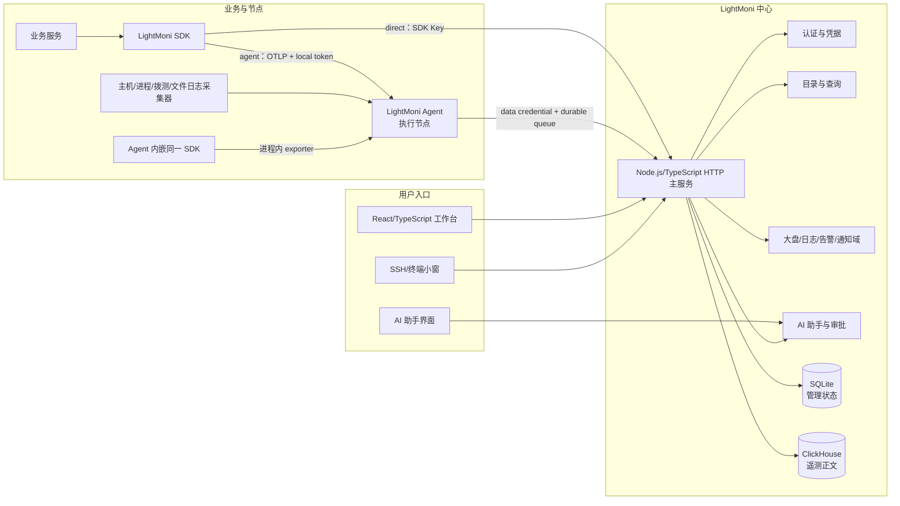
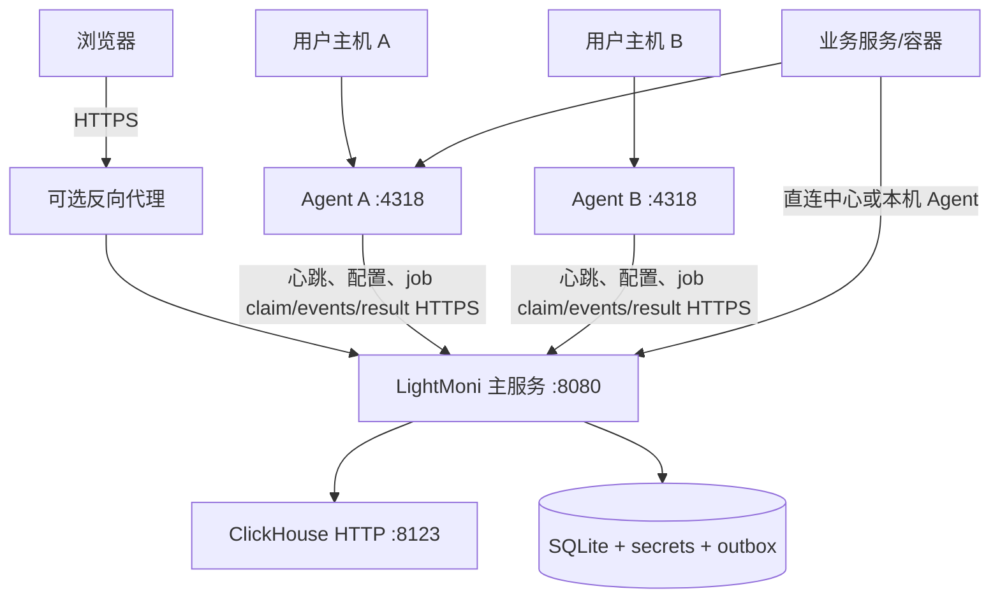
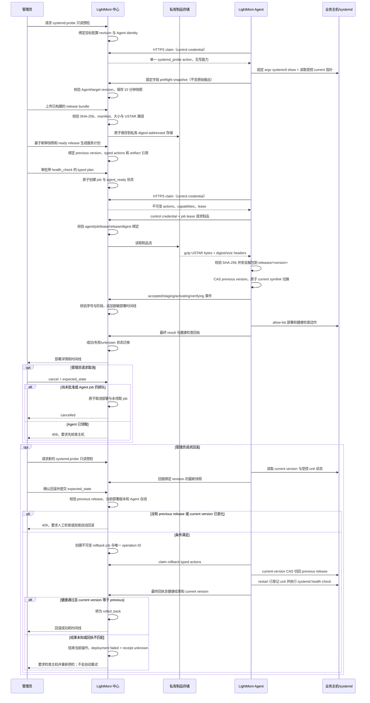
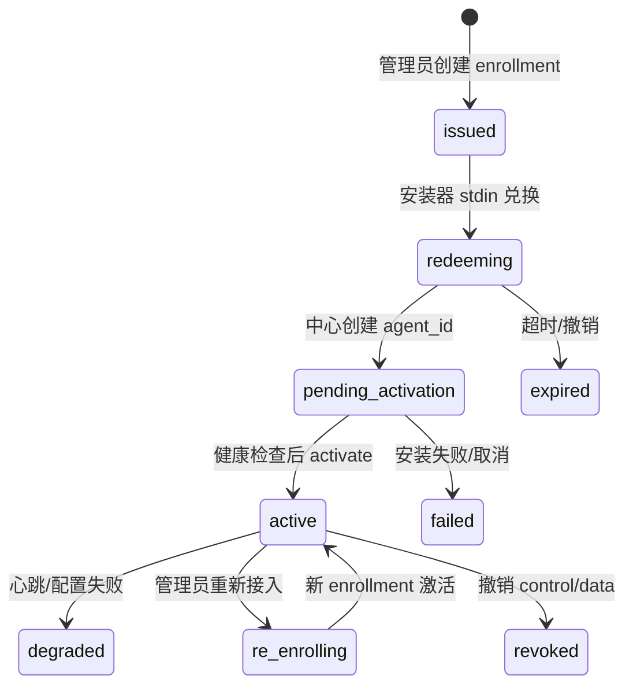
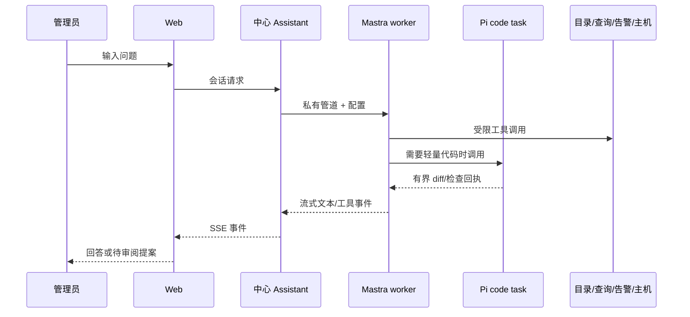

# LightMoni 系统设计基线

> 状态：当前主干的 HLD/LLD 设计基线；2026-10-20 建立。本文是系统联动的总入口，特性变更仍必须通过 SDD（spec、plan、tasks、validation）交付。
>
> 配套变更：[SDD 019：系统设计基线](../specs/019-system-design-baseline/spec.md)。

## 1. 文档定位与事实来源

LightMoni 是面向个人和小团队的一体化监控工作台。它把业务 SDK、独立 LightMoni Agent、中心服务、Web 工作台、AI 助手、告警和主机接入放在一套可独立部署、可追踪和可恢复的系统里。本文件回答四个问题：系统为什么这样设计、组件如何联动、请求和数据怎样流动、当前实现与未来目标分别是什么。

本文件是跨模块设计的权威入口，但不是每个模块的唯一契约。字段、状态码和验收步骤以更细的 SDD 和公共契约为准。出现冲突时，采用以下优先级并开新 SDD 修正旧文档：

1. 当前可运行代码和公开 API 的实际行为。
2. 当前主干中最新的特性 SDD 契约和验证记录。
3. `docs/contracts.md`、`docs/architecture.md`、`docs/brief.md` 等共享设计。
4. 历史任务说明、早期 Go 实现和未完成的规划文字。

“当前”表示代码或验证证据已经存在；“兼容”表示为了已部署版本保留；“目标”表示设计方向，必须经过新的 SDD 和验证才能变成当前能力。本文不以规划代替测试。

### 1.1 变更维护与双端同步

本文的仓库来源是 [`docs/system-design.md`](system-design.md)，在线协作副本是 [Doca：LightMoni 系统设计基线](https://doca.heyphp.com/#/r/2902a80f-c592-414e-9aed-64fe19f2ed53)。任何影响组件职责、数据或控制路径、凭据边界、存储、协议、部署拓扑或 AI/工具边界的架构变更，都必须在同一个 SDD 和 Pull Request 中同步更新这两个位置。

同步时保留 Doca 的原生图块和无关内容；写入成功后使用最新版本回读目标章节或图块，核对文字、节点和连线。Pull Request 必须记录架构影响判断、仓库文档章节、Doca 链接和回读结果。Doca 不可访问、鉴权失败或保存未确认时，不得声称设计已同步。不影响架构的改动填写“不适用”及理由即可；凭据不得写入仓库、日志、URL、Pull Request 或文档正文。

## 2. 驱动目标

### 2.1 产品目标

- 让用户在一台中心服务上完成主机、业务指标、日志、Trace、拨测、告警、通知和 AI 分析。
- 让业务服务用少量代码记录结构化数据，不需要先设计复杂的指标注册表。
- 让 Agent 独立运行并成为节点级执行平面，承接主机采集、拨测、文件日志、任务配置、心跳和离线补传。
- 让 AI 助手基于真实目录、查询、告警、模型和主机状态工作，并在产生副作用前给管理员清晰的可审阅回执。
- 让小团队在不引入 Redis、Kafka、Grafana、Kibana 或专用网关的情况下完成部署；ClickHouse 专注遥测数据，SQLite 专注管理状态。

### 2.2 工程目标

- **可恢复**：网络中断、进程重启、丢 ACK、部分写入和 Agent 离线时，系统能说明哪些数据仍可重试、哪些已丢失。
- **可演进**：中心、Agent 和 SDK 共享公共协议；新的功能通过 SDD 增量加入，不把页面实现当作协议。
- **可审计**：凭据、主机、AI 提案、告警响应、部署计划和模型用量都有结构化状态和操作者。
- **可控成本**：SDK 在端侧有界聚合，AI 有输入、输出和步数限制，ClickHouse 查询和日志浏览有资源上限。
- **安全默认**：最小权限、凭据分用途、不把秘密交给模型、不把 SSH 变成长期运维通道。
- **可理解**：一个请求、一个批次、一个任务和一个提案都能追溯到发起者、目标、结果和下一步。

### 2.3 非目标

首版不承诺多租户、逐表 ACL、完整 PromQL/KQL/Lucene、完整 IDE、自动发布、Agent 任意远程 shell、节点侧模型调用、跨文件崩溃事务、无限期离线补传或高可用集群。需要这些能力时必须先新增或修订 SDD。

## 3. 设计原则

1. **数据路径显式选择**：SDK 直连中心与 SDK 经 Agent 是两条完整路径，不因网络错误自动互相改投。
2. **Agent 是一等节点**：业务退出不会停止 Agent；Agent 不只是 SDK 的中转器，也不等同于“采集器”这个单一功能。
3. **控制面和数据面分离**：控制凭据用于心跳和配置，数据凭据用于遥测；SDK Key、Agent local token、enrollment token 不能混用。
4. **中心是配置权威**：任务、标签、告警、模型、密钥和部署计划在中心保存；Agent 只缓存可执行配置，SDK 只缓存端侧规则。
5. **写入先确认边界再确认成功**：Agent 先持久化再 ACK，中心等待目标 ClickHouse 写入完成再 ACK；未知结果保留原批次。
6. **AI 提案优先于 AI 副作用**：查询可以直接读，保存大盘、修改告警、部署 Agent、应用代码 diff 必须回到用户确认接口。
7. **结构化回执优先于原始输出**：页面和模型收到固定状态、错误码、ID 和摘要；私钥、密码、令牌、原始 SSH 输出和上游秘密永不进入上下文。
8. **共享模块而非隐式耦合**：HTTP、SQLite、ClickHouse、目录、查询、凭据和时间由公共服务注入，模块不能自己重建权限或 SQL 规则。

## 4. 系统边界与核心概念

### 4.1 核心对象

| 对象 | 定义 | 生命周期拥有者 |
| --- | --- | --- |
| 用户 | 登录中心的管理员或成员 | 中心 SQLite |
| SDK Key | 业务直连中心的数据上报凭据 | 中心凭据管理 |
| Agent enrollment token | 一次性、短期的节点接入凭据 | 管理员创建，中心兑换 |
| Agent control credential | 节点心跳、配置和控制通道凭据 | 中心签发，Agent 保存 |
| Agent data credential | 节点遥测上报凭据 | 中心签发，Agent 保存 |
| Agent local token | 可选的本机 SDK → Agent 鉴权令牌 | 目标 Agent 本地配置 |
| 执行节点 | 一个独立运行的 LightMoni Agent 实例 | Agent 身份与中心节点记录 |
| 任务 | 指标采集、服务拨测或目录日志配置 | 中心任务仓储 |
| 任务标签 | 把任务分发给节点的标签集合 | 中心标签仓储 |
| 业务表 | SDK 记录的逻辑表名 | 中心目录与 ClickHouse |
| 批次 | 一个 signal、table、service 和稳定批次 ID 的发送单元 | SDK/Agent/中心链路 |
| 告警规则 | 对查询结果进行求值并产生 episode 的配置 | 告警域 |
| 提案 | AI 产生但尚未应用的变更或代码结果 | 中心 SQLite |
| 业务服务 | 用户希望被打点、构建和部署的逻辑服务 | 中心 SQLite |
| 服务目标 | 服务在一台登记主机上的运行实例及适配器配置 | 中心 SQLite |
| 制品版本 | 带版本、来源和 SHA-256 的不可变发布输入 | 中心 SQLite/受控制品存储 |
| 业务部署 | 将一个制品激活到一个服务目标的可审阅计划 | 中心 SQLite，Agent 执行 |

### 4.2 系统边界

LightMoni 中心管理身份、配置和可查询数据，但不拥有业务代码、用户主机的全部权限或供应商账单。业务 SDK 可在不安装 Agent 的后端中运行。Agent 可部署在主机、虚拟机或容器中；业务是否与它同机不是身份判断条件。SSH 只作为首次接入、人工维护和救援通道，Agent 激活后日常控制应走 Agent API。

## 5. HLD 总体架构



### 5.1 部署拓扑

默认部署是一个中心容器加一个可访问的 ClickHouse；SQLite、加密主密钥和 Agent 包/队列使用持久卷。Agent 作为独立进程或容器运行，使用自己的数据目录、身份和队列。SDK 与业务服务一起运行，不要求和中心同机，也不要求 Agent 必须存在。



TLS 可以由已有反向代理承担。中心外部地址必须能被 Agent 和直连 SDK 访问；容器中 `localhost` 只表示当前容器。发布的 Agent 包为 Linux amd64/arm64，并自带固定 Node 运行时；目标主机不需要另装 Node/npm。

## 6. 组件职责和依赖方向

| 组件 | 主要职责 | 不应承担 |
| --- | --- | --- |
| `runtime/src/server` | HTTP、认证、模块装配、管理 API、接收和后台任务 | 不把业务查询散落到 Web 或 AI |
| `runtime/src/domains` | 大盘、日志、告警、通知和领域状态机 | 不直接绕过公共 Query/目录 |
| `runtime/src/agent` | 节点身份、采集、拨测、文件日志、接收、持久队列、上报、心跳 | 不持有中心模型 Key；不执行任意远程命令 |
| `sdk/*` | 轻量记录、端侧窗口聚合、OTLP、重试和上下文传播 | 不保存磁盘队列；不决定平台权限 |
| `ai-runtime` | Mastra worker、provider 适配、流式事件和工具 loop | 不拥有中心权限或秘密存储 |
| `runtime/src/assistant` | 会话、工具、审批、Pi 代码任务、模型用量 | 不直接让模型写数据库或 SSH |
| `web` | 用户交互、展示、草稿和确认 | 不持有 API Key、私钥或模型供应商秘密 |
| SQLite | 管理配置、身份、状态、摘要、凭据摘要、队列元数据 | 不保存大量遥测正文 |
| ClickHouse | 日志、指标、Trace 及查询视图 | 不成为管理权限的唯一来源 |

中心是模块化单体，不拆为运行时微服务。模块通过 `Dependencies` 使用共享 DB、目录、查询、认证、路由、加密、时钟和日志；启动和关闭由 `runtime/src/server/app.ts` 管理。

## 7. 端到端数据流

### 7.1 业务 SDK 直连中心

1. 业务初始化 SDK，必填 `service` 和 `env`，可选版本和实例 ID。
2. SDK 按 `record(table, metric_name, dimensions, value, count)` 写入内存窗口；日志和 Trace 捕获调用时的上下文。
3. SDK 在 UTC 固定窗口结束后冻结批次，生成稳定批次 ID、创建时间和 OTLP payload。
4. SDK 向中心 `/v1/metrics`、`/v1/logs` 或 `/v1/traces` 发送 Bearer SDK Key。
5. 中心验证逻辑表、Key、批次头、OTLP schema、时间和容量，写入 ClickHouse 物理表。
6. 写入确认后返回 OTLP ACK；SDK 释放同一批次。失败保留原批次并按策略重试。

直连是 SDK 的默认目标，适合普通服务器、容器和 Serverless。安装 Agent 不是直连的前置条件。

### 7.2 业务 SDK 经 Agent

1. 用户明确选择 `LIGHTMONI_MODE=agent`，SDK 使用 Agent endpoint 和可选 local token。
2. SDK 仍在业务进程内聚合和生成 OTLP，不把中心 control/data credential 暴露给业务。
3. Agent 接收请求，验证 table、batch ID、时间和 local token，把批次持久化到本地 SQLite 队列后 ACK SDK。
4. Agent 使用自己的 data credential 向中心发送完全相同的批次；网络失败时从磁盘队列重试。
5. 中心完成 ClickHouse 写入后，Agent 删除队列记录，但保留受限 receipt 去重。

Agent 模式增加本地持久化和离线补传能力，同时增加一跳网络与本地队列故障面。它不会自动压缩、自动合批、替换凭据，也不代表中心已入库。Agent 不可达时，SDK 不自动改投中心。

### 7.3 Agent 节点任务流

1. 管理员在“节点助手”创建任务和任务标签。
2. 节点通过 control credential 心跳并拉取按标签合并的 `RemoteConfig`。
3. Agent 先校验并缓存完整配置，再原子替换当前有效 revision；冲突配置整体拒绝。
4. 采集器按配置产生 host/process/probe/files 数据，使用 Agent 内嵌的同一 TypeScript SDK，经进程内 exporter 写入 Agent 队列。
5. Agent 上报并维护心跳、队列、采集器状态和有限运行事件。
6. 节点无匹配任务时暂停内部采集和拨测，但仍可接收业务 SDK 数据。

任务标签只负责分发，不是租户、权限或业务 service。一个节点可以有多个标签，一个任务也可以关联多个标签，命中任一标签即可下发且不会重复执行。

### 7.4 AI 分析与变更流

1. 浏览器通过中心创建/恢复会话，中心在私有 stdin/stdout 管道中启动 Mastra worker。
2. Mastra 使用管理员保存的模型连接配置调用协议 SDK；Key 只在后端和 worker 内存中存在。
3. AI 读取目录、描述表、执行有界只读 SQL、检索日志和读取告警状态。
4. 大盘、告警、静默、代码和 Agent 部署以 draft/proposal/plan 形式返回。
5. 用户在独立页面查看完整变更、影响、版本和回执，再由中心重新校验权限和 revision 后应用。
6. 每次实际模型请求写入幂等用量账本；模型目录刷新不发送生成请求，测试连接才发送最小真实请求。

### 7.5 SDK 插桩与业务部署流

1. 管理员为业务服务提供已授权的源码 workspace；AI 先调用只读 `scan_sdk_instrumentation`，识别语言、框架、LightMoni SDK、直连/Agent 模式和候选请求/错误边界。
2. 扫描不导入或执行业务代码，也不写文件。对于可以明确定位的 TypeScript/JavaScript 多行请求边界，AI 调用只读 `propose_sdk_instrumentation` 生成结构化 unified diff、风险、手动步骤和验证命令；Python、Go、Rust、Ruby 或歧义边界只给手动步骤。复杂改写才交给隔离 workspace 的 `code_task`，同样只产生可审阅 diff；所有 diff 都必须经过管理员确认后才应用。
3. 已确认的 revision 目标上由隔离构建器生成带版本、架构、来源 revision 和 SHA-256 的 release；构建器尚未实现前，systemd MVP 允许管理员上传预构建的 `lightmoni-release-v1.tar.gz`。Manifest 至少包含 `schema_version`、`service_id`、`version`、`architecture`、`source_revision` 和固定 `entrypoint:"run"`。中心只保存元数据与私有 digest-addressed 正文，不能从静态下载路由取到业务制品；生产 Agent 不接收源码仓库凭据或模型密钥。
4. 管理员为 service 创建一个或多个 service target，登记 systemd unit 与受控 release directory。release 根目录由 root 持有并属于 Agent systemd unit 配置的 `lightmoni-agent` 主组（建议 `0775`，业务服务用户只读且可遍历，并且不得属于 Agent 组）；Agent 的 `ProtectSystem=strict` 沙箱需把该精确目录加入 `ReadWritePaths`。Agent 预检检查根目录 UID/GID 与 POSIX mode 位，要求 root 所有、Agent 有效主组可写、其他用户仅可读/遍历。MVP 不检查扩展 POSIX ACL，也不解析 systemd unit 的业务进程 User/Group/附加组；管理员必须确保业务用户不属于 Agent 组且无 ACL 写权限。unit 必须预先配置稳定入口 `ExecStart=<release_directory>/current/run`；LightMoni Agent 不编辑任意 unit、环境文件或服务用户。release bundle 只放运行所需文件，不能放密钥或环境凭据。MVP 的 `systemd` 适配器覆盖 Node、Python、Go、Rust、二进制和解释器服务；语言不是部署协议。Docker Compose、Kubernetes/Helm 和 CI/GitOps 作为后续适配器。
5. 管理员可请求目标 Agent 执行 `systemd.probe` 只读预检。Job 仅检查绑定的 unit 与 release directory，通过固定参数读取 systemd 属性和版本指针；输出限定为状态枚举、布尔值、安全版本标识、观测时间、一次性请求 ID、目标配置 revision 和固定错误码，不回传原始命令输出，也不创建目录或改变服务。Agent 确认 `ExecStart` 精确使用登记路径下的 `current/run`；中心校验请求 ID/revision 与观测时间，阻止跨 job 快照重放；路径含符号链接、unit 不符合入口、被 masked 或处于启动/停止过渡态时不标记 ready。文件系统检查仅在支持通过固定目录句柄拒绝符号链接的平台启用；当前实现为 Linux Agent，其他平台报告 `filesystem_check_supported=false` 且不就绪。中心按 target/operation 保存快照，部署计划可附最近 10 分钟且 ready 的预检结果。没有预检、预检过期或快照未就绪都不能得到可执行动作。
6. 中心执行 `probe → plan → apply → verify → rollback` 的受控计划层，生成 `awaiting_approval` 部署计划。计划只包含 typed actions，不包含 shell 字符串；管理员审批前中心要求 release ready、目标快照新鲜且 ready、manifest 与目标匹配，以及带能力授权的 health_check，随后原子写入不可变 Agent job 并把部署推进到 `agent_ready`。制品上传只允许管理员认证的有界接口；Agent 下载只允许 control credential、当前 lease 和 action 绑定的 agent/release/digest 同时匹配，不接受任意 URL，秘密不进 URL。
7. Agent executor 通过 control credential 拉取短时租约 job。中心后台定期处理过期任务，按单调序号接收阶段事件，并将 staging/activating/verifying/final receipt 映射到脱敏部署时间线。只有 verifying 后的最终回执包含 `health.healthy=true` 才标记业务 deployment `succeeded`；未领取 job 可以安全取消或过期取消。普通部署若执行结果未知或成功回执不完整，保留最后确认的部署阶段并将 receipt 标为 `unknown`，要求检查目标主机，不推断为部署失败；回滚操作的未知结果或不匹配回执则结束本次操作，将 deployment 标为 `failed`、receipt 标为 `unknown`，管理员完成新的安全预检后才能显式重试。此状态仅表示 Agent 报告计划内健康检查通过，中心 ClickHouse 遥测验证仍单独显示未验证。
8. 管理员若要回滚，先为目标执行新的只读 preflight。仅当快照新鲜且结构安全（允许 unit 为 `active`、`inactive` 或 `failed`）、current 仍指向本次部署版本、previous version 是同一 service 下登记的 ready release、Agent 在线时，中心才创建受限 rollback job。Agent 通过 current-pointer CAS 恢复 previous version，随后 restart 并执行 systemd health check；中心同时核对 `health.healthy=true` 和回报的 current version 才转为 `rolled_back`。首次部署、CAS 冲突或旧版本未登记时拒绝创建任务。执行结果未知或回执不匹配会结束当前操作并将部署标为 `failed`、receipt 标为 `unknown`，提示人工检查；系统不自动重试，只有管理员再次执行新鲜安全预检且 current 仍是本次部署版本后，才可显式创建新的回滚操作。

部署的执行和结果状态通过两条控制通道形成闭环：



当前代码已持久化 service、target、release、deployment 元数据及脱敏 `deployment_events`，提供 `awaiting_approval` 计划、管理员 approve、Agent 回执状态映射、事件查询和受限人工 systemd 回滚 job。回滚仅在新鲜且结构安全的 preflight 显示 current version 仍为本次部署、previous version 有同 service ready release 记录且 Agent 在线时入队；即使 unit 处于 failed，只要目标路径和入口安全也允许尝试恢复。Agent 执行 current-pointer CAS、systemd restart 和 health check，并核对回执 current version 后才标记 `rolled_back`。Agent 的只读 `systemd.probe` job 将目标配置 revision 与一次性 preflight ID 绑定，有效期最多 10 分钟；Agent 校验 `ExecStart=<release_directory>/current/run`，并以受控 bundle 的相对 symlink 维护 `current`。本轮已接入制品私有存储、管理员上传、control credential + job lease 绑定下载、USTAR 校验、安全解包和 systemd typed actions；digest 对象可被多个 release 共享，校验失败的上传不会立即按 digest 删除对象，后续 GC 必须先确认无引用并满足保留期；没有 ready bundle、预检或 typed actions 的计划仍被审批 API 拒绝。

本轮将 bundle 限定为 gzip USTAR，要求 manifest 与可执行 `run`，只允许普通文件和目录；中心私有保存 digest 正文，Agent 下载须经 control credential + 当前 job lease + release/digest 匹配。Agent 在摘要验证后安全解包，并通过 CAS 与原子相对 symlink 将 `current` 指向 `releases/<version>`；目标 unit 由管理员预先配置为 `current/run`。管理员确认的受限回滚闭环已实现；自动补偿、真实 ClickHouse 遥测查询、生产签名、存储 GC/配额和 Linux 主机验收仍待后续切片。页面与 AI 不得把“预检通过”“已批准”或“已入队”当作业务已部署；`succeeded` 仅说明 Agent 报告计划内 health_check 通过，不能代表遥测已验证。

## 8. 中心服务 HLD/LLD

### 8.1 启动和模块装配

中心入口是 `runtime/src/server/main.ts`，创建配置、SQLite、ClickHouse、认证、路由和模块。模块在构造时执行自身迁移，`start()` 启动后台任务，`close()` 取消定时器、等待任务并关闭连接。健康检查 `/healthz` 不需要登录；其他 API 由统一 Router 注入 `Context.user`。

模块分层：

```text
HTTP Router / Auth
        ↓
server modules (nodes, machines, settings, ingest, query, install)
        ↓
domains (dashboards, logs, alerts, notifications)
        ↓
shared (SQLite, ClickHouse, OTLP, crypto, JSON, time)
```

### 8.2 认证和用户

本地账号、GitHub、微信、QQ 和通用 OAuth2 由中心处理。会话 cookie 只在同源请求中使用；OAuth state 一次性且绑定会话与用途，支持 PKCE 时启用 PKCE，OIDC 使用 nonce 和 token 校验。外部身份以 `(provider, subject)` 稳定绑定，不按昵称或未经验证的邮箱自动合并。管理员和成员共享实例数据，但凭据、用户管理、供应商配置、Agent enrollment、SSH 和 AI 变更只能由管理员执行。

### 8.3 接收和查询

接收端支持 OTLP HTTP JSON/Protobuf：`POST /v1/logs`、`/v1/metrics`、`/v1/traces`。统一请求头为 `X-Lightmoni-Table`、`X-Lightmoni-Batch-ID`、`X-Lightmoni-Batch-Created-At`。Query 使用 `POST /api/v1/query`，只允许已验证公开表上的有界只读 SELECT/WITH，参数绑定而非字符串插值。

查询统一使用 UTC 半开时间范围、正的 `interval_ms` 和带类型的 Frame。服务端限制查询数量、时间、行数、内存和 SQL 表集合；取消必须传入 ClickHouse。页面、告警和 AI 使用同一查询执行器，但各自有更小的结果和并发上限。

### 8.4 数据接入 API 族

| API | 用途 | 角色 |
| --- | --- | --- |
| `/api/v1/keys` | SDK Key 创建、启停和事件 | 管理员 |
| `/api/v1/sdk-config` | SDK 动态规则和窗口 | SDK/Agent |
| `/api/v1/catalog/tables` | 逻辑表目录 | 登录成员；修改管理员 |
| `/api/v1/metric-windows/:table` | 业务表聚合周期 | 管理员 |
| `/api/v1/agent-enrollments` | 创建、列出和撤销一次性接入 | 管理员 |
| `/api/v1/agents/enroll` | Agent 兑换 enrollment | 安装器 |
| `/api/v1/agents/:id/activate` | Agent 激活 | Agent |
| `/api/v1/agent-credentials` | 凭据元数据 | 管理员 |
| `/api/v1/agents/:id/heartbeat` | 节点心跳/配置通道 | Agent control credential |
| `/api/v1/machines/*` | 受管主机、SSH、部署计划 | 管理员 |
| `/api/v1/services/*` | 业务服务、服务目标、制品版本和审核计划 | 管理员 |
| `/api/v1/services/:serviceId/releases/:releaseId/artifact` | 有界上传预构建 release bundle；正文进入私有存储 | 管理员 |
| `/api/v1/agents/:agentId/jobs/:jobId/artifacts/:releaseId` | lease 与 release/digest 绑定的私有制品下载 | Agent control credential + job lease |
| `/api/v1/deployments/:id` | 脱敏部署计划/状态/回执查询 | 管理员 |
| `/api/v1/deployments/:id/events` | 脱敏部署状态事件时间线 | 管理员 |
| `/api/v1/deployments/:id/cancel` | 取消未审批部署或尚未领取的 Agent job；已领取任务拒绝取消 | 管理员 |
| `/api/v1/deployments/:id/approve` | 管理员确认并推进到 `agent_ready` | 管理员 |
| `/api/v1/deployments/:id/rollback` | 新鲜预检、旧版本登记、CAS/健康回执满足时创建回滚 job | 管理员 |
| `/api/v1/agents/:id/jobs/claim` | Agent 拉取一个能力受限且带租约的部署 job | Agent control credential |
| `/api/v1/agents/:id/jobs/:jobId/events` | Agent 上报幂等阶段事件和脱敏快照 | Agent control credential |
| `/api/v1/agents/:id/jobs/:jobId/result` | Agent 提交成功、失败、取消或未知回执 | Agent control credential |
| `/api/v1/agent-jobs/:jobId/cancel` | 管理员取消尚未完成的 Agent job | 管理员 |
| `/api/v1/assistant/*` | 会话、模型、提案、用量和 AI 工具 | 登录/管理员按接口 |

## 9. 存储设计

### 9.1 SQLite

SQLite 保存低体量、强一致的管理状态：用户和外部身份、会话、SDK Key 摘要与事件、enrollment 状态、Agent 身份和凭据摘要、节点/任务/标签、主机和 SSH 凭据密文、业务 services/service_targets/releases/deployments、`agent_jobs`/`agent_job_events` 及其脱敏回执、部署计划、告警规则/episode/静默/outbox、仪表盘和草稿、模型配置/用量账本、表目录、窗口历史和有限队列元数据。

明文 secret 只在创建/兑换/轮换响应的单次边界出现，随后使用加密存储或不可逆摘要。SQLite 不保存大量日志、指标或 Trace 正文。

### 9.2 ClickHouse

单库 `lightmoni` 保存遥测。逻辑表名匹配 `[a-z][a-z0-9_]{0,47}`，不能自带 `log_`、`metric_`、`trace_` 前缀。公开视图按类型生成：`log_<table>`、`metric_<table>_sum`、`metric_<table>_gauge`、`metric_<table>_histogram`、`trace_<table>`。系统表使用 `lightmoni_*` 并用 `component=center|agent|sdk` 区分来源。

共用身份列包含 `event_id`、`event_time`、`ingested_at`、`service`、`instance_id`、`host_id`、`agent_id`、`key_id`、资源和类型保持信息。日志保存 severity、body、trace/span；指标按 sum/gauge/histogram 各自 schema；Trace 保存 parent、duration、状态、事件和 links。

底层使用稳定排序键和 ReplacingMergeTree 兼容重试，公开视图以 `FINAL` 去重。后台 merge 尚未完成不能被当作实时去重保证；读账号只能访问公开视图，写/迁移账号分开。

### 9.3 批次与幂等

一个自有 SDK 批次只有一个 signal、table 和 service。相同 batch ID 必须拥有相同创建时间和 payload；同 ID 不同正文返回冲突。中心用 batch ID、signal 和原记录位置生成稳定 event ID。重试、Agent 转发和凭据轮换不修改批次正文、原始时间或首次归因。

## 10. SDK 设计

### 10.1 公共 API

业务初始化必须提供 `service` 和 `env`，可选 `service_version`、`instance_id`；实例 ID 缺省自动生成。推荐入口为：

```ts
const moni = createLightMoni({ service: "order-api", env: "prod" });
moni.record(
  "business",
  "db.query.duration_ms",
  { key1: "mysql", key2: "select" },
  128,
  1,
);
await moni.shutdown({ timeoutMs: 5000 });
```

`dimensions` 只允许 `key1`～`key16` 字符串；`value` 是 `count` 个样本的总和。Counter、Gauge、Histogram、日志和 Span 保留旧 API 兼容，但新代码使用统一 record/上下文接口。W3C `traceparent`/`tracestate` 用于跨服务传播，日志在调用时捕获上下文，不在发送时读取另一个请求的上下文。

### 10.2 聚合和远程规则

SDK 默认使用 30 秒 UTC 固定窗口；每张业务指标表可选 10、30、60、300、600、1800、3600 秒之一。SDK 通过 `GET /v1/sdk-config?metric_windows=1`、停报和日志采样规则轮询；配置先验证后原子替换，失败保留上一份有效配置。查询步长须为实际窗口的整数倍，切换历史取公倍数对齐。

Go、Node/TypeScript、Python 等已接入的语言可按各自 SDD 使用动态停报、UID 排除、QA/VIP 保留比例；未接入某规则的语言必须在发布矩阵中明确标注，不能通过中心入库后补过滤来假装支持。

### 10.3 两种上报模式

| 模式 | 环境变量 | 接收端 | 凭据 | 持久化 |
| --- | --- | --- | --- | --- |
| `direct`（默认） | `LIGHTMONI_ENDPOINT`、`LIGHTMONI_DATA_KEY` 或兼容 `LIGHTMONI_KEY` | 中心 `/v1/*` | SDK data key | SDK 进程内有界缓冲 |
| `agent` | `LIGHTMONI_AGENT_ENDPOINT`、可选 `LIGHTMONI_LOCAL_TOKEN` | Agent `/v1/*` | Agent local token（如启用） | Agent SQLite 磁盘队列 |

模式必须由用户显式选择，不能在一条路径失败后静默改变授权或目标。两种模式都保持 OTLP、table、批次头和 shutdown 语义。SDK 不知道“业务所在机器的 Agent”是靠业务名称推断出来的；需要 agent 模式时，用户通过本机/容器可达地址或部署编排显式提供 Agent endpoint。未来可以新增服务发现，但不能把推断结果当作凭据。

## 11. LightMoni Agent 设计

### 11.1 定位

LightMoni Agent 是独立运行的系统级执行节点。它可以接收业务 SDK 数据，也可以使用同一套 TypeScript SDK 为自身主机采集和任务执行打点；业务 SDK 不必安装或经过 Agent。Agent 的进程由 systemd、容器编排或其他进程管理器负责，业务服务的启停不会影响 Agent。

### 11.2 模块

| 模块 | 职责 |
| --- | --- |
| `config.ts` | 地址、凭据、容量、任务和本地令牌校验 |
| `agent.ts` | HTTP 接收、上报、心跳、运行状态和 SDK exporter |
| `queue.ts` | SQLite durable queue、receipt、重试、容量和日志 cursor |
| `collect.ts` | CPU、内存、磁盘、网络、负载和进程采集 |
| `probe.ts` | HTTP/TCP 拨测和超时 |
| `file-logs.ts` | 目录日志增量读取、轮转、截断和分片 |
| `main.ts` | `run --config`、信号、启动和优雅关闭 |

### 11.3 节点控制协议

节点通过 control credential 注册/心跳并拉取 `RemoteConfig`，其中包含 revision、任务标签合并后的指标/拨测/日志配置和控制间隔。Agent 先校验、写入本地缓存，再应用 revision。中心不接受 Agent 在心跳请求体中自行声明的 `agent_id` 作为授权依据。

Agent 上报使用 data credential 和 `X-Lightmoni-Agent-ID`。队列至少一次交付；`receipts` 防止同一 batch 重复入队，队列满或磁盘不足时返回背压而不是 ACK 后删除。重启后继续发送原 ID；超过最大补传年龄的批次进入明确的过期/隔离状态。

## 12. Agent enrollment 与凭据



流程如下：

1. 管理员选择中心地址、版本、架构和初始任务标签，创建短期 enrollment token。
2. 页面只显示一次 token 和不含 token 的安装命令；安装器从 stdin 或秘密文件 FD 读取。
3. 安装器提交 token、install nonce、版本、架构和最小主机信息；同 nonce 重试幂等，不同 nonce 重放拒绝。
4. 中心创建节点并返回一次性 bootstrap credential；Agent 写入临时受限文件并完成健康检查。
5. Agent 激活后取得 control/data credential，使用 fsync 和原子 rename 落盘；中心只保存摘要。
6. 凭据临近过期时由 Agent 轮换，旧 credential 只在有限 grace 窗口有效；撤销立即拒绝新请求。

`control_credential` 只用于心跳、配置和控制；`data_credential` 只用于遥测；SDK local token 只用于本机 SDK → Agent。旧 `config.key` 仅是迁移兼容路径，不能让新节点借它伪造任意 agent 身份。

## 13. 主机、SSH 和 Agent 引导

受管主机记录地址、端口、登录用户名、已确认主机指纹和凭据 ID。私钥或短期密码提交后服务端加密保存，页面永远不回显；默认提示密码不要长期保存。模型只能看到主机元数据、凭据 ID 和结构化检查结果。

SSH 预检是只读固定命令集合，检查网络、指纹、Linux、架构、systemd、权限和 HTTPS 可达性。预检通过后生成持久化部署计划；管理员在页面确认后，后端 worker 使用固定安装模板、凭据租约、stdin enrollment token、版本/架构白名单执行。Agent 激活后日常配置和诊断优先走 Agent 通道，SSH 凭据可撤销。

网页终端是管理员本人使用的临时 PTY：同源 Origin、登录 cookie、已确认指纹、单次 WebSocket 入口、输入/输出上限、10 分钟空闲和 30 分钟总时长。终端输出不持久化、不写日志、不发送给 AI。终端不是 AI 任意 shell 工具。

## 14. AI 助手设计

### 14.1 运行时分层

Mastra 是 LightMoni AI 助手的主对话和工具编排运行时。中心每轮通过私有 stdin/stdout 管道启动 Node worker；模型连接由 provider 适配 OpenAI Chat Completions、OpenAI Responses、Anthropic Messages 和 Google Gemini。Pi Agent 不是另一个平台入口，而是 Mastra 在 `code_task` 中调用的受限代码执行器，负责“读取 → 修改 → 检查 → 修复”的多轮循环。



### 14.2 工具分级

| effect | 示例 | 应用方式 |
| --- | --- | --- |
| `read` | list/describe tables、run_query、日志、告警读取、主机状态、业务部署事件 | 有界执行，可直接返回 |
| `draft` | dashboard draft、alert change、silence、SDK `propose_sdk_instrumentation`、Agent deployment plan | 保存或返回提案，用户审阅 |
| `code` | Pi `code_task` | 隔离副本、检查、diff，用户确认应用 |
| `execute` | 当前不提供模型任意 SSH/命令 | 未来单独 SDD，默认关闭 |

AI 的查询必须走目录和统一 Query，SQL 只读、有时间范围和结果上限。告警规则和静默的修改使用 revision/版本检查和 15 分钟提案有效期；应用时重新检查权限、版本和对象状态。代码任务只在管理员配置的 workspace 中运行，限制路径、符号链接、文件大小、白名单检查命令、步数和时长；Pi 不 commit、push、PR、merge 或 deploy。

### 14.3 模型管理与用量

管理员在“模型管理”保存 Base URL、协议、模型和输入/输出单价。自动识别只给地址和目录依据推荐；第三方 OpenAI 兼容目录无法区分 Chat/Responses 时必须人工选择。各协议独立规范化 `/v1`、`/v1beta`、目录鉴权和生成接口；修正后的地址回填输入框并说明原因。目录刷新不产生生成费用；连接测试发送一次最小真实请求。

每个真实模型请求使用稳定 request ID 幂等写入账本，记录 started、usage 和终态，区分 complete、partial、unpriced、failed、cancelled。缺失 token 不能猜成零，模型输入、Key 和回复正文不写入用量统计。

## 15. 告警、静默和通知

告警规则使用统一 Query 执行器，以固定窗口求值。规则显式声明来源表，目录表可提供默认责任组；多组路由按 group 独立生成响应。episode、响应、接手、升级、静默和通知 outbox 是独立状态机，通知失败不能阻塞采集。

AI 可以读取规则、静默和责任组的脱敏信息，也可以创建待确认的规则/静默提案。应用时使用对象 revision 和范围权限，重复确认返回原回执，配置冲突返回 409。通知渠道秘密只在中心保存，AI 不读取联系方式和供应商 Key。

## 16. Web 工作台设计

主侧栏包含概览、监控大盘、日志、链路、告警、节点助手、数据接入、数据管理、管理后台和 AI 助手。登录用户与身份位于右上角；颜色支持浅色、深色、跟随系统和强调色；界面支持简体中文/English。语言和外观保存在浏览器，不改变业务名称、日志、SQL、代码、凭据和模型输出原文。

页面只使用共享 React 控件，不使用浏览器原生 select、alert、confirm、prompt。SDK 接入提供 direct/agent 说明、SDK Key、豁免表和 Agent enrollment；数据管理提供目录、保留和采样；模型管理提供连接、目录、测试、价格和用量；节点助手提供节点、任务和标签；主机管理提供预检、部署计划和终端。

前端不保存真实凭据。浏览器请求只携带登录 cookie 和不含秘密的资源 ID；需要秘密的 SSH、模型和部署操作由中心后端执行。所有修改页面都要处理加载、失败、权限、冲突、过期和重试状态。

## 17. 安全和信任边界

### 17.1 凭据矩阵

| 秘密 | 生成/保存 | 使用位置 | 禁止位置 |
| --- | --- | --- | --- |
| SDK Key | 中心创建；密文/摘要 | SDK → 中心 | Agent control、模型、浏览器持久化 |
| enrollment token | 管理员一次性生成；中心摘要 | 安装 stdin/FD | URL、argv、env、日志、AI |
| control credential | 中心兑换；Agent 0600 文件 | 心跳/配置/控制 | 遥测、SDK、模型 |
| data credential | 中心兑换；Agent 0600 文件 | Agent → 中心遥测 | 控制 API、业务 SDK |
| local token | 用户在 Agent 本地配置 | SDK → Agent | 中心签发、AI上下文 |
| SSH 私钥/密码 | 中心加密；短期租约 | 后端 SSH worker/终端 | 浏览器、模型、日志 |
| 模型 API Key | 中心加密 | 私有 Mastra worker | 浏览器、URL、模型消息 |

### 17.2 通用安全规则

- Host key 必须 pin；指纹变化需管理员重新确认，不能关闭校验。
- 主机地址只接受主机名/IP，不接受 URL、用户信息、命令、控制字符或云元数据地址。
- AI 工具 schema 使用 `additionalProperties:false`；未知参数、任意 command、任意 host 和任意 key 直接拒绝。
- 凭据撤销和会话降权应在受限时间内断开终端；离线 Agent 的缓存任务不能被文档宣称为即时停止，直到配置租约实现。
- 日志、审计和错误只记录固定错误码、资源 ID、操作者、时间和脱敏摘要。

## 18. LLD：关键接口与状态机

### 18.1 OTLP 请求

```text
POST /v1/{logs|metrics|traces}
Authorization: Bearer <key-or-agent-data-credential>
X-Lightmoni-Table: <logical-table>
X-Lightmoni-Batch-ID: <UUID>
X-Lightmoni-Batch-Created-At: <RFC3339Nano UTC>
Content-Type: application/json | application/x-protobuf
```

200/202 表示整批接受；400 表示永久协议错误；401/403 表示凭据问题；429/502/503/504 可按 Retry-After 重试；未知网络结果保留原批次。自有链路不使用 partial success 丢掉未知子集。

### 18.2 Agent 接收与队列状态

```text
received → persisted → forwarding → acknowledged
                     ↘ retry_wait → forwarding
                     ↘ quarantine / expired / rejected
```

`persisted` 才能向 SDK ACK；`acknowledged` 才能回收队列 payload。队列 SQLite 保存 input hash、forward hash、身份、创建时间、attempts、next time、last error 和日志 cursor。容量不足返回可重试背压。

### 18.3 告警响应状态

```text
rule evaluation → episode open → unclaimed → acknowledged → resolved
                         ↘ cancelled / silenced / escalated
```

episode 状态与业务条件状态分开；静默只抑制通知和响应计时，不删除采集数据。接手必须通过已登录确认链接或供应商回调完成，GET 不产生副作用。

### 18.4 AI 提案状态

```text
drafted → awaiting_approval → applying → applied
                           ↘ expired / rejected / conflict / failed
```

提案绑定用户和会话，应用时检查 owner、权限、对象 revision、有效期和当前连接。重复应用返回原回执，不重复写入。代码任务的 `awaiting_approval` 只代表 diff 审阅，不代表已经写回工作区。

## 19. 可靠性、容量和故障处理

系统采用至少一次传输和查询去重，不承诺 exactly-once 网络交付。SDK 内存缓冲在进程崩溃时可能丢失；需要跨重启补传时使用 Agent durable queue。队列满、磁盘满、凭据错误、永久拒绝和过期批次都必须出现在 stats、节点状态或日志中。

ClickHouse 写入前后的 SQLite 状态不是跨数据库原子事务；中心只能在写入确认后 ACK，部分写入由稳定 event ID 和公开视图 `FINAL` 抵抗重复。掉电、异步 insert、磁盘耗尽和长时间补传需真实环境验证。

查询、日志历史和 AI 工具都使用有界会话：日志冻结分页有行数/内存/TTL；实时查询用重叠窗口和 event_id 去重；AI SQL 最长 90 天、10 秒和 1000 行样本；代码任务按文件/输出/步骤/超时限制。超过边界要返回显式 truncated/error，而不是静默给出不完整结论。

## 20. 部署、升级和运维

### 20.1 中心

```sh
cp .env.example .env
chmod 600 .env
docker compose config --quiet
docker compose up -d --build --wait
```

根 Compose 默认运行中心并连接外部 ClickHouse；`deploy/with-clickhouse` 提供一起启动的隔离配置。启动时初始化 `lightmoni` 数据库和读账号。升级保留 SQLite、密钥主密钥、队列和 ClickHouse 数据卷；备份必须同时保存状态卷、遥测卷和 `.env`。

### 20.2 Agent

发布脚本构建 Linux amd64/arm64 包和 SHA256；安装脚本校验 HTTPS、版本、架构和包完整性。Agent 以独立 systemd 服务或容器启动，`node runtime/dist/agent/main.js run --config /path/agent-config.json` 是源码运行入口。重装和升级保留 identity、凭据（若未撤销）、配置 revision 和队列；安装失败不能删除已有节点数据。

### 20.3 关闭顺序

中心停止接收新后台任务，等待可取消请求，关闭 AI worker、通知 outbox、目录轮询、ClickHouse writer 和 SQLite。业务 SDK 先停止生产再在截止时间内 `shutdown`；Agent 先停止采集，再等待队列尝试，最后关闭 HTTP server 和 SQLite。

## 21. 可观测性和审计

中心、Agent、SDK 自身使用 `lightmoni_*` 系统表记录心跳、队列、重试、丢弃、拒绝、配置 revision、采集器和模型用量。系统遥测不应递归记录原始请求、Key 或任意异常全文。每个系统级事件至少包含 component、service/agent_id、instance_id、时间、事件名和固定计数。

审计对象包括：登录和身份绑定、Key 创建/撤销、enrollment/激活/轮换/撤销、SSH 检查/部署/终端、任务和标签修改、告警提案应用、代码 diff 应用、模型连接测试和价格修改。审计只保存资源 ID、操作者、结果、版本/摘要和错误码，不保存 token、密码、私钥、提示词或生成正文。

## 22. 当前实现、兼容路径和限制

### 22.1 当前已实现或已有验证证据

- 中心和 Agent 使用 Node.js/TypeScript；Web 使用 React/TypeScript；AI runtime 使用 Mastra。
- SDK、Agent、中心共享 OTLP 和公共 TypeScript 类型；Agent 使用同一个 TypeScript SDK 做内部指标和 exporter。
- 节点标签/任务、Agent enrollment、control/data 凭据、主机 SSH 预检、部署计划和网页终端均有对应特性 SDD。
- SDD 021 已加入业务服务/目标/发布元数据、只读 SDK 插桩扫描、受限 TS/JS 结构化插桩提案、管理员确认后的安全 apply、中心部署状态迁移/审批/事件/人工回滚 job、Agent job/租约协议、MVP capability executor/runner 和 AI 部署计划工具。approve 要求带授权 capability 的 health_check 并创建不可变 job；Agent 的有序阶段回执、健康成功证据、取消和 unknown 结果已联动部署状态。Agent 可通过隔离的 `systemd.probe` job 对登记目标做只读主机预检，中心保存绑定目标配置 revision 的 10 分钟快照；它不会改变主机或推进部署状态。本轮已落地 release bundle 格式、私有存储和 job-scoped 下载、受限解包、current symlink 激活、CAS 回滚和 systemd typed actions；真实 ClickHouse 遥测闭环、自动补偿、源码构建、签名、GC/配额、Linux 主机验收和 Docker/Kubernetes 适配器仍未完成。
- AI 具备目录、查询、日志、告警读取、可审阅草稿、SDK 插桩提案、业务部署状态/事件读取、Pi 代码任务和模型用量/连接测试设计。
- 告警规则、静默、值班、通知 outbox 和现场取证由中心域模块负责。

### 22.2 兼容路径

- 旧 `/agents`、旧 `group_id`/`--group-id`、旧 Agent `config.key` 和旧 SDK 构造 API 为迁移保留。
- 旧数据视图和历史物理列不因新 record 模型删除。
- 浏览器入口和历史深链接通过重定向兼容到“数据管理”“模型管理”和“节点助手”。

### 22.3 当前必须保持诚实的限制

- SDK 发布语言矩阵仍需以目标分支的 `/api/v1/sdk-install`、发布脚本和 SDD 012 对齐；源码存在的历史 SDK 不等于当前发行包已承诺支持。PHP 不在当前发布目标；Go/Rust 若标记为后续支持，页面必须显示 deferred 而不是可下载。
- SDK 远程停报、日志采样和规则配置不是每种语言都已接入；未支持的语言不能声称平台规则已生效。
- Agent 离线时撤销不能即时停止其已缓存任务，配置租约仍是后续强化。
- SSH 终端是管理员临时工具，不给 AI 增加任意 shell 能力。
- 代码任务副本不是操作系统沙箱；白名单命令只适用于受信 workspace，不能当成不可信代码隔离。
- ClickHouse 的掉电可靠性、极端容量、Linux 实机和完整 Docker 发布需要按证据目录继续验收。

## 23. 演进路线

1. **一致性门**：统一 SDK 发布矩阵、接入页、下载 API 和验证 fixture；清理过时的 Java/C#/PHP 发布文字。
2. **Agent 强化**：配置租约、凭据持有证明、在线升级、更多 OS、受限 Agent Executor；每项先建 SDD。
3. **服务发现**：在 K8s/sidecar/本机部署场景增加明确的 Agent endpoint 注入或服务发现协议，不凭主机猜测身份，不改变 direct 默认。
4. **AI 工具扩展**：在中心实现受审计的 Agent 操作 API 后，再让 AI 调用节点工具；不把 SSH 作为长期路径，也不让节点获得模型 Key。
5. **数据和告警**：增加更强的降采样估算、依赖抑制、事件关联和大规模查询优化，同时保留明确的截断与计价状态。
6. **规模化**：只有在小团队单体部署的资源和可靠性证据充分后，再评估多租户、HA、分布式队列或独立查询服务。

## 24. 设计决策记录

| 决策 | 结论 | 原因 |
| --- | --- | --- |
| SDK 是否必须经过 Agent | 否；默认直连，可选 agent 模式 | 直连路径简单，Agent 只在需要离线队列/节点能力时增加 |
| Agent 是否随业务启停 | 否 | 节点采集、拨测、日志和控制需要独立生命周期 |
| Agent 是否自带模型 | 当前否 | 模型 Key、计费和会话属于中心；未来节点工具另行设计 |
| SDK 与 Agent 是否用同一 SDK | 是 | 统一记录、批次、上下文和系统自监控语义 |
| Mastra 与 Pi 的关系 | Mastra 主导会话和工具；Pi 只负责受限代码任务循环 | 保持中心权限和审批单一入口 |
| SSH 是否是日常控制 | 否 | 首次部署/救援使用，激活后优先 Agent control |
| 凭据是否合并管理 | 页面统一展示，权限和生命周期分开 | 降低操作复杂度但不扩大权限 |
| 是否自动把模型目录当协议证明 | 否 | OpenAI 兼容目录无法证明 Chat/Responses 或工具能力 |

## 25. 相关文档索引

- 产品约束：[docs/brief.md](brief.md)
- 旧架构叙述与部署摘要：[docs/architecture.md](architecture.md)
- 公共协议：[docs/contracts.md](contracts.md)
- Agent 安装与恢复：[docs/agent-deployment.md](agent-deployment.md)
- 网页 SSH 终端：[docs/machine-terminal.md](machine-terminal.md)
- UI 交互：[docs/ui-design.md](ui-design.md)
- SDK 总览：[sdk/README.md](../sdk/README.md)
- 任务索引：[docs/tasks/README.md](tasks/README.md)
- Mastra 助手：[SDD 001](../specs/001-mastra-assistant/spec.md)
- 模型发现和协议：[SDD 002](../specs/002-model-discovery/spec.md)、[SDD 003](../specs/003-multi-protocol-models/spec.md)、[SDD 005](../specs/005-model-management/spec.md)
- Agent、迁移和凭据：[SDD 006](../specs/006-execution-nodes/spec.md)、[SDD 007](../specs/007-node-runtime-migration/spec.md)、[SDD 010](../specs/010-agent-deployment/spec.md)
- SDK 数据与模式：[SDD 010 telemetry](../specs/010-telemetry-table-model/spec.md)、[SDD 011](../specs/011-aligned-metric-windows/spec.md)、[SDD 012](../specs/012-sdk-reporting-choice/spec.md)
- AI 告警、主机和终端：[SDD 009](../specs/009-assistant-alert-controls/spec.md)、[SDD 013](../specs/013-ai-alert-controls/spec.md)、[SDD 014](../specs/014-managed-machines-agent-bootstrap/spec.md)、[SDD 017](../specs/017-assistant-ssh-bootstrap/spec.md)、[SDD 018](../specs/018-machine-web-terminal/spec.md)
- 设计基线 SDD：[SDD 019](../specs/019-system-design-baseline/spec.md)
- AI SDK 插桩与业务部署：[SDD 021](../specs/021-ai-sdk-instrumentation-deployment/spec.md)
- 在线设计副本：[Doca：LightMoni 系统设计基线](https://doca.heyphp.com/#/r/2902a80f-c592-414e-9aed-64fe19f2ed53)
- 架构文档双端同步规则：[SDD 020](../specs/020-architecture-design-sync/spec.md)
