# LightMoni 系统设计基线

> 状态：当前主干的 HLD/LLD 设计基线；2026-10-20 建立。本文是系统联动的总入口，特性变更仍必须通过 SDD（spec、plan、tasks、validation）交付。
>
> 配套变更：[SDD 019：系统设计基线](../specs/019-system-design-baseline/spec.md)。

## 1. 文档定位与事实来源

LightMoni 是面向个人和小团队的一体化监控工作台。它把业务 SDK、独立 LightMoni Agent、中心服务、Web 工作台、AI 助手、告警和主机接入放在一套可独立部署、可追踪和可恢复的系统里。本文件回答四个问题：系统为什么这样设计、组件如何联动、请求和数据怎样流动、当前实现与未来目标分别是什么。

本文件是跨模块设计的权威入口，但不是每个模块的唯一契约。字段、状态码和验收步骤以更细的 SDD 和公共契约为准。出现冲突时，采用以下优先级并开新 SDD 修正旧文档：

1. 当前可运行代码和公开 API 的实际行为。
2. 当前主干中最新的特性 SDD 契约和验证记录。
3. `docs/contracts.md`、`docs/architecture.md`、`docs/brief.md` 等共享设计。
4. 历史任务说明、早期 Go 实现和未完成的规划文字。

“当前”表示代码或验证证据已经存在；“兼容”表示为了已部署版本保留；“目标”表示设计方向，必须经过新的 SDD 和验证才能变成当前能力。本文不以规划代替测试。

### 1.1 变更维护与双端同步

本文的仓库来源是 [`docs/system-design.md`](system-design.md)，在线协作副本是 [Doca：LightMoni 系统设计基线](https://doca.heyphp.com/#/r/2902a80f-c592-414e-9aed-64fe19f2ed53)。任何影响组件职责、数据或控制路径、凭据边界、存储、协议、部署拓扑或 AI/工具边界的架构变更，都必须在同一个 SDD 和 Pull Request 中同步更新这两个位置。

同步时保留 Doca 的原生图块和无关内容；写入成功后使用最新版本回读目标章节或图块，核对文字、节点和连线。Pull Request 必须记录架构影响判断、仓库文档章节、Doca 链接和回读结果。Doca 不可访问、鉴权失败或保存未确认时，不得声称设计已同步。不影响架构的改动填写“不适用”及理由即可；凭据不得写入仓库、日志、URL、Pull Request 或文档正文。

## 2. 驱动目标

### 2.1 产品目标

- 让用户在一台中心服务上完成主机、业务指标、日志、Trace、拨测、告警、通知和 AI 分析。
- 让业务服务用少量代码记录结构化数据，不需要先设计复杂的指标注册表。
- 让 Agent 独立运行并成为节点级执行平面，承接主机采集、拨测、文件日志、任务配置、心跳和离线补传。
- 让 AI 助手基于真实目录、查询、告警、模型和主机状态工作，并在产生副作用前给管理员清晰的可审阅回执。
- 让小团队在不引入 Redis、Kafka、Grafana、Kibana 或专用网关的情况下完成部署；ClickHouse 专注遥测数据，SQLite 专注管理状态。

### 2.2 工程目标

- **可恢复**：网络中断、进程重启、丢 ACK、部分写入和 Agent 离线时，系统能说明哪些数据仍可重试、哪些已丢失。
- **可演进**：中心、Agent 和 SDK 共享公共协议；新的功能通过 SDD 增量加入，不把页面实现当作协议。
- **可审计**：凭据、主机、AI 提案、告警响应、部署计划和模型用量都有结构化状态和操作者。
- **可控成本**：SDK 在端侧有界聚合，AI 有输入、输出和步数限制，ClickHouse 查询和日志浏览有资源上限。
- **安全默认**：最小权限、凭据分用途、不把秘密交给模型、不把 SSH 变成长期运维通道。
- **可理解**：一个请求、一个批次、一个任务和一个提案都能追溯到发起者、目标、结果和下一步。

### 2.3 非目标

首版不承诺多租户、逐表 ACL、完整 PromQL/KQL/Lucene、完整 IDE、自动发布、Agent 任意远程 shell、节点侧模型调用、跨文件崩溃事务、无限期离线补传或高可用集群。需要这些能力时必须先新增或修订 SDD。

## 3. 设计原则

1. **独立上报、路径显式**：业务 SDK 仅直连中心，Agent 独立上报自身任务数据；两者复用同一套 SDK 包，业务上报不依赖安装 Agent。SDK与Agent独立使用中心地址发现，内网优先、公网备用。
2. **Agent 是一等节点**：业务退出不会停止 Agent；Agent承担独立采集、节点控制与任务执行，不接收业务SDK。
3. **控制面和数据面分离**：控制凭据用于心跳和配置，数据凭据用于遥测；SDK Key、Agent local token、enrollment token 不能混用。
4. **中心是配置权威**：任务、标签、告警、模型、密钥和部署计划在中心保存；Agent 只缓存可执行配置，SDK 只缓存端侧规则。
5. **写入先确认边界再确认成功**：Agent 先持久化再 ACK，中心等待目标 ClickHouse 写入完成再 ACK；未知结果保留原批次。
6. **AI 提案优先于 AI 副作用**：查询可以直接读，保存大盘、修改告警、部署 Agent、应用代码 diff 必须回到用户确认接口。
7. **结构化回执优先于原始输出**：页面和模型收到固定状态、错误码、ID 和摘要；私钥、密码、令牌、原始 SSH 输出和上游秘密永不进入上下文。
8. **共享模块而非隐式耦合**：HTTP、SQLite、ClickHouse、目录、查询、凭据和时间由公共服务注入，模块不能自己重建权限或 SQL 规则。

## 4. 系统边界与核心概念

### 4.1 核心对象

| 对象 | 定义 | 生命周期拥有者 |
| --- | --- | --- |
| 用户 | 登录中心的管理员或成员 | 中心 SQLite |
| SDK Key | 业务直连中心的数据上报凭据 | 中心凭据管理 |
| Agent enrollment token | 绑定已登记主机的一次性短期安装凭据 | 主机部署内部签发，中心兑换 |
| Agent control credential | 节点心跳、配置和控制通道凭据 | 中心签发，Agent 保存 |
| Agent data credential | 节点遥测上报凭据 | 中心签发，Agent 保存 |
| Agent local token | 本机Agent诊断鉴权令牌 | 目标 Agent 本地配置 |
| 执行节点 | 一个独立运行的 LightMoni Agent 实例 | Agent 身份与中心节点记录 |
| 任务 | 指标采集、服务拨测或目录日志配置 | 中心任务仓储 |
| 任务标签 | 把任务分发给节点的标签集合 | 中心标签仓储 |
| 业务表 | SDK 记录的逻辑表名 | 中心目录与 ClickHouse |
| 批次 | 一个 signal、table、service 和稳定批次 ID 的发送单元 | SDK/Agent/中心链路 |
| 告警规则 | 对查询结果进行求值并产生 episode 的配置 | 告警域 |
| 提案 | AI 产生但尚未应用的变更或代码结果 | 中心 SQLite |
| 业务服务 | 用户希望被打点、构建和部署的逻辑服务 | 中心 SQLite |
| 服务目标 | 服务在一台登记主机上的运行实例及适配器配置 | 中心 SQLite |
| 制品版本 | 带版本、来源和 SHA-256 的不可变发布输入 | 中心 SQLite/受控制品存储 |
| 业务部署 | 将一个制品激活到一个服务目标的可审阅计划 | 中心 SQLite，Agent 执行 |

### 4.2 系统边界

LightMoni 中心管理身份、配置和可查询数据，但不拥有业务代码、用户主机的全部权限或供应商账单。业务 SDK 可在不安装 Agent 的后端中运行。Agent 可部署在主机、虚拟机或容器中；业务是否与它同机不是身份判断条件。SSH 只作为首次接入、人工维护和救援通道，Agent 激活后日常控制应走 Agent API。

## 5. HLD 总体架构

总览分为两个视图，避免把遥测、节点控制和浏览器入口混成一条链路。第一张图展示业务 SDK 与 Agent 各自上报中心：两个 SDK 节点表示同一套 SDK 包在不同进程中的实例。Agent 的采集和任务执行通过内嵌 SDK 打点，使用进程内 exporter 写入自己的持久队列，再由 Agent 发送。业务 SDK 的数据不经过 Agent。

**独立数据上报与节点控制：**

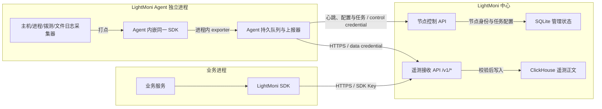

图中的箭头表示调用或发送方向；心跳、拉配置与部署任务的 claim/events/result 使用 control credential，响应沿原请求返回，遥测上报使用 data credential。任务配置由中心持有，节点主动拉取；这里没有新增中心主动连接 Agent 的入站要求。SDK→Agent转发已移除；两条中心连接均按第50章同步入口。

**用户入口与中心内部模块：**

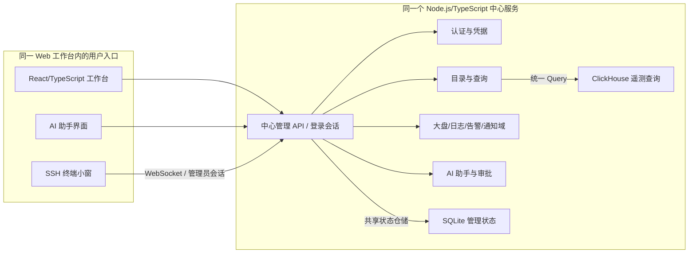

图中拆开的 API 和领域模块是同一中心进程内的逻辑职责，不是新增的独立服务。鉴权先于领域处理；内部模块复用统一目录、查询与状态仓储，不在图中逐条展开依赖。AI 助手界面和 SSH 终端是两个用户入口，不相互调用；模型没有任意 SSH 终端权限。

### 5.1 部署拓扑

默认部署是一个中心容器加一个可访问的 ClickHouse；SQLite、加密主密钥和 Agent 包/队列使用持久卷。Agent 作为独立进程或容器运行，使用自己的数据目录、身份和队列。SDK 与业务服务一起运行，不要求和中心同机，也不要求 Agent 必须存在。

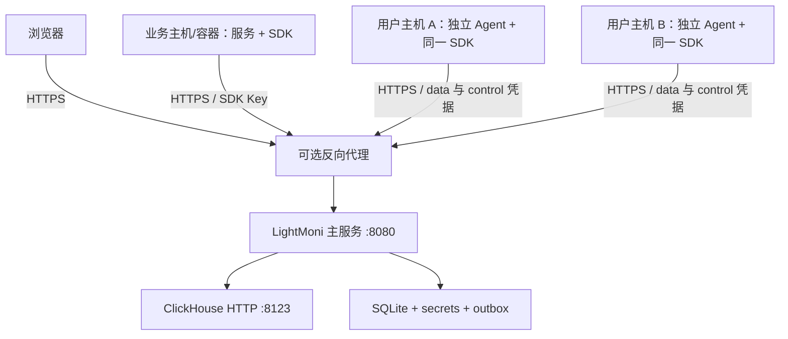

图中反向代理是可选的：不部署时，这些 HTTPS 请求直接到可访问的中心入口。Agent 的 data 凭据仅用于遥测；control 凭据用于心跳、配置和部署任务的 job claim/events/result。业务主机与 Agent 主机可以是同一台，也可以分别部署；图中分开表示进程与凭据独立，不要求业务先找到 Agent 的本地端口。TLS 可以由已有反向代理承担。中心外部地址必须能被 Agent 和直连 SDK 访问；容器中 `localhost` 只表示当前容器。发布的 Agent 包为 Linux amd64/arm64，并自带固定 Node 运行时；目标主机不需要另装 Node/npm。

## 6. 组件职责和依赖方向

| 组件 | 主要职责 | 不应承担 |
| --- | --- | --- |
| `runtime/src/server` | HTTP、认证、模块装配、管理 API、接收和后台任务 | 不把业务查询散落到 Web 或 AI |
| `runtime/src/domains` | 大盘、日志、告警、通知和领域状态机 | 不直接绕过公共 Query/目录 |
| `runtime/src/agent` | 节点身份、采集、拨测、文件日志、接收、持久队列、上报、心跳 | 不持有中心模型 Key；不执行任意远程命令 |
| `sdk/*` | 轻量记录、端侧窗口聚合、OTLP、重试和上下文传播 | 不保存磁盘队列；不决定平台权限 |
| `ai-runtime` | Mastra worker、provider 适配、流式事件和工具 loop | 不拥有中心权限或秘密存储 |
| `runtime/src/assistant` | 会话、工具、审批、Pi 代码任务、模型用量 | 不直接让模型写数据库或 SSH |
| `web` | 用户交互、展示、草稿和确认 | 不持有 API Key、私钥或模型供应商秘密 |
| SQLite | 管理配置、身份、状态、摘要、凭据摘要、队列元数据 | 不保存大量遥测正文 |
| ClickHouse | 日志、指标、Trace 及查询视图 | 不成为管理权限的唯一来源 |

中心是模块化单体，不拆为运行时微服务。模块通过 `Dependencies` 使用共享 DB、目录、查询、认证、路由、加密、时钟和日志；启动和关闭由 `runtime/src/server/app.ts` 管理。

## 7. 端到端数据流

### 7.1 业务 SDK 直连中心

1. 业务初始化 SDK，必填 `service` 和 `env`，可选版本和实例 ID。
2. SDK 按 `record(table, metric_name, dimensions, value, count)` 写入内存窗口；日志和 Trace 捕获调用时的上下文。
3. SDK 在 UTC 固定窗口结束后冻结批次，生成稳定批次 ID、创建时间和 OTLP payload。
4. SDK 向中心 `/v1/metrics`、`/v1/logs` 或 `/v1/traces` 发送 Bearer SDK Key。
5. 中心验证逻辑表、Key、批次头、OTLP schema、时间和容量，写入 ClickHouse 物理表。
6. 写入确认后返回 OTLP ACK；SDK 释放同一批次。失败保留原批次并按策略重试。

直连是 SDK 的默认目标，适合普通服务器、容器和 Serverless。安装 Agent 不是直连的前置条件。

### 7.2 SDK独立直报与中心地址选择

SDK仅连接中心，删除Agent接收与配置代理；默认本机4318地址和agent/auto模式均不再提供。SDK在业务进程内聚合与缓冲，中心确认后释放批次。Agent不承担业务SDK持久队列；其自身采集通过进程内exporter进入原有持久队列。

管理员在上报地址簿登记内网IP及端口和公网引导入口，SDK与Agent从所在网络查询清单、验证中心身份并优先使用可达内网。地址变更30秒同步；Agent心跳、配置、任务通道和上报共用入口。协议、兼容和验收见第50章。

### 7.3 Agent 节点任务流

1. 管理员在“节点助手”创建任务和任务标签。
2. 节点通过 control credential 心跳并拉取按标签合并的 `RemoteConfig`。
3. Agent 先校验并缓存完整配置，再原子替换当前有效 revision；冲突配置整体拒绝。
4. 采集器按配置产生 host/process/probe/files 数据，使用 Agent 内嵌的同一 TypeScript SDK，经进程内 exporter 写入 Agent 队列。
5. Agent 上报并维护心跳、队列、采集器状态和有限运行事件。
6. 节点无匹配任务时暂停内部采集和拨测，继续维护自身控制通道。

任务标签只负责分发，不是租户、权限或业务 service。一个节点可以有多个标签，一个任务也可以关联多个标签，命中任一标签即可下发且不会重复执行。

### 7.4 AI 分析与变更流

1. 浏览器通过中心创建/恢复会话，中心在私有 stdin/stdout 管道中启动 Mastra worker。
2. Mastra 使用管理员保存的模型连接配置调用协议 SDK；Key 只在后端和 worker 内存中存在。
3. AI 读取目录、描述表、执行有界只读 SQL、检索日志和读取告警状态。
4. 大盘、告警、静默、代码和 Agent 部署以 draft/proposal/plan 形式返回。
5. 用户在独立页面查看完整变更、影响、版本和回执，再由中心重新校验权限和 revision 后应用。
6. 每次实际模型请求写入幂等用量账本；模型目录刷新不发送生成请求，测试连接才发送最小真实请求。

### 7.5 SDK 插桩与业务部署流

1. 管理员为业务服务提供已授权的源码 workspace；AI 先调用只读 `scan_sdk_instrumentation`，识别语言、框架、LightMoni SDK、中心直连配置及需迁移的历史Agent配置和候选请求/错误边界。
2. 扫描不导入或执行业务代码，也不写文件。对于可以明确定位的 TypeScript/JavaScript 多行请求边界，AI 调用只读 `propose_sdk_instrumentation` 生成结构化 unified diff、风险、手动步骤和验证命令；Python、Go、Rust、Ruby 或歧义边界只给手动步骤。复杂改写才交给隔离 workspace 的 `code_task`，同样只产生可审阅 diff；所有 diff 都必须经过管理员确认后才应用。
3. 已确认的 revision 目标上由隔离构建器生成带版本、架构、来源 revision 和 SHA-256 的 release；构建器尚未实现前，systemd MVP 允许管理员上传预构建的 `lightmoni-release-v1.tar.gz`。Manifest 至少包含 `schema_version`、`service_id`、`version`、`architecture`、`source_revision` 和固定 `entrypoint:"run"`。中心上传与 Agent 暂存都会拒绝常见私密凭据路径，以及扫描窗口内匹配到的私钥、知名 token、URL/DSN userinfo、凭据查询参数、Basic Auth 和有值凭据字段；错误不回显匹配内容。该启发式检查不能保证检测所有秘密，bundle 仍只能包含运行文件，运行凭据须由目标主机的独立秘密管理注入。中心只保存元数据与私有 digest-addressed 正文，不能从静态下载路由取到业务制品；生产 Agent 不接收源码仓库凭据或模型密钥。
4. 管理员为 service 创建一个或多个 service target，登记 systemd unit 与受控 release directory。release 根目录由 root 持有并属于 Agent systemd unit 配置的 `lightmoni-agent` 主组（建议 `0775`，业务服务用户只读且可遍历，并且不得属于 Agent 组）；Agent 的 `ProtectSystem=strict` 沙箱需把该精确目录加入 `ReadWritePaths`。Agent 预检检查根目录 UID/GID 与 POSIX mode 位，要求 root 所有、Agent 有效主组可写、其他用户仅可读/遍历。MVP 不检查扩展 POSIX ACL，也不解析 systemd unit 的业务进程 User/Group/附加组；管理员必须确保业务用户不属于 Agent 组且无 ACL 写权限。unit 必须预先配置稳定入口 `ExecStart=<release_directory>/current/run`；LightMoni Agent 不编辑任意 unit、环境文件或服务用户。release bundle 只放运行所需文件，不能放密钥或环境凭据。MVP 的 `systemd` 适配器覆盖 Node、Python、Go、Rust、二进制和解释器服务；语言不是部署协议。Docker Compose、Kubernetes/Helm 和 CI/GitOps 作为后续适配器。
5. 管理员可请求目标 Agent 执行 `systemd.probe` 只读预检。Job 仅检查绑定的 unit 与 release directory，通过固定参数读取 systemd 属性和版本指针；输出限定为状态枚举、布尔值、安全版本标识、观测时间、一次性请求 ID、目标配置 revision 和固定错误码，不回传原始命令输出，也不创建目录或改变服务。Agent 确认 `ExecStart` 精确使用登记路径下的 `current/run`；中心校验请求 ID/revision 与观测时间，阻止跨 job 快照重放；路径含符号链接、unit 不符合入口、被 masked 或处于启动/停止过渡态时不标记 ready。文件系统检查仅在支持通过固定目录句柄拒绝符号链接的平台启用；当前实现为 Linux Agent，其他平台报告 `filesystem_check_supported=false` 且不就绪。中心按 target/operation 保存快照，部署计划可附最近 10 分钟且 ready 的预检结果。没有预检、预检过期或快照未就绪都不能得到可执行动作。
6. 中心执行 `probe → plan → apply → verify → rollback` 的受控计划层，生成 `awaiting_approval` 部署计划。计划只包含 typed actions，不包含 shell 字符串；管理员审批前中心要求 release ready、目标快照新鲜且 ready、manifest 与目标匹配，以及带能力授权的 health_check，随后原子写入不可变 Agent job 并把部署推进到 `agent_ready`。制品上传只允许管理员认证的有界接口；Agent 下载只允许 control credential、当前 lease 和 action 绑定的 agent/release/digest 同时匹配，不接受任意 URL，秘密不进 URL。
   - 中心 bundle 上传以进程级单槽门限制并行收件与同步校验；槽位占用时不排队并返回 `503 artifact_upload_busy`。管理员可通过 `POST /api/v1/admin/release-artifacts/gc` 先 dry-run 再确认清理超过 24 小时且未被任一 release 引用的私有对象；每轮最多扫描 10,000 项并删除 500 项，且与上传互斥。达到上限时用当前进程内最多有效 5 分钟的不透明游标续扫，游标绑定扫描模式和初始保留期截止时间；每轮重新读取引用。新扫描、进程重启或超时会使旧游标失效。存储祖先必须通过与读取一致的 UID/写权限校验，内部符号链接和硬链接不参与回收。这允许回收旧孤儿，但不消除单个最大 bundle 的解析内存峰值，也不提供硬磁盘配额或集群级协调。
7. Agent executor 通过 control credential 拉取短时租约 job。中心后台定期处理过期任务，按单调序号接收阶段事件，并将 staging/activating/verifying/final receipt 映射到脱敏部署时间线。只有 verifying 后的最终回执包含 `health.healthy=true` 才标记业务 deployment `succeeded`；未领取 job 可以安全取消或过期取消。普通部署若执行结果未知或成功回执不完整，保留最后确认的部署阶段并将 receipt 标为 `unknown`，要求检查目标主机，不推断为部署失败；回滚操作的未知结果或不匹配回执则结束本次操作，将 deployment 标为 `failed`、receipt 标为 `unknown`，管理员完成新的安全预检后才能显式重试。此状态仅表示 Agent 报告计划内健康检查通过，中心遥测结论独立保存，由管理员显式发起 ClickHouse 核验，不能仅靠健康回执标记遥测成功。
8. 管理员若要回滚，先为目标执行新的只读 preflight。仅当快照新鲜且结构安全（允许 unit 为 `active`、`inactive` 或 `failed`）、current 仍指向本次部署版本、previous version 是同一 service 下登记的 ready release、Agent 在线时，中心才创建受限 rollback job。Agent 通过 current-pointer CAS 恢复 previous version，随后 restart 并执行 systemd health check；中心同时核对 `health.healthy=true` 和回报的 current version 才转为 `rolled_back`。首次部署、CAS 冲突或旧版本未登记时拒绝创建任务。执行结果未知或回执不匹配会结束当前操作并将部署标为 `failed`、receipt 标为 `unknown`，提示人工检查；系统不自动重试，只有管理员再次执行新鲜安全预检且 current 仍是本次部署版本后，才可显式创建新的回滚操作。

9. 管理员可在 target 的可选 `config.telemetry` 中绑定规范业务公开表、SDK `service.name` 和稳定 `service.instance.id`；绑定进入目标 revision 与不可变部署快照，配置变更会使既有预检/计划和旧核验结果过期。SDK 必须自行设置 `service.version=release.version`；平台随机 service ID 不能用于推断 SDK 服务名。只有普通 deploy 已有有效 Agent 健康成功回执、目标配置仍匹配且没有后续已批准操作时，管理员才能通过 `POST /api/v1/deployments/:deploymentId/verify-telemetry`（严格 `{}`）发起一次核验。
   - 观察窗口固定为 `[finished_at, finished_at+5min)`，查询时仅观察到 `min(now, window.to)`，并限制 `ingested_at` 在完成时间至核验时刻之间；接收等待截止为完成后 6 分钟。SDK 服务、实例和发布版本均须精确匹配，最多读取 1000 条身份/时间样本。该证据只证明部署完成后的匹配遥测已入库，不证明部署因果关系或 SDK 身份不可伪造，启动及健康检查前的数据不算入本窗口。
   - 中心从目录验证非系统、规范公开业务表和必需列，使用 ClickHouse reader 参数化值查询；不读取遥测正文或接收任意 SQL。单次最多执行 3 秒、5 秒取消、64 MiB 查询内存和 100 万扫描行；单进程只允许一个核验请求，不排队。查询前后校验状态/operation、完成时间、目标 revision、计划/快照、release 和后续批准 job 顺序，变化时丢弃结果。
   - SQLite `deployments.telemetry_json` 单独保存脱敏摘要和上下文指纹；GET 与 AI 只读工具显示 `verified/waiting/timed_out/unavailable/invalid/unconfigured`，未核验为 null，过期结论标记 `stale`。查询失败、超时或无配置均不改部署健康状态，不触发自动回滚。Web 仅提供手动核验/重试，无自动查询轮询。

部署的执行、健康结果和独立遥测核验通过以下通道联动：

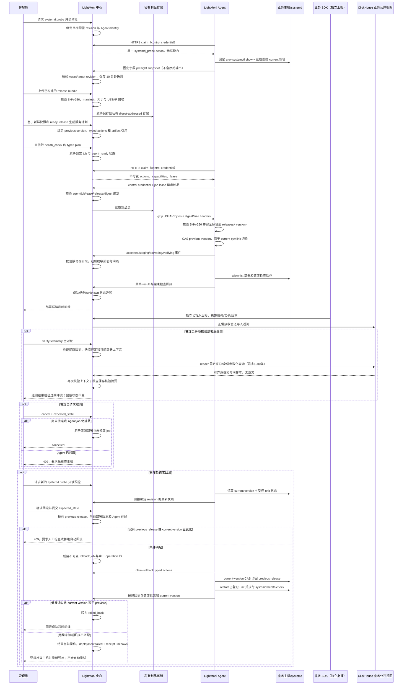

当前代码已持久化 service、target、release、deployment 元数据及脱敏 `deployment_events`，提供 `awaiting_approval` 计划、管理员 approve、Agent 回执状态映射、事件查询和受限人工 systemd 回滚 job。回滚仅在新鲜且结构安全的 preflight 显示 current version 仍为本次部署、previous version 有同 service ready release 记录且 Agent 在线时入队；即使 unit 处于 failed，只要目标路径和入口安全也允许尝试恢复。Agent 执行 current-pointer CAS、systemd restart 和 health check，并核对回执 current version 后才标记 `rolled_back`。Agent 的只读 `systemd.probe` job 将目标配置 revision 与一次性 preflight ID 绑定，有效期最多 10 分钟；Agent 校验 `ExecStart=<release_directory>/current/run`，并以受控 bundle 的相对 symlink 维护 `current`。本轮已接入制品私有存储、管理员上传、control credential + job lease 绑定下载、USTAR 校验、安全解包和 systemd typed actions；digest 对象可被多个 release 共享，校验失败的上传不会立即按 digest 删除对象，管理员可在保留期后用有界 GC 清理无引用对象；没有 ready bundle、预检或 typed actions 的计划仍被审批 API 拒绝。

本轮将 bundle 限定为 gzip USTAR，要求 manifest 与可执行 `run`，只允许普通文件和目录；中心私有保存 digest 正文，Agent 下载须经 control credential + 当前 job lease + release/digest 匹配。Agent 在摘要验证后安全解包，并通过 CAS 与原子相对 symlink 将 `current` 指向 `releases/<version>`；目标 unit 由管理员预先配置为 `current/run`。管理员确认的受限回滚闭环及有保留期、引用检查和分批上限的手动孤儿 GC 已实现；手动、显式身份绑定的 ClickHouse 核验已接入；自动补偿、真实 ClickHouse/业务主机验收、生产签名与硬存储配额仍待后续切片。页面与 AI 不得把“预检通过”“已批准”或“已入队”当作业务已部署；`succeeded` 仅说明 Agent 报告计划内 health_check 通过，不能代表遥测已验证。

## 8. 中心服务 HLD/LLD

### 8.1 启动和模块装配

中心入口是 `runtime/src/server/main.ts`，创建配置、SQLite、ClickHouse、认证、路由和模块。模块在构造时执行自身迁移，`start()` 启动后台任务，`close()` 取消定时器、等待任务并关闭连接。健康检查 `/healthz` 不需要登录；其他 API 由统一 Router 注入 `Context.user`。

模块分层：

```text
HTTP Router / Auth
        ↓
server modules (nodes, machines, settings, ingest, query, install)
        ↓
domains (dashboards, logs, alerts, notifications)
        ↓
shared (SQLite, ClickHouse, OTLP, crypto, JSON, time)
```

### 8.2 认证和用户

本地账号、GitHub、微信、QQ 和通用 OAuth2 由中心处理。会话 cookie 只在同源请求中使用；OAuth state 一次性且绑定会话与用途，支持 PKCE 时启用 PKCE，OIDC 使用 nonce 和 token 校验。外部身份以 `(provider, subject)` 稳定绑定，不按昵称或未经验证的邮箱自动合并。管理员和成员共享实例数据，但凭据、用户管理、供应商配置、Agent enrollment、SSH 和 AI 变更只能由管理员执行。

### 8.3 接收和查询

接收端支持 OTLP HTTP JSON/Protobuf：`POST /v1/logs`、`/v1/metrics`、`/v1/traces`。统一请求头为 `X-Lightmoni-Table`、`X-Lightmoni-Batch-ID`、`X-Lightmoni-Batch-Created-At`。Query 使用 `POST /api/v1/query`，只允许已验证公开表上的有界只读 SELECT/WITH，参数绑定而非字符串插值。

查询统一使用 UTC 半开时间范围、正的 `interval_ms` 和带类型的 Frame。服务端限制查询数量、时间、行数、内存和 SQL 表集合；取消必须传入 ClickHouse。页面、告警和 AI 使用同一查询执行器，但各自有更小的结果和并发上限。

### 8.4 数据接入 API 族

| API | 用途 | 角色 |
| --- | --- | --- |
| `/api/v1/keys` | SDK Key 创建、启停和事件 | 管理员 |
| `/api/v1/sdk-config` | SDK 动态规则和窗口 | SDK/Agent |
| `/api/v1/catalog/tables` | 逻辑表目录 | 登录成员；修改管理员 |
| `/api/v1/metric-windows/:table` | 业务表聚合周期 | 管理员 |
| `/api/v1/agent-enrollments` | 列出、撤销接入会话；独立创建接口停止使用 | 管理员 |
| `/api/v1/agents/enroll` | Agent 兑换 enrollment | 安装器 |
| `/api/v1/agents/:id/activate` | Agent 激活 | Agent |
| `/api/v1/agent-credentials` | 凭据元数据 | 管理员 |
| `/api/v1/agents/:id/heartbeat` | 节点心跳/配置通道 | Agent control credential |
| `/api/v1/machines/*` | 受管主机、SSH、部署计划 | 管理员 |
| `/api/v1/services/*` | 业务服务、服务目标、制品版本和审核计划 | 管理员 |
| `/api/v1/services/:serviceId/releases/:releaseId/artifact` | 有界上传预构建 release bundle；正文进入私有存储 | 管理员 |
| `/api/v1/admin/release-artifacts/gc` | 预览或确认清理有保留期的未引用私有制品 | 管理员 |
| `/api/v1/agents/:agentId/jobs/:jobId/artifacts/:releaseId` | lease 与 release/digest 绑定的私有制品下载 | Agent control credential + job lease |
| `/api/v1/deployments/:id` | 脱敏部署计划/状态/回执查询 | 管理员 |
| `/api/v1/deployments/:id/events` | 脱敏部署状态事件时间线 | 管理员 |
| `/api/v1/deployments/:id/verify-telemetry` | 固定身份、版本与时间窗的独立遥测核验；严格 `{}`，单进程单槽 | 管理员 |
| `/api/v1/deployments/:id/cancel` | 取消未审批部署或尚未领取的 Agent job；已领取任务拒绝取消 | 管理员 |
| `/api/v1/deployments/:id/approve` | 管理员确认并推进到 `agent_ready` | 管理员 |
| `/api/v1/deployments/:id/rollback` | 新鲜预检、旧版本登记、CAS/健康回执满足时创建回滚 job | 管理员 |
| `/api/v1/agents/:id/jobs/claim` | Agent 拉取一个能力受限且带租约的部署 job | Agent control credential |
| `/api/v1/agents/:id/jobs/:jobId/events` | Agent 上报幂等阶段事件和脱敏快照 | Agent control credential |
| `/api/v1/agents/:id/jobs/:jobId/result` | Agent 提交成功、失败、取消或未知回执 | Agent control credential |
| `/api/v1/agent-jobs/:jobId/cancel` | 管理员取消尚未完成的 Agent job | 管理员 |
| `/api/v1/assistant/*` | 会话、模型、提案、用量和 AI 工具 | 登录/管理员按接口 |

## 9. 存储设计

### 9.1 SQLite

SQLite 保存低体量、强一致的管理状态：用户和外部身份、会话、SDK Key 摘要与事件、enrollment 状态、Agent 身份和凭据摘要、节点/任务/标签、主机和 SSH 凭据密文、业务 services/service_targets/releases/deployments、`agent_jobs`/`agent_job_events` 及其脱敏回执、部署计划、告警规则/episode/静默/outbox、仪表盘和草稿、模型配置/用量账本、表目录、窗口历史和有限队列元数据。

明文 secret 只在创建/兑换/轮换响应的单次边界出现，随后使用加密存储或不可逆摘要。SQLite 不保存大量日志、指标或 Trace 正文。

### 9.2 ClickHouse

单库 `lightmoni` 保存遥测。逻辑表名匹配 `[a-z][a-z0-9_]{0,47}`，不能自带 `log_`、`metric_`、`trace_` 前缀。公开视图按类型生成：`log_<table>`、`metric_<table>_sum`、`metric_<table>_gauge`、`metric_<table>_histogram`、`trace_<table>`。系统表使用 `lightmoni_*` 并用 `component=center|agent|sdk` 区分来源。

共用身份列包含 `event_id`、`event_time`、`ingested_at`、`service`、`instance_id`、`host_id`、`agent_id`、`key_id`、资源和类型保持信息。日志保存 severity、body、trace/span；指标按 sum/gauge/histogram 各自 schema；Trace 保存 parent、duration、状态、事件和 links。

底层使用稳定排序键和 ReplacingMergeTree 兼容重试，公开视图以 `FINAL` 去重。后台 merge 尚未完成不能被当作实时去重保证；读账号只能访问公开视图，写/迁移账号分开。

### 9.3 批次与幂等

一个自有 SDK 批次只有一个 signal、table 和 service。相同 batch ID 必须拥有相同创建时间和 payload；同 ID 不同正文返回冲突。中心用 batch ID、signal 和原记录位置生成稳定 event ID。重试、Agent 转发和凭据轮换不修改批次正文、原始时间或首次归因。

## 10. SDK 设计

### 10.1 公共 API

业务初始化必须提供 `service` 和 `env`，可选 `service_version`、`instance_id`；实例 ID 缺省自动生成。推荐入口为：

```ts
const moni = createLightMoni({ service: "order-api", env: "prod" });
moni.record(
  "business",
  "db.query.duration_ms",
  { key1: "mysql", key2: "select" },
  128,
  1,
);
await moni.shutdown({ timeoutMs: 5000 });
```

`dimensions` 只允许 `key1`～`key16` 字符串；`value` 是 `count` 个样本的总和。Counter、Gauge、Histogram、日志和 Span 保留旧 API 兼容，但新代码使用统一 record/上下文接口。W3C `traceparent`/`tracestate` 用于跨服务传播，日志在调用时捕获上下文，不在发送时读取另一个请求的上下文。

### 10.2 聚合和远程规则

SDK 默认使用 30 秒 UTC 固定窗口；每张业务指标表可选 10、30、60、300、600、1800、3600 秒之一。SDK 通过 `GET /v1/sdk-config?metric_windows=1`、停报和日志采样规则轮询；配置先验证后原子替换，失败保留上一份有效配置。查询步长须为实际窗口的整数倍，切换历史取公倍数对齐。

Go、Node/TypeScript、Python 等已接入的语言可按各自 SDD 使用动态停报、UID 排除、QA/VIP 保留比例；未接入某规则的语言必须在发布矩阵中明确标注，不能通过中心入库后补过滤来假装支持。

### 10.3 中心直报与地址同步

| 客户端 | 引导配置 | 接收端 | 凭据 | 缓冲 |
| --- | --- | --- | --- | --- |
| 业务SDK（仅直报） | LIGHTMONI_ENDPOINT、LIGHTMONI_KEY | 中心/v1/*（内网优先） | SDK Key / 已启用豁免表 | 进程内有界缓冲 |
| 独立Agent | config.endpoint + 中心地址发现 | 中心控制/数据/任务API（共用入口） | 独立control/data凭据 | 自身采集SQLite队列 |

SDK仅使用中心endpoint与SDK Key；删除agent/auto模式及LIGHTMONI_AGENT_ENDPOINT、LIGHTMONI_LOCAL_TOKEN入口。SDK保留进程内有界缓冲，中心ACK后释放批次。管理员登记内网IP/端口和公网入口，客户端查询清单、验证身份、内网优先、公网备用，详见第50章。

AI插桩仅允许direct，生成LIGHTMONI_ENDPOINT和LIGHTMONI_KEY环境配置。检测历史SDK→Agent设置只提示迁移，不能继续生成该模式或向未迁移客户端自动插入调用。

## 11. LightMoni Agent 设计

### 11.1 定位

LightMoni Agent 是独立运行的系统级执行节点。它使用同一套TypeScript SDK为自身主机采集和任务执行打点，产物通过进程内exporter入队；业务 SDK 不必安装或经过 Agent。Agent 的进程由 systemd、容器编排或其他进程管理器负责，业务服务的启停不会影响 Agent。

### 11.2 模块

| 模块 | 职责 |
| --- | --- |
| `config.ts` | 地址、凭据、容量、任务和本地令牌校验 |
| `agent.ts` | 本地诊断、中心统一选路、上报、心跳、运行状态和进程内SDK exporter |
| `queue.ts` | SQLite durable queue、receipt、重试、容量和日志 cursor |
| `collect.ts` | CPU、内存、磁盘、网络、负载和进程采集 |
| `probe.ts` | HTTP/TCP 拨测和超时 |
| `file-logs.ts` | 目录日志增量读取、轮转、截断和分片 |
| `task-runner.ts` | 通用脚本任务出站领取、租约、独立工作目录、有界子进程及结果回传（SDD 043） |
| `main.ts` | `run --config`、信号、启动和优雅关闭 |

### 11.3 节点控制协议

节点通过 control credential 注册/心跳并拉取 `RemoteConfig`，其中包含 revision、基于平台主机标签与单机覆盖合并后的指标/拨测/日志配置和控制间隔。标签归属主机 ID，Agent 不得通过心跳自行选择可触发脚本的标签。Agent 先校验、写入本地缓存，再应用 revision。中心不接受 Agent 在心跳请求体中自行声明的 `agent_id` 作为授权依据。有限脚本任务通过独立的 task-runs 出站领取协议执行，不与部署 job 的健康验证状态机混用，见第 27 节。

Agent 上报使用 data credential 和 `X-Lightmoni-Agent-ID`。队列至少一次交付；`receipts` 防止同一 batch 重复入队，队列满或磁盘不足时返回背压而不是 ACK 后删除。重启后继续发送原 ID；超过最大补传年龄的批次进入明确的过期/隔离状态。

## 12. Agent enrollment 与凭据

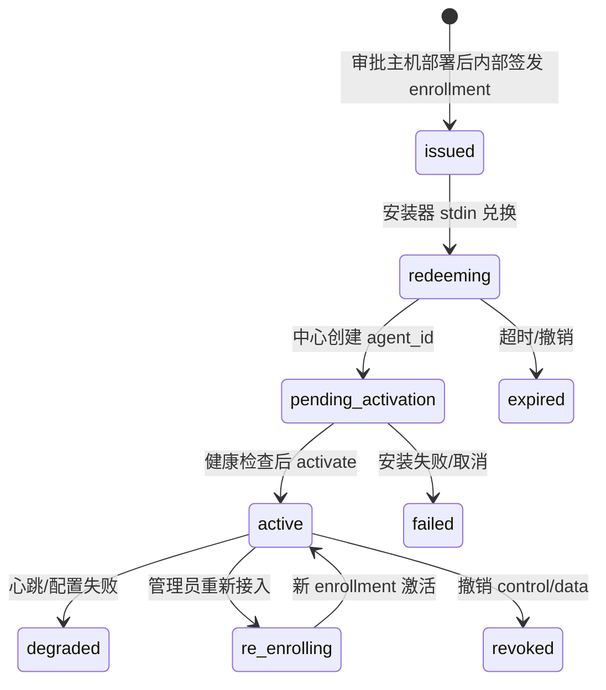

流程如下：

1. 管理员在已登记主机完成 SSH 预检并审阅部署计划；中心内部签发绑定主机、版本/架构和初始任务标签的短期 enrollment。
2. 页面只展示部署计划与回执，不提供独立 token/安装命令入口；中心通过受保护 SSH stdin 将 token 传入固定安装器。
3. 安装器提交 token、install nonce、版本、架构和最小信息；中心核验预绑定主机仍存在且未被其他身份占用，同 nonce 重试幂等，不同 nonce 重放拒绝。
4. 中心创建待激活身份并返回 bootstrap；安装器仅用它发起激活，不写入运行配置。激活前暂存配置只做离线预检，不能运行 Agent；取得独立双凭据后再次严格校验配置，再启动服务并确认启动结果。
5. Agent 激活后取得 control/data credential，使用 fsync 和原子 rename 落盘；中心只保存摘要。
6. 撤销立即拒绝新请求；凭据自动轮换与有限 grace 窗口仍是后续能力，当前不能声称已自动轮换。

`control_credential` 只用于心跳、配置和控制；`data_credential` 只用于 Agent 遥测。Agent 不再接受旧 config.key 或共享 SDK Key 的运行/控制面降级；SDK Key 仍供业务 SDK 独立上报。SDK本地接收器与配置代理已移除，业务SDK仅直连中心。

## 13. 主机、SSH 和 Agent 引导

主机是唯一机器资产，Agent 是它的管理通道；在主机或容器中安装并接入 LightMoni Agent、取得身份后才具备节点能力。登记主机本身不会创建在线 Agent；Agent 必须先登记主机，再通过平台部署并关联，不提供独立脚本接入。主机资产、Agent 身份、SSH 凭据和 control/data 凭据仍分别保存、授权和审计，登记资产不产生 SSH 权限或秘密。

平台自动安装默认在宿主机运行独立的 systemd Agent 服务，不与业务服务的启动、休眠或停止绑定。后续容器部署可选择独立 Agent 容器、Kubernetes DaemonSet，或在用户部署业务时显式注入 sidecar；本轮不实现自动 sidecar 注入，不默认改写用户业务镜像。容器内 Agent 的执行范围取决于真实挂载、命名空间和运行权限，不能仅因登记为节点就声称具备宿主机操作能力。业务 SDK 与 Agent 均可独立上报中心，SDK 不依赖 Agent 安装、不强制经 Agent 转发；Agent 需要自监控打点时复用同一公开 SDK。

前端统一“主机”入口，将主机列表、任务中心和主机标签放在同一工作区。所有列表行使用真实平台主机 ID，Agent 仅补充通道状态和任务；不再拼接无主机资产的独立节点行。主机展示 Agent 在线/离线、未接入、已卸载、已移除与 SSH 是否配置/恢复可用。旧 /machines、/agents 路由和任务深链继续可用。普通成员通过不含 SSH 秘密的主机目录与任务接口只读访问，不获取管理员 SSH 凭据或生命周期操作能力。通用任务模型见第 27 节。

Agent 接入只有“先登记主机、再由平台部署”路径。已认证 Agent 按已有绑定或服务端安装预约确定所属主机，注册/心跳不创建资产；enrollment 由中心预绑定已登记主机，兑换、激活和控制面均核验预约与关联。独立签发及手工主机关联入口移除，共享 SDK Key 不再用于控制面降级。不能按 hostname、出口 IP 或 Agent 本地 host_id 合并或认领主机。SQLite 事务防止提前注册造成重复资产或抢占其他 Agent；MVP 一条主机最多一个 Agent，容器 Agent 的执行范围不等于物理宿主机。

“移除节点”是中心侧归档操作：管理员二次确认后，在同一 SQLite 事务保存移除时间、操作者和原因，撤销该身份全部 control/data 凭据，并保留身份、凭据墓碑、遥测历史和审计。移除不停止或卸载远端程序，不删除主机，不撤销共享 SDK Key。未结束、已派发或结果未知的节点任务，以及待审批、执行中或结果未知的卸载流程阻止移除；重复请求幂等。默认节点列表排除已移除身份，管理员可查询历史；控制鉴权、数据鉴权和任务派发均拒绝已移除节点，禁止回退共享 Key 或由后续心跳复活。共享 SDK Key 不用于 Agent 控制面；旧无预约身份需从主机管理重新部署，不能通过撤销全局 SDK Key 实现 Agent 移除，也不恢复旧秘密。

节点承担周期指标、日志、拨测、受限运维任务和管理员授权的有限脚本。任务中心支持 Node.js/POSIX shell 的手动派发、指定时间一次、固定间隔和带时区的日历 Cron，脚本具有 Agent 用户权限，边界详见第 27 节与 SDD 048。AI 助手通过中心工具查询或生成行动提案，用户审阅批准后才保存或启用计划；Agent 通过出站控制通道领取并回传有界结果。SSH 保留为首次安装、固定身份核验、卸载及离线恢复通道。Agent 自卸载、Agent 本地模型决策和操作系统脚本沙箱仍是后续能力。

登记须填写主机名称和 SSH 目标地址、端口及登录用户；连接凭据可稍后添加，Agent 可稍后部署。主机公钥及指纹在首次 SSH 握手时自动记录，无需用户填写或确认。观测 hostname 不自动成为可信 SSH 地址，管理员可编辑同一主机名称和目标连接。秘密提交后由服务端使用 AES-256-GCM 加密，主密钥独立于数据库保存，页面永远不回显；模型只能看到主机元数据、凭据 ID 和结构化检查结果。主机删除是管理员操作：先移除仍有效的 Agent 身份，并结束终端、检查、部署/卸载和未结束计划、解绑有效连接凭据后才可删除，避免后续心跳自动重建。移除/卸载 Agent 不删除主机资产，删除记录不等于远端程序已卸载。

SSH 是首次接入、临时维护和故障恢复通道。登记在单一表单中展示连接信息、登录方式、秘密输入与保存时长；登录方式为密码或 SSH 私钥。主机公钥和指纹不在表单输入，首次 SSH 握手自动记录，详情只读可见；后续连接自动核验已记录身份。密码与私钥统一默认按期限保存 6 小时（managed），到期或撤销后清空；可显式确认永久保存（permanent），无固定过期时间，直到管理员撤销。有限托管和永久凭据均不因 Agent 激活提前清除；建议优先短期保存。凭据保存失败保留原主机 ID，就地重试不重复登记。主机名称、ID、指纹是资产元数据，不随登录凭据期限过期。已有凭据期限不自动改变；显式 temporary/one_time 仍沿用短期/使用后清除语义。

SSH 预检是只读固定命令集合，检查网络、指纹、Linux、架构、systemd、权限、HTTPS 可达性及已有 Agent 安装。私钥或明确选用 temporary/managed/permanent 的可复用密码可用于预检、终端、固定身份核验和 Agent 安装/卸载；one_time 密码只用于一次预检或终端，结束即清除，无论成功、失败或取消。密码和私钥均经 ssh2 内存参数认证，不进入命令行、环境、进程 stdin、模型上下文或原始日志；enrollment token 单独经 SSH exec channel stdin 传递。密码不保存秘密摘要，历史密码指纹启动时清空；同一主机各类 SSH 操作互斥。

预检通过后生成持久化部署计划；管理员明确确认后，后端先保存 enrollment 与目标主机的服务端预约，再使用固定安装模板、有效凭据、stdin enrollment token 及版本/架构白名单执行。下载脚本和包需要鉴权，0600 curl 配置暂存 token；不进入 URL、argv、环境、日志或回执。生成计划、执行前和安装锁内拒绝覆盖既有安装。计划绑定主机名称及连接 revision，执行前改名使旧计划失效。Agent 注册早于安装回执时仍通过预约关联原主机，不另建资产；确认激活后完成回执与凭据清理，清除 temporary/one_time 秘密并保留有效 managed/permanent 凭据。失败但新 enrollment 已激活时，仅撤销本次节点凭据并提示核对，不影响已有节点。日常管理优先走 Agent。

卸载使用独立的持久化计划和回执。中心固定只读探测核对远端独立身份、主机关联、受管服务及未结束任务；同一节点卸载与任务按 agent_id 跨主机互斥。计划绑定主机名称、地址、端口、用户名、可信指纹、有效私钥或可复用密码、节点身份及 15 分钟预检有效期；目标或授权变化不能复用。网页提供预览、确认、取消和历史，AI 不能绕过确认执行卸载。

确认卸载后仅执行平台版本受控的固定脚本：核对标准路径受管 systemd unit，拒绝其他来源的同名服务，再停止并禁用独立服务，确认停止后移除服务文件、启动器和 Agent 运行目录；停止失败不得删除程序。默认保留 /etc/lightmoni-agent、/var/lib/lightmoni-agent、专用服务用户，以及业务部署、制品、容器和卷。保留配置与队列用于核查和数据恢复，不代表保留文件中的旧凭据仍有效，也不保证尚未送达的数据可自动补传。

成功核验要求程序路径已移除、服务 not-found 且未运行、远端身份一致、两个持久目录保留并且没有未完成任务标记。中心在同一 SQLite 事务中撤销该节点全部 control/data 凭据并完成卸载记录；已登记节点不能回退为 legacy Key 认证。保留主机、节点和卸载历史，重新接入需要新的 enrollment。运行中、已派发或结果未知的节点任务必须先完成或核对。卸载的 awaiting_approval、running、succeeded、failed、unknown、cancelled 分别记录审批、执行和结果边界；SSH 断连或结果不确定进入 unknown，不报告成功且不盲目重跑。管理员可触发固定只读 reconcile，原临时私钥到期后可以添加新的有效私钥用于核对；完全移除且身份和保留数据核验通过才补做凭据撤销并成功，完整程序仍在且服务状态明确、无生命周期锁或任务标记时记录失败并保留凭据，部分移除或不确定则继续 unknown。待审批或未知结果仍允许管理员用终端人工核查，但禁止改主机、删除或新建部署；实际执行与核对期间同主机终端和检查互斥。

凭据到期或撤销时同样清空当前记录的 `secret_encrypted`，保留 ID、策略来源、有效期、清除时间/原因和不含秘密的事件。有限凭据在启动时、读取/使用前和每 30 秒统一清理；永久凭据仅在明确撤销时清除，不以空期限计算为到期。统一有效性判断要求未撤销、秘密未清除，且永久策略无固定期限或有限期限在未来；关闭模块时释放定时器；清理幂等，并取消引用失效凭据的待审批计划，不改写正在运行的计划。终端租约在到期或撤销后失效。清空当前记录不等于擦除 SQLite WAL/free pages、备份、已进入有界操作的进程副本或远端 authorized_keys。

主机能力由后端按连接方式、忙状态及有效凭据计算 terminal、ssh_check、deploy_agent、uninstall_agent、update_agent、rollback_agent。active_reusable_ssh_credential_count 只统计私钥及 temporary/managed/permanent 密码，安装、卸载和升级不能用含一次性密码或手动脚本的总数推导。界面展示能力及置灰原因；所有操作后刷新状态。未记录主机身份不会置灰，首次 SSH 操作自动记录。实现契约见 SDD 031、032、034、037、038、039、040、045。

网页终端是管理员本人使用的临时 PTY：同源 Origin、登录 cookie、首次自动记录且后续比对的主机公钥、单次 WebSocket 入口、输入/输出上限、10 分钟空闲和 30 分钟总时长。终端输出不持久化、不写日志、不发送给 AI。终端不是 AI 任意 shell 工具。

### 13.1 目标：主机接入状态与 SDK 归属（SDD 036，设计提案）

本节是待评审和实现的目标设计，不代表当前主机页面已具备 SDK 归属查询。“主机与节点”拟统一为“主机”，原管理通道改为接入状态，分 Agent、SDK、SSH 三项；不设置由任一通道推导的整机在线状态。旧路由、监控任务、任务标签和批量计划确认保留。

SDK 归属是后续显式资产绑定设计，不要求 SDK 安装 Agent。当前主机可先登记后配置 SSH，Agent 统一走 SDD 038 的登记主机部署流程，不再规划独立 Agent-only 资产入口；不能把容器 Agent 当作已核实物理宿主机。

SQLite 拟保存 SDK 归属的 host_ref、服务器认证得到的 key_id、service、instance_id、生效区间、revision、来源和审计。同一有效选择器最多关联一个目标；管理员从已观察到的候选明确确认，或在服务部署审批中确认准确 Key ID 和实例配置。客户端 host.id、hostname、来源 IP 和 SDK Key 不能单独证明主机归属；SDK 不发现本机 Agent，不增加注册或凭据签发协议。

SDK 心跳汇总使用 component=sdk 的规范化系统目录，按本页明确选择器有界查询。中心时钟计算 90 秒新鲜窗口与最多 30 秒未来偏差，同一条样本的 event_time、ingested_at 均须满足策略，且事件/接收时间属于当前归属生效后的范围；历史补传不能点亮新主机。查询失败、截断或时钟异常给出未知/原因，不能按 0 个在线处理；默认仅显示近期上报实例数，不以全部历史实例计算健康率。

Agent 显示未接入、在线、心跳超时、已移除或已验证卸载；没有绑定不等于未安装，受管安装不存在只由带时间的 SSH 检查证明。SDK 显示未关联、尚无可用心跳、近期上报、心跳超时或未知；自监控关闭/匿名/断网不直接推断业务停止。SSH 显示配置、指纹、有效凭据与最近检查，不声称持续在线。SDK 和 Agent 独立直报中心，任一通道状态不替代另一通道。

实例随机 ID 变化、新 Key、服务迁移和主机聚合不能静默继承归属。解除、迁移和删除需要明确确认、revision 守卫及事务审计，生效区间保留历史；卸载或移除 Agent 不解除已登记主机的 SDK 关系，不撤销共享 SDK Key。删除主机先预览 SDK 关系影响，旧删除/关联接口不能绕过新守卫；归属只用于观测展示，不授予 SSH 或 Agent 执行权限。

MVP 新主机资产与 SDK 归属/摘要接口仅管理员可用，成员保留原有 Agent/任务只读权限。AI 只可读取脱敏摘要和提出归属提案，不能批准。先交付命名及状态语义，再实现仅资产登记、归属与心跳查询，最后接入部署审批；每阶段以 SDD 036 的需求、HLD/LLD、拟议契约和验收清单为准，不把设计草图当已实现能力。

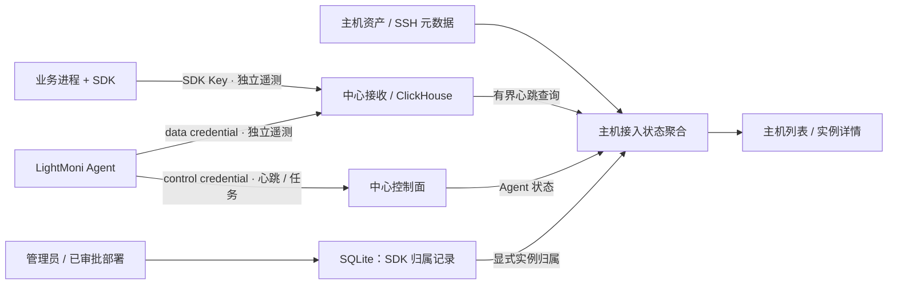

### 13.2 当前：登记接入与平台主机标识（SDD 037）

主界面统一称“主机”，移除“脚本接入节点”按钮，主路径是登记主机、保存所选期限的凭据、SSH 预检、审阅确认后自动安装宿主机 Agent。此节记录 SDD 037 的登记改动；单屏表单与默认保存时长以 SDD 039 后续修订为准。SDD 038 进一步移除独立脚本接入与旧身份兼容，不删除用户数据库历史记录。登记资产本身不执行 SSH 或远端写入。

平台通过 managed_machines.id 和 name 标识主机资产。ID 在登记时由中心自动生成，作为不可变主键；名称由用户填写和修改，是展示名称而非唯一键。同名主机通过不同 ID 区分，改名不改变资产 ID、凭据归属或已有 Agent 关联，界面详情保留稳定 ID 供核对。

本轮不创建或展示 SDK 主机环境变量，不扩展 SDK 读取能力，不在安装参数、Agent 配置或 SDK 遥测中注入平台资产 ID/名称。SDK 与 Agent 各自独立上报的既有路径保持；主机与 Agent 的绑定继续走已认证身份和现有受管关联流程。

SDD 036 的完整 SDK 归属表、显式绑定和双时间心跳汇总仍是目标设计。当前仅完成平台内主机身份、凭据有效期和登记安装主路径，不从主机名称、地址或 SDK 声明自动认定归属。

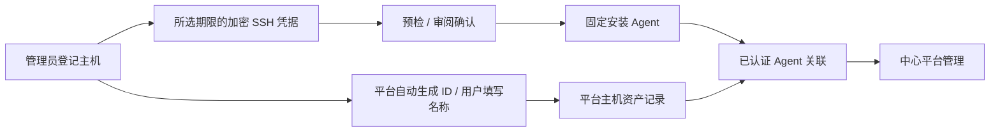

### 13.3 当前：登记主机与 Agent 身份一体化（SDD 038）

主机是唯一资产入口：先登记平台 ID / 用户名称，再按需保存指定期限的 SSH 凭据、预检、审阅确认并安装 Agent。中心内部签发 enrollment 必须预绑定已登记主机，公共独立签发接口停止创建新 token。兑换、激活及注册/心跳核验预约和独立凭据，首次注册与绑定在 SQLite 事务内完成；注册早于安装回执仍关联原主机。客户端提交资产 ID 不具有关联效力。

注册/心跳不建档、不修改归属，不回填旧独立 Agent，不支持手工关联与历史协议降级；无主机预约的 token/身份拒绝接入，不能通过 SDK Key 控制面 fallback。旧数据库记录保留，不自动删除用户资产。重新部署保留原主机 ID：旧身份须已移除或全部凭据失效、没有未完成任务，新的有效 SSH 预检确认远端无 Agent，再由新安装预约的旧身份快照完成原子替换，保留旧身份历史。移除或卸载 Agent 后保留主机，主机有有效 Agent 身份时不可直接删除；旧身份卸载回执不能决定新身份的状态或删除权限。

用户名称与 observed_hostname 分离，心跳不覆盖名称或 SSH 配置。登记须填写名称与 SSH 目标地址、端口、登录用户，凭据可稍后添加，主机公钥与指纹首次 SSH 握手自动记录；管理员可编辑名称及目标连接，凭据按用户选择的期限保存。Agent 本地 host_id 保留遥测资源含义，不作为平台主机 ID；同名、共享出口或容器身份不能自动识别同一物理宿主机。成员只获取主机 ID/名称与原有 Agent 可见信息，不获 SSH 元数据。SDK 独立直报，不增加 SDK 环境变量、主机发现或 Agent 依赖。


### 13.4 当前：单屏登记与统一凭据保存时长（SDD 039）

登记主机的同一表单直接显示主机名称、地址、端口、用户名、密码或 SSH 私钥输入及保存时长。主机公钥/指纹由首次 SSH 握手自动记录，无需填写或确认。默认登录方式为密码，默认保存 6 小时；可选择有限期限或永久保存。公钥/指纹在详情只读显示并用于后续 SSH 服务端自动核验，既不是 SSH 登录公钥，也不能替代密码/私钥；指纹与平台 ID/用户名称作为资产元数据保留。管理员仍可明确选择仅登记、稍后添加凭据，登记本身不执行 SSH。

API 有限策略为 managed，默认 expires_in_seconds=21600；永久策略为 permanent，必须显式 confirm_permanent=true，且不得同时提交有限秒数。数据库以 expires_at 空字符串表达无固定期限，仅在 retention=permanent 时有效；不使用虚构的远期时间戳。此节的早期实现将秘密加密绑定主机和凭据 ID；集中连接凭据及共享绑定以第 13.6 节为准，秘密仍不回显、不进入 AI、日志或审计正文。

统一有效性用于计数、终端、SSH 检查、安装/卸载、批量及 AI 脱敏凭据选择：未撤销、秘密未清除，且永久无固定期限或有限期限晚于当前时间。Agent 激活保留 managed/permanent；撤销清空密文、终止引用终端并使待执行计划失效。永久凭据不代表终端会话或部署计划无限期；原空闲/总时长、固定目标指纹、预检 TTL 和人工审批继续生效。

登记表单用原主机 ID 重试秘密保存，失败不重复建档、不执行 SSH；关闭窗口或更换登录方式清理秘密输入。已有凭据保持其既定期限，旧 temporary/one_time 行为明确独立，不改变统一主机登记和 SDK 独立直报架构。

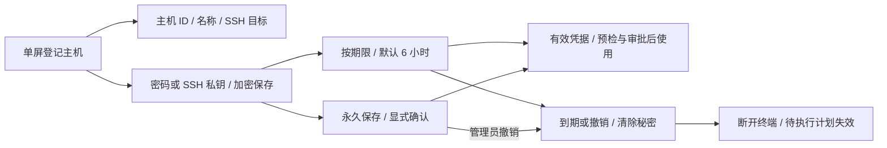

规格、契约与验收见 [SDD 039](../specs/039-host-registration-credential-retention/spec.md)。

### 13.5 当前：自动记录 SSH 主机身份（SDD 040）

登记和编辑只接收用户名称、SSH 地址、端口和用户名；登录密码或私钥按 SDD 039 的时长独立保存。主机公钥、SHA256 指纹及首次记录时间由中心产生并只读返回，API 拒绝客户端写入。主机页不再展示连接凭据安全提示横幅，登记和编辑也不展示身份输入或确认。

SSH 固定命令和网页终端统一使用 ssh2，在同一实际连接的 hostVerifier 中处理服务端公钥；不依赖单独 ssh-keyscan 后无条件信任另一条连接。首次握手在认证前，以主机 ID 和 SSH 端点原子固定公钥及指纹；已有指纹只允许匹配后补全公钥。重复连接匹配已记录身份，变化则拒绝连接，不覆盖旧身份、不执行远端命令。首次使用信任（TOFU）不包含带外首次身份核验，也不把自动记录描述为人工验证。

保存身份时重新核对活动操作、凭据状态、主机端点与当前指纹，阻止过时或竞争结果。首次记录后终端租约和预检使用更新的 revision，安装及卸载计划继续绑定该身份、有效凭据、目标与预检期限；生成计划不执行程序，人工执行审批保持。影响 SSH 目标的编辑以单调递增的 ssh_target_generation 纳入 revision，同时删除旧检查、取消待审批计划，避免端点 A→B→A 复用旧结果。地址或端口修改额外清空公钥/指纹/记录时间；仅改用户名称或登录用户名保留同一端点身份。认证完成后、执行命令前仍重新验证授权与目标；已经开始执行的操作按真实回执收敛，不因中途凭据到期伪造失败。

管理员在详情只读查看和复制主机公钥/指纹及记录时间；未连接显示“首次 SSH 连接后自动记录”。成员与 AI 的可见范围保持原有脱敏边界。没有指纹不阻塞首次预检、终端或批量操作，缺少有效凭据、互斥、权限和既有计划约束仍由后端能力决定。

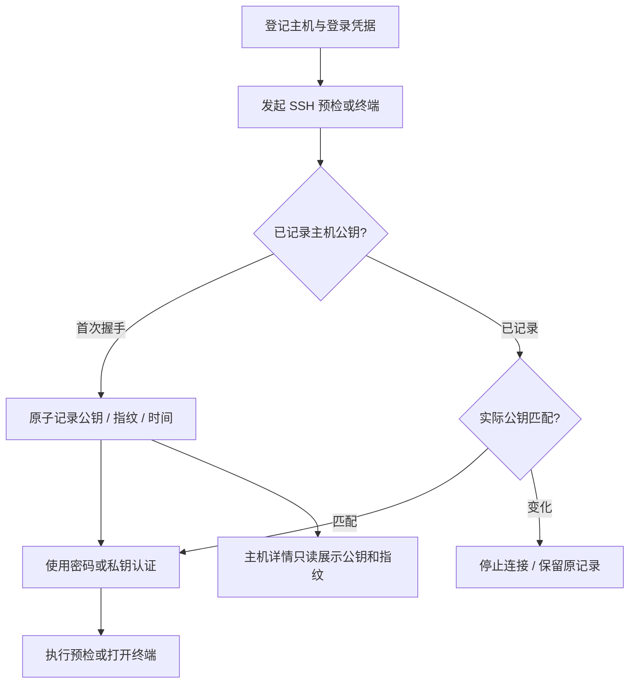

规格与验收见 [SDD 040](../specs/040-automatic-ssh-host-identity/spec.md)。

### 13.6 集中连接凭据与主机默认绑定（SDD 050）

运维工具提供独立“连接凭据”页，统一管理 SSH 私钥和密码。主机登记可选择已有有效凭据，也可直接填写新秘密并保存到凭据库；主机自身保存名称、SSH 地址、端口和登录用户名。默认保存 6 小时，可选择其他期限或明确确认永久。页面展示名称、类型、状态、有效期、关联主机与私钥公钥指纹；服务端不返回秘密或密文。此设计更新第 13.4 节的按主机保存实现，保留原期限和主机身份语义。

中央 connection_credentials 加密保存秘密；machine_credentials 保留稳定 ID 作为主机绑定并引用中央项，managed_machines.default_credential_id 指向默认绑定。SSH 检查、终端、部署和卸载省略凭据 ID 时自动使用默认项；默认过期、撤销或解绑后明确提示更新，不自动换用其他凭据。检查和审批计划始终绑定当时的凭据 ID，不因修改默认值而更换已审阅授权。

SSH 私钥以实际公钥 SHA256 指纹识别，同一私钥可关联多台主机；重复提交复用已有有效项并返回其真实期限，不隐式延长或改名。密码不生成可离线猜测的秘密散列。手工新增同钥时，本主机绑定仍遵守本次请求期限并受中央期限约束；明确选择已有库项时才继承库项期限，不因去重扩大本主机授权。有效旧凭据迁移时保留绑定 ID、原期限与消费语义；无法解密或解析的旧材料隔离为不可用，保留受保护密文供核查，有限期限到期仍清除，不默认选用或重新激活。绑定的有效性同时受中央项和自身期限限制，不因合并其他主机的永久私钥而延长旧授权。

解绑仅清除本主机绑定，取消对应待审批计划并关闭引用终端，不撤销其他主机共用的中央项。全局撤销需要明确确认并展示关联主机，清除中央密文并使所有绑定、终端和待审批计划失效。中央过期也统一清除秘密。临时绑定仍按 Agent 激活清除，仅影响该绑定；一次性密码仅允许单主机绑定，使用结束同时清除其独占中央秘密，不能再次绑定复用。删除主机不删除共享中央项；AI 只获得公开元数据和绑定 ID，不能读取或取回秘密。

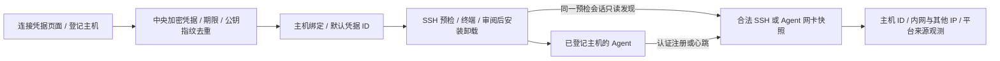

### 13.7 主机网络地址与可信来源观测（SDD 050、051）

主机列表的“主机”栏在用户名称下标记 SSH 连接地址、内网 IP、其他网卡地址与平台观测来源 IP；详情显示观测主机名、网卡、地址族、地址分类、发现方式和最近观测时间。支持多网卡、多 IPv4/IPv6 和纯内网环境。登记时的 SSH 连接地址仍由用户提供；平台不能从私钥、浏览器所在电脑或机器名称推导它。IP 和观测主机名是可变元数据，平台生成的主机 ID 才是唯一身份，不按 hostname、内网 IP 或共享 NAT 出口自动合并资产，也不覆盖用户名称、SSH 地址、端口和登录用户名。

安装 Agent 前，管理员主动执行 SSH 安装检查即可发现网络。平台复用同一次已验证服务端主机密钥、凭据和目标的 SSH 会话，追加固定、有界的只读 hostname/网卡采集区块；不额外连接、不安装依赖、不执行用户脚本。核心安装条件与可选发现分别解析。缺少 ip 工具、非法数据或超过字节/条数上限时，发现返回 unavailable，不降低已通过的核心 ready，也不保存原始 stderr 或擦除先前成功快照。核心安装条件未通过但发现成功时仍可展示和保存结果；取消、身份变化或授权失效的过时结果不得写入。

Agent 通过系统网卡接口采集 network_addresses，每次注册/心跳提交最多 64 条规范地址。SSH 与 Agent 共用 IP 规范化及服务端分类，支持 RFC1918、CGNAT、IPv6 ULA、链路本地和回环；超量或非法 Agent 输入仍整体拒绝，不能部分刷新心跳状态。主机 summary 的 network 保留 addresses、private_ips、public_ips、observed_at、source_ip、source_observed_at 和 source_kind，新增 observed_via（ssh、agent 或 unavailable）及 hostname。hostname 仅表达该成功快照的观测主机名，observed_at 使用服务端接收该成功快照的采样时间，不信任远端时钟；没有合法快照时显示可执行 SSH 安装检查或等待 Agent 上报。

machine_network_observations 原位保存规范快照及观测身份。SSH 快照绑定当前 ssh_target_generation 和实际服务端主机密钥指纹，提交前重新验证；修改 SSH 地址、端口或登录用户名使旧 SSH 快照失效，A→B→A 也不能复用。Agent 快照由 snapshot_agent_id 约束当前认证绑定；旧 agent_id 独立约束平台来源 IP。读取时分别验证网卡快照和平台来源的身份，不因其中一个失效而抹掉另一个仍合法的观测。Agent 重装不能沿用上一 Agent 的网卡或来源，合法 SSH 快照也不因旧 Agent 失效而丢失。

同一主机按服务端采样时间保存最新合法的成功网卡/主机名快照，SSH 与 Agent 没有固定优先级。新的成功空快照清空当前网卡；失败保留先前成功数据。旧 Agent 未提交 network_addresses 时不伪造或覆盖网卡，也不擦除独立 SSH 快照，来源 IP 仍可在认证请求中单独更新。更新网卡不刷新 source_observed_at；SSH 永远不填充 source_ip。

source_ip 仅由平台根据该 Agent 请求连接观测，不从正文接收，不调用第三方公网 IP 查询服务。平台观测来源可以是内网、NAT、代理或 VPN 地址，只代表 Agent 到平台这一条连接；网卡公网范围也不代表公网可达。两者都不推导 NAT 映射、全局出口或公网入站地址，不自动改写 SSH 连接配置。

默认忽略 X-Forwarded-For，只采用 socket 对端。反向代理部署可通过 LIGHTMONI_TRUSTED_PROXIES 显式设置 IP/CIDR；仅在直连对端可信时，从右向左剥离可信代理链，采用第一个非可信来源。可信代理缺失或提供非法转发链时显示来源不可确定，不能将代理地址当成已发现的主机出口。未配置可信代理时显示的来源可能是代理本身，界面明确注明平台观测依据。

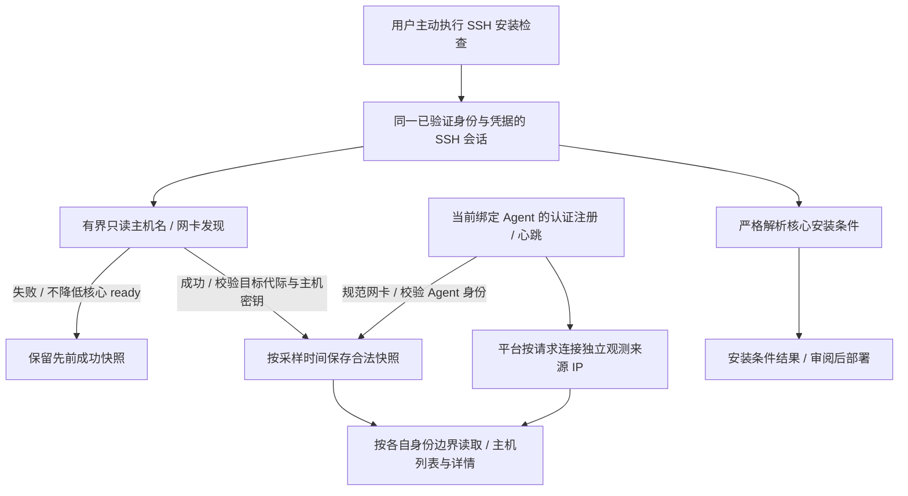

规格与契约见 [SDD 051](../specs/051-ssh-host-network-discovery/spec.md)。

## 14. AI 助手设计

### 14.1 运行时分层

Mastra 是 LightMoni AI 助手的主对话和工具编排运行时。中心每轮通过私有 stdin/stdout 管道启动 Node worker；模型连接由 provider 适配 OpenAI Chat Completions、OpenAI Responses、Anthropic Messages 和 Google Gemini。Pi Agent 不是另一个平台入口，而是 Mastra 在 `code_task` 中调用的受限代码执行器，负责“读取 → 修改 → 检查 → 修复”的多轮循环。

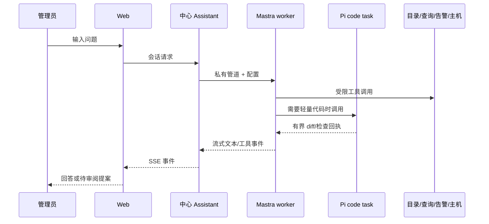

### 14.2 工具分级

| effect | 示例 | 应用方式 |
| --- | --- | --- |
| `read` | list/describe tables、run_query、日志、告警读取、主机状态、业务部署事件 | 有界执行，可直接返回 |
| `draft` | dashboard draft、alert change、silence、SDK `propose_sdk_instrumentation`、Agent deployment plan | 保存或返回提案，用户审阅 |
| `code` | Pi `code_task` | 隔离副本、检查、diff，用户确认应用 |
| `execute` | 当前不提供模型任意 SSH/命令 | 未来单独 SDD，默认关闭 |

AI 的查询必须走目录和统一 Query，SQL 只读、有时间范围和结果上限。告警规则和静默的修改使用 revision/版本检查和 15 分钟提案有效期；应用时重新检查权限、版本和对象状态。代码任务只在管理员配置的 workspace 中运行，限制路径、符号链接、文件大小、白名单检查命令、步数和时长；Pi 不 commit、push、PR、merge 或 deploy。

### 14.3 模型管理与用量

管理员在“模型管理”保存 Base URL、协议、模型和输入/输出单价。自动识别只给地址和目录依据推荐；第三方 OpenAI 兼容目录无法区分 Chat/Responses 时必须人工选择。各协议独立规范化 `/v1`、`/v1beta`、目录鉴权和生成接口；修正后的地址回填输入框并说明原因。目录刷新不产生生成费用；连接测试发送一次最小真实请求。

每个真实模型请求使用稳定 request ID 幂等写入账本，记录 started、usage 和终态，区分 complete、partial、unpriced、failed、cancelled。缺失 token 不能猜成零，模型输入、Key 和回复正文不写入用量统计。

### 14.4 平台开放能力与 MCP：目标架构（SDD 046）

平台开放能力的总体目标覆盖完整业务，任务只是其中一个领域。采用“统一应用能力层 + MCP/Web HTTP/内置 AI 三种适配器”：外部 Codex、Claude 通过 Streamable HTTP MCP 调用，平台助手在进程内调用相同 Dispatcher，页面和普通程序通过 HTTP 复用同一领域服务。MCP 负责协议与工具发现，能力层统一真实主体、role/scope/资源交集、参数校验、审批、幂等、审计和安全结果；不直接包装助手 execute 并伪造 session/admin。首期同进程模块部署，不新增微服务或队列。SDD 047 已实现首批主机/任务工具、专用 PAT、OAuth 与接入管理，其他领域逐步迁移，不等于全部目标已完成。

用户客户端授权采用 OAuth 2.1 授权码 + PKCE，独立 PAT 只作为支持 Bearer 配置客户端的补充；二者均不复用 SDK/Agent/SSH/模型凭据。首期安全读取与提案，操作在平台审阅；客户端弹窗或模型确认不代替审批。通用提案把 owner 与来源会话分开，已有助手历史权限保持。后续自动执行仅限管理员固定能力/版本、主机、参数界限与期限的持续授权。

所有主机主动操作关联统一 execution ID，复用真实 task run、Agent job、部署、运维和生命周期回执；不同领域保留真实状态与恢复策略，unknown 不自动重放。遥测查询记调用审计，持续采样不逐条建任务；交互按独立会话协议留痕。长任务返回 ID，连接中断不等于取消。远端 MCP 不读取用户本地源码，本地 AI 负责本地文件，平台部署使用明确提交的版本/制品。任意 SQL 和脚本源码须额外数据授权，不能由主机范围 token 绕过资源隔离。

SDD 047 首期只开放安全目录、任务/执行状态及已有任务派发、取消、重试提案；不开放任意 SQL、任务定义修改、直接执行或自动批准。外部提案审批和排队项领取前复验稳定授权；OAuth 短期 access token 自然过期不取消已批准项。执行索引本期仅关联真实 task run，在接受/查询时投影，状态以原生记录为准。`/mcp-access` 管理自己的令牌、OAuth 授权与预注册客户端，`/mcp/authorize` 明确授权。使用官方 SDK 1.32.2 的 2025 协议；2026 适配尚未实现。externalURL 不满足 HTTPS origin/本机 HTTP origin 时仅禁用 MCP，不阻止原平台运行。尚未完成的 MCP 来源提案在审批授权适配器缺失时拒绝应用，不能通过内部助手 fallback 绕过原授权；外部排队项和自动重试保留稳定授权，领取前无校验器时拒绝开始。首期告警启用时共 10 个工具，平台默认任务与用户任务共用 list/get，移除独立模板目录。MCP 主机名称区分用户资产 name 与当前 Agent 的 observed_hostname，替换、移除或尚未上报时不回退旧缓存。

完整 HLD/LLD、三张流程图、授权、工具矩阵、执行/幂等契约、数据与代码边界以及分期验收见 [平台开放能力与 MCP 架构](platform-mcp.md)、[SDD 046](../specs/046-platform-mcp/spec.md)；当前实现及使用边界见 [SDD 047](../specs/047-platform-mcp-service/spec.md) 和 [MCP 接入指南](mcp.md)。

## 15. 告警、静默和通知

告警规则使用统一 Query 执行器，以固定窗口求值。规则显式声明来源表，目录表可提供默认责任组；多组路由按 group 独立生成响应。episode、响应、接手、升级、静默和通知 outbox 是独立状态机，通知失败不能阻塞采集。

AI 可以读取规则、静默和责任组的脱敏信息，也可以创建待确认的规则/静默提案。应用时使用对象 revision 和范围权限，重复确认返回原回执，配置冲突返回 409。通知渠道秘密只在中心保存，AI 不读取联系方式和供应商 Key。

## 16. Web 工作台设计

主侧栏包含概览、监控大盘、日志、链路、告警、节点助手、数据接入、数据管理、管理后台和 AI 助手。登录用户与身份位于右上角；颜色支持浅色、深色、跟随系统和强调色；界面支持简体中文/English。语言和外观保存在浏览器，不改变业务名称、日志、SQL、代码、凭据和模型输出原文。

页面只使用共享 React 控件，不使用浏览器原生 select、alert、confirm、prompt。SDK 接入提供独立上报说明、SDK Key 和豁免表；数据管理提供目录、保留和采样；模型管理提供连接、目录、测试、价格和用量；节点助手提供节点、任务和标签；主机管理提供预检、部署计划和终端。

前端不持久保存真实凭据。登录秘密仅在管理员填写并确认保存时提交中心，提交后不回填；后续 SSH、模型和部署请求只携带登录 cookie 与资源 ID，秘密解密及执行由中心后端完成。所有修改页面都要处理加载、失败、权限、冲突、过期和重试状态。

## 17. 安全和信任边界

### 17.1 凭据矩阵

| 秘密 | 生成/保存 | 使用位置 | 禁止位置 |
| --- | --- | --- | --- |
| SDK Key | 中心创建；密文/摘要 | SDK → 中心 | Agent control、模型、浏览器持久化 |
| enrollment token | 已登记主机部署内部签发；中心摘要 | 固定安装器 stdin/FD | URL、argv、env、日志、AI |
| control credential | 中心兑换；Agent 0600 文件 | 心跳/配置/控制 | 遥测、SDK、模型 |
| data credential | 中心兑换；Agent 0600 文件 | Agent → 中心遥测 | 控制 API、业务 SDK |
| local token | 用户在 Agent 本地配置 | SDK → Agent | 中心签发、AI上下文 |
| SSH 私钥/密码 | 中心 AES-GCM；统一默认按期限保存 6h，可显式确认永久保存；有限到期/撤销清除，永久撤销清除；主机指纹为独立元数据 | 后端固定 SSH worker/终端；Agent 激活清理临时凭据 | 浏览器持久化、模型、日志 |
| 模型 API Key | 中心加密 | 私有 Mastra worker | 浏览器、URL、模型消息 |

### 17.2 通用安全规则

- Host key 采用首次使用信任（TOFU）：同一握手先原子固定公钥再认证，首次无需用户确认；后续必须匹配，变化时停止且不自动覆盖。地址/端口改变清空该端点身份及旧预检/计划，不能关闭后续校验。
- 主机地址只接受主机名/IP，不接受 URL、用户信息、命令、控制字符或云元数据地址。
- AI 工具 schema 使用 `additionalProperties:false`；未知参数、任意 command、任意 host 和任意 key 直接拒绝。
- 凭据撤销和会话降权应在受限时间内断开终端；离线 Agent 的缓存任务不能被文档宣称为即时停止，直到配置租约实现。
- 日志、审计和错误只记录固定错误码、资源 ID、操作者、时间和脱敏摘要。

## 18. LLD：关键接口与状态机

### 18.1 OTLP 请求

```text
POST /v1/{logs|metrics|traces}
Authorization: Bearer <key-or-agent-data-credential>
X-Lightmoni-Table: <logical-table>
X-Lightmoni-Batch-ID: <UUID>
X-Lightmoni-Batch-Created-At: <RFC3339Nano UTC>
Content-Type: application/json | application/x-protobuf
```

200/202 表示整批接受；400 表示永久协议错误；401/403 表示凭据问题；429/502/503/504 可按 Retry-After 重试；未知网络结果保留原批次。自有链路不使用 partial success 丢掉未知子集。

### 18.2 Agent 接收与队列状态

```text
received → persisted → forwarding → acknowledged
                     ↘ retry_wait → forwarding
                     ↘ quarantine / expired / rejected
```

`persisted` 才能向 SDK ACK；`acknowledged` 才能回收队列 payload。队列 SQLite 保存 input hash、forward hash、身份、创建时间、attempts、next time、last error 和日志 cursor。容量不足返回可重试背压。

### 18.3 告警响应状态

```text
rule evaluation → episode open → unclaimed → acknowledged → resolved
                         ↘ cancelled / silenced / escalated
```

episode 状态与业务条件状态分开；静默只抑制通知和响应计时，不删除采集数据。接手必须通过已登录确认链接或供应商回调完成，GET 不产生副作用。

### 18.4 AI 提案状态

```text
drafted → awaiting_approval → applying → applied
                           ↘ expired / rejected / conflict / failed
```

提案绑定用户和会话，应用时检查 owner、权限、对象 revision、有效期和当前连接。重复应用返回原回执，不重复写入。代码任务的 `awaiting_approval` 只代表 diff 审阅，不代表已经写回工作区。

## 19. 可靠性、容量和故障处理

系统采用至少一次传输和查询去重，不承诺 exactly-once 网络交付。SDK 内存缓冲在进程崩溃时可能丢失；需要跨重启补传时使用 Agent durable queue。队列满、磁盘满、凭据错误、永久拒绝和过期批次都必须出现在 stats、节点状态或日志中。

ClickHouse 写入前后的 SQLite 状态不是跨数据库原子事务；中心只能在写入确认后 ACK，部分写入由稳定 event ID 和公开视图 `FINAL` 抵抗重复。掉电、异步 insert、磁盘耗尽和长时间补传需真实环境验证。

查询、日志历史和 AI 工具都使用有界会话：日志冻结分页有行数/内存/TTL；实时查询用重叠窗口和 event_id 去重；AI SQL 最长 90 天、10 秒和 1000 行样本；代码任务按文件/输出/步骤/超时限制。超过边界要返回显式 truncated/error，而不是静默给出不完整结论。

## 20. 部署、升级和运维

### 20.1 中心

```sh
cp .env.example .env
chmod 600 .env
docker compose config --quiet
docker compose pull
docker compose up -d --no-build --wait
```

根 Compose 默认同时运行中心与 ClickHouse；`deploy/with-clickhouse` 作为兼容目录继承两个服务。中心使用发布镜像 `docker.heyphp.com/lightmoni/lightmoni:20261026-admin`（Linux amd64/arm64），通过 `LIGHTMONI_CH_URL`（默认 `http://clickhouse:8123`）、`LIGHTMONI_CH_USER/PASSWORD` 接入数据库；ClickHouse 使用同一账号密码环境变量，不向宿主机映射端口，中心等待其健康后启动。启动时初始化 `lightmoni` 数据库和读账号。升级保留 SQLite、加密主密钥、队列和 ClickHouse 数据卷；备份必须同时保存状态卷、遥测卷和 `.env`。源码构建仍可显式 `build lightmoni` 后 `up --no-build --pull never --wait`。

### 20.2 Agent

发布脚本构建 Linux amd64/arm64 包、带源码/构建身份的发行目录和 SHA256；安装脚本校验 HTTPS、版本、架构和包完整性。平台接入使用宿主机独立 systemd 服务，`node runtime/dist/agent/main.js run --config /path/agent-config.json` 是源码运行入口。首装拒绝覆盖已有身份，受管升级采用第 28 节的独立确认与回退协议；维护保留 identity、凭据（若未撤销）、配置 revision 和队列，不能删除已有节点数据。

### 20.3 关闭顺序

中心停止接收新后台任务，等待可取消请求，关闭 AI worker、通知 outbox、目录轮询、ClickHouse writer 和 SQLite。业务 SDK 先停止生产再在截止时间内 `shutdown`；Agent 先停止采集，再等待队列尝试，最后关闭 HTTP server 和 SQLite。

### 20.4 管理员初始化与密码恢复

系统没有默认管理员或默认密码；空用户库允许网页首次设置，或由有本机/容器执行权限的运维人员运行 `lightmoni-admin init --name <name>`。运维命令直接访问 `LIGHTMONI_DATA/lightmoni.db`（容器 `/data/state`），复用中心 users/sessions 表、bcrypt cost=10 和 SQLite WAL/事务，不启动 HTTP、ClickHouse、AI worker 或主密钥初始化。此入口属于本机状态卷管理边界，不能作为 HTTP 后门或 AI 工具调用。

`reset-password --name <name>` 仅修改已有管理员的 bcrypt 密码哈希，并在同一 `BEGIN IMMEDIATE` 事务清除该用户所有登录会话；不提升成员、不创建未知用户、不改变启用状态。`init` 在事务中重查用户数，仅允许空库创建启用管理员，避免与网页初始化并发覆盖。密码由无回显终端双次输入或显式 `--password-stdin` 单行受限输入提供，至少 8 个 Unicode 字符、最多 72 个 UTF-8 字节；不进入 CLI 参数、Compose 环境、镜像层、日志或文档正文。具体命令与验收见 SDD 023。

## 21. 可观测性和审计

中心、Agent、SDK 自身使用 `lightmoni_*` 系统表记录心跳、队列、重试、丢弃、拒绝、配置 revision、采集器和模型用量。系统遥测不应递归记录原始请求、Key 或任意异常全文。每个系统级事件至少包含 component、service/agent_id、instance_id、时间、事件名和固定计数。

审计对象包括：登录和身份绑定、Key 创建/撤销、enrollment/激活/轮换/撤销、SSH 检查/部署/终端、任务和标签修改、告警提案应用、代码 diff 应用、模型连接测试和价格修改。审计只保存资源 ID、操作者、结果、版本/摘要和错误码，不保存 token、密码、私钥、提示词或生成正文。

## 22. 当前实现、兼容路径和限制

### 22.1 当前已实现或已有验证证据

- 中心和 Agent 使用 Node.js/TypeScript；Web 使用 React/TypeScript；AI runtime 使用 Mastra。
- SDK、Agent、中心共享 OTLP 和公共 TypeScript 类型；Agent 使用同一个 TypeScript SDK 做内部指标和 exporter。
- 节点标签/任务、Agent enrollment、control/data 凭据、主机 SSH 预检、部署计划和网页终端均有对应特性 SDD。
- SDD 021 已加入业务服务/目标/发布元数据、只读 SDK 插桩扫描、受限 TS/JS 结构化插桩提案、管理员确认后的安全 apply、中心部署状态迁移/审批/事件/人工回滚 job、Agent job/租约协议、MVP capability executor/runner 和 AI 部署计划工具。approve 要求带授权 capability 的 health_check 并创建不可变 job；Agent 的有序阶段回执、健康成功证据、取消和 unknown 结果已联动部署状态。Agent 可通过隔离的 `systemd.probe` job 对登记目标做只读主机预检，中心保存绑定目标配置 revision 的 10 分钟快照；它不会改变主机或推进部署状态。本轮已落地 release bundle 格式、私有存储、job-scoped 下载、有界管理员孤儿 GC、受限解包、current symlink 激活、CAS 回滚和 systemd typed actions；已加入管理员手动 ClickHouse 遥测核验与独立结果；真实 ClickHouse/业务主机验收、自动补偿、源码构建、签名、硬配额和 Docker/Kubernetes 适配器仍未完成。
- AI 具备目录、查询、日志、告警读取、可审阅草稿、SDK 插桩提案、业务部署状态/事件读取、Pi 代码任务和模型用量/连接测试设计。
- 告警规则、静默、值班、通知 outbox 和现场取证由中心域模块负责。

### 22.2 兼容路径

- `/agents` 工作区与 `group_id`/`--group-id` 标签字段仍存在；Agent 独立脚本接入、config.key 和手工关联已移除。SDK 构造 API 的版本策略与 Agent 接入分别管理。
- 旧数据视图和历史物理列不因新 record 模型删除。
- 浏览器入口和历史深链接通过重定向兼容到“数据管理”“模型管理”和“节点助手”。

### 22.3 当前必须保持诚实的限制

- SDK 发布语言矩阵仍需以目标分支的 `/api/v1/sdk-install`、发布脚本和 SDD 012 对齐；源码存在的历史 SDK 不等于当前发行包已承诺支持。PHP 不在当前发布目标；Go/Rust 若标记为后续支持，页面必须显示 deferred 而不是可下载。
- SDK 远程停报、日志采样和规则配置不是每种语言都已接入；未支持的语言不能声称平台规则已生效。
- Agent 离线时撤销不能即时停止其已缓存任务，配置租约仍是后续强化。
- SSH 终端是管理员临时工具，不给 AI 增加任意 shell 能力。
- 通用脚本使用 Agent 进程权限，私有脚本目录、最小环境与有界子进程不构成不可信代码沙箱；不得在脚本中写入连接凭据。默认开启的拨测任务在地址未配置时为“待配置”，不产生虚构成功。SDD 048 增加脚本上传/编辑、单次定时、固定间隔与五段 Cron/IANA 时区；参数和自定义工作目录需要 task.script.v2。不支持持续守护脚本、跨主机编排 DAG、任意运行时/秘密注入或分布式 exactly-once。
- 代码任务副本不是操作系统沙箱；白名单命令只适用于受信 workspace，不能当成不可信代码隔离。
- ClickHouse 的掉电可靠性、极端容量、Linux 实机和完整 Docker 发布需要按证据目录继续验收。

## 23. 演进路线

1. **一致性门**：统一 SDK 发布矩阵、接入页、下载 API 和验证 fixture；清理过时的 Java/C#/PHP 发布文字。
2. **Agent 强化**：配置租约、凭据持有证明、更多 OS、受限 Agent Executor；每项先建 SDD。宿主机受管 Agent 的 SSH 升级与确认/回退协议见第 28 节。
3. **服务发现**：在 K8s/sidecar/本机部署场景增加明确的 Agent endpoint 注入或服务发现协议，不凭主机猜测身份，不改变 direct 默认。
4. **AI 工具扩展**：在中心实现受审计的 Agent 操作 API 后，再让 AI 调用节点工具；不把 SSH 作为长期路径，也不让节点获得模型 Key。
5. **数据和告警**：增加更强的降采样估算、依赖抑制、事件关联和大规模查询优化，同时保留明确的截断与计价状态。
6. **规模化**：只有在小团队单体部署的资源和可靠性证据充分后，再评估多租户、HA、分布式队列或独立查询服务。

## 24. 设计决策记录

| 决策 | 结论 | 原因 |
| --- | --- | --- |
| SDK 是否必须经过 Agent | 否；默认直连，可选 agent 模式 | 直连路径简单，Agent 只在需要离线队列/节点能力时增加 |
| Agent 是否随业务启停 | 否 | 节点采集、拨测、日志和控制需要独立生命周期 |
| Agent 是否自带模型 | 当前否 | 模型 Key、计费和会话属于中心；未来节点工具另行设计 |
| SDK 与 Agent 是否用同一 SDK | 是 | 统一记录、批次、上下文和系统自监控语义 |
| Mastra 与 Pi 的关系 | Mastra 主导会话和工具；Pi 只负责受限代码任务循环 | 保持中心权限和审批单一入口 |
| SSH 是否是日常控制 | 否 | 首次部署/救援使用，激活后优先 Agent control |
| 凭据是否合并管理 | 页面统一展示，权限和生命周期分开 | 降低操作复杂度但不扩大权限 |
| 是否自动把模型目录当协议证明 | 否 | OpenAI 兼容目录无法证明 Chat/Responses 或工具能力 |

## 25. 相关文档索引

- 产品约束：[docs/brief.md](brief.md)
- 旧架构叙述与部署摘要：[docs/architecture.md](architecture.md)
- 公共协议：[docs/contracts.md](contracts.md)
- Agent 安装与恢复：[docs/agent-deployment.md](agent-deployment.md)
- 网页 SSH 终端：[docs/machine-terminal.md](machine-terminal.md)
- UI 交互：[docs/ui-design.md](ui-design.md)
- SDK 总览：[sdk/README.md](../sdk/README.md)
- 任务索引：[docs/tasks/README.md](tasks/README.md)
- 脚本创建与日历调度：[使用与设计](task-authoring.md)、[SDD 048](../specs/048-task-authoring-schedules/spec.md)
- Mastra 助手：[SDD 001](../specs/001-mastra-assistant/spec.md)
- 平台开放能力与 MCP 目标架构：[HLD/LLD](platform-mcp.md)、[SDD 046](../specs/046-platform-mcp/spec.md)
- 平台 MCP 首期实现：[SDD 047](../specs/047-platform-mcp-service/spec.md)、[接入指南](mcp.md)
- 模型发现和协议：[SDD 002](../specs/002-model-discovery/spec.md)、[SDD 003](../specs/003-multi-protocol-models/spec.md)、[SDD 005](../specs/005-model-management/spec.md)
- Agent、迁移和凭据：[SDD 006](../specs/006-execution-nodes/spec.md)、[SDD 007](../specs/007-node-runtime-migration/spec.md)、[SDD 010](../specs/010-agent-deployment/spec.md)
- SDK 数据与模式：[SDD 010 telemetry](../specs/010-telemetry-table-model/spec.md)、[SDD 011](../specs/011-aligned-metric-windows/spec.md)、[SDD 012](../specs/012-sdk-reporting-choice/spec.md)
- AI 告警、主机和终端：[SDD 009](../specs/009-assistant-alert-controls/spec.md)、[SDD 013](../specs/013-ai-alert-controls/spec.md)、[SDD 014](../specs/014-managed-machines-agent-bootstrap/spec.md)、[SDD 017](../specs/017-assistant-ssh-bootstrap/spec.md)、[SDD 018](../specs/018-machine-web-terminal/spec.md)
- 设计基线 SDD：[SDD 019](../specs/019-system-design-baseline/spec.md)
- AI SDK 插桩与业务部署：[SDD 021](../specs/021-ai-sdk-instrumentation-deployment/spec.md)
- 在线设计副本：[Doca：LightMoni 系统设计基线](https://doca.heyphp.com/#/r/2902a80f-c592-414e-9aed-64fe19f2ed53)
- 架构文档双端同步规则：[SDD 020](../specs/020-architecture-design-sync/spec.md)
- 镜像发布与管理员运维：[SDD 023](../specs/023-registry-admin-cli/spec.md)

## 26. 运维平台基础与备份恢复（SDD 026，网站/容器现行设计见第33章）

### 26.1 驱动目标与范围

在现有监控、主机、Agent、服务部署和 AI 助手之上，为个人及小团队提供可追溯的日常运维闭环：登记资源 → 生成方案 → 管理员批准 → 节点执行 → 真实验证 → 记录结果。第一批覆盖小型静态网站、反向代理、证书与受管 Compose；第二批覆盖目录备份、恢复和计划任务。不复制第三方面板代码，不引入第二个控制面。SDK 默认直连中心、Agent 独立运行，均不因运维功能改变。

### 26.2 HLD 与控制路径

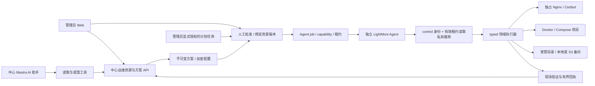

AI 工具只有 `list_operations_resources`、`get_operations_run`、`propose_operations_action`，不会批准或直接执行。所有工具重查当前用户的管理员角色。静态文件和 Compose 正文只向模型提供数量、大小、服务名与镜像等摘要；列表按上下文预算分页，提案保存后只返回 ID、状态与审阅链接，避免大正文导致已保存提案却返回失败。原始业务日志可能包含无法穷举的凭据，因此日志回执只在管理员界面展示，不自动交给模型。AI 可返回 `/operations?run=<id>` 供人审阅。读取现场状态本身也作为明确的只读任务执行，登记配置不等于节点当前状态。

### 26.3 LLD：中心数据、接口与授权

`runtime/src/operations` 按 website、certificate、compose、backup 分别定义配置校验、公开脱敏表示、动作及输入校验。`server/operations.ts` 统一登记、版本、方案和批准；`server/operation-schedules.ts` 只调度受支持的固定动作。SQLite 新增：

| 表 | 数据与边界 |
| --- | --- |
| `ops_resources` | ID、kind、name、agent_id、revision、加密 config、创建/更新时间与创建者 |
| `ops_runs` | 资源/版本、动作、加密不可变 payload、脱敏 preview、授权者、30 分钟有效期、关联 job 与状态 |
| `ops_schedules` | 资源版本、动作、加密输入、五字段 Cron、IANA 时区、启停、授权者、revision 与停止原因 |
| `ops_schedule_fires` | schedule_id＋UTC slot 唯一去重、计划版本、run_id 与触发结果 |

管理员 API 为 `/api/v1/operations/resources` CRUD、`resources/:id/plans`、`runs` 读取、`runs/:id/approve` 和未领取取消，以及 `/api/v1/operation-schedules` CRUD/运行/历史。修改配置使用 revision 乐观锁，资源执行中拒绝修改。网站须成功停用后才能移除执行过的登记；有变更历史的 Compose 保留登记和历史；证书被网站引用、资源被计划引用时拒绝删除。删除登记不销毁远端数据。

批准事务检查方案未过期、资源版本一致、没有同资源进行中任务，然后幂等创建现有 Agent job。普通 job 只含 operation ID、domain 和 capability；不保存证书私钥、S3 凭据等秘密。Agent 必须以 control 身份和 `X-LightMoni-Job-Lease` 读取 `/api/v1/agents/:id/jobs/:jobId/operations`，中心核对节点、租约/任务有效期、动作、批准与 run/job 关联，响应 `Cache-Control: no-store`。Agent 禁止重定向、限制下载 1,200,000 字节，再核对 operation、node、domain、capability 和期限。

阶段沿用 accepted → staging → activating → verifying → succeeded/failed/unknown。成功要求现场验证与绑定该 operation/resource 的回执；中心不接受错配或没有健康证据的成功。已领取任务不能当作安全取消；租约失联、进程中断或部分修改无法确认时保留 unknown，不自动重放写操作。旧 Agent claim 跳过无法提供 capability 的新任务，避免堵住原有任务。

中心以事务确保同一节点只有一个有效任务租约，但租约失效不能证明旧进程已停止。节点写动作另以持久 `<dataDir>/operations/execution.lock` 的独占创建互斥：正常已知结果释放，unknown 或崩溃保留，不按 PID 消失或超时自动解锁。只读 inspect/logs 不获取写锁，供恢复核查。管理员须先确认旧进程与 Docker daemon 等后端动作停止、检查真实状态，再人工移除锁并批准新的方案；只点击重试或 `acknowledge_unknown` 不能解锁。相同节点身份必须使用同一持久 dataDir，禁止克隆身份到多个独立目录。

### 26.4 LLD：网站与证书

网站配置绑定域名、节点、static/proxy 模式、端口、静态文件或 upstream、可选 certificate_id/service_id。默认 HTTP 8088，HTTPS 8443；不会自动抢占已有 80/443 或修改 1Panel/其他 Nginx。小型静态站最多 200 个 UTF-8 文本文件、总文本 512 KiB，并限制序列化大小；不支持任意宿主目录和 ZIP 上传。HTTPS upstream 默认校验系统 CA，管理员显式关闭时在配置中可见。

Agent 在独占目录生成 Nginx 配置、版本和日志。先校验候选，再原子切换、重载，并请求唯一配置摘要端点验证真正生效；HTTPS 另核对实际 peer 证书指纹。失败尝试恢复上版。restore 指向保存版本，disable 验证停用，logs 按行数和 JSON 字节截断。Agent 启动只恢复已有受管网关，不安装依赖或重写用户网关。每次信号操作核对 PID 对应独占 prefix/config，避免操作其他 Nginx。

Agent 私有数据目录 0700、私钥 0600；root master 的 worker 使用 nobody。公开静态资产和 ACME challenge 独立放入 `/var/lib/lightmoni-web/<数据目录摘要>`，目录 0755、资产 0644，不开放整个 Agent 数据目录。证书公开接口只返回 has_certificate/has_private_key 和元数据；私钥加密传送，节点校验私钥匹配、域名和有效期后安装，展示到期天数与指纹。

ACME 采用 Certbot webroot HTTP 验证，不停止已有 Web 服务。前提是同域名的受管 HTTP 网站已在 80 端口生效、外部 DNS/防火墙可达且 challenge 检查成功。issue/renew 为显式任务，周期续期须单独启用计划。首次签发后需将网站绑定 certificate_id 并 apply；已绑定证书的 install/renew 在替换前核对所有实际绑定网站的域名 SAN，随后重载受管网关并逐站核对新连接的实际 HTTPS 指纹，失败恢复旧文件并验证旧指纹。中心也禁止从证书登记中移除已被网站依赖的域名。证书是共享引用，网站方案固定 certificate_id 和自身配置，不能声称冻结了依赖证书文件的历史指纹。崩溃后自动恢复拒绝未与最后验证状态一致的配置/证书，必须人工检查。DNS challenge、通配符、DNS 托管及公网证书实厂商验收不在已验证范围。

### 26.5 LLD：Docker 与 Compose

管理员先登记项目名和受限 JSON Compose 文档，再 discover/inspect 观察；发现不会获得写权限。支持 1～20 服务、显式 tag/digest 镜像、项目命名卷和网络、受限端口、环境变量、启动参数与健康检查。禁止 latest/无 tag、build、宿主 bind、docker.sock、privileged、host 网络及用户指定 external 卷/驱动。环境值、command/entrypoint、healthcheck.test 在公开配置中遮蔽；编辑默认保留旧密文，替换时提交完整文档，不保存遮蔽占位符。

每个写动作带 `expected_generation`，防止基于旧状态执行。显式接管另要求现场 `inventory_sha256` 和 `acknowledge_recreate`，提醒可能短暂停机；项目名一经登记不可修改。受管文件、资源 label 与节点 registry 共同核对归属；接管已存在卷保留其精确名称和数据，不做卷删除。所有 Docker 调用显式使用 `--context default` 并剥离远程 Docker 环境，避免节点用户保存的 currentContext 把任务发到其他机器。apply/start/stop/restart/rollback 检查真正容器状态与健康，启动过程最多有界等待。配置回退使用历史 generation，只恢复配置，不恢复或删除数据卷，不承诺数据库迁移可逆。部分执行失败保留 pending/unknown；重新收敛须先按 26.3 人工核实并解除节点写锁，再以 `acknowledge_unknown` 批准新的 apply/rollback 方案。

此领域与 SDD 021 的 systemd release bundle 分开：本轮提供受管 Compose 文档生命周期，不声称源码自动构建、任意 YAML 导入、Kubernetes 或跨节点发布已经实现。

### 26.6 LLD：备份与安全恢复

备份面向受管普通文件目录，来源和本地存储必须为绝对路径、不可重叠且拒绝符号链接。Linux 全链路径要求 root 管理、不可被业务用户写入（系统 sticky 临时祖先例外）；不支持活动数据库一致性或不受信用户同时修改目录。默认最多 64 MiB/10,000 文件，可配置上限 256 MiB/20,000 文件。

归档为有界 gzip manifest，包含相对路径、模式、内容和 SHA256。创建后回读校验；本地文件以 resource ID 隔离，S3 采用 SigV4、path-style PUT/GET/LIST/DELETE，限定 bucket/prefix/resource ID，不自动创建云资源。显示归档摘要、源摘要、大小和对象版本（提供者支持时）。修改同一 S3 目标可空填复用密钥，换 endpoint/bucket/region/prefix 必须重填；读取不回显密钥。

恢复带 backup_id 与 `expected_target_sha256`，先验证归档路径/摘要及当前目标 CAS，再创建恢复前副本，最后替换与验证。prune 仅清理超出 retain_count 的常规备份，保留恢复前副本；这些副本需管理员后续单独管理，当前不自动清理。列表和清理回执最多展示 100 条并附总数/截断标记，不缩减实际清理范围；已验证恢复的旧目录清理失败只记录 cleanup_pending，不推翻成功恢复。部分写入或补偿结果不能确认时返回 unknown。文件备份有真实本机验证，S3 协议有独立验签 HTTP 验证；未声称已在 AWS/MinIO 上完成供应商验收。

### 26.7 LLD：调度、运行依赖与验证边界

计划支持五字段 Cron（分钟/小时/日/月/星期）与 IANA 时区，UTC 分钟 slot 持久去重，DST 回拨对应不同 UTC slot；中心错过的分钟跳过、不突发补跑。同一计划不重叠，同一资源审批互斥。配置 revision 变化、授权管理员停用/降权、dispatch 不确定或执行 unknown 时停止计划，管理员显式更新重新授权后才在新 slot 运行。每次触发重查 users.active 与 admin 角色。

首期允许 backup create/verify/prune、certificate renew、website inspect、compose inspect；不开放周期任意 shell、恢复、重启或发布。手动运行也使用相同边界与回执，计划启用表示管理员对固定目标/参数的持续授权，不能由 AI 代为启用。

管理员按需为 Linux Agent 准备 Nginx、OpenSSL、Certbot、Docker 与 Compose plugin；中心不需要 docker.sock，节点不能通过模型生成任意 shell。命令用参数数组、shell:false、超时/取消与合计输出限制，不继承 DOCKER_HOST 或中心秘密环境变量。POSIX 中断会终止整个子进程组，但不能据此认定 Docker daemon 的操作也已撤销，因此未知结果保留持久写锁，恢复步骤见 26.3 和 [运维手册](operations.md)。真实 Linux 隔离验证覆盖网站、反代、TLS 轮换、日志/恢复/停用、Compose 生命周期与配置回退；公网 ACME、S3 供应商、生产并发与大容量继续按验收记录说明。规格、输入契约和证据统一见 [SDD 026](../specs/026-operations-platform/spec.md) 及其 validation 文档。


## 27. 任务中心与主机标签（SDD 043）

### 27.1 驱动目标与统一概念

任务中心统一管理平台内置能力与用户自定义任务。任务定义描述做什么，目标描述哪些主机执行，派发创建配置或执行实例，执行记录说明真实结果。内置指标采集、HTTP/TCP 拨测、目录日志使用 Agent 原生处理器；自定义 Node.js/POSIX shell 使用有限脚本处理器。两者共享任务目录、主机目标和单机覆盖，不要求把持续采集改写成重复启动的脚本。

平台初始化直接持久化指标采集、服务拨测、目录日志三条默认任务，默认启用并面向所有登记主机，不再提供独立模板目录。Agent 接入后自动获得适用任务；空拨测目标或空日志目录为 waiting_config，不执行空配置。用户可调整默认任务配置、目标和启停，通过停用停止默认任务；新建任务直接编写或上传脚本。升级一次性补齐缺失默认任务，保留已有 ID、参数、目标、主机覆盖和停用选择，重启不重置。

主机工作台采用“主机 / 任务中心 / 主机标签”。主机列表只展示分类标签；实际任务、单机覆盖和执行记录放在详情与任务中心。原生任务用持续配置状态反映应用情况，不伪造 succeeded 脚本执行记录。

### 27.2 HLD：控制与执行路径

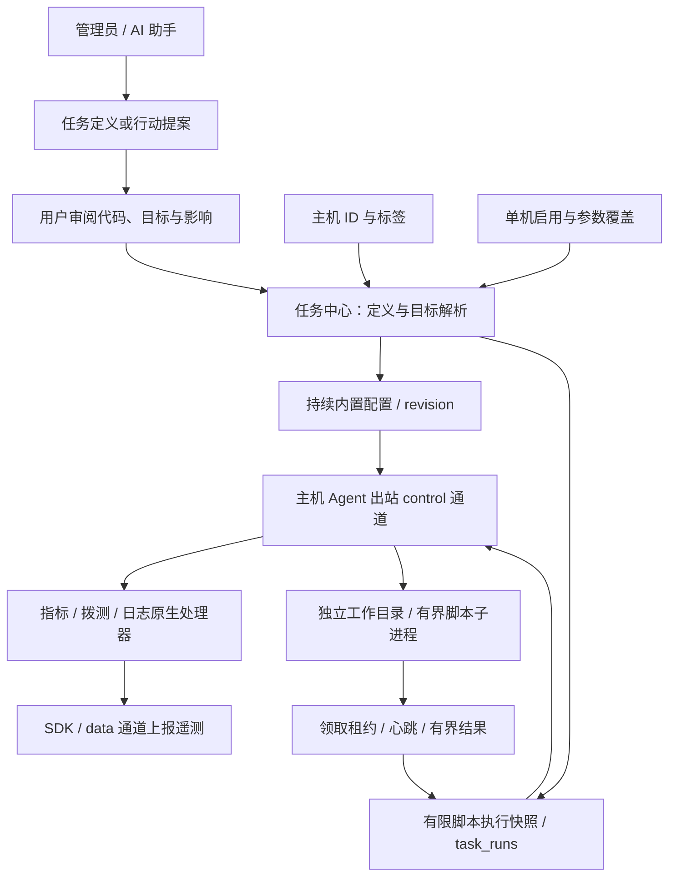

业务 SDK 继续独立直报中心。任务控制只使用节点 control credential，遥测只使用 data credential。任务脚本不接收 Agent 凭据或中心模型 Key。AI 仅能生成持久化提案，不能调用 apply 或绕过用户审阅直接执行脚本。

### 27.3 LLD：主机标签、任务定义和优先级

machine_host_labels(machine_id,label_id) 关联平台主机与标签目录；已安装 Agent 的历史标签一次性迁移到对应主机。无 Agent 的主机也可以设置标签；移除/卸载后保留，重装读取同一主机关系。Agent heartbeat.group_id 不能授予主机标签，避免持有 control credential 的节点自行扩大脚本接收范围。主机名称由用户设置，主机 ID 由平台产生；不向业务环境注入 SDK 主机变量。

Task 包括 id/name/type/enabled、origin、target_all、host_ids、label_ids、config、schedule 及脚本专用 script/execution_policy。原生持续任务类型为 host/probe/log，有限脚本为 script；来源仅由服务端初始化或既有记录决定，展示为平台默认/用户任务。新建仅允许 script，更新锁定类型和来源，默认任务不能删除；既有用户原生任务保留编辑能力。目标是全部主机、明确主机 ID 或任一相同标签的并集；空目标不广播。单机 override 覆盖启用状态及内置参数，清除后恢复继承。同一主机匹配的自定义指标任务覆盖内置指标基线；多个自定义指标任务仍需通过表名与采集间隔冲突检查。

脚本定义包含运行时 shell/node、源码、超时和输出上限，可选参数数组 args 和远端绝对工作目录 cwd。上传与直接编写最终保存同一份代码，上传文件不会作为可变路径在后续执行时读取。任务 revision 包括代码、目标、计划和执行策略；手动派发和显式重试携带 expected_task_revision，事务内拒绝已变化的旧预览。源码最多 64 KiB、超时 1–3600 秒、输出 1–256 KiB；args 最多32项/总8KiB，cwd 最多4096字节。continuous 仅用于原生采集；脚本 once 表示手动，at 为指定时间一次，interval 为10秒至30天固定间隔，cron 为五段表达式加 IANA 时区。保存时统一校验模式专属字段、目标、脚本、采集冲突及服务端来源/类型约束。

### 27.4 LLD：执行快照、租约与调度

task_runs 保存任务、主机、当时的 Agent 身份、脚本和运行参数的不可变快照，以及 trigger、requested_by、retry_of、superseded_by、状态、租约散列、有限 stdout/stderr、退出码与时间。resolved_at, resolved_by, resolution_reason 记录管理员对 unknown 的人工核对决议。执行列表只返回状态摘要，完整输出和代码通过单条记录读取，避免历史列表随着脚本和输出长度无界放大。用户执行记录接口不返回 lease_token，领取时仅向对应 Agent 返回一次原始凭证。运行记录不引用可被后续修改的源码来执行；显式重试读取当前定义，必须重新审阅，并建立关联的新记录。

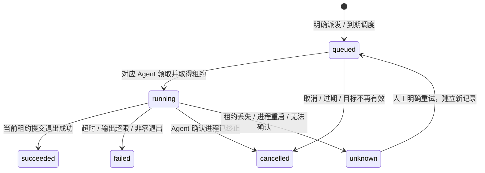

图中 unknown 到 queued 表示经审阅创建关联新执行，旧记录保持 unknown，不改写历史。领取租约有效期为60秒；新脚本队列等待默认1小时，可配置10秒至24小时，已有排队项保留原截止时间。中心按 task/host 防止重叠，单个 Agent 只领取一个脚本；每任务全局并发默认10，可配置1–100。task_schedules 持久化定义摘要和下一次时间，task_schedule_consumptions 按 task_id/run_at 保存单次消费；中心计算日历和固定间隔，不向主机安装 crontab。默认每5秒扫描，正常容差15秒；超出容差或启动前已到期的槽位不补跑，重启不重置未来计划。at 被消费或错过后不因重启、停用/启用而重放。

自动重试默认关闭，可明确设置最多3次及10秒至1小时的等待间隔；只接受 failed 且错误码为 script_failed/runtime_unavailable/timeout/output_limit 的明确回执，沿用原代码、参数及策略快照，创建独立 retry_of 记录。任务版本、有效目标、Agent 绑定或外部授权变化时停止重试；unknown、控制丢失、租约或队列过期、取消不自动重试。显式人工重试仍审阅当前定义。当前状态图只描述原运行状态，失败后允许的自动重试同样是新记录，不把 failed 改回 queued。

基础脚本接受 task.script.v1 或 v2；非空 args/cwd 必须 task.script.v2，旧 Agent 显示需升级，不会静默忽略选项。control 认证、主机当前 Agent 绑定和生命周期在领取、续租和提交结果时检查。取消 queued 直接终止；取消 running 等 Agent 终止进程后回执。控制失败或父进程关闭终止脚本，独立监督进程保留截止时间并检测 Agent 父进程。本地0600标记只重交已得结果，不重执行。远端副作用不能确认时保持 unknown，不提供分布式 exactly-once。

脚本文件与监督器保存在新建的私有目录，运行目录默认该目录，也可显式指定远端绝对 cwd；不存在或无权限时失败，不静默回退。解释器固定，args 原样传入而不拼接 shell，保持最小环境，不继承 Agent control/data credential。Unix 按进程组处理超时、取消和输出上限。脚本仍具有 Agent 用户权限，不是操作系统沙箱。运行中或未核对 unknown 阻止主机删除、身份替换或 Agent 卸载。管理员人工核对后填写原因并确认结束，保存 resolved_at/resolved_by/resolution_reason 后解除阻塞；历史仍为 unknown，不执行、不改成功、不接受晚回执。此决议不证明远端进程已停止，AI 不提供人工核对替代工具。

### 27.5 LLD：接口与 AI 审阅边界

- /api/v1/agent-tasks：统一任务定义目录；内部旧路径不等于产品概念。
- /api/v1/task-hosts：不含 SSH 秘密的主机目录；模板目录接口已移除。任务创建仅接受脚本，默认任务删除返回409。
- POST /api/v1/task-schedules/preview：管理员预览计划规范化结果与未来最多五次时间，不保存或执行任务。
- /api/v1/host-labels 与 /machines/:id/labels：主机标签目录与归属。
- /api/v1/machines/:id/tasks 和 /task-overrides/:taskId：单机任务、覆盖与恢复继承。
- /api/v1/agent-tasks/:id/dispatch、/task-runs、/task-runs/:id/cancel|retry|resolve：明确派发、记录、取消、重试与人工核对结束。
- /api/v1/agents/:id/task-runs/claim、/:runId/heartbeat|result：出站 control 领取、租约及回执。
- /api/v1/assistant/task-proposals/:id 和 /apply：用户查看与明确确认任务行动提案。

平台写接口仅管理员可用，普通成员通过安全主机目录和任务接口只读访问。AI 工具提供 list_tasks/get_task、list_task_runs/get_task_run、propose_task_action/get_task_proposal；没有 apply 或直接执行工具。提案支持创建/修改任务、派发、取消、重试，保存所有者、会话、前后差异、目标绑定摘要与 15 分钟有效期，正文及审计加密保存。用户批准时，在同一数据库事务中重新核对任务定义、主机/Agent/标签/单机覆盖或执行状态，再提交变更和审批回执；重复确认返回已有结果，不产生第二次派发。AI 的执行查询只提供有限状态元数据，原始主机输出与领取凭证不进入模型上下文。

### 27.6 验证与边界

验证必须覆盖真实数据库迁移与重启、未安装主机标签、重新接入继承、默认拨测待配置、成员权限、派发原子性、快照不变、领取隔离、租约失效 unknown、结果重试、取消、当前定义显式重试、周期不重叠、不追赶、真实子进程超时/输出上限/最小环境以及浏览器任务操作。仅有任务 enabled 或创建 queued 记录不能声称主机已执行成功。发布到真实用户主机需要新 Agent 包；本地受控子进程验收不等于 vchive 或生产发布验收。

### 27.7 脚本创建与日历调度（SDD 048）

任务宽抽屉的新建入口直接打开脚本编辑器，不再选择模板。UTF-8 .sh/.js/.mjs 文件经64KiB、编码和NUL检查后填入同一编辑器，用户可继续修改；替换已有内容前确认，不新增二进制执行或可变文件引用接口。Node.js 沿用 ESM 语义。表单依次展示执行内容、计划、目标与高级策略，实时预览实际匹配主机和 Agent 就绪状态；手动和 AI 创建共用 normalizeTask。

日历计划提供每天、每周、每月控件和高级 Cron，保存同一五段表达式与 IANA 时区；后端 preview 和 scheduler 共用 cron-parser 5.10.2，返回明确UTC时间并按所选时区显示。America/New_York 春季不存在的02:00转为03:00，秋季重复的01:30只取第一次；每月不存在的日期跳过。指定时间一次保存 UTC run_at。保存草稿不执行，明确启用表示授权后续按计划派发；AI 仍先保存提案，再由用户批准。重叠固定跳过、历史错过不补跑，重试需显式配置且不会自动重放 unknown。完整设计和使用说明见 [脚本任务创建与调度](task-authoring.md) 及 [SDD 048](../specs/048-task-authoring-schedules/spec.md)。


### 27.8 平台默认任务与统一目录（SDD 049）

默认任务是持久化的真实 Task，与用户任务共用目标、启停、单机覆盖和状态目录；不再保留 template_id 或独立模板 API。新库创建三条默认任务，旧库通过 platform-default-tasks-v1 一次性事务补齐，已有默认定义和运行历史不重写。主机尚无 Agent 时等待接入，后注册或重装后按当前目标自动获取任务；停用、排除目标或单机停用后不采集。

原生持续处理器使用配置 revision 与应用状态，有限脚本使用 TaskRun、快照及租约，不为每次采样生成执行记录。Agent 心跳、鉴权、配置领取和结果回传属于基础协议，不作为可停用任务。移除模板元数据可能使旧定义 revision 变化，旧预览及旧版本自动重试按现有校验拒绝；普通已排队或运行中的执行继续沿用已审阅快照，历史和单次消费记录保持，不自动重放。平台来源仅服务端生成，新建脚本或更新任务的人工/AI路径共用校验及审批。详见 [SDD 049](../specs/049-platform-default-tasks/spec.md)。

## 28. Agent 版本、升级与回退（SDD 045）

### 28.1 驱动目标和职责

更新中心镜像只更新平台与可下载发行物，不会改变用户主机正在运行的 Agent。主机管理应分别展示 Agent 报告的运行发行身份、可用发行与维护结果。管理员可准备单机升级、回退和串行批次；AI 可查询和准备计划，执行仍由管理员明确批准。开发与实际验收记录见 [SDD 045](../specs/045-agent-lifecycle-updates/spec.md)。

Agent 常态以专用非 root 用户运行。自身程序和 systemd unit 由 root 管理；本轮维护继续使用主机的 SSH root/免交互 sudo 通道，运行独立的固定维护器。业务任务仍通过 Agent 出站 control 通道派发，无需中心入站连接 Agent。升级不重新 enrollment，不替换 Agent ID，不注入 SDK 主机变量，SDK 继续独立直报。

### 28.2 HLD：审批、独立维护与中心确认

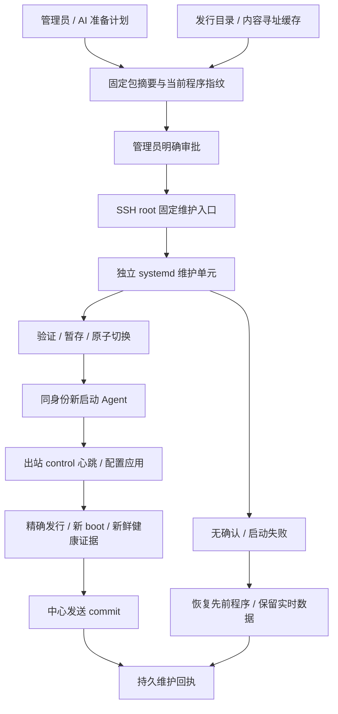

维护器生命周期独立于 SSH 会话。等待中心确认期间，平台断线不代表成功；维护器达到确认期限后自动尝试恢复原程序。掉电可能中断维护器，不能承诺系统未运行时完成恢复；远端持久事务和程序指纹供恢复后核对，平台不自动重复切换。

### 28.3 LLD：发行身份与固定下载

AgentRelease 包含 version、source_revision、build_id、state_schema、platform、arch、file、sha256。version 只是展示信息，同版本不同源码或编译内容必须具有可区别的构建身份。包内 release.json 声明源码和状态兼容域，外部清单保存整个 tar 包 SHA256，避免自身摘要循环依赖。首装和升级在对应受管发行目录保存不含秘密的安装摘要。

运行进程从自身代码所属发行目录读取 release metadata 和安装摘要；不能动态读取 current 链接后把仍在运行的旧进程误报成新程序。每次进程启动产生新的 boot_id，心跳携带 release 与 boot_id。旧 Agent 无此信息时显示未知；平台不得只靠 version=0.1.0 判断更新或升级成功。

中心生成计划时校验发行清单与包，保留不可变内容寻址副本，固定维护脚本和包摘要，避免更新平台镜像或替换 downloads 文件改变已批准内容。短期维护下载票据限定计划、目标主机和文件，中心仅保存散列，通过 SSH stdin 输入，root 私有临时文件用于 curl 鉴权；票据不放 URL、命令参数、普通环境变量或 AI 上下文。该 scope 与 enrollment、control、data 完全分离，不能用于创建节点身份或任意文件下载。

### 28.4 LLD：维护事务和数据兼容

SSH 计划核对目标主机、公钥、Agent ID、受管路径/unit、当前程序指纹、服务运行状态、发行架构和权限；审批绑定当前主机连接 revision、Agent 归属、当前程序指纹、服务运行状态与目标摘要，15 分钟后失效。中心执行前、远端维护器接收及切换前再次核对；不一致时拒绝旧计划，避免失败恢复采用未经审阅的运行状态。已有任务、任务 unknown、其他生命周期计划或执行锁阻止开始维护；维护期间也阻止新增/领取冲突任务、重绑定、卸载与删除。

root 私有事务目录保存请求、备份与 receipt。维护器取得固定生命周期锁，验证暂存包及配置后，保留原 launcher/unit/current 并原子切换程序；配置、control/data credential、identity、SQLite 队列、日志游标、任务回执均保持原路径和内容。普通服务保持专用非 root 用户及现有 systemd 权限边界。

维护状态包括准备、切换、等待确认、成功、已回退和失败。中心只有同时看到远端等待确认、同 Agent ID 的目标包摘要/build/schema、新 boot、新鲜心跳、已应用配置且无控制错误，才发送 commit 并记录 succeeded。本地 systemd active 只能作为存活证据，不能单独作为平台升级成功。

本轮只支持相同 state_schema=1 的程序升级和回退；受管旧 0.1.0 Node 包须经过明确识别，未知 manifest/schema 拒绝自动维护。旧包可作为升级来源及失败自动恢复目标，显式回退目标必须提供完整发行和新 boot 证明，缺少 metadata 的旧包不降级为猜测成功。回退恢复程序和 unit，保留实时队列；不恢复旧数据快照以免丢失升级后遥测或重复已确认数据。跨 schema 迁移需要独立 SDD 和恢复方案。显式回退也创建新审批计划，目标固定为保留的上一发行，重新验证指纹与健康；受管新程序已经故障停止时仍可核对身份与文件后准备回退，普通升级来源则必须健康。

### 28.5 LLD：不确定结果与批次

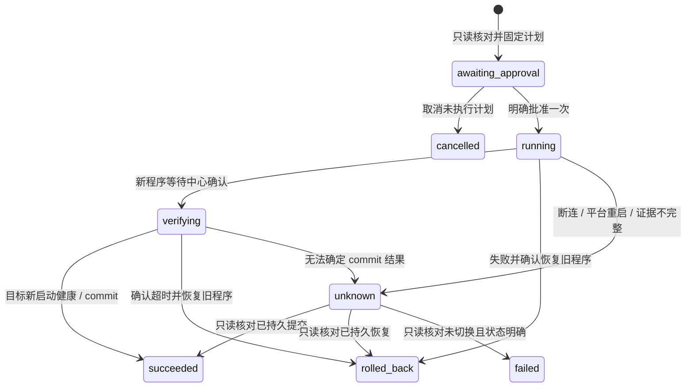

unknown 不自动重跑。核对读取原操作 receipt、真实 Agent 身份和当前程序；waiting_confirmation 不由核对自动提交，等待远端确认期限处理。原 SSH 凭据失效时可提供新有效凭据；结果证据仍须绑定同一操作和目标，不把另一次维护状态当本次成功。若远端已经持久提交但确认响应丢失，随后 Agent 又正常重启，核对以当前只读程序指纹、精确目标发行、新 boot 与新鲜心跳独立验证当前健康，在 receipt.current_verification 保存核对证据，并保留原提交 boot 历史。回退失败或部分结果保持未知并阻塞冲突操作；掉电、强杀导致 accepted/preparing 遗留且维护器已停止时同样保守保留 unknown，管理员通过外部 SSH 检查持久事务和对应 systemd 单元，不凭无锁观察自动清除。

批次最多 20 台，逐机保存不可变计划与结果，默认串行。失败、已回退或 unknown 自动暂停后续机器；继续须重新明确批准。取消只取消未启动项，已开始操作继续由自身健康/回退协议结束，历史保持真实结果。平台重启暂停批次并把未确认执行记 unknown，不自动重放。批次本身完成不替代逐机成功证明。

### 28.6 LLD：接口与 AI 边界

发行目录使用 GET /api/v1/agent-releases；单机计划、历史、审批、取消、核对使用 /api/v1/machines/:id/agent-updates；批次使用 /api/v1/agent-rollouts。平台写操作仅管理员；成员只读安全版本和状态。接口不接受用户任意维护脚本、远程路径或 sudo 命令。下载接口独立验证操作 scope，不接受 SDK Key 替代。

AI 工具 list_agent_releases、propose_agent_update、get_agent_update 只返回安全 metadata、计划、结果和审阅链接。准备计划可执行固定只读 SSH probe；助手不能 apply、commit、执行回退或读取下载票据、原始 SSH 输出和主机秘密。rolled_back 表示本次更新未成功但原程序已恢复；unknown 需要核对，不能被助手改写为完成。

### 28.7 任务中心的统一演进方向

后续将任务中心作为外部 API、平台界面与 AI 共用的任务提交和执行记录入口。任务定义描述动作及参数，执行实例固定目标主机/Agent、代码或结构化参数摘要、来源、发起人、审批、幂等键、状态和结果。自定义脚本与平台内置结构化能力并存；结构化文件、服务、部署等能力应显式声明 capability、参数 schema、影响级别和验证策略。AI、外部客户端和平台页面复用相同权限、审批、目标解析与执行服务，不能创建绕开记录的 Agent 命令通道。

统一入口和记录保留底层执行策略：持续采集使用配置 revision；有限脚本使用租约与退出结果；服务部署使用分阶段健康回执；Agent 首装/升级使用 SSH 生命周期与独立维护确认。主机检查等短操作可同步返回执行结果，耗时任务异步返回执行 ID，均记录来源、授权和目标；交互式能力另用会话协议，关联授权、开始、结束及退出状态，不把每次按键拆成任务，也不将终端原始输出持久化或发送给模型。高频采样不逐条创建任务执行记录。首次安装尚无 Agent 可接收任务，仍通过 SSH。周期任务与单次任务均归属明确主机，结果未知不会被幂等重试偷偷重放。

本轮交付 Agent 维护自身的计划、审批和完整结果 API；SDD 047 已交付用户主体的 MCP 专用 PAT/OAuth、role/scope 与主机范围授权，任务提案复用平台审批。跨脚本、业务运维、Agent 生命周期的完整统一执行读模型、服务主体及自定义 typed action 注册表仍属于后续单独 SDD，不将已有分散接口声称为完整统一外部任务 API。

## 33. 网站、DNS、证书与 Docker 服务托管（SDD 033）

2026-10-29。用户批准整体重构并明确尚未上线、无需旧模型兼容。此章描述 SDD 033 分支实现，合入和真实外部服务验收以对应 PR/validation 为准；第26章的网站、证书与容器描述由本章替代，备份/计划和恢复说明继续适用。

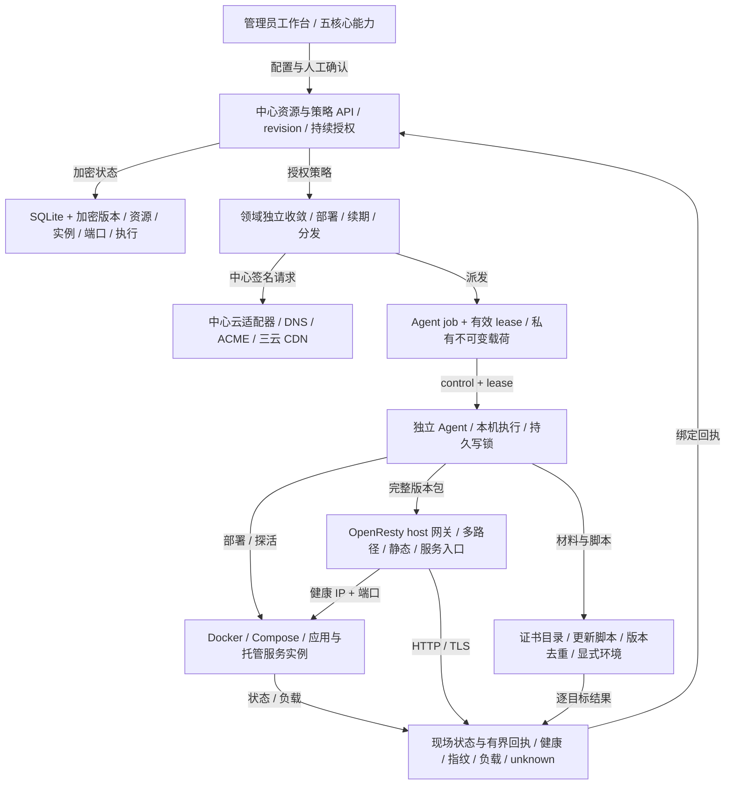

### 33.1 组件职责与资源模型

中心仍是 Node.js/TypeScript 模块化单体，SQLite 保存管理状态，ClickHouse 保存遥测；未引入 Consul、Kubernetes、第二个中心或中心 Docker socket。runtime/src/ops 统一全局 credential、dns_zone、acme_account、certificate、certificate_target、application、service、node_pool、gateway_group、website。应用描述 Docker 单容器或 Compose 声明；部署/实例绑定机器；托管服务声明资源、副本和端口；网站声明域名、HTTPS 与静态/反代/服务目标。OpenResty 是 host Docker 系统应用，多网站共享网关组内的进程。

### 33.2 存储、版本与执行

ops_platform_resources 保存 revision、加密 spec、脱敏 status 和授权者；ops_platform_revisions 保存不可变配置快照；ops_platform_runs 保存加密请求快照/输入、逻辑去重键、执行状态和脱敏结果。ops_platform_run_events 按执行 ID 和递增 sequence 保存最多 2000 条脱敏步骤；实时日志从 SQLite 读取并通过事务 outbox 投影到系统日志。ops_platform_instances、ops_platform_ports 保存实例、资源与端口预留；ops_platform_nodes 保存 Agent 只读容量观察。证书版本、ACME 账号/订单/挑战、DNS 观察/归属及云证书映射分别持久保存。配置保存与应用发布分开；发布冻结 desired_revision，托管服务同时冻结 application_revision 和 node_pool_revision。新配置需显式发布才进入持续维护。

### 33.3 鉴权、私有载荷与调度

管理员 API 为 /api/v1/ops，统一 revision、confirmed、资源引用和可用动作检查。人工动作和已启用的持续策略记录授权者，每次新派发重查管理员有效性。新建证书在资源事务内保存首轮执行意图，提交后立即建立后台执行；创建返回 201、手动申请/续期返回 202 与执行 ID，不等待 ACME/DNS。首轮执行与 auto_renew 开关独立；同一证书共享活动执行。领域各自维护 in-flight，慢 DNS/ACME 不阻塞工作负载轮次；网站 DNS 刷新另有并发上限。新 Agent 动作使用 operations.platform，复用现有 control 身份、job lease 和 /agents/:id/jobs/:jobId/operations 私有下载；普通 job 仅含 ID。成功回执必须匹配 operation/resource/node 并有现场验证；中心拒绝陈旧或撤权载荷。关闭时拒绝新动作，等待已开始的领域/云动作再关闭存储。

### 33.4 DNS 与 ACME

阿里 DNS 与 DNSPod 通过固定官方 HTTPS 端点签名请求，支持全量分页 CRUD/启停和管理 scope；五分钟有界只读同步观察外部修改。人工可管理授权范围内记录，网站/ACME 自动化只维护已记录归属和 Record ID 的记录。API 接受、平台回读和公网传播是不同状态。ACME 在中心使用持久账号密钥、订单、CSR 和 DNS-01 挑战，精确创建/清理本订单 TXT，支持同名多值与通配符；不把 DNS 凭据下发到网关。账号、订单、DNS 写入/传播、挑战提交/核验、证书下载/保存和 TXT 清理分别写步骤日志；失败保留阶段、可用的 CA problem 说明、类型/HTTP 状态/云 Request ID，敏感值过滤后才持久化。创建订单结果不确定或中心重启时记为 unknown，不自动重放。

### 33.5 证书版本与三类分发目标

证书支持 ACME、上传、自签；公私钥匹配、SAN、有效期和指纹均校验。材料与不可变版本加密保存，普通资源接口只显示元数据和 has_*。管理员通过 GET /api/v1/ops/resources/:id/certificate 按需查看当前已保存版本的公开 PEM 与元数据；POST certificate/download 按 certificate_id 与不可变 version 精确导出 cert.pem、chain.pem、fullchain.pem 或 privkey.pem。查看 JSON 只白名单返回公开材料，缺失中间链时不伪造。下载固定版本，续期切换不改变已打开版本的下载内容；失败续期仍可查看既有版本。上传证书只能提醒到期；ACME/自签可显式启用自动续期，窗口按实际有效期计算，尚未接入 ARI；失败续期可人工重新 issue/renew，不宣称完整自动退避已实现。网站首次发布 HTTPS 时，材料缺失或过期可调用同一可追踪签发流程，内部等待（或等待已有执行）取得材料后再继续部署；管理员 HTTP 创建/签发接口不等待。上传材料也在后台校验并导入；编辑既有配置不会自动签发。证书目标分别为 Agent 目录、云 CDN、更新脚本，各自记录 desired/applied 版本与结果。

### 33.6 云服务、脚本与凭据边界

首批云目标覆盖阿里云、腾讯云、火山引擎 CDN HTTPS 域名。阿里 CDN 直接部署 PEM；腾讯 SSL 上传后更新 CDN；火山证书中心上传后部署 CDN。云映射保留远端证书ID，上传/绑定/逐域回读分别核实；HTTP 200、上传成功或某一域成功不替代全部目标生效。云凭据、ACME 账号密钥只由中心加密使用。证书私钥可由有效管理员显式点击独立 POST 附件下载，按请求从加密版本解密，不进入查看 JSON、普通资源、日志、URL 或 AI/工具；复用会话及同源检查，查看和下载响应 no-store，附件文件名仅使用安全 ID/版本。目录按受管版本落盘并切换指针，私钥权限受限。更新脚本由管理员固定 Agent、解释器、正文、显式环境和超时；正文与环境加密，不在普通摘要回显，也不送 AI。脚本通过证书临时文件路径及版本元数据获得材料，具有 Agent 本机权限，无沙箱承诺。

### 33.7 幂等、未知结果与恢复

证书目标按目标修订＋证书版本持久去重，云上传复用已保存远端ID。unknown 不自动重放任意脚本或不确定写入；inspect 可只读核对云配置、目录指纹或脚本成功标记，未核实的 unknown 不允许 retry。核对目标不会自动清理节点持久 unknown 写锁，旧进程/daemon和现场状态仍需管理员核查。回执和错误只保存安全码、ID及有界摘要，不返回私钥、脚本环境或任意 stdout/stderr。历史中心 verifying 表示等待读回，不作为永久编辑忙锁；真正执行中的中心动作和活动 Agent lease 才阻止冲突编辑。

### 33.8 Docker 应用与轻量调度

Agent 使用本机固定 Docker context 执行单容器/Compose。平台管理配置文件、只首次写入的初始化文件、数据目录和 Docker volume；停止/移除容器不删除业务数据。资源和端口在 SQLite 事务预留，实际端口在节点复核。机器池可显式设置容量，也可经 node.inspect 获取 CPU/内存/IP/Docker 能力。调度基于在线机器、容量、端口与副本分散；现有副本按健康回执逐个更新，健康连续失败时有界重建。服务发现提供新鲜健康实例的机器可达 IP＋发布端口，要求机器之间已有可达网络；没有自动 overlay 或本地数据复制。

### 33.9 网站、网关与流量

网站支持静态文本文件、手工 HTTP(S) 反代和托管服务。网站仅在显式启用后进入网关完整版本包；域名在组内唯一。Agent 按版本暂存站点/证书/静态文件，检查 OpenResty 配置后切换、重载并实际验证 HTTP 内容与 TLS 指纹，失败恢复旧版。服务路径无健康后端时仅该路径返回503；多路径与Nginx可配置能力见33.11，端点变化重编译对应上游。网关在 Linux host 网络直接监听端口；已验证健康网关的公网地址进入平台拥有的 A/AAAA，关闭网站移除自身拥有记录。DNS TTL 不提供即时故障切换保证。Agent 失联不等于容器停止，不据此释放端口或静默迁移本地数据。

### 33.10 界面、验证与支持范围

网站与运维提供五核心页签和共享基础设施，应用/服务列表显示机器和现场负载，证书显示到期和逐目标结果，表单支持中英文/主题/窄屏、失败保留输入。旧 /services 用户入口转向托管服务。代码验证覆盖 SQLite/HTTP/有效 Agent 租约、真实自签/目录/脚本、协议签名/分页/ACME 生命周期及调度故障；真实 Linux Docker/Compose/OpenResty 与 UI 夹具和实际 SQLite 页面验收分别记录。真实云账号/CDN边缘传播、公网 ACME 发证和大规模生产负载未获现场验收，不由夹具代替。详见 specs/033-operations-control-plane/validation.md 和 docs/operations-platform.md。

### 33.11 Nginx多路径与站点配置

网站配置新增 nginx 站点设置与 locations 路径规则，作为加密不可变网站版本保存。中心与 Agent 共用 runtime/src/operations/nginx.ts 校验与编译；中心在组包时将每条托管服务路径解析成新鲜健康端点，只有无后端的对应路径返回503。支持精确、最长前缀、^~ 与有序正则匹配；独立上游及加权轮询/最少连接/IP哈希、URI保留/去前缀/替换、Host/SNI与TLS校验、WebSocket、超时/缓冲、请求与响应头、CORS及OPTIONS、访问控制、上传和速率/连接限制。站点提供HTTPS跳转/HTTP2/TLS、Gzip、静态索引/SPA/缓存和日志。反代缓存使用各站点路径独立临时区域，默认绕过Authorization、Cookie与升级请求。server/location补充片段按词法边界限制上下文，拒绝include、动态脚本和全局/文件越界指令；其他语法由真实nginx -t验证，失败保留活动版本。管理员 GET /api/v1/ops/resources/:id/nginx 提供保存修订的脱敏预览，隐藏自定义片段和敏感头值，只展示证书占位路径，不读取PEM、不部署、不声称现场已验证。控制/租约及完整版本检查、切换、HTTP/TLS回执通路不变。

## 第42章 集群与应用统一部署（SDD 042）

2026-10-30。本章描述codex/042-cluster-applications最终跨集群首版，替代第33章独立机器池、托管服务、网关组及单集群应用/网站模型。第33章DNS、ACME、证书、云分发、脚本和执行安全边界继续适用。分支实现与验证记录以SDD042为准，不声称已合入main。

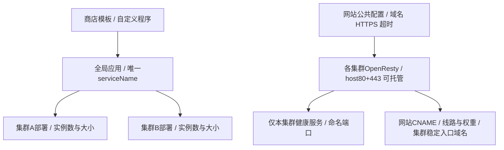

### 42.1 集群与稳定机器归属

公开运行资源为cluster、全局application和全局website。一台稳定managed_machines.id只属于一个cluster，ops_platform_cluster_members以machine_id主键在资源保存事务内约束唯一。Agent重装不改变归属；agents.group_id继续表示采集标签。运行实例使用中的机器不能直接移出，仍属集群的主机不能从主机目录删除，非空集群不能删除。

### 42.2 全局应用与集群部署

商店模板或自定义镜像/Compose生成普通application，一份模板可安装多套独立应用。name为可重复展示名；service_name全局唯一且创建后不可改，默认模板英文标识加序号，小写字母/数字/短横线、首尾字母数字、最长63字符。应用共享运行配置、命名端口与manual/managed模式；deployments按cluster分别设置手动机器或托管实例数、每实例CPU/内存。持久部署状态以application_id+cluster_id为键分别冻结发布修订和授权者，一处发布不升级另一处草稿。

### 42.3 实例、端口与发现

ops_cluster_instances显式保存cluster_id，活跃slot按owner+cluster唯一，退役attempt保留到原节点确认清理。ops_platform_instance_ports保存每实例全部命名端口，ops_platform_ports提供宿主协议/端口排他预留。manual不自动换机或补副本；managed仅在对应集群选择满足容量和全部端口的机器。两种模式均支持固定host_port，冲突不能改号；中心排除已知占用，Agent现场复核，已知占用失败退避该候选并选择其他机器，无候选待调度。serviceName+cluster_id+port_name只返回新鲜健康端点，网站严格当前集群发现，无跨地域隐式兜底。

### 42.4 OpenResty托管与完整配置

OpenResty是role=openresty的全局唯一应用，可部署多个集群，每集群一项部署。已安装应用可编辑部署集群、机器、副本和资源；运行中的部署先停用清理再移除。每个入口部署保存稳定gateway_domain，可选gateway_dns_zone_id托管健康入口A/AAAA；未选择时由用户维护。manual选择机器，managed设置实例数和资源；Linux host网络固定80/443。内部gateway.apply/inspect/stop/remove复用Agent执行器，owner仍为application。每集群完整网站、证书和静态文件包逐机nginx -t、切换、重载、HTTP/TLS验证；失败保留旧版。故障换机完成配置与验证后恢复DNS资格。中心按目标网关实例逐机解析应用上游并计算完整包签名；同集群不同机器的配置可以不同，拓扑或健康变化后沿用调和流程重新发布。

### 42.5 网站公共配置与集群上游

website为全局对象，bindings统一域名、HTTPS、证书、DNS，nginx及locations统一路径、超时、头部、缓存、限流和其他高级选项。routing_mode=managed时选择一次service_application_id和HTTP(S)命名service_port_name，自动发现其部署集群，集群内只解析该服务的健康端点。manual保留locations.cluster_targets逐集群应用端口或代理URL；不支持公共配置覆盖。集群流量策略cluster_policies保存enabled、1–100相对weight、default及厂商线路id/name，独立于冻结网站公共修订；关闭立即退出期望解析，恢复仍需成功回执。公共草稿不能通过流量策略保存被隐式发布。同一网站的domain_routes按domain独立指定cluster_ids与可选cluster_policies；省略范围跟随全部可用集群，固定选择只保留其仍可用的交集，不自动扩大。旧网站无此字段继续继承全站范围与策略。域名范围随发布冻结，每集群完整包只包含绑定到该集群的域名；同绑定组的证书与路径仍复用。候选旧集群仍接收空站点包以清理已移走域名。

平台发现的应用端点与目标 OpenResty 实例 machine_id 相同时，上游 host 使用127.0.0.1；异机继续使用发现的内网地址，IPv6保留方括号。此规则适用于managed托管服务及manual应用端口目标，保留HTTP(S)、命名端口对应的宿主端口、健康过滤与集群范围；用户显式填写的代理URL不改写。发现接口与仅有集群上下文的预览仍显示实际发现地址。依据为现有Linux host网络网关与应用宿主端口模型，无新Agent协议或存储迁移（SDD 058）。

### 42.6 DNS聚合、共享资源与界面

DNS/ACME账号、托管域名、证书和分发目标保持中心加密共享，凭据不下发网关。新网站dns_record_mode=cname，网站以自身为owner，按默认和高级运营商/省份线路维护到各集群gateway_domain的加权CNAME；各域名分别只包含其已绑定、开启、已发布且有新鲜健康入口和成功网站回执的集群，托管服务还须有健康后端。默认在各域名绑定范围内1:1，失效集群在默认与高级线路中撤下，细分线路无目标由厂商回退该域名默认，不能越过域名绑定范围。可选集群入口A/AAAA以全局OpenResty应用为owner维护。旧address模式保留A/AAAA兼容。只修改自身归属记录；线路纳入身份，权重/TTL/状态必须回读。厂商可用线路查询后预检，拒绝不支持套餐或权重，API接受与缓存传播分开。网站页面主体展示用户网站、域名及实际集群、开关、权重、线路与错误；OpenResty部署集群和入口域名收于次要的“OpenResty 管理”抽屉。

### 42.7 控制与兼容边界

中心继续Node/TypeScript+SQLite；cluster-workloads由原workloads组合装配，原加密资源/修订/执行、Agent control凭据和有效job lease保持不变。配置/发布/持续策略由管理员授权，AI不批准或任意执行，生产中心无Docker socket。旧单cluster application/website规范化为deployments和cluster_targets单项，保留资源ID、serviceName、实例ID、数据路径及运行容器；legacy node_pool/service/gateway_group保留历史，不提供新建与新部署。首版商店内置MySQL/Redis/OpenResty，自定义程序通过镜像/Compose发布，源码CI与第三方商店源后续扩展。

### 42.8 现场验证与范围

Demo使用真实SQLite/HTTP、Agent enrollment与有效lease、生产执行器、Docker、MySQL、自定义Web双端口和OpenResty，覆盖网站读写、TLS、Web重建数据保留以及托管入口。多节点QA如使用DinD，明确其为同一物理Docker宿主上的独立daemon/网络命名空间，不冒称多地域实机。测试域Host替代公网DNS、自签证书替代公有CA；DNS聚合协议另行mock验证，不声称公网传播或ACME已验。具体通过项、未验范围和可复现命令见SDD042 validation及examples/cluster-demo/README.md。

### 42.9 网站多集群入口与线路流量管理（SDD 043）

2026-10-30。以上42.4至42.6按SDD043演进。托管网站跟随最近授权发布修订的服务部署新增/移除集群；公共草稿不驱动线上切换。DNS归属日志增量保存line和weight；同值不同线路独立归属，外部修改、未知写入与授权撤销保持保护。阿里云CNAME权重部分接口文档与产品说明有差异，必须实际请求接受且回读权重策略；DNSPod活动权重只使用1–100，0不表示停用。失败不静默回退或冒称成功。域名套餐、省份/运营商线路和缓存传播依赖厂商能力；当前验证用HTTP/SQLite/Agent租约与DNS协议夹具，不声称真实云套餐或公网传播已验。同一绑定组可含多个域名且分别绑定南北集群，共享路径不重复。DNS同时校验期望发布范围与成功应用回执范围；域名级策略独立即时覆盖全站默认策略，不能借保存策略发布绑定草稿。实际集群为已发布域名范围的并集，逐域名状态摘要有字节上限与截断标记。

```mermaid
flowchart LR
  site[网站域名 / 独立集群绑定] --> default[默认线路 / 仅此域名绑定的健康集群]
  site --> special[省份与运营商线路 / 回退此域名默认]
  default -->|CNAME 1| south[南方集群稳定域名]
  default -->|CNAME 1| north[北方集群稳定域名]
  special -->|CNAME| south
  south --> southIP[健康南方入口 A / AAAA / OpenResty 80+443]
  north --> northIP[健康北方入口 A / AAAA / OpenResty 80+443]
  health[中心：域名范围 / 开关 / 健康与发布回执] -->|维护| default
  health -->|维护| special
```

具体规格、数据字段、契约、厂商官方资料与验收记录见[SDD 043](../specs/043-website-cluster-routing/spec.md)。


## 第44章 应用自动观测与统一系统日志（SDD 044）

### 44.1 运维入口与应用目录

集群、应用、网站、域名、证书的操作日志通过页面及资源详情右上图标打开，正文不内嵌执行历史。商店按数据库、缓存、网站与网关分类，支持分类与关键词组合。主机可查询平台应用及全部 Docker（含停止、非平台容器），集群可查询应用；外部容器只发现，不接管。每个应用天然派生监控目录，按集群、部署实例、容器筛选，无需创建大盘或物理表。

### 44.2 Agent 观测与控制归属

Agent 在既有任务配置就绪后独立周期发现 Docker、采集 CPU、内存、网络/磁盘累计字节及进程数，自动读取平台容器 stdout/stderr。中心在认证心跳回包中下发本 Agent 的 application_targets；Agent 用现有实例标签匹配容器，不增加 SSH 采集路径。心跳中的 docker_inventory 仅保留容器 ID、名称、镜像、状态、端口和实例标识，最多500项，显示截断、未接入、采集失败、过期状态。观测权限不等于应用生命周期操作授权。

应用遥测仅接受 Agent data 凭据。中心核对部署实例的 agent_id/owner_id/cluster_id，覆盖应用、集群、主机及 service 归属；业务 Key 不能写系统表。网站访问标识还要求来源为本集群 OpenResty 应用，且网站已配置到该集群。控制面仍使用 control 凭据，凭据不进入标签、URL、正文或文档。

### 44.3 两张独立共享应用遥测表

系统逻辑名 lightmoni_application 独立于平台自监控 lightmoni。全部应用自动负载观测使用同一物理表 `_lm_metric_lightmoni_application_gauge`，全部应用日志使用 `_lm_log_lightmoni_application`。公开视图为 `metric_lightmoni_application_gauge` 与 `log_lightmoni_application`，复用 Catalog、TTL、只读 AST、Query 时间和资源限制；应用数量不增加物理表。自动观测全部为 gauge，包括网络和磁盘累计字节，页面根据相邻采样计算速率并排除重置。业务进程内部指标仍由 SDK 显式打点，不修改用户代码。

日志使用原始 Docker 纳秒时间，stdout/stderr 各自保存时间戳、同时间戳行计数及单调 source_seq。批次与游标原子进入已有 Agent SQLite 队列；重启、满队列、网络断连和丢 ACK 不静默越过未发送数据。每次读取有界前缀，不使用 tail 丢弃积压；大前缀拆成多个批次。超过单行读取/批次预算时保留游标并报告采集失败。轮转或外部删除已丢失的 Docker 原始日志无法恢复，首次采集受7天日志保留窗口限制。

### 44.4 网站流量

OpenResty 在站点 access_log 开启时输出 escape=json 格式，记录网站 ID、HTTP 状态、request_time 与 upstream_addr，不记录查询字符串或请求头。站点配置不能覆盖结构化格式；内部部署健康证明路径不计访问日志。历史运行网关需要发布新配置后产生该格式；显式关闭访问日志时不产生网站请求数据。

Agent 自动将访问记录写入共享应用日志表。网站 QPS（分钟均值）与平均耗时从原始访问日志按事件时间查询，避免另造易重复的请求计数副本。后端应用仅关联保存绑定中匹配的“网站+集群”对；网站流量按集群汇总，容器负载与应用日志可细分到部署/容器。无请求数据与采集失败明确显示，不以离线推导零流量。

### 44.5 全系统日志统一写入 ClickHouse

中心运行日志、Agent runtime_events、运维执行、Agent jobs/events、任务中心执行/取消/结果核对、发布事件、主机安装/卸载/SSH检查、凭据与节点关联事件、定时运维、资源修订/删除、Key 接入、节点移除、终端连接/关闭元数据、告警/响应及 AI 告警提案应用审计统一进入平台系统日志公开视图 `lightmoni_log`，新日志写物理表 `_lm_lightmoni_log`。component 区分 center、agent、operations、auth、alerts、assistant、tasks，source、resource_id、resource_kind、cluster_id、machine_id、record_id 支持检索。旧系统日志兼容视图继续读取历史数据，不删除旧记录。

SQLite 继续保存审批、配置版本、执行状态及回执，承担事务控制。system_log_outbox 通过同事务触发器记录白名单事件元数据并幂等补录已有记录；仅在 Ingest.internal 成功写入 ClickHouse 后标记已投递并清除 outbox 正文。ClickHouse 失败保留待发送项，重启和重复投递使用稳定 event_id。中心运行日志也使用该 outbox，关闭性能自监控不关闭系统日志。outbox 不记录密钥、环境、加密配置、任意脚本输出、交互终端内容、告警联系人、通知载荷、AI 对话或加密回执。任务失败解释脱敏后导出。证书步骤通过 ops_platform_run_events 的同事务触发器进入 outbox；白名单说明在投递时读取，run_id 关联回执。证书抽屉直接读取 SQLite 增量步骤，每 2 秒刷新，不依赖 ClickHouse 可用性。

```mermaid
flowchart LR
  Docker[全部 Docker 清单与平台容器] --> Agent[Agent 周期观测]
  Center[中心认证与实例归属] -->|心跳授权目标| Agent
  Agent -->|清单快照| SQLite[(SQLite 控制状态)]
  Agent --> Queue[持久队列与日志游标]
  Queue -->|data 凭据 / OTLP| Ingest[中心归属核验 / Ingest]
  Ingest --> AppMetrics[(共享应用指标表)]
  Ingest --> AppLogs[(共享应用日志表)]
  Events[中心运行 / 运维 / 生命周期事件] --> Outbox[事务系统日志 outbox]
  SQLite --> Outbox
  Outbox -->|Ingest.internal / 成功后确认| SystemLogs[(共享平台系统日志表)]
  AppMetrics --> Query[统一只读 Query]
  AppLogs --> Query
  SystemLogs --> Query
  Query --> UI[应用监控目录 / 右上日志抽屉]
```

验证与 Doca 保存回读见 `specs/044-operations-observability/validation.md`。部署升级需要新中心与新 Agent；旧 Agent 无清单时显示等待采集，历史业务表和存储数据保持兼容。

## 第50章 中心内外网地址同步与SDK直报（SDD 050）

2026-10-31。本章为codex/050-center-endpoint-discovery分支预览，代码验证见对应SDD，合入状态以GitHub为准。管理员沿用上报地址簿登记完整内网IP+port URL与public引导入口，scope缺省public，默认引导必须为public，至少保留一个public。SQLite保存稳定center_id与地址清单修订。SDK与Agent分别直连中心，SDK→Agent的OTLP接收与配置代理全部移除；Agent自己的SDK只通过进程内exporter入持久队列，本地监听仅提供诊断。

GET /v1/center-endpoints使用SDK密钥、已启用豁免表匿名规则或Agent ID+control凭据，发布version=1、center_id、revision及带scope的地址；固定30秒刷新。GET /v1/center-identity不携带凭据，仅用于同中心误配检测。客户端保留公网引导，首次请求前发现，周期及显式操作同步；从已发现入口刷新前先无凭据核对身份，失效时回公网查询新内网。候选探测有时限与64KiB响应上限，禁止跳转，不关闭TLS验证；身份ID不替代HTTPS认证，显式HTTP仅用于受信链路。

Go、Node/浏览器、Python、Rust共享内网优先、公网备用语义。配置和上报复用同一选择；Agent的心跳/配置、job/task轮询、operations及制品下载同样共用入口，内网可达时不将数据与控制分流到公网。当前Agent是HTTP轮询，无独立WebSocket协议。传输失败使下次原请求/批次重选，不在同次调用内重放写请求；批次ID、创建时间及正文保持，所有入口必须共用中心去重存储。30秒冷却和有效新修订控制重新探测。全部已知入口失效时由运维修复公网引导。

同集群Nginx固定使用应用内网端点，按集群内网完全互通处理；无健康内网后端时503，不生成公网备用。网关public_address只用于外部入口DNS。旧中心未提供发现协议时保留显式地址直报；新SDK不再隐式默认本机4318。验收覆盖隔离HTTP/SQLite与多语言真实客户端，不等同公网/VPC、真实TLS证书或大规模生产网络验收。


## 第53章 证书异步首轮执行与步骤诊断（SDD 053）

新建 certificate 的 afterSave 在同一资源事务内保存 initial_issue_pending；HTTP 处理器在事务提交后调用 startIssue，持久化 running 执行快照、queued 步骤和 issuing 状态，并返回 201。实际工作延迟到微任务执行，网络等待不占用创建响应。定时轮次接管尚未开始的首轮意图；编辑不触发申请，auto_renew 只控制后续续期。首轮去重键绑定证书 ID/修订，同一证书的手动操作或网站材料请求共享活动执行；每个网络写入边界重新检查保存的管理员授权，保存证书前重查修订。

管理员手动 issue/renew 返回 202 与执行 ID。中心内部仍可 await 执行句柄，网站 HTTPS 发布只在证书实际验证保存后继续。成功申请后的分发沿用已有授权、版本与目标去重。重启将未完成的中心执行标为 unknown，追加中断步骤，保持旧证书材料；不会因 unknown 自动重放申请。未建立执行的首轮意图可由下一轮调度接管。

SQLite ops_platform_run_events 保存白名单的 phase/state、domain/attempt、时间及有界安全诊断；每次写入分配连续 sequence，单次执行保留最近 2000 条。GET /api/v1/ops/runs/:id/events?after=N 仅管理员可访问，每页最多 200 条，返回当前回执和增量游标。界面按执行 ID 隔离轮询、展示历史申请与各阶段状态；旧回执只含通用码时明确无法恢复历史原因。

诊断只选择错误说明与结构化元数据，不序列化请求/响应、错误对象或栈。过滤账号密钥、凭据、EAB、CSR/私钥、DNS challenge token/TXT、Authorization 和 URL 查询内容后，才写回执、资源状态及步骤表。TXT 清理失败单独记录，保留主要失败原因；证书已签发但清理未完成时继续显示清理问题。步骤通过现有 system_log_outbox 投影到 ClickHouse lightmoni_log；实时抽屉直接读 SQLite，因此 ClickHouse 中断不妨碍定位当前阶段。未引入外部队列、Worker 服务或新凭据边界。

```mermaid
flowchart LR
  Create[管理员新建证书] --> Intent[SQLite 资源与首轮意图]
  Intent --> Start[后台执行句柄 / 每证书互斥]
  Start --> Return[立即返回 201 / 202 与执行 ID]
  Start --> ACME[账号 / 订单 / DNS / ACME 验证]
  ACME --> Material[验证并加密保存证书版本]
  ACME --> Journal[(SQLite 有序安全步骤)]
  Material --> Journal
  Journal --> Live[管理员增量日志抽屉 / 每 2 秒]
  Journal --> Outbox[事务系统日志 outbox]
  Outbox --> CH[(ClickHouse 系统日志)]
  Restart[中心重启] --> Unknown[未完成执行 unknown / 禁止自动重放]
  Unknown --> Journal
```

规格、契约、测试及 Doca 保存回读证据见 specs/053-certificate-async-issuance/。
