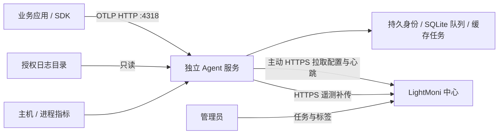

# Deployment design: LightMoni Agent

Status: Baseline implementation delivered; hardening and Linux acceptance remain · 2026-10-18

## Architecture decision

默认每台 Linux 主机部署一个独立 Agent，由宿主 systemd 管理。应用通过 SDK 向本机 OTLP HTTP 接口上报，或向 Agent 有权读取的目录写日志；Agent 的启动、升级和存储不跟随业务进程或应用 Compose 生命周期。

默认监听 `127.0.0.1:4318`；中心不需要回连 Agent。跨容器上报必须按实际网络命名空间选择共享网络名称、宿主 gateway 或 Linux host 网络，再显式设置监听、`local_token` 和防火墙。当前只支持 OTLP HTTP，不提供 OTLP gRPC 4317。

## Reuse of implemented components

- [发行构建器](../../scripts/build-agent-release.mjs) 为 Linux amd64/arm64 下载并校验固定 Node 24.15.0，打包 runtime、SDK 和生产依赖，生成 `SHA256SUMS`。目标为 glibc ≥ 2.28；不承诺 Alpine/musl。
- [安装器](../../deploy/agent/install.sh) 预检平台、包哈希和暂存配置，以独立 systemd unit 启动，失败时尝试恢复先前配置、launcher、unit、current 链接和服务启用/运行状态。
- [服务定义](../../deploy/agent/lightmoni-agent.service) 使用专用用户、`NoNewPrivileges`、只读系统保护、私有 tmp 和受限可写目录；CLI 提供配置校验、状态和隔离管理。
- [Agent](../../runtime/src/agent/agent.ts) 主动注册、心跳和轮询配置；配置验证并原子落盘后才更新已应用 revision；重启可用有效缓存任务恢复。
- [队列](../../runtime/src/agent/queue.ts) 在 SQLite 中事务提交 receipt、批次和文件游标，保存冻结的 OTLP 内容；背压、重试、隔离和重启恢复已有实现。

这些能力是后续实现的基线。现有 [迁移验收](../007-node-runtime-migration/agent-validation.md) 包含本地 Node 循环、打包和 shell 安装事务测试；安装测试使用 systemctl 等命令 shim，未证明 Linux 双架构真实 systemd 升级或当前 Agent 容器运行。

## Filesystem and process model

| 路径/资源 | 归属与用途 | 持久与权限决策 |
| --- | --- | --- |
| `/usr/local/bin/lightmoni-agent` | root 管理的 launcher | 可替换，不保存身份或秘密 |
| `/opt/lightmoni-agent/releases/<version>-<hash>-<id>` | root 管理的不可变发行目录 | 包含 bundled Node，禁止普通用户写入；保留已知可用版本的清理策略待实现 |
| `/opt/lightmoni-agent/current` | 当前发行软链接 | 安装器原子切换 |
| `/etc/systemd/system/lightmoni-agent.service` | root 管理服务定义 | 独立于应用服务 |
| `/etc/lightmoni-agent/config.json` | 中心地址、Key、本地令牌及本地配置 | 目录 0700、文件 0600，服务用户可读；当前目录归服务用户，后续评估只读秘密挂载 |
| `/var/lib/lightmoni-agent` | 身份、队列、游标、receipt、远程配置缓存 | 目录 0700，服务用户持久写入；升级和默认卸载保留 |
| 业务日志目录 | 业务拥有的采集源 | 明确 ACL/组只读和目录遍历权限，不向 Agent 开放无关目录 |

安装需要 root 创建用户、目录和 unit；常态运行不需要 root。`PrivateTmp=true` 意味着应用宿主 `/tmp` 中的日志不能假定在服务内可见，应使用明确的稳定日志目录。服务 `ProtectSystem=strict` 与 `ReadWritePaths=/var/lib/lightmoni-agent` 限定运行时写入；自定义 data dir 必须同时审视 unit。

同一主机升级保留身份与 spool。新独立主机从空 data dir 生成新 UUID；禁止把运行过的 `identity.json`/队列烘焙到镜像或复制给多台主机。身份当前是本地随机标识，不是中心签发或硬件证明。

## Credentials and installation trust

旧节点的 `config.key` 是长期上报 Key，同一 Key 仍可用于兼容包下载、注册/心跳/取配置和遥测转发；新脚本路径使用管理员生成的一次性 enrollment token，兑换 pending bootstrap 后再激活为绑定 `agent_id` 的 control/data credential。中心只保存 token/凭据摘要，数据与控制 audience 分离；表 allowlist 仍不构成节点 enrollment 授权边界。凭据轮换、重新 enrollment、签名发行和 legacy Key 收敛仍待实现。

`local_token` 只保护 SDK→Agent 的本地 OTLP、状态和配置代理，不替代中心 Key。非 loopback 监听已强制需要它；共享主机即使 loopback 也建议设置，因为 loopback 不能区分本机不同用户。

安装器现支持受限 token 文件/stdin；网页生成的安装命令不包含 enrollment token，在线下载使用临时 curl 配置文件而非命令行参数，并在脚本结束时清理。旧 `--key-stdin` 路径仍保留兼容；token 泄露审计、签名发行和完整 sudo/审计链路验证仍待补齐。

发行链路当前校验 SHA256，但没有签名和可信更新元数据。后续需定义发行信任根、签名验证、版本/过期策略、密钥轮换和离线分发验证；不能从同源 SHA256 清单推断包已获得可信发行方认证。

当前 enrollment 已采用短期、单次、限定中心及允许节点/标签范围的引导凭据，成功后换取绑定节点的 bootstrap，再激活为 control/data credential；数据上报凭据与控制权限分离。实现了兑换幂等、重放拒绝、摘要存储和按 audience 撤销。控制、数据、本地 SDK、安装/更新及未来执行权限分别建模，避免复用一个秘密扩大权限；轮换、重新 enrollment、配置租约和签名发行仍是后续工作。

## Control, buffering and diagnostics

当前 Agent 首次注册，之后按默认 30 秒间隔心跳/取配置，单次请求超时 15 秒。任务由中心按标签合成，Agent 校验并原子缓存后上报 revision。初次没有有效缓存且中心不可达时，采集器/拨测/文件采集等待任务；已有有效缓存可离线继续，OTLP 接收及转发循环独立运行。当前无配置租约、单调发布序列或过期撤销策略，撤权在断网期间会延迟。

队列默认最大 256 MiB、10,000 批、100,000 receipts、32 MiB 最低可用磁盘，单批 4 MiB，最大重放年龄 24 小时、receipt 48 小时。容量与期限是上限约束；隔离批次也占空间，文件系统/SQLite 开销另计。满或存储失败不返回成功，SDK 必须保留并重试。网络/鉴权/限流等可重试错误留队列，401/403 不清队列；不可重试、过期和部分成功进入隔离。

诊断分四个问题：进程是否存活、中心控制是否可达、预期配置是否装入、数据是否实际送达。当前 `/healthz` 只读队列统计后返回 200；`/status` 提供 queue、revision、collector、最后错误/成功及运行事件。网页在线阈值是 `max(90 秒, 3 × control_interval)`，代表心跳新鲜度；revision 相等只代表配置装入。运行事件在 Agent 内存中有界保存，未被中心接收前进程崩溃可能丢失；最后成功时间重启后不连续。

后续 readiness/diagnostics 应分别标注注册、控制刷新、缓存任务、各采集器和上报结果及其时间，不能因断网缓冲就统一宣告进程失败。健康门槛和告警阈值应考虑无任务、无流量、代理、DNS/TLS、Key 失效及队列压力；避免把“必须有业务数据”用于空闲节点。

## Upgrade and recovery boundary

当前安装顺序：固定版本取包→SHA256→解压并运行 bundled Node→暂存 configure/check→保存旧安装文件和服务状态→创建/更新目录与配置→原子切 current/launcher→替换 unit→重载、启用并重启→`systemctl is-active`。configure/check 不打开 spool 或创建身份。

普通安装错误和 HUP/INT/TERM 会触发恢复：停止尝试启动的新服务，恢复旧配置/launcher/unit/current，恢复旧 enabled 状态，必要时重新启动旧服务。恢复失败保留备份目录并要求人工处理。该事务不是整机或数据事务：

1. SIGKILL、掉电和系统崩溃不保证执行 trap；发行目录/目录权限/新用户等外围变化不全部撤销。
2. 新版进程可能在 `is-active` 失败前已经写入 data dir。回退安装文件不会还原队列/schema，因此不能承诺任意版本反向兼容。
3. `is-active` 只证明当前进程状态，没有中心登记、配置 revision 或遥测健康观察窗；安装成功之后没有自动回滚。

未来升级应先定义向后兼容 schema 窗口。若必须做不可逆迁移，在停服务后生成配置与状态的一致快照，验证旧版可恢复后再切换；运行中直接复制 `queue.sqlite` 不能替代包含 WAL 一致性的备份。健康门槛失败时只有在数据兼容或快照方案成立后才能安全回退。发行保留、健康观察、canary 和批量 rollout 作为单独实现，不由当前安装器暗示已具备。

## Container strategy

优先保留宿主 Agent 采主机指标；容器应用向宿主或独立转发 Agent 上报。现有 `compose.yaml`、`deploy/with-clickhouse/compose.yaml` 和 `deploy/server/Dockerfile` 是中心部署，入口为 server，不是 Agent 镜像。

后续独立 Agent 镜像先支持 OTLP 转发和显式只读日志挂载：固定 digest、非 root、只读根目录、独立持久卷、受限秘密配置和网络；不绑定业务 sidecar 的启停。跨容器使用服务 DNS:4318 时必须非 loopback 监听并设置本地令牌；宿主 `127.0.0.1`、应用容器 `127.0.0.1` 和 Agent 容器 `127.0.0.1` 属不同命名空间。`host.docker.internal` 不保证在所有 Linux 环境存在。

当前采集器使用 `os`、systeminformation 及固定 `/proc` 路径，未提供 `/host/proc` 路径前缀。容器内可能获得容器或混合视图，单独 bind mount 不能证明完整宿主采集。宿主采集容器需显式路径/namespace 设计、权限审查和 Linux 双架构数据对照验收；不以 privileged 或 Docker socket 作为默认解法。

## Future intelligent execution

当前采集任务只接受结构化配置；中心 AI 代码任务在中心所选 workspace 内运行，不向 Agent 下发自然语言或 shell。未来若增加远程执行，应独立可选进程/组件与凭据，默认关闭，限定能力和目标，带显式审批、有效期、资源与文件边界、取消、结果审计和秘密隔离。采集 Key、标签和 root 安装动作不授予执行、提权或自更新权限。

## Implementation sequence and validation

1. 完成本规格、现状契约和运维指南，保留所有实现项待办。
2. 加固安装秘密传递与发行可信度，建立节点凭据/撤销模型和必要兼容路径。
3. 实现分层诊断、状态兼容策略及升级健康门槛，再做 canary/批量升级设计。
4. 在 Linux amd64/arm64 glibc≥2.28 上验证真实安装/开机启动、失败恢复、日志权限、断网、Key 轮换、磁盘背压和跨版本状态恢复。
5. 发布独立容器转发/日志方案；宿主容器采集单独立项与验收，未来执行器另行设计。

本次只做 Markdown、源码事实和链接检查。不会修改已有 `specs/006-execution-nodes/validation.md`，不会把现有 shim 测试记为实机证据。

## Script deployment and per-node credential design

### User-facing flow

1. 管理员在“节点助手 → 添加节点”选择中心地址、发行版本/架构、可选任务标签和凭据作用域，点击生成安装会话。中心返回 `enrollment_id`、过期时间和只显示一次的短期引导凭据；页面同时提供脚本下载和可复制命令，但不把秘密拼进命令、URL 或环境变量。
2. 运维从可信地址下载固定版本脚本和签名/哈希清单，在目标主机执行。交互式模式隐藏读取 token；自动化模式从 root 可读的 0600 文件或受限 FD 传入 `--enrollment-token-stdin`。脚本先校验 HTTPS 中心、架构、包清单和本地权限，再发起兑换。
3. 脚本生成本机 `install_nonce` 和持久身份密钥，调用 enrollment endpoint。中心把会话置于 `pending_activation`，返回绑定节点的短期 bootstrap credential；同 nonce 重试可得到同一 pending 会话，其他 nonce 被拒绝。
4. 脚本先校验暂存配置并以 `service=ready`、`config_checked=true` 调用 activate；中心原子签发 control/data 凭据并将节点置为 `active`。随后脚本原子写入凭据和身份、启动独立 systemd 服务；完整中心心跳/配置 readiness 在后续验收中确认。
5. Web 页面按 `enrollment_id` 轮询状态（pending、redeemed、active、failed、expired、revoked），展示最近心跳、已应用 revision、任务标签和凭据摘要。页面永远不显示已签发的完整秘密。

脚本不应默认为 `curl | sh`。如果必须从中心在线获取脚本，应先下载到临时文件、校验签名/哈希、设置 0700，再执行；生产推荐把固定脚本和发行包预置到受信目录。`sudo`、shell tracing、systemd journal、审计和错误输出均不得包含 token。

### Deployment choices and recommendation

| 方式 | 适合场景 | 边界 |
| --- | --- | --- |
| 节点助手生成脚本，在目标主机执行 | 单台或少量 Linux 主机，最容易让用户完成 | 每台主机执行一次；脚本只是 enrollment 的入口，不把中心和业务放到同一台机器 |
| Ansible、SSH、云厂商 SSM、cloud-init 调用同一脚本 | 多台主机和批量发布 | 只增加分发编排，不复制 token；每台主机仍使用独立 enrollment/nonce |
| deb/rpm 或内部软件仓库 | 有标准主机镜像、需要版本治理 | 安装包不包含节点秘密；安装后仍需一次 enrollment |
| Docker Compose sidecar / Kubernetes DaemonSet | 只需要容器 OTLP 转发或显式日志挂载 | 不默认承诺完整宿主指标/进程采集；Agent 生命周期和业务容器解耦，使用独立持久卷 |
| 离线 bundle + 文件导入 | 无法访问公网或中心下载站的受限网络 | 在可信介质传递固定包和一次性 enrollment 文件，激活仍需中心可达或按离线流程明确完成 |

推荐默认路径是“节点助手生成一次性 enrollment → 目标主机执行固定脚本 → Agent 独立 systemd 运行”。目标主机不必与中心或业务服务同机：Agent 只需主动访问中心 HTTPS，中心不需要反向连接；一台机器一个 Agent，多台机器分别安装。业务服务可以先启动，Agent 后装也能接管主机指标、进程和日志，但 SDK 在 Agent 未启动时可能产生初始发送重试，因此新部署建议先装 Agent 再启动业务。容器业务通过同机 Agent 的 localhost/宿主网关或显式 Agent DNS 接入，跨主机暴露必须使用 TLS、`local_token` 和网络 ACL。

对于批量主机，平台仍只负责生成和追踪 enrollment 状态，不把 SSH/SSM 凭据交给中心；用户自己的 Ansible、跳板机或云初始化系统调用同一个安装脚本。这样单机、批量、离线三种方式共用凭据、回滚和审计规则。

### Credential model

| 记录 | 用途 | 生命周期与边界 |
| --- | --- | --- |
| `enrollment_session` | 页面创建、脚本兑换 | `issued → redeeming → pending_activation → active/expired/revoked`；单次、短期、绑定中心/租户/标签/架构；只存摘要 |
| `bootstrap_credential` | 完成一次安装激活 | 仅允许同一 pending enrollment 的 activate/abort，默认 10 分钟；不允许拉配置、上报或管理员操作 |
| `control_credential` | Agent 心跳、配置拉取、状态证明 | 每节点独立，scope=`agent.control`、audience=`center`，绑定 `agent_id`；可轮换、可撤销 |
| `data_credential` | 遥测/日志/指标上报 | scope 只覆盖允许的数据目标；与控制凭据分离，可独立轮换/撤销 |
| `local_token` | 同机 SDK→Agent OTLP/status | 仅本机或显式受限网络使用，不发送到中心，不替代节点凭据 |

Token 使用高熵随机值并带非秘密 `credential_id`/前缀便于审计；中心仅保存不可逆摘要和状态。请求使用 TLS 与 `Authorization: Bearer`，服务端同时验证 token audience、scope、`agent_id` 绑定、过期和撤销状态。请求体的 `agent_id` 只作路由/一致性检查，不能单独授权。

控制路由迁移必须先于全面停用旧 Key：新节点的注册后心跳、配置拉取和状态证明只接受 `control_credential`；遥测入口只接受 `data_credential`。旧 `config.key` 可以在受控兼容窗口内继续工作，但需标记 legacy、限制权限、记录迁移提示，且不允许借它声明任意 `agent_id`、创建新绑定节点或调用管理员接口。发行包推荐预置并校验签名，避免 enrollment token 兼任下载授权。

### Rotation, revocation and recovery

- **自动轮换**：Agent 在控制/数据凭据剩余 TTL 小于轮换阈值时，以旧控制凭据和幂等 `rotation_nonce` 请求新凭据。服务端生成新摘要，旧凭据进入最多 10 分钟 grace；Agent 将新秘密写入 0600 临时文件、fsync、原子 rename，再发送 confirm。确认失败时旧凭据继续可用，重试同 nonce 返回同一轮换结果。
- **管理员轮换**：节点详情的“轮换凭据”创建短期轮换会话。管理员只能看到 credential ID、创建/过期/最后使用时间和 grace 状态，不能读取秘密。成功确认后旧凭据失效；不需要重新安装或删除队列。
- **撤销**：管理员撤销节点或单个凭据时，中心在事务中记录原因/操作者、标记 revoked 并拒绝新的 control/data 请求。撤销不删除 `identity.json`、queue 或审计；恢复必须重新生成 enrollment，不得把 revoked token 改回 active。安全事件可一次撤销该节点全部凭据。
- **脚本失败回滚**：首次安装在激活前失败，脚本清理 pending 凭据临时文件并依赖短期 bootstrap 过期；当前尚未提供 abort API。已有安装升级失败只回滚发行链接、unit 和配置文件，不重新 enrollment、不覆盖原控制/数据凭据或状态目录。
- **网络/响应丢失**：兑换和 activate 都以 `install_nonce`/幂等键去重；在 token 仍处于 redeeming/pending 状态时同 nonce 可安全重试。已 active 的凭据不在响应中再次显示完整秘密；丢失激活结果应由状态查询确认，必要时由管理员发起新的轮换/重新 enrollment。
- **离线撤销边界**：节点失去网络时无法立即获知撤销，仍可能执行已缓存任务并把数据写入本地队列；中心恢复连接后拒绝上报。后续配置租约需限制离线执行最长时间，UI 应明确 `revoked_pending_reconnect`，不能显示“已停止”。

### Endpoint sketch (implemented baseline plus follow-up)

| Method | Path | Caller | 语义 |
| --- | --- | --- | --- |
| `POST` | `/api/v1/agent-enrollments` | 管理员会话 | **已实现**：创建一次性 enrollment，返回 ID、过期时间和一次性 token display |
| `GET` | `/api/v1/agent-enrollments` | 管理员会话 | **已实现**：查看脱敏状态/节点 ID；按 ID 查询仍待补充 |
| `POST` | `/api/v1/agents/enroll` | 安装脚本 | **已实现**：以 token+install_nonce 兑换 pending 节点和 bootstrap credential；原子去重 |
| `POST` | `/api/v1/agents/:id/activate` | pending Agent | **已实现**：健康检查通过后激活，签发 control/data credential |
| `POST` | `/api/v1/agents/:id/abort-enrollment` | pending Agent/管理员 | 后续：取消 pending 会话并使 bootstrap 失效 |
| `POST` | `/api/v1/agents/:id/credentials/rotate` | Agent/管理员 | 后续：以 rotation_nonce 申请新凭据；返回一次性秘密 |
| `POST` | `/api/v1/agents/:id/credentials/revoke` | 管理员会话 | **已实现**：撤销节点全部或指定 audience 凭据；记录撤销原因 |
| `POST` | `/api/v1/agents/:id/re-enroll` | 管理员会话 | 后续：为已撤销/丢失凭据节点生成新的短期 enrollment；不恢复旧 token |

已实现写操作使用 enrollment token、install nonce 或 bootstrap credential 做边界校验；错误响应不得回显 token。脚本仅拥有 enrollment/activate 权限，不能调用管理员 API、执行任务或下载未允许版本。完整 `Idempotency-Key`、rotation/grace、配置租约和签名发行仍需在后续规格中冻结。
