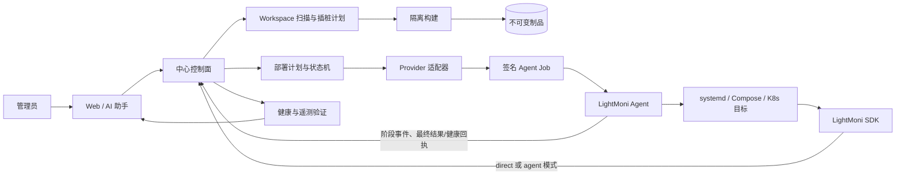

# SDD 021：实施计划

## 1. 实施边界

本计划把 AI 源码辅助和业务部署拆为两个可以单独验收的子域：

- **instrumentation**：在受控 workspace 里扫描、生成、审阅和应用 SDK 插桩 diff。
- **deployment**：将已确认 revision 构建成不可变 release，按目标 provider 生成并执行部署计划，完成健康和遥测验证。

两者通过 `service_id`、源 revision、release digest 和 deployment plan 关联，但任何一个阶段失败都不会隐式执行另一个阶段。Agent 安装是 deployment 的前置阶段，仍保留现有 enrollment/SSH 预检边界。

架构影响为“是”。需要同步 `docs/system-design.md` 的 HLD 组件图、部署拓扑、AI/Agent 工具边界、业务部署数据流、SQLite 数据模型和 API 族；同一个 Pull Request 必须记录 Doca 写入及回读证据。Doca 不可访问时不能把同步标为完成。

## 2. 目标架构

中心控制面只保存管理状态和制品元数据；遥测仍写入 ClickHouse。Agent 是独立节点执行平面，不能获得模型凭据或任意命令权限。SDK 默认直连中心，Agent 模式由用户显式选择。

当前实现覆盖中心元数据、状态迁移、审批提案、有界验证判定、受控插桩 apply 和最小 Agent job/executor 切片：systemd 适配器提供可测试的纯逻辑接口；`service-deployments` 持久化审批与脱敏事件，管理员批准且 Agent 就绪时创建不可变 job；Agent 的有序阶段回执会推进部署状态，最终成功必须包含计划内 health_check 且回执报告健康通过。事件序号/阶段回退会被拒绝；取消未领取 job 可安全结束部署，已领取/执行任务取消、租约过期和不完整成功回执都保留为 `unknown` 供人工复核。Agent 可通过 `systemd.probe` 对登记目标进行只读 systemd preflight，中心保存有限状态快照并将新鲜快照附到后续计划；一次性 preflight ID、target revision 和观测时间绑定结果，旧 job 快照不能重放；路径符号链接、masked unit 和不稳定 active state 不会标为 ready。Linux 下 Agent 通过目录文件描述符和 `O_NOFOLLOW` 保护预检及制品文件操作；不支持的系统不标记 ready，FIFO 版本指针不会阻塞 job loop。这不会运行部署动作。`deployment/verification.ts` 仍只对已获取且有界的健康/遥测证据做中心侧判定，插桩 apply 绑定 revision 并在管理员确认后原子写入。

本轮将制品交付边界定义为受限 `lightmoni-release-v1.tar.gz`、中心私有 digest 存储、管理员有界上传、绑定 Agent/job lease 的下载以及仅含普通文件和目录的安全解包。部署入口固定为管理员预配置的 `<release_directory>/current/run`；Agent 不修改任意 systemd unit，而以相对 `releases/<version>` symlink 原子切换并比较预检时 previous version。内容寻址对象可能由多个 release 共用，因此上传内容格式或 manifest 校验失败时不得按 digest 立即删除；未引用对象留待有引用检查与保留期的安全 GC。完整构建 worker、真实 ClickHouse 查询和自动补偿仍待实现；管理员确认的回滚仅恢复已登记的 previous release，并经 CAS、restart、健康与 current-version 回执验证；首次部署无 previous release、目标版本已变化或执行结果未知时不自动覆盖/重试。回滚未知结果将关闭当前操作并要求人工复核；管理员只有经更新的安全 preflight 再次证明 current 仍为本次部署版本后才能显式重试。部署 `succeeded` 仅表示 Agent 报告计划内 health_check 通过，不代表中心遥测已验证。

中心管理员制品上传使用进程级单槽准入门，覆盖收件到 release 状态提交，避免并行请求倍增临时磁盘和同步解析负载；槽位占用时返回 `503 artifact_upload_busy`，不建立等待队列。管理员 GC dry-run/确认执行也使用同一门控；仅清理所有 release 状态均未引用且超过 24 小时的文件，每轮最多扫描 10,000 项、删除 500 个对象。扫描上限通过当前进程内最多存活 5 分钟的不透明游标续扫，模式/截止时间绑定，后续轮次重新查询引用；新扫描或过期会关闭旧目录句柄。存储祖先校验复用读取的受信 UID/写权限边界。它不构成集群级门控，也不降低单个输入的最大解析内存；当前模块化单体按单中心进程部署。硬磁盘配额、Worker/流式解析属于后续资源硬化。

制品进入私有 digest 存储前以及 Agent 暂存后都运行同一个有界凭据扫描器，检查常见私密路径、私钥/已知 token、URL/DSN userinfo、凭据查询参数、Basic Auth 和配置中的有值凭据字段；字段匹配支持跨行空白、窗口重叠与一次 percent 解码，并忽略明显的运行时环境引用及 token 计数/TTL 等元数据。扫描只是一层常见凭据拦截，不能代替来源审查或证明制品无密钥；运行凭据必须通过目标机独立秘密管理注入。

受管 release 根目录必须由 root 持有并属于 Agent systemd unit 配置的 `lightmoni-agent` 主组（建议 `0775`，业务服务用户可读/遍历但只读）；Agent 的 `ProtectSystem=strict` 沙箱需将登记目录显式加入 `ReadWritePaths`。Agent 预检要求根目录 UID 为 0、GID 等于 Agent 有效主 GID、组可写、其他用户仅可读/遍历且 Agent 本身具有有效写访问。MVP 不读取扩展 POSIX ACL 或 systemd unit 的业务进程身份/附加组；管理员必须确保业务用户不属于 Agent 组、无 ACL 写权限。bundle 不承载任何密钥或运行环境凭据。

## 3. 分层与模块

### 3.1 `runtime/src/assistant`

- 增加 `scan_instrumentation`：调用受限 workspace scanner，返回技术栈、SDK 发现、候选插入点和风险。
- 增加 `propose_instrumentation`/`apply_instrumentation`：只生成并审批 diff；应用前检查 workspace revision。
- 增加 `propose_service_deployment`、`get_deployment` 和 `get_deployment_events`：只创建计划、读取状态和请求管理员确认。
- 现有 Pi `code_task` 继续承担多轮读取/修改/检查，不把部署执行塞进模型 loop。

### 3.2 `runtime/src/deployment`

- `types.ts`：状态、制品、目标、健康检查、typed actions 和 provider 接口。
- `systemd.ts`：MVP 只做纯逻辑 `probe/plan/apply/verify/rollback`；不在适配器内调用 shell。
- 后续 `docker-compose.ts`、`kubernetes.ts` 实现同一接口并独立注册，不修改 AI 工具参数。
- `executor` 由 Agent 负责，按 capability allow-list 解释 actions。

### 3.3 `runtime/src/server`

- 新增服务、目标、release、deployment 的 SQLite migration 和 repository。
- 新增 API：服务 CRUD、目标 probe、release 元数据、部署 plan/approve/status/rollback/events。
- 将现有 Agent 安装计划作为 `ensure_agent` 阶段引用；不把 `machine_deployments` 伪装成业务 deployment。
- 统一权限、幂等键、审计、状态迁移和错误码。

### 3.4 `runtime/src/agent`

- 新增 job 拉取/租约、control credential 鉴权、幂等持久化、执行回执和取消/过期处理；生产签名校验仍待补充。
- MVP executor 只实现 `stage_artifact`（lease 绑定下载、压缩包摘要验证、安全 USTAR 解包）、`activate_release`（previous-version 比较及原子 `current` symlink）、允许 unit 的 `daemon-reload/start/restart/enable/stop` 和固定健康检查。
- job 完成后只回传状态、摘要、错误码和健康快照；原始输出只在节点本地短期保留并脱敏。
- Agent 仍独立心跳和上报，不要求业务进程存活；SDK 经 Agent 的遥测队列保持现有协议。

### 3.5 隔离扫描与构建

- scanner 使用已有路径/符号链接/文件大小限制；语言检测优先读取 lockfile、manifest 和入口文件，不执行项目代码。
- 结构化补丁优先；无法安全解析时输出人工步骤而不是猜测写文件。
- build worker 使用临时目录、资源上限、脱敏日志和明确的网络策略；生成 `source_revision + version + sha256 + arch`。
- 生产 Agent 只接收 release，不接受 Git token、package registry secret 或模型 Key。
- `lightmoni-release-v1.tar.gz` 根目录固定包含 `manifest.json` 与可执行 `run`，目标 unit 预先配置 `ExecStart=<release_directory>/current/run`。受限 USTAR 只接受普通文件/目录，压缩上限 64 MiB、解压上限 256 MiB、10,000 条目；不调用 `tar`/shell 解包用户制品。

## 4. 数据模型

以下表在 SQLite 中维护，所有写操作带 `created_by`/`approved_by` 与时间；敏感值只存密文或摘要。

| 表 | 关键字段 | 约束 |
| --- | --- | --- |
| `services` | `id`, `name`, `repository_ref`, `default_mode`, `created_by` | 名称唯一；不保存仓库 token |
| `service_targets` | `id`, `service_id`, `machine_id`, `provider`, `provider_config_json`, `agent_id` | provider 配置经 schema 校验；目标机器必须已登记 |
| `releases` | `id`, `service_id`, `source_revision`, `version`, `sha256`, `arch`, `artifact_ref`, `status` | digest+arch 唯一；artifact immutable |
| `release_artifacts`（元数据） | `release_id`, `sha256`, `size`, `format`, `created_at` | 正文只在中心私有 content-addressed 文件目录；无公开静态路由 |
| `deployments` | `id`, `service_id`, `target_id`, `release_id`, `state`, `plan_json`, `previous_json`, `operation_id`, `approved_by` | 状态迁移和 operation 幂等 |
| `deployment_events` | `id`, `deployment_id`, `phase`, `state`, `code`, `summary`, `actor`, `created_at` | 只存脱敏摘要，按 deployment 有序 |
| `instrumentation_plans` | `id`, `service_id`, `workspace_ref`, `base_revision`, `diff_json`, `findings_json`, `state` | apply 必须匹配 base revision |
| `agent_jobs` | `id`, `agent_id`, `deployment_id`, `capabilities`, `expires_at`, `state`, `receipt_json` | job ID 唯一，一次仅一个 deployment operation；由 `runtime/src/server/agent-jobs.ts` 创建 |

当前代码实际创建 `services`、`service_targets`、`service_target_preflights`、`releases`、`deployments`、`deployment_events` 和 Agent job 表；插桩计划以加密的键值记录保存，尚未迁移为独立 `instrumentation_plans` 表。当前 service API 的字段是 `repository_url`、`adapter`、`config` 等，`default_mode`、`provider_config`、`agent_id` 和 release 构建状态等契约字段尚未接入，不能按目标契约调用。部署 API 已实现 `awaiting_approval → agent_ready` 管理员审批、合法迁移校验、Agent 阶段回执和带健康证据的最终状态映射，以及 `GET .../events`、rollback job 和 `rolled_back` 回执；Agent job 的租约、单调事件、结果、取消、过期 `unknown` 和 MVP capability executor/runner 已落地。只读 systemd preflight job 已检查并存储目标快照；私有 digest 制品正文、绑定 lease 的下载、受限 USTAR 校验、安全解包和相对 symlink 激活已落地，ready bundle 可生成可执行 typed actions。中心健康/遥测查询、自动补偿、生产签名仍待实现。中心侧有界验证判定已独立实现并测试。

## 5. HTTP 与工具流程

### 5.1 插桩

1. `POST /api/v1/services` 创建逻辑服务。
2. `POST /api/v1/services/:id/instrumentation/scan` 返回扫描报告和 `plan_id`。
3. `POST /api/v1/instrumentation-plans/:id/propose` 生成可审阅 diff。
4. `POST /api/v1/instrumentation-plans/:id/apply`（管理员）带 `base_revision` 应用 diff。
5. `POST /api/v1/services/:id/releases` 触发受控构建；完成后生成 release metadata。

AI 工具只调用扫描、提案和只读状态；apply/build 的接口返回 approval-required 结果，不能由模型隐式确认。

### 5.2 Agent + 业务部署

1. `POST /api/v1/services/:id/targets` 登记目标和 provider 配置。
2. `POST /api/v1/services/:id/targets/:targetId/preflight` 创建短时只读 Agent job，检查登记的 systemd unit 和 release directory；job 内含一次性 preflight ID 与 target revision，中心校验回执绑定和观测时间；`GET .../preflight` 返回最后一次脱敏预检结果。
3. `POST /api/v1/services/:id/deployments/plan` 将最近 10 分钟内 ready 的预检快照绑定到计划；没有快照或快照未就绪时，计划保留原因并且不生成可执行动作。
4. `POST /api/v1/deployments/:id/approve` 由管理员确认；当前实现要求有可执行 actions 和获授权 health_check，检查 Agent 心跳、创建不可变 job 并推进到 `agent_ready`。无 ready bundle、预检或 typed actions 的普通业务计划仍会被拒绝审批。
5. Agent 使用 control credential 拉取 job、在 capability allow-list 内执行 typed actions 并提交单调阶段事件；中心映射 `staging → activating → verifying` 并将脱敏回执写入部署时间线。只有 verifying 后的最终结果含 `health.healthy=true` 才能进入 `succeeded`。
6. 已领取任务取消、租约过期和缺少健康证据的成功回执都进入 `unknown`，保留最后已知部署状态并要求人工复核；未领取的 job 可安全取消。Agent 健康成功不等于遥测已验证；管理员可按快照绑定、发布版本和固定时间窗显式发起中心 reader 核验，独立保存摘要。
7. 管理员通过 `PUT /api/v1/services/:serviceId/releases/:releaseId/artifact` 上传有界 bundle。中心验证 `X-Artifact-SHA256`、manifest 归属和格式后，原子写入私有 digest 目录并将 release 标记 ready。因 digest 可共享，失败上传不立即删除 blob；GC 需确认无 release 引用、无进行中的上传且满足保留期后才能删除。
8. 批准部署后 Agent 通过 `GET /api/v1/agents/:agentId/jobs/:jobId/artifacts/:releaseId` 下载制品；请求须使用 control credential 和 `X-LightMoni-Job-Lease`，中心验证 lease、Agent、release 与不可变 action 精确匹配。Agent 先验摘要再安全解包至 `releases/<version>`。
9. Agent 通过 `systemd.probe` 验证目标 unit `ExecStart` 指向 `<release_directory>/current/run`；审批计划绑定 previous version。激活创建同目录临时相对 symlink 并原子替换 `current`，只有指针仍等于 previous version 才允许切换；随后执行允许的 restart/start 与 health check。
10. 管理员 `POST /api/v1/deployments/:id/rollback` 仅对仍处于当前版本、存在已登记 previous release 且有最新结构安全 preflight 的 systemd target 创建独立回滚 job；unit 可为 active/inactive/failed，路径、入口与 current 指针必须安全。Agent 依次执行 current-version CAS、恢复旧指针、restart 与 systemd health check，中心再核对健康和 `current_version` 后进入 `rolled_back`。首次部署无旧版本、CAS 冲突、租约过期或结果未知均不自动补偿/重试；未知回执结束当前操作并要求人工检查，新的安全预检仍确认部署版本是 current 后，管理员才可创建新 operation。

### 5.3 重试和未知结果

- HTTP 请求使用 `Idempotency-Key`；重复 plan/approve/rollback 返回原计划或原回执。
- Agent 断线时中心后台每 5 秒检查过期任务：未领取的 queued job 超时为安全取消；已领取 job 的租约过期转 `unknown` 并同步保留部署最后已知状态，拒绝迟到的成功回执。先人工检查目标，再决定是否重放；取消已领取任务也标记为 unknown，因为不能证明主机没有发生副作用。
- activating 后进程是否已切换不能靠客户端超时判断；必须以 Agent 快照和目标健康检查为准。

## 6. 适配器实现策略

### systemd（MVP）

- `probe`：通过 Agent `systemd.probe` job 检查 systemd 可用、unit 存在、active/enabled、当前版本和登记的 release directory。仅返回固定 schema 快照，不回传命令输出。快照绑定目标和预检 operation，并在部署计划生成时记录；快照最大有效期为 10 分钟。
- `plan`：生成暂存制品、daemon-reload、enable/start/restart、健康检查和 rollback typed actions。
- `apply`：只把已批准计划转成 Agent job，不直接启动子进程。
- `verify`：对 Agent 回报的快照执行 active/version/health 检查；必要时向中心查询遥测。
- `rollback`：管理员确认后切换到已登记的 `previous` 版本，CAS 期望当前版本为此次部署版本；随后 restart 并执行 systemd health check。没有 previous release 或 fresh preflight、目标已被其他部署改变、Agent 不在线时拒绝执行；不删除 release。只有最终回执健康通过且 current version 等于 previous 才算 `rolled_back`。

中心侧验证抽象位于 `runtime/src/deployment/verification.ts`：它要求固定服务/实例、UTC 时间窗口、截止时间和最多 1000 条样本，只统计窗口内的精确匹配；健康通过但没有遥测时返回 `succeeded_telemetry_unverified`，不会把延迟误判为进程失败。只读 Agent systemd preflight 已检查 unit 与受控 release directory，并将快照绑定到 target config revision、一次性 preflight ID 和观测时间；当前 Agent 通过事件回执报告部署 typed health_check，中心可将有健康证据的最终回执映射为 deployment `succeeded`；本轮 T015 已增加显式 SDK 服务/实例绑定和发布版本匹配的中心 reader 查询，使用固定部署后窗口、单进程单槽以及查询前后上下文校验；结果独立保存、过期结果标记 stale。真实 ClickHouse/业务主机验收仍待环境。自动探测/补偿仍未完成；管理员确认的 current-version CAS 回滚已接入，真实 Linux 主机验收待 CI/实机验证。

### 后续 provider

- `docker_compose`：目标配置仅包含受控 compose project/service 名和制品引用；executor 只允许固定 compose actions。
- `kubernetes`：通过受控 namespace、deployment 名和镜像 digest 计划；优先使用集群内 Agent/受限凭据。
- `helm`、CI/GitOps、Windows、Serverless 先分别编写 SDD，不在 systemd MVP 中隐式兼容。

## 7. 安全控制

- AI 输出是建议，不是授权；所有副作用 API 都重新检查角色、状态、revision、TTL 和目标归属。
- Agent job 使用短期签名和 capability allow-list；拒绝额外字段、越界路径、`..`、控制字符、任意 shell 和不匹配 digest。
- SSH 凭据默认不长期保存，使用已有受保护存储；部署后提示用户清除或设置过期时间。
- Builder、中心和 Agent 日志统一脱敏；secret 不能进入模型上下文、SQLite 明文、PR、Doca 或 URL。

## 8. 迁移与兼容

- 现有 SDK 直连/Agent 模式、Agent enrollment、受管机器和 SSH 预检 API 保持兼容。
- 新表和新 API 以增量 migration 建立；没有业务服务记录的旧 Agent 不受影响。
- 现有 `machine_deployments` 继续代表 Agent 安装；新增 `deployments` 专门代表业务版本激活，两者通过 `agent_id`/事件关联但不共用状态。
- 如果扫描或适配器无法安全判断，返回可读的手动步骤；不能自动把未知服务当成 systemd。

## 9. 验证策略

- 纯逻辑：适配器路径校验、状态机、摘要校验、重复 job 和 rollback 单元测试。
- 集成：SQLite migration、权限、计划/批准/回执 API、Agent job 租约、ClickHouse 遥测查询。
- 端到端：临时 systemd fixture（或受控 mock executor）验证成功、健康失败回滚、Agent 离线、延迟遥测和并发 revision。
- 安全：恶意路径、shell 注入、过期签名、错误 audience、秘密出现在日志/上下文等负向测试。
- 文档：代码、`docs/system-design.md` 和 Doca 设计图/文本在同一 PR 中同步并回读。

## 10. 发布门

进入待评审 PR 前必须满足：

1. SDD 五类文档和契约完成，任务状态与真实实现一致。
2. systemd 适配器与 Agent executor 的相关测试通过。
3. 所有新增 API 有权限、错误码、幂等和审计验证。
4. `docs/system-design.md` 已更新，Doca 最新版本回读确认文本、节点和连线；不能用旧 seq 或“已提交”代替保存确认。
5. PR 描述列出架构影响、文档章节、Doca 链接、验证命令、已知限制和未实现 provider。

## T015 本轮实施计划：受绑定的 ClickHouse 核验

1. 先固化 `contracts/api.md` 的可选 target telemetry binding、固定时间窗、独立结果和过期 CAS。
2. 复用纯证据判定并拆开平台 service ID 与 SDK service/name/version；新增有界 reader 查询模块和身份/时间/目录负向测试。
3. 增加非破坏 `telemetry_json` 迁移及管理员手动核验 API；单槽并发保护，查询前后核对 deployment/target/release，拒绝后续批准操作取代的部署。GET/AI 标注旧结果过期。
4. Web 目标编辑加入可选绑定，部署详情展示独立核验结果及固定窗口；明确 SDK 版本/实例要求和证据限制。
5. API 覆盖持久化、权限、严格 body、未配置、查询失败、单槽、回滚/目标修改/新部署竞态；执行类型检查、测试和前端构建。
6. 同步仓库设计及 PR #25；Doca 不可访问时维持发布门未通过，记录真实阻塞。源码隔离 Builder、真实 Linux/ClickHouse 验收、自动补偿仍不在本切片内。
