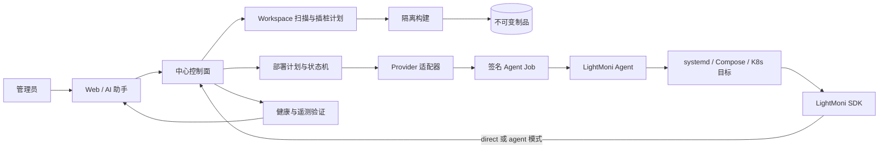

# SDD 021：实施计划

## 1. 实施边界

本计划把 AI 源码辅助和业务部署拆为两个可以单独验收的子域：

- **instrumentation**：在受控 workspace 里扫描、生成、审阅和应用 SDK 插桩 diff。
- **deployment**：将已确认 revision 构建成不可变 release，按目标 provider 生成并执行部署计划，完成健康和遥测验证。

两者通过 `service_id`、源 revision、release digest 和 deployment plan 关联，但任何一个阶段失败都不会隐式执行另一个阶段。Agent 安装是 deployment 的前置阶段，仍保留现有 enrollment/SSH 预检边界。

架构影响为“是”。需要同步 `docs/system-design.md` 的 HLD 组件图、部署拓扑、AI/Agent 工具边界、业务部署数据流、SQLite 数据模型和 API 族；同一个 Pull Request 必须记录 Doca 写入及回读证据。Doca 不可访问时不能把同步标为完成。

## 2. 目标架构

中心控制面只保存管理状态和制品元数据；遥测仍写入 ClickHouse。Agent 是独立节点执行平面，不能获得模型凭据或任意命令权限。SDK 默认直连中心，Agent 模式由用户显式选择。

当前实现只覆盖中心的元数据和计划切片：systemd 适配器独立提供可测试的纯逻辑接口，但尚未由 `service-deployments` API 调用，也没有 Agent job 执行链路。下文带“后续”或“待实现”的模块不能在本次 PR 中宣称可用。

## 3. 分层与模块

### 3.1 `runtime/src/assistant`

- 增加 `scan_instrumentation`：调用受限 workspace scanner，返回技术栈、SDK 发现、候选插入点和风险。
- 增加 `propose_instrumentation`/`apply_instrumentation`：只生成并审批 diff；应用前检查 workspace revision。
- 增加 `propose_service_deployment`、`get_deployment` 和 `get_deployment_events`：只创建计划、读取状态和请求管理员确认。
- 现有 Pi `code_task` 继续承担多轮读取/修改/检查，不把部署执行塞进模型 loop。

### 3.2 `runtime/src/deployment`

- `types.ts`：状态、制品、目标、健康检查、typed actions 和 provider 接口。
- `systemd.ts`：MVP 只做纯逻辑 `probe/plan/apply/verify/rollback`；不在适配器内调用 shell。
- 后续 `docker-compose.ts`、`kubernetes.ts` 实现同一接口并独立注册，不修改 AI 工具参数。
- `executor` 由 Agent 负责，按 capability allow-list 解释 actions。

### 3.3 `runtime/src/server`

- 新增服务、目标、release、deployment 的 SQLite migration 和 repository。
- 新增 API：服务 CRUD、目标 probe、release 元数据、部署 plan/approve/status/rollback/events。
- 将现有 Agent 安装计划作为 `ensure_agent` 阶段引用；不把 `machine_deployments` 伪装成业务 deployment。
- 统一权限、幂等键、审计、状态迁移和错误码。

### 3.4 `runtime/src/agent`

- 新增 job 拉取/租约、签名校验、幂等持久化、执行回执和取消/过期处理。
- MVP executor 只实现 `stage_artifact`、允许 unit 的 `daemon-reload/start/restart/enable/stop` 和固定健康检查。
- job 完成后只回传状态、摘要、错误码和健康快照；原始输出只在节点本地短期保留并脱敏。
- Agent 仍独立心跳和上报，不要求业务进程存活；SDK 经 Agent 的遥测队列保持现有协议。

### 3.5 隔离扫描与构建

- scanner 使用已有路径/符号链接/文件大小限制；语言检测优先读取 lockfile、manifest 和入口文件，不执行项目代码。
- 结构化补丁优先；无法安全解析时输出人工步骤而不是猜测写文件。
- build worker 使用临时目录、资源上限、脱敏日志和明确的网络策略；生成 `source_revision + version + sha256 + arch`。
- 生产 Agent 只接收 release，不接受 Git token、package registry secret 或模型 Key。

## 4. 数据模型

以下表在 SQLite 中维护，所有写操作带 `created_by`/`approved_by` 与时间；敏感值只存密文或摘要。

| 表 | 关键字段 | 约束 |
| --- | --- | --- |
| `services` | `id`, `name`, `repository_ref`, `default_mode`, `created_by` | 名称唯一；不保存仓库 token |
| `service_targets` | `id`, `service_id`, `machine_id`, `provider`, `provider_config_json`, `agent_id` | provider 配置经 schema 校验；目标机器必须已登记 |
| `releases` | `id`, `service_id`, `source_revision`, `version`, `sha256`, `arch`, `artifact_ref`, `status` | digest+arch 唯一；artifact immutable |
| `deployments` | `id`, `service_id`, `target_id`, `release_id`, `state`, `plan_json`, `previous_json`, `operation_id`, `approved_by` | 状态迁移和 operation 幂等 |
| `deployment_events` | `id`, `deployment_id`, `phase`, `state`, `code`, `summary`, `actor`, `created_at` | 只存脱敏摘要，按 deployment 有序 |
| `instrumentation_plans` | `id`, `service_id`, `workspace_ref`, `base_revision`, `diff_json`, `findings_json`, `state` | apply 必须匹配 base revision |
| `agent_jobs` | `id`, `agent_id`, `deployment_id`, `capabilities`, `expires_at`, `state`, `receipt_json` | job ID 唯一，一次仅一个 deployment operation；当前尚未建表 |

当前代码实际只创建 `services`、`service_targets`、`releases` 和 `deployments` 四张表；`deployment_events`、`instrumentation_plans`、`agent_jobs` 仍是目标模型。当前 service API 的字段是 `repository_url`、`adapter`、`config` 等，`default_mode`、`provider_config`、`agent_id` 和 release 构建状态等契约字段尚未接入，不能按目标契约调用。

## 5. HTTP 与工具流程

### 5.1 插桩

1. `POST /api/v1/services` 创建逻辑服务。
2. `POST /api/v1/services/:id/instrumentation/scan` 返回扫描报告和 `plan_id`。
3. `POST /api/v1/instrumentation-plans/:id/propose` 生成可审阅 diff。
4. `POST /api/v1/instrumentation-plans/:id/apply`（管理员）带 `base_revision` 应用 diff。
5. `POST /api/v1/services/:id/releases` 触发受控构建；完成后生成 release metadata。

AI 工具只调用扫描、提案和只读状态；apply/build 的接口返回 approval-required 结果，不能由模型隐式确认。

### 5.2 Agent + 业务部署

1. `POST /api/v1/services/:id/targets` 登记目标和 provider 配置。
2. `POST /api/v1/services/:id/deployments/plan` 运行 `ensure_agent` 依赖检查和 adapter `probe/plan`，状态为 `awaiting_approval`。
3. `POST /api/v1/deployments/:id/approve` 由管理员确认，状态按 `agent_ready → staging → activating → verifying` 推进。
4. 中心生成签名 job；Agent 拉取、执行 typed actions 并回报事件。
5. 中心执行健康检查和遥测验证，进入 `succeeded` 或 `rollback_pending`。
6. `POST /api/v1/deployments/:id/rollback` 生成回滚 job；Agent 完成后进入 `rolled_back`。

### 5.3 重试和未知结果

- HTTP 请求使用 `Idempotency-Key`；重复 plan/approve/rollback 返回原计划或原回执。
- Agent 断线时中心保留租约和最后状态；超时转 `failed` 或 `unknown`，先重新 probe，再决定是否重放。
- activating 后进程是否已切换不能靠客户端超时判断；必须以 Agent 快照和目标健康检查为准。

## 6. 适配器实现策略

### systemd（MVP）

- `probe`：检查 systemd 可用、unit 存在、active/enabled、当前 release 和受控目录。
- `plan`：生成暂存制品、daemon-reload、enable/start/restart、健康检查和 rollback typed actions。
- `apply`：只把已批准计划转成 Agent job，不直接启动子进程。
- `verify`：对 Agent 回报的快照执行 active/version/health 检查；必要时向中心查询遥测。
- `rollback`：切换到 `previous` 版本；不删除旧制品，便于审计和再次激活。

### 后续 provider

- `docker_compose`：目标配置仅包含受控 compose project/service 名和制品引用；executor 只允许固定 compose actions。
- `kubernetes`：通过受控 namespace、deployment 名和镜像 digest 计划；优先使用集群内 Agent/受限凭据。
- `helm`、CI/GitOps、Windows、Serverless 先分别编写 SDD，不在 systemd MVP 中隐式兼容。

## 7. 安全控制

- AI 输出是建议，不是授权；所有副作用 API 都重新检查角色、状态、revision、TTL 和目标归属。
- Agent job 使用短期签名和 capability allow-list；拒绝额外字段、越界路径、`..`、控制字符、任意 shell 和不匹配 digest。
- SSH 凭据默认不长期保存，使用已有受保护存储；部署后提示用户清除或设置过期时间。
- Builder、中心和 Agent 日志统一脱敏；secret 不能进入模型上下文、SQLite 明文、PR、Doca 或 URL。

## 8. 迁移与兼容

- 现有 SDK 直连/Agent 模式、Agent enrollment、受管机器和 SSH 预检 API 保持兼容。
- 新表和新 API 以增量 migration 建立；没有业务服务记录的旧 Agent 不受影响。
- 现有 `machine_deployments` 继续代表 Agent 安装；新增 `deployments` 专门代表业务版本激活，两者通过 `agent_id`/事件关联但不共用状态。
- 如果扫描或适配器无法安全判断，返回可读的手动步骤；不能自动把未知服务当成 systemd。

## 9. 验证策略

- 纯逻辑：适配器路径校验、状态机、摘要校验、重复 job 和 rollback 单元测试。
- 集成：SQLite migration、权限、计划/批准/回执 API、Agent job 租约、ClickHouse 遥测查询。
- 端到端：临时 systemd fixture（或受控 mock executor）验证成功、健康失败回滚、Agent 离线、延迟遥测和并发 revision。
- 安全：恶意路径、shell 注入、过期签名、错误 audience、秘密出现在日志/上下文等负向测试。
- 文档：代码、`docs/system-design.md` 和 Doca 设计图/文本在同一 PR 中同步并回读。

## 10. 发布门

进入待评审 PR 前必须满足：

1. SDD 五类文档和契约完成，任务状态与真实实现一致。
2. systemd 适配器与 Agent executor 的相关测试通过。
3. 所有新增 API 有权限、错误码、幂等和审计验证。
4. `docs/system-design.md` 已更新，Doca 最新版本回读确认文本、节点和连线；不能用旧 seq 或“已提交”代替保存确认。
5. PR 描述列出架构影响、文档章节、Doca 链接、验证命令、已知限制和未实现 provider。
