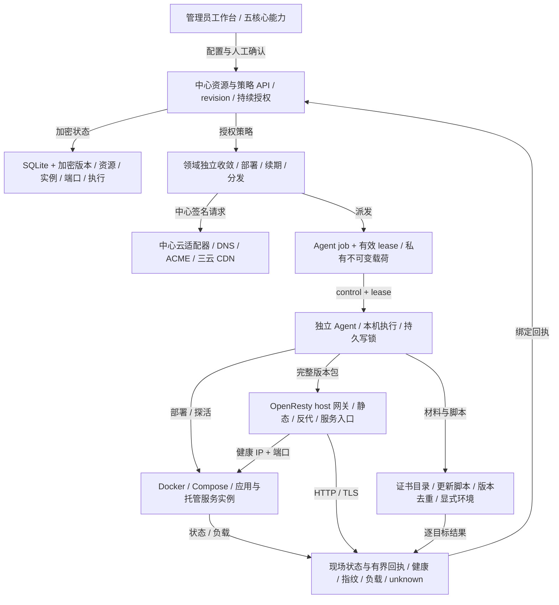

## 33. 网站、DNS、证书与 Docker 服务托管（SDD 033）

2026-10-29。用户批准整体重构并明确尚未上线、无需旧模型兼容。此章描述 SDD 033 分支实现，合入和真实外部服务验收以对应 PR/validation 为准；第26章的网站、证书与容器描述由本章替代，备份/计划和恢复说明继续适用。

### 33.1 组件职责与资源模型

中心仍是 Node.js/TypeScript 模块化单体，SQLite 保存管理状态，ClickHouse 保存遥测；未引入 Consul、Kubernetes、第二个中心或中心 Docker socket。runtime/src/ops 统一全局 credential、dns_zone、acme_account、certificate、certificate_target、application、service、node_pool、gateway_group、website。应用描述 Docker 单容器或 Compose 声明；部署/实例绑定机器；托管服务声明资源、副本和端口；网站声明域名、HTTPS 与静态/反代/服务目标。OpenResty 是 host Docker 系统应用，多网站共享网关组内的进程。

### 33.2 存储、版本与执行

ops_platform_resources 保存 revision、加密 spec、脱敏 status 和授权者；ops_platform_revisions 保存不可变配置快照；ops_platform_runs 保存加密请求快照/输入、逻辑去重键、执行状态和脱敏结果。ops_platform_instances、ops_platform_ports 保存实例、资源与端口预留；ops_platform_nodes 保存 Agent 只读容量观察。证书版本、ACME 账号/订单/挑战、DNS 观察/归属及云证书映射分别持久保存。配置保存与应用发布分开；发布冻结 desired_revision，托管服务同时冻结 application_revision 和 node_pool_revision。新配置需显式发布才进入持续维护。

### 33.3 鉴权、私有载荷与调度

管理员 API 为 /api/v1/ops，统一 revision、confirmed、资源引用和可用动作检查。人工动作和已启用的持续策略记录授权者，每次新派发重查管理员有效性。领域各自维护 in-flight，慢 DNS/ACME 不阻塞工作负载轮次；网站 DNS 刷新另有并发上限。新 Agent 动作使用 operations.platform，复用现有 control 身份、job lease 和 /agents/:id/jobs/:jobId/operations 私有下载；普通 job 仅含 ID。成功回执必须匹配 operation/resource/node 并有现场验证；中心拒绝陈旧或撤权载荷。关闭时拒绝新动作，等待已开始的领域/云动作再关闭存储。

### 33.4 DNS 与 ACME

阿里 DNS 与 DNSPod 通过固定官方 HTTPS 端点签名请求，支持全量分页 CRUD/启停和管理 scope；五分钟有界只读同步观察外部修改。人工可管理授权范围内记录，网站/ACME 自动化只维护已记录归属和 Record ID 的记录。API 接受、平台回读和公网传播是不同状态。ACME 在中心使用持久账号密钥、订单、CSR 和 DNS-01 挑战，精确创建/清理本订单 TXT，支持同名多值与通配符；不把 DNS 凭据下发到网关。

### 33.5 证书版本与三类分发目标

证书支持 ACME、上传、自签；公私钥匹配、SAN、有效期和指纹均校验。材料与不可变版本加密保存，公开接口只显示元数据和 has_*。上传证书只能提醒到期；ACME/自签可显式启用自动续期，窗口按实际有效期计算，尚未接入 ARI；失败续期可人工重新 issue/renew，不宣称完整自动退避已实现。网站首次发布 HTTPS 时，材料缺失或过期可调用中心证书签发后继续部署。证书目标分别为 Agent 目录、云 CDN、更新脚本，各自记录 desired/applied 版本与结果。

### 33.6 云服务、脚本与凭据边界

首批云目标覆盖阿里云、腾讯云、火山引擎 CDN HTTPS 域名。阿里 CDN 直接部署 PEM；腾讯 SSL 上传后更新 CDN；火山证书中心上传后部署 CDN。云映射保留远端证书ID，上传/绑定/逐域回读分别核实；HTTP 200、上传成功或某一域成功不替代全部目标生效。云凭据、ACME 密钥只由中心加密使用。目录按受管版本落盘并切换指针，私钥权限受限。更新脚本由管理员固定 Agent、解释器、正文、显式环境和超时；正文与环境加密，不在普通摘要回显，也不送 AI。脚本通过证书临时文件路径及版本元数据获得材料，具有 Agent 本机权限，无沙箱承诺。

### 33.7 幂等、未知结果与恢复

证书目标按目标修订＋证书版本持久去重，云上传复用已保存远端ID。unknown 不自动重放任意脚本或不确定写入；inspect 可只读核对云配置、目录指纹或脚本成功标记，未核实的 unknown 不允许 retry。核对目标不会自动清理节点持久 unknown 写锁，旧进程/daemon和现场状态仍需管理员核查。回执和错误只保存安全码、ID及有界摘要，不返回私钥、脚本环境或任意 stdout/stderr。历史中心 verifying 表示等待读回，不作为永久编辑忙锁；真正执行中的中心动作和活动 Agent lease 才阻止冲突编辑。

### 33.8 Docker 应用与轻量调度

Agent 使用本机固定 Docker context 执行单容器/Compose。平台管理配置文件、只首次写入的初始化文件、数据目录和 Docker volume；停止/移除容器不删除业务数据。资源和端口在 SQLite 事务预留，实际端口在节点复核。机器池可显式设置容量，也可经 node.inspect 获取 CPU/内存/IP/Docker 能力。调度基于在线机器、容量、端口与副本分散；现有副本按健康回执逐个更新，健康连续失败时有界重建。服务发现提供新鲜健康实例的机器可达 IP＋发布端口，要求机器之间已有可达网络；没有自动 overlay 或本地数据复制。

### 33.9 网站、网关与流量

网站支持静态文本文件、手工 HTTP(S) 反代和托管服务。网站仅在显式启用后进入网关完整版本包；域名在组内唯一。Agent 按版本暂存站点/证书/静态文件，检查 OpenResty 配置后切换、重载并实际验证 HTTP 内容与 TLS 指纹，失败恢复旧版。全部后端不健康时下发明确503，实例端点变化只更新上游。网关在 Linux host 网络直接监听端口；已验证健康网关的公网地址进入平台拥有的 A/AAAA，关闭网站移除自身拥有记录。DNS TTL 不提供即时故障切换保证。Agent 失联不等于容器停止，不据此释放端口或静默迁移本地数据。

### 33.10 界面、验证与支持范围

网站与运维提供五核心页签和共享基础设施，应用/服务列表显示机器和现场负载，证书显示到期和逐目标结果，表单支持中英文/主题/窄屏、失败保留输入。旧 /services 用户入口转向托管服务。代码验证覆盖 SQLite/HTTP/有效 Agent 租约、真实自签/目录/脚本、协议签名/分页/ACME 生命周期及调度故障；真实 Linux Docker/Compose/OpenResty 与 UI 夹具和实际 SQLite 页面验收分别记录。真实云账号/CDN边缘传播、公网 ACME 发证和大规模生产负载未获现场验收，不由夹具代替。详见 specs/033-operations-control-plane/validation.md 和 docs/operations-platform.md。
