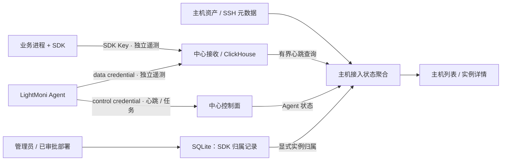

# 设计：HLD 与 LLD

## 1. 总体关系

SDK 和 Agent 各自上报中心。归属记录用于观测展示，不授予控制权限；SSH 凭据仍只由中心现有受限接口使用。主机页面统一产品术语，后端继续区分资产、Agent 身份、业务进程和认证凭据。

## 2. 身份与展示对象

| 标识 | 含义 | 是否可作主机认证 |
| --- | --- | --- |
| `managed_machines.id` | 已登记主机资产；新增仅资产登记时不要求连接地址 | 否 |
| `agent_id` | 独立控制/数据凭据绑定的 Agent 身份 | 仅通过既有认证与受管身份核验 |
| Agent `host_id` | Agent 自身持久资源标识，与资产 ID 不相等 | 否 |
| `service + instance_id` | 一个业务进程实例；SDK 默认 ID 可随重启改变 | 否 |
| `key_id` | 中心认证得出的上报凭据 ID，可被多个服务/实例共享 | 否；只能证明通过此凭据接收 |
| SDK `resource["host.id"]` | 用户声明的资源属性，可作为候选提示 | 否，不直接建立归属 |

MVP 的 `host_ref` 是展示目标引用：`machine:<id>` 或 `agent:<id>`，不是新认证身份。已有可信绑定时统一解析到 machine 引用；Agent-only 保留独立接入目标及 scope=unknown/container 提示，不能承诺一条未核实 Agent 行就是一台物理主机。SDK-only 必须先登记真实资产，不能因一个上报实例自动创建主机。

后续实现给 `managed_machines` 增加明确 `access_mode=asset_only`（拟议字段，不直接扩用现有枚举）：新模式允许无 address/port/username；所有 SSH 能力返回 false 和 `ssh_not_configured`。既有记录回填 `access_mode=ssh`，连接方式保持原义。旧 `/machines` 仍仅返回其旧契约可表示的连接记录；新版 host-view API 汇总资产/Agent，避免让旧客户端把空地址当合法 SSH 目标。SDK-only 不强制 Agent 或 SSH。

## 3. SDK 归属：最小可信增量

新增 `sdk_host_bindings` 和不含秘密的审计表，SQLite 保存归属及生效区间，不复制完整遥测：

- `id, host_ref, key_id, service, instance_id, valid_from, valid_to, revision, source, service_target_id?, created_by, created_at`。
- 有效选择器唯一约束 `(key_id, service, instance_id)`；`env/version/language` 为观测属性，不单独作为身份。同一 90 秒重叠窗口出现互不相容的环境/客户端位置声明时标“元数据不一致，需核对”（`identity_conflict`），不自动跨主机绑定；不能仅因 24 小时历史属性或版本变过就永久拒绝，正常顺序迁移/版本更新允许保留分段历史。两个进程复用同一 selector 且元数据相同无法区分，必须明确该限制。
- `source=manual|approved_deployment`；候选必须来自中心已认证 SDK 自监控数据，使用服务器生成的短期 observation ID，提交不能任意拼写 Key/地址或借客户端 host.id 建立权限。
- 手动关联：选主机 → 查近 24 小时实际观察到的候选 → 显示 service/instance/env/Key 指纹摘要、时间、现有归属 → 确认 → CAS 保存；已绑定其他目标返回 409 并进入显式迁移流程。
- 平台部署：复用服务目标的已登记 machine、审批中的 service/instance 配置，提交部署审批时可勾选“关联 SDK 实例”；必须明确该目标实际使用的 SDK Key ID，不能只由当前 table/service/instance 绑定推导凭据。成功部署后保存 `awaiting_signal` 关系，收到合格心跳后显示活跃。新关系属于同一审批目标快照，不由 AI 工具自行批准。
- Key 轮换：SDK Key 不代表主机，新 Key 不静默继承；提供“将本主机关联迁移到新 Key”预览，逐项检查 selector/revision 后终止旧关系并建新关系。已经轮换的实例可由候选重新关联，历史分段保留。
- SDK 现有 `instance_id` 可选配置继续使用。推荐受管服务显式配置“每个并发进程唯一、重启可复用”的实例槽位；平台部署生成该值并通过应用配置传入，SDK 无需新增自动环境读取约定。不能让多副本共用同一实例 ID；默认随机 ID 的新实例由管理员重新关联，首批不做通配符继承。
- `resource["host.id"]` 只显示为“客户端声明”，不与资产 ID 或 Agent host_id 混为一谈，不自动绑定/迁移/恢复。即使另一持有同 Key 的进程伪造 selector，也只能污染该 Key 下的观测信息，不能获得主机执行权；MVP 不声称具备硬件或进程证明。

仅有 SDK 匿名业务上报且无自监控心跳的实例，首批不能自动列为可发现 SDK 候选，提示“配置有效 SDK Key 与自监控后可关联”。不扫描所有业务表、不为此扩大豁免表权限。

## 4. 心跳状态与时间

SDK 状态源为已规范化的系统 gauge 目录：component=sdk、name=lightmoni.sdk.heartbeat，按 `(key_id,service,instance_id)` 查询；物理表由目录解析，不能依赖历史兼容别名。

中心统一产生 `evaluated_at`。MVP 采用 90 秒新鲜窗口、最多 30 秒未来偏差，两者均作为返回策略字段；合格样本须同时满足：

1. `ingested_at` 位于本次关系的 `[valid_from,valid_to)`（有效关系上界为当前），且不晚于 evaluated_at；
2. `event_time >= max(valid_from,evaluated_at-90s)`，`event_time <= evaluated_at+30s`；
3. `ingested_at >= evaluated_at-90s`，`event_time <= ingested_at+30s`；
4. selector 与服务器认证 Key ID 精确匹配；只有同时符合这些条件的**同一条样本**可点亮状态，不能分别取 max(event_time)/max(ingested_at) 后组合。

这是“近期观测”，不是存活或真实性证明。历史补传不能点亮；超限时钟偏差显示原因，不改写事件时间。更改主机归属生效前的事件不能证明迁移后目标在线，即使迁移后才补传。

状态：

- 无有效关系：`unassociated` → “未关联”；
- 有关系、查询完整成功但未观察到合格样本：`awaiting_signal` → “尚无可用心跳”；
- 窗口内有合格样本：`reporting` → “近期上报”；
- 曾保存过合格样本、如今超时：`heartbeat_overdue` → “心跳超时”，不是“进程已停止”；
- 本平台可确定停报规则命中：附 `platform_reporting_disabled`；本地 selfTelemetry=false/匿名/本地关闭无法由中心确定，保留未知原因，不伪造“已禁用”；
- 查询失败、数据被截断、关键字段不兼容：`unknown`，保留带 evaluated_at 的上次结果作次要参考，不能降级成 0 个在线或离线。

聚合：任一 reporting 时显示“近期上报 N 个实例”；如果同时存在超时/未知，另加“另 M 个需查看”，详情保留每项原因。所有已关联实例都是历史/当前归属数量，不等于业务期望副本数。Agent 使用控制层已有心跳期限和生命周期；SSH 仅展示现有能力及带时间的固定检查结果，均与 SDK 状态分开。

## 5. 查询、容量与失效

新聚合服务先读取本页有效归属，再构造参数化 selector 查询，禁止拼接客户端 SQL；每页最多 50 个主机引用、每台最多 100 条有效关联。候选近 24 小时，分页最多 50，结果扫描与内存均有限制；详情最多 100 项分页。热状态查询只查 90 秒窗口和本页 selectors。

SQLite 可在完整查询确认后按绑定保存 `last_qualified_event_at/last_qualified_received_at` 观测摘要；不在每条 ingest 上同步写 SQLite，不创建通用每进程注册服务。摘要只用于“曾收到过”与历史，不由旧缓存点亮在线。无摘要且无新鲜样本的实例，详情可执行一次近 24 小时且不早于 valid_from 的有界历史查询：同条样本满足 event_time/ingested_at 均在关系区间、事件不晚于中心当前时间加 30 秒、事件相对接收时间介于 -90 秒到 +30 秒时，可补充“曾收到过”证据，当前活跃仍需第 4 节全部条件。此历史查询不能把延迟很久的补传当作合格心跳。

未覆盖到的离线时间段不声称完整观测；若停报发生在已查询范围之外且无摘要，保守显示“尚无可用心跳 · 未在已查询范围验证到”，不能说从未安装或离线。每组查询 5 秒超时，缓存最多 15 秒，按权限/绑定 revision 分区；失败、截断、目录缺失显式返回 source_state，前端按 evaluated_at 过期标记未知。

UI 每 15 秒请求当前页的只读聚合；离页中止读取。一次分页变化仅请求该页，不对全表逐行 N+1 查 ClickHouse。鉴权先于任何目录/遥测读取；不在新接口接收 SQL 或任意时间范围。

## 6. 关联生命周期与现有操作

- 解除 SDK 关联：确认后终止有效区间、增加 revision 和审计；不撤销 Key、不删遥测、不停业务。旧配置不会自动重新绑定。
- 服务迁移/Key 轮换：审核旧/新 selector 和主机，事务结束旧关系并生成新关系；不回填历史事件到新主机。
- 可信 Agent 关联使 `agent:<id>` 聚合到 `machine:<id>`：如有 SDK 关系，预览其数量和来源，在同一确认及事务内转移；冲突时 409，不静默丢弃。不做新的 IP/名称合并。
- Agent 卸载或移除：保持已登记主机及其 SDK 关系；Agent-only 关系在归档目标历史显示，不能自动转给新 Agent。仍使用现有 control/data 撤销和受审阅 SSH 卸载流程。
- 删除主机：新增 `prepare deletion` 摘要 revision/关联数量；最终删除明确确认 SDK 关系终止。与并发绑定/迁移共用事务守卫。旧 DELETE 有有效 SDK 关系时返回 409，不能绕过新预览。保留不含秘密的归属审计快照，遥测留在 ClickHouse，不撤销共享 Key。
- 成员权限：本轮不开放主机/SDK 分布信息，旧节点任务只读继续。AI 只增加脱敏 list/get/propose，应用由管理员界面调用；不增加绑定批准、Key 签发或 SSH 任意执行工具。

## 7. 分阶段实现

**第一阶段：主机页面语义。** 命名、三行状态、未接入≠未安装、SSH 最近检查；SDK 尚未实现时明确显示“SDK 关联待支持”，不显示假状态。回归 SDD 034/035。

**第二阶段：SDK 主机归属。** asset_only 资产、新版 host-view、显式 selector 关系/审计、候选与有界心跳查询、实例详情、解除/迁移、删除守卫，验证 SDK-only 不依赖 Agent/SSH。

**第三阶段：审批内部署联动。** 服务目标配置生成唯一实例槽位与明确 Key ID，审批预览归属及迁移；没有心跳时保持待验证，部署执行成功不冒充遥测成功。

每阶段单独验收，未完成的阶段不能在产品中宣称具备。实现前先将本提案契约细化为类型/迁移与测试；对架构正文和 Doca 的“当前/目标”状态同步更新。
