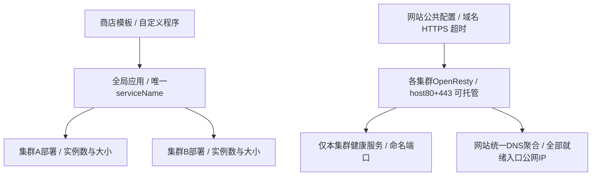

## 第42章 集群与应用统一部署（SDD 042）

2026-10-30。本章描述codex/042-cluster-applications最终跨集群首版，替代第33章独立机器池、托管服务、网关组及单集群应用/网站模型。第33章DNS、ACME、证书、云分发、脚本和执行安全边界继续适用。分支实现与验证记录以SDD042为准，不声称已合入main。

### 42.1 集群与稳定机器归属

公开运行资源为cluster、全局application和全局website。一台稳定managed_machines.id只属于一个cluster，ops_platform_cluster_members以machine_id主键在资源保存事务内约束唯一。Agent重装不改变归属；agents.group_id继续表示采集标签。运行实例使用中的机器不能直接移出，仍属集群的主机不能从主机目录删除，非空集群不能删除。

### 42.2 全局应用与集群部署

商店模板或自定义镜像/Compose生成普通application，一份模板可安装多套独立应用。name为可重复展示名；service_name全局唯一且创建后不可改，默认模板英文标识加序号，小写字母/数字/短横线、首尾字母数字、最长63字符。应用共享运行配置、命名端口与manual/managed模式；deployments按cluster分别设置手动机器或托管实例数、每实例CPU/内存。持久部署状态以application_id+cluster_id为键分别冻结发布修订和授权者，一处发布不升级另一处草稿。

### 42.3 实例、端口与发现

ops_cluster_instances显式保存cluster_id，活跃slot按owner+cluster唯一，退役attempt保留到原节点确认清理。ops_platform_instance_ports保存每实例全部命名端口，ops_platform_ports提供宿主协议/端口排他预留。manual不自动换机或补副本；managed仅在对应集群选择满足容量和全部端口的机器。两种模式均支持固定host_port，冲突不能改号；中心排除已知占用，Agent现场复核，已知占用失败退避该候选并选择其他机器，无候选待调度。serviceName+cluster_id+port_name只返回新鲜健康端点，网站严格当前集群发现，无跨地域隐式兜底。

### 42.4 OpenResty托管与完整配置

OpenResty是role=openresty的全局应用，可部署多个集群，每集群最多一项OpenResty部署。manual选择机器，managed设置实例数和资源；Linux host网络固定80/443。内部gateway.apply/inspect/stop/remove复用Agent执行器，owner仍为application。每集群完整网站、证书和静态文件包下发到该部署全部入口实例，逐机nginx -t、切换、重载、HTTP/TLS验证；失败保留旧版，逐集群和实例显示实际修订。故障换机先完成配置与验证，再更新入口发现和受管DNS。

### 42.5 网站公共配置与集群上游

website为全局对象，cluster_ids定义作用范围；bindings统一域名、HTTPS、证书、DNS，nginx及locations统一路径、超时、头部、缓存、限流和其他高级选项。只有locations.cluster_targets按cluster选择反代URL或application_id+port_name，不支持任意公共配置覆盖。绑定目标应用必须有该cluster的deployment且端口可HTTP(S)代理，保存/发布双重检查；被引用部署/端口删除须先解除引用。暂时无健康实例保留绑定并在对应路径返回503，恢复后刷新上游。

### 42.6 DNS聚合、共享资源与界面

DNS/ACME账号、托管域名、证书和分发目标保持中心加密共享，凭据不下发网关。网站以自身为DNS记录owner，统一汇总全部生效集群已经验证的OpenResty实例公网地址，再维护本网站的A/AAAA，避免各集群互删；调度和入口健康变化触发刷新，保留外部记录。界面以应用/网站为全局入口，集群用于机器归属和部署目标，列表可按集群筛选。应用安装逐集群配置实例大小，网站公共设置仅一份；快捷创建抽屉保留父表单并回填。

### 42.7 控制与兼容边界

中心继续Node/TypeScript+SQLite；cluster-workloads由原workloads组合装配，原加密资源/修订/执行、Agent control凭据和有效job lease保持不变。配置/发布/持续策略由管理员授权，AI不批准或任意执行，生产中心无Docker socket。旧单cluster application/website规范化为deployments和cluster_targets单项，保留资源ID、serviceName、实例ID、数据路径及运行容器；legacy node_pool/service/gateway_group保留历史，不提供新建与新部署。首版商店内置MySQL/Redis/OpenResty，自定义程序通过镜像/Compose发布，源码CI与第三方商店源后续扩展。

### 42.8 现场验证与范围

Demo使用真实SQLite/HTTP、Agent enrollment与有效lease、生产执行器、Docker、MySQL、自定义Web双端口和OpenResty，覆盖网站读写、TLS、Web重建数据保留以及托管入口。多节点QA如使用DinD，明确其为同一物理Docker宿主上的独立daemon/网络命名空间，不冒称多地域实机。测试域Host替代公网DNS、自签证书替代公有CA；DNS聚合协议另行mock验证，不声称公网传播或ACME已验。具体通过项、未验范围和可复现命令见SDD042 validation及examples/cluster-demo/README.md。
