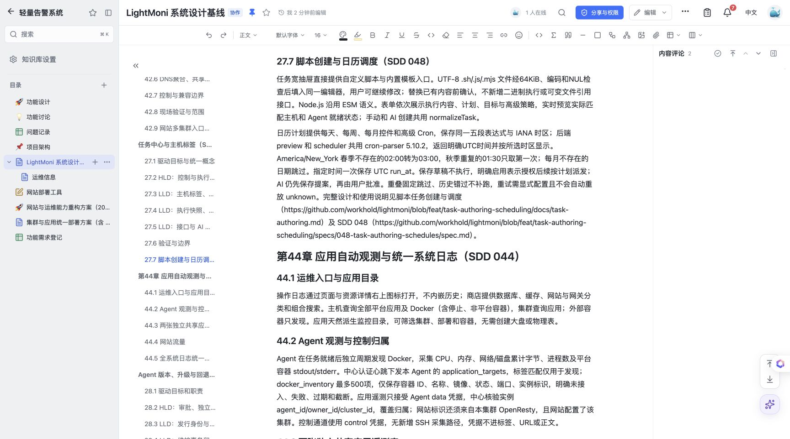

# Doca 同步与回读

- 架构影响：任务计划、持久化调度、执行策略及 Agent 脚本能力协议扩展。
- 仓库设计：`docs/system-design.md` 第13、22.3、25、27.3–27.5、27.7节；使用说明 `docs/task-authoring.md`。
- 在线文档：[LightMoni 系统设计基线](https://doca.heyphp.com/#/r/2902a80f-c592-414e-9aed-64fe19f2ed53)。
- 方法：已登录浏览器的正常编辑界面，逐块编辑后重新加载文档并回读 DOM；本次没有调用 MCP，不将浏览器回读表述成 MCP 版本号或序列号验证。

同步内容包含脚本导入与编辑、单次/间隔/Cron时区计划、预览接口、独立的单次消费表、5秒扫描与15秒容差、并发和队列期限、自动重试失败码及守卫、v1/v2能力边界和创建审阅流程。新增27.7节及使用说明/SDD引用；保留在线已有的其他 PR 章节，未用当前仓库文档覆盖整篇在线文档。

## 保存验证

变更前530个顶级块，完成后537个。重新加载后537个块的ID、顺序和文字与保存前快照一致；目标章节以外的原有块内容均保留。单块清空重写会由编辑器生成新段落ID，相关段落正文和列表样式已回读核对。详细数量、验证时间和文字快照摘要见 [doca-readback.json](doca-readback.json)。

22个原生图块均保留。重新加载后，逐一打开22张图的原生编辑器，只读核对稳定节点/连线ID、图形类型、标签、节点位置及连线端点，全部一致；关闭编辑器时未修改或保存图。忽略渲染实例ID和编辑器自动重算的中间路由像素，不声称预览SVG字节相同。任务控制图为12个节点/13条边，执行状态图为7个节点/7条边。

浏览器回读确认在线保存；该证据不代替代码、真实Agent或生产部署验收。
