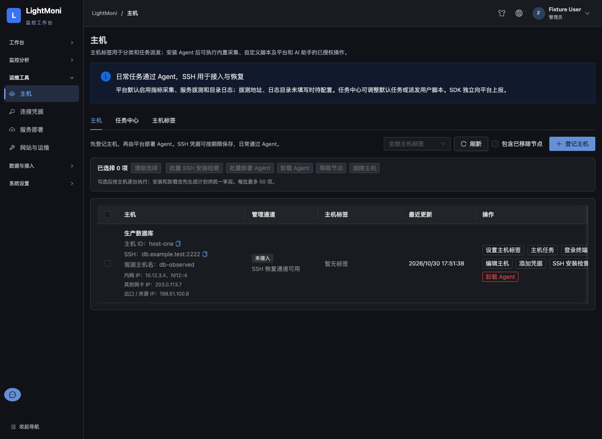
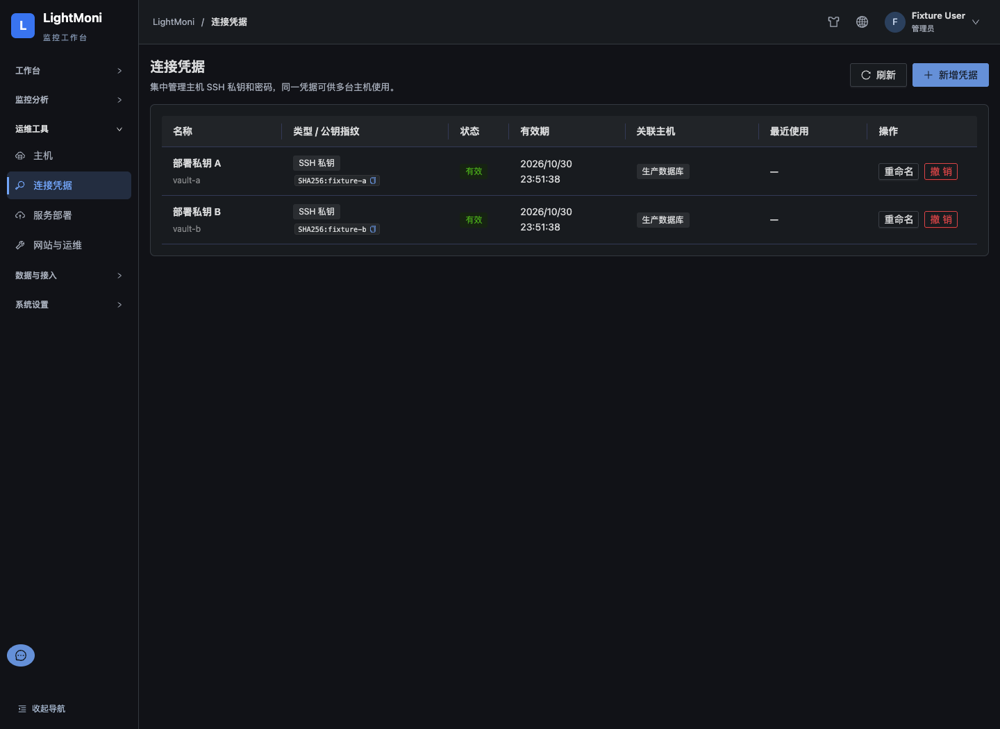
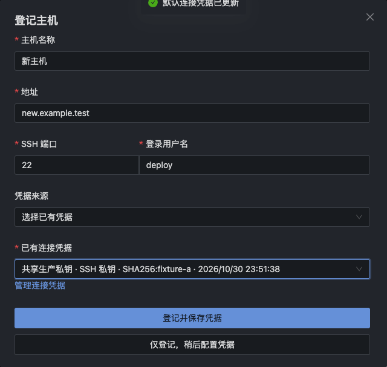
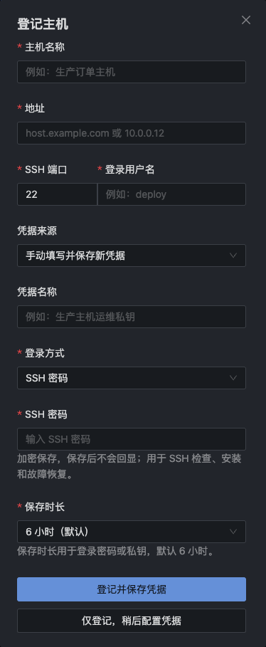

# 验收记录

## 结果

- Runtime 全量：537 通过，17 项依赖外部环境的测试跳过，0 失败（共 554）。
- AI runtime：71/71；TypeScript SDK：18/18。
- 凭据/SSH/主机身份/Agent 安装卸载专项：95/95；主机目录与网络专项：20/20。
- 新界面验收：16 项；原登记/凭据/终端流程双语与窄屏回归：36 项。无 page error 或非预期 API 请求。
- 根目录 `npm run typecheck`、`npm run build` 和 `git diff --check` 通过。构建中的 antd use-client 第三方指令提示不影响产物。
- 完整 Runtime 首次发现主机目录字段白名单尚未包含新增 network；已更新契约断言并增加未发现地址断言，随后全量复跑通过。

## 删除主机文案收尾

删除前提示统一为“先解绑本主机的有效连接凭据”，确认影响明确仅删除本主机记录、凭据绑定与部署/卸载历史；中央凭据库及其他主机的共享凭据保留。Agent control/data 身份的撤销说明保持原语义。

- 后端删除专项 **3/3**：有效绑定阻止删除；解绑取消本主机待审批计划后允许删除；共享私钥在一台主机解绑并删除后仍可供另一台主机使用。
- 删除主机界面回归 **12/12**，含中英文共享凭据保留提示、未确认不删除、各类删除阻断、单次提交、延迟响应及刷新失败。报告：[machine-list-delete-ui-report.json](deletion-regression/machine-list-delete-ui-report.json)。
- SSH 与删除流程回归 **18/18**，含主机解绑后通过统一工具栏删除，以及原 SSH 检查、计划、确认与双语流程。报告：[ui-report.json](ssh-deletion-regression/ui-report.json)。
- 两份界面报告均为 0 page error、0 非预期请求。Runtime/web 类型检查、web 生产构建及差异检查通过；未再次运行全量测试。已恢复生成的 `web/tsconfig.tsbuildinfo`，不纳入提交。

```sh
cd runtime
node --import tsx --test --test-name-pattern='host deletion|unlinking a host credential|detaching and deleting' test/managed-machines.test.ts test/connection-credentials.test.ts
cd ..
LIGHTMONI_QA_OUTPUT=specs/050-connection-credentials-host-addresses/deletion-regression node web/src/app/verify-machine-list-delete.mjs
LIGHTMONI_QA_OUTPUT=specs/050-connection-credentials-host-addresses/ssh-deletion-regression node web/src/app/verify-machine-ssh.mjs
```

## 复现

```sh
npm --prefix runtime test
npm --prefix ai-runtime test
npm --prefix sdk/typescript test
npm run typecheck
npm run build
node web/src/app/verify-connection-credentials.mjs
node web/src/app/verify-host-registration-onboarding.mjs
```

界面脚本启动隔离本地服务器和 fixture API，不连接线上或真实 SSH，生成报告及截图。新凭据行为用隔离 SQLite、实际生成 SSH 私钥和注入式 SSH runner 验证；已有真实 ssh2 密码/终端测试共同回归，未读取用户私钥。

## 交付边界

本轮没有发布镜像、升级线上平台或修改 vchive。网卡地址需要运行本版本 Agent 后上报；平台升级后旧 Agent 仍可连接，未上报地址明确显示待发现。出口/来源是平台的连接观测，代理部署需配置可信代理才采用转发链，不保证公网可达。

旧凭据升级保留稳定绑定 ID 和有效期限；不可解密/解析的材料隔离为不可用，不将异常材料选为默认；原有限期限到期仍清除。一次性密码单主机独占并消费后清除，手工同钥复用不扩大本次保存期限。审查发现的上述边界均补回归后修复。

架构及 Doca 同步回读见 [同步记录](doca-sync.md)，机器可读测试汇总见 [test-summary.json](test-summary.json)。

## 界面证据








