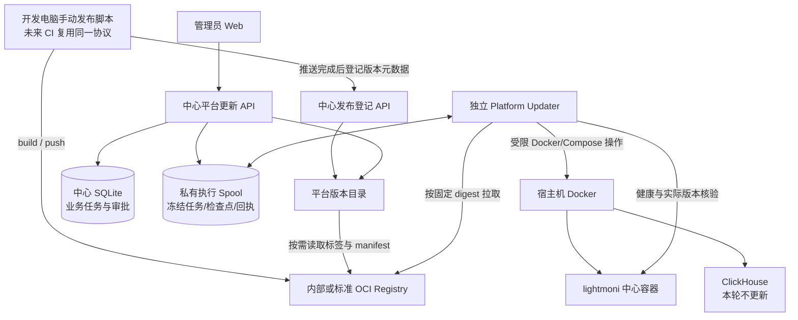
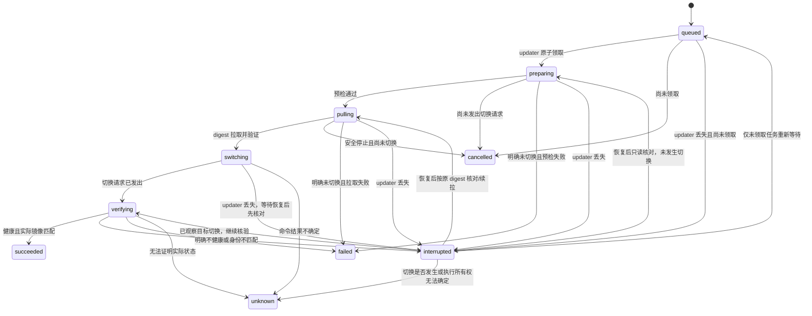

# SDD 143：平台自更新 MVP HLD（待评审）

**Branch**: `codex/143-platform-self-update-hld`
**Date**: 2026-11-14
**Status**: HLD draft for review；未授权实现
**Architecture impact**: 适用。新增中心与独立更新器的控制路径、发布登记协议、持久化执行记录和 Docker 权限边界；实现 PR 必须同步 `docs/system-design.md`。

## 1. 目标与范围

管理员在中心页面配置平台自身的镜像来源，按需读取版本，查看标签、不可变 digest、实际上传时间和源码提交，动态选择目标并确认更新。中心容器重建期间，由独立更新器继续执行；中心或更新器中断后，原任务按持久化检查点恢复或进入明确的核对状态，不重复创建或盲目重放更新。

### 1.1 MVP 包含

- 开发电脑上的手动发布脚本：构建/推送镜像，并登记上传时间、digest 与源码提交。
- 当前内部 Registry 的版本读取；内部与标准 OCI Registry 共用发布登记协议和版本模型，标准 Registry 读取适配器可后续增量实现。
- 更新源配置、按需检查版本、版本下拉选择、二次确认和更新按钮。
- 独立 Platform Updater，固定 digest 拉取并只重建 `lightmoni` 服务。
- 持久化任务、带时间阶段事件、回执补读和中断续跑。
- 健康检查、实际运行镜像核验、失败/中断/未知结果展示。
- 保存更新前版本，允许管理员以后明确选择该版本执行程序恢复。

### 1.2 MVP 不包含

- 无人值守自动更新、维护窗口、定时轮询和更新通道自动跟踪。
- 零停机、双中心、HA 或跨主机切换。
- 自动更新 ClickHouse、updater、宿主机或远端 Agent。
- 数据备份、数据迁移或数据库结构自动回滚。
- 用户自定义 Docker/Compose 命令、任意目标服务或任意宿主路径。
- AI 批准或执行更新；AI 能力不属于本轮范围。

## 2. 现状约束

- 根 `compose.yaml` 当前固定中心镜像标签；需要改为受控目标镜像参数，保留原项目名、`.env`、端口、网络和数据卷。
- 中心当前以非 root 用户运行，未声明 Docker socket 权限；不得为自更新把 Docker 控制权限授予中心主容器。
- 现有私有镜像读取可枚举标签并校验 manifest/digest，但 Registry V2 通用接口不提供可靠的标签上传时间。
- OCI `org.opencontainers.image.created` 或镜像 config 的创建时间不是推送完成时间，不能作为上传时间展示。
- 当前 `/healthz` 仅证明 HTTP 健康；实际升级成功还需要 updater 从 Docker 侧核对运行容器和镜像身份。
- 当前中心存储基线为 `center_schema=2`。发布元数据必须显式声明兼容域，未知兼容不能按可升级处理。

## 3. 总体架构



### 3.1 职责边界

| 组件 | 职责 | 明确不拥有 |
|---|---|---|
| 发布脚本 | 构建、推送、解析 digest、保存原始发布回执、登记元数据 | 审批或执行平台更新 |
| 中心版本目录 | 合并 Registry 标签与发布登记，重新校验 digest，提供安全版本视图 | 把构建/首次发现时间冒充上传时间 |
| 中心更新 API | 配置来源、创建冻结任务、管理员审批、历史与审计 | Docker/Compose 执行权限 |
| 中心 SQLite | 任务 ID、目标、操作者、审批、业务状态和事件投影 | 中心停止期间的唯一执行状态 |
| 私有执行 Spool | updater 可独立使用的冻结任务、检查点、锁、心跳和回执 | 保存 Registry/中心秘密 |
| Platform Updater | 预检、拉取、切换、恢复、健康检查和实际镜像核验 | 公网入口、任意命令执行、其他服务更新 |
| Docker/Compose | 实际容器生命周期 | 数据卷删除或业务配置改写 |

中心 SQLite 是管理与审计权威；updater 的本地检查点是执行权威。中心恢复后按任务 ID 和事件序号补读执行事实，不反向覆盖 updater 已持久化的真实结果。

## 4. 发布端设计：当前手动，未来 CI 复用

### 4.1 本地发布脚本

新增仓库脚本作为唯一推荐入口，概念命令为：

```sh
npm run publish:platform -- \
  --repository docker.heyphp.com/lightmoni/lightmoni \
  --tag 20261114-abc1234
```

脚本负责：

1. 检查 Git 源码提交和允许的发布条件，记录完整 `source_revision`。
2. 使用既有镜像构建能力构建并推送明确的不可变标签；多架构发布沿用现有 buildx 流程。
3. 推送完成后重新读取 Registry manifest，取得并验证实际 digest。
4. 在开发电脑的私有发布目录原子保存回执，记录 `published_at`、repository、tag、digest、source revision 和兼容信息。
5. 调用中心发布登记接口；中心再次读取 Registry，核对标签仍指向登记的 digest。
6. 登记失败时明确区分“镜像已推送、登记未完成”，不得重新推送来假装登记成功。

脚本只读使用开发电脑已有的 Registry 推送权限；中心登记使用独立 publisher 凭据，经受保护文件或进程环境注入，不进入命令行、Git、URL、镜像或日志。

### 4.2 登记重试

若中心暂时不可用，脚本支持仅重试登记：

```sh
npm run publish:platform -- --register-only <本地发布回执路径>
```

- 沿用回执中的原始 `published_at`，不改成重试时间。
- 重新读取 Registry，标签已改指向其他 digest 时拒绝登记。
- 重复登记同一 repository/tag/digest 幂等；元数据冲突时拒绝覆盖。
- 本地回执不得包含 Registry 密码、publisher token 或中心会话。

### 4.3 发布登记身份

发布登记身份为 `repository + tag + digest`。同一 digest 的新标签有自己的上传登记；同一标签改指向新 digest 是新的发布记录，旧任务立即失效。

```json
{
  "repository": "docker.heyphp.com/lightmoni/lightmoni",
  "tag": "20261114-abc1234",
  "digest": "sha256:...",
  "published_at": "2026-11-14T10:30:00Z",
  "source_revision": "abc1234...",
  "state_schema": 2
}
```

- `published_at`：发布端在推送完成后记录的时间。
- `registered_at`：中心收到登记的时间，单独保存但不冒充上传时间。
- `first_seen_at`：中心首次从 Registry 发现该标签的时间，仅用于无登记版本。
- publisher 只能登记版本，不能读取中心秘密、批准或执行更新。
- 未来 CI 直接复用同一脚本或登记协议，不改变中心版本目录和更新器。

## 5. 版本目录与页面

### 5.1 来源适配

定义 `PlatformReleaseSource` 端口，版本目录与更新任务不依赖具体 Registry 产品：

- 内部系统 Registry：复用已登记端点、受控只读 Registry 路径及现有凭据边界。
- 标准 Registry：通过显式管理员配置的 HTTPS 来源和受保护凭据引用读取；MVP 可实现为后续适配器，但数据模型和发布登记协议现在保持兼容。
- 不允许更新任务携带任意 URL、命令、凭据正文或宿主路径。
- 标签和 manifest 读取有分页、条目、响应大小、并发、深度和超时上限，不跟随未授权重定向。

### 5.2 版本视图

| 字段 | 含义 |
|---|---|
| `tag` | 用户选择的标签 |
| `digest` | 标签当前对应的不可变 manifest digest |
| `published_at` | 推送完成后的上传登记时间 |
| `source_revision` | 构建对应的完整 Git commit |
| `current` | 是否与 updater 观察到的当前运行身份一致 |
| `compatibility` | 可更新、信息不完整或明确不兼容 |
| `verification` | Registry 与发布登记是否一致 |

列表按有效 `published_at` 倒序；无登记的历史版本显示“上传时间未记录”，排在有时间记录之后，不能按标签字符串猜新旧。`first_seen_at` 如展示，必须标为“平台首次发现时间”。

### 5.3 操作闭环

页面位于“系统设置 → 平台更新”，并提供到私有镜像来源管理的链接：

1. 显示 updater 状态、当前实际运行版本和当前更新源。
2. 管理员点击“检查版本”，按需读取，不后台轮询。
3. 从版本列表选择目标，确认页展示当前/目标 digest、上传时间、源码提交和兼容信息。
4. 明确提示中心将短暂重启；不更新 ClickHouse、Agent 或数据卷；程序恢复不等于数据迁移回滚。
5. 二次确认后创建任务并返回 `operation_id`。
6. 页面按原操作 ID 回读持久阶段；刷新或断线不影响执行。

## 6. 更新计划与审批

点击确认即授权本次更新，但服务端仍需在同一业务路径完成冻结和复核：

- 重新读取目标标签并固定 digest；与页面审阅不一致则要求重新选择。
- 固定更新源配置修订、目标 repository/tag/digest、源码提交和兼容域。
- 通过 updater 只读观察固定 Compose 项目身份、当前中心容器、当前镜像 ID/RepoDigest、当前存储基线和最近成功版本。
- 检查 updater 协议兼容、执行锁可用且没有其他活动更新。
- 保存操作者、审批时间、幂等键和计划摘要。
- 配置、当前容器身份或目标 digest 在执行前变化时拒绝旧计划。

重复点击相同未终结请求返回原任务；不同目标或已有活动任务返回冲突。MVP 全局只允许一个平台更新任务。

### 6.1 SQLite 与 Spool 的崩溃一致性

中心与 updater 不通过分布式事务保持同步，采用可恢复的幂等投递：

1. 中心在一个 SQLite 事务中保存任务、审批和完整不可变执行载荷，初始为 `queued`。
2. 中心或启动恢复器按原 `operation_id` 将完全相同的载荷原子写入 Spool；重写只允许发生在 updater 尚未持久确认领取之前。
3. updater 只接受完整、可验证且来源仍被允许的任务，先原子保存 `accepted` 检查点，再允许任何 Docker 写操作。
4. Spool 写入结果不确定时，中心只按原任务 ID 和载荷摘要多读/重写同一未领取任务，不生成第二个 ID。
5. updater 一旦确认领取，Spool 的执行状态只由 updater 推进；中心恢复器不得用 SQLite 旧状态覆盖它。
6. 中心崩溃造成“SQLite 有任务、Spool 尚未投递”时，恢复器补投原任务；“Spool 已领取、中心尚未看到”时，中心只补读，不再次投递新任务。

## 7. 执行协议与状态机



`cancel_requested` 是持久标志，不把 `switching/verifying` 强制改成已取消。未知结果不能自动重试；中断恢复必须先获得本任务所有权并做只读观察。

### 7.1 切换操作

updater 只允许执行固定等价于以下的受限流程，具体命令和参数在后续 LLD/契约中冻结：

1. 按 digest 拉取并验证目标镜像和平台架构。
2. 持久化 `switch_intent`，包含任务 ID、旧/新镜像身份和 Compose 配置摘要。
3. 通过受控目标镜像参数，仅重建 `lightmoni` 服务；切换使用持久化目标状态文件，不直接改写仓库中的 `compose.yaml`。
4. 不执行 `down`、不删除卷、不重建 ClickHouse、不改变 `.env` 和项目名。
5. 等待中心健康，并从 Docker 侧核对实际容器与目标镜像身份。

Docker 命令超时或连接断开不能解释为“未执行”。

## 8. 中断续跑与结果恢复

### 8.1 持久化检查点

updater 在私有 Spool 中为每个任务原子保存：

- 完整冻结计划与计划摘要。
- 当前检查点和单调递增事件序号。
- 任务锁、执行进程启动代次和最近心跳。
- 当前/目标镜像身份和 `switch_intent`。
- 已完成步骤、最终回执和回执持久化状态。

秘密不写入 Spool。Registry 认证在需要时经短期、单仓库授权获得，临时文件用后清理；任务、事件和日志只保存安全元数据。若恢复时中心不可用且授权已失效，任务保持 `interrupted` 并等待中心恢复，不绕过认证或使用长期秘密。

### 8.2 updater 重启

1. 扫描未终结任务，获取全局执行锁并核对任务所有权。
2. 校验冻结计划、允许的更新源和 Compose 项目身份。
3. 先只读观察 Docker、中心健康及是否有本次残留执行进程。
4. 按检查点恢复，而不是从头重放。
5. 同一任务的回执按 `operation_id + sequence` 幂等补交。

| 最后检查点 | 恢复语义 |
|---|---|
| `queued` | 未领取则保持排队；有领取证据则核对原任务，不新建任务 |
| `preparing` | 重新只读预检；身份不变且未发生切换才继续 |
| `pulling` | 按原 digest 核对本机镜像，缺失时继续同一拉取 |
| `switch_intent` 已保存、切换结果未知 | 不再次执行切换；先核对实际容器与残留进程，能证明状态则进入核验，否则 `unknown` |
| `verifying` | 继续健康与实际镜像核验，不重复切换 |
| 最终回执已保存但中心未收到 | 中心恢复后补读，不重新执行 |
| 锁、任务所有权或检查点冲突 | 保持 `interrupted/unknown`，等待人工核对 |

### 8.3 中心重启

- 中心不把重启前的活动任务直接改写为失败或成功。
- 从 SQLite 恢复原任务和审批，再读取 updater 的心跳、检查点及事件。
- updater 健康时恢复事件投影；updater 不可达时显示“执行中断，等待更新器恢复”。
- 中心重启期间 updater 继续已领取任务，不依赖中心 API 在线。
- 页面以原 `operation_id` 回读，不通过重复点击创建替代任务。

### 8.4 中断与未知的区别

- `interrupted`：执行者暂时不可用，但任务与检查点完整，允许原 updater 恢复。
- `unknown`：切换是否发生、实际镜像或任务所有权无法可靠确认；只允许只读核对和明确的人工后续操作。
- 任何网络超时、中心重启或页面断开本身都不等于 `unknown`，必须根据持久证据判断。

## 9. 成功、失败与恢复

### 9.1 成功条件

必须同时满足：

1. 新中心容器运行且健康检查通过。
2. 中心所需存储初始化完成，未报告不兼容基线。
3. updater 从 Docker 侧确认实际容器使用批准的目标镜像身份。
4. 最终回执已原子持久化，中心能够补读。
5. ClickHouse、数据卷和其他服务未被本任务更新。

`docker compose up` 返回成功、镜像已经下载或中心曾短暂返回 HTTP 200 均不能单独证明更新成功。

### 9.2 失败与恢复

- 切换前明确失败：保留原中心并标记 `failed`。
- 切换后健康或身份核验失败：保存实际状态、旧版本和安全诊断，不自动反复重启。
- MVP 不承诺自动回滚；数据库结构一旦变化，恢复旧镜像不保证兼容。
- 历史版本只有满足当前兼容门禁时才允许管理员再次明确选择并执行程序恢复。
- `unknown` 必须先由 updater 只读核对；核对接口不能通过重新执行更新来“修复”。

## 10. 权限、安全与部署

- 仅有效管理员的人类会话可配置来源、创建/审批更新、取消允许阶段任务和查看历史。
- publisher、管理员、Agent control/data、SDK Key 和 Registry 拉取凭据互相分离。
- updater 不暴露公网端口，不接受浏览器直接请求，不执行任意 shell。
- updater 是宿主机高权限组件，需显式安装；Docker 控制权限必须真实可写，不能以 `:ro` 声称可完成更新。
- 私有 Spool 不与业务应用共享，不保存主密钥、数据库密码、Registry 密码或 publisher token。
- 默认安装仍可由管理员手工使用 Compose；只有启用自更新时才增加 updater 服务。
- 既有部署需一次性手工安装/升级 updater 和中心，完成后才具备页面自更新能力。
- updater 自身使用独立固定版本，MVP 不通过本功能更新 updater。
- 所有事件使用固定安全枚举和有界诊断，不持久化任意 Docker/Registry 响应正文。

## 11. 数据与接口概览（HLD 级）

详细字段、错误码和 HTTP 契约在 HLD 评审后另行生成。

### 11.1 逻辑实体

- `PlatformUpdateSource`：repository、来源适配器、凭据引用、revision、更新者和时间。
- `PlatformReleasePublication`：repository/tag/digest、published_at、registered_at、source_revision、state_schema 和校验状态。
- `PlatformUpdateOperation`：operation_id、冻结计划、当前/目标身份、状态、操作者、审批、幂等键和时间。
- `PlatformUpdateEvent`：operation_id、sequence、phase、安全代码和时间。
- `UpdaterCheckpoint/Receipt`：updater 私有执行状态，不作为公开可写资源。

### 11.2 接口方向

- 管理员：读取/更新来源，检查版本，读取当前状态，创建并确认更新，按 ID 查询任务和事件。
- publisher：仅登记发布元数据，支持幂等重试。
- updater：只通过私有 Spool 和固定内部协作路径领取/续跑/回报，不开放公网写 API。

## 12. MVP 验收场景

1. 开发电脑手动构建并推送后，一次登记即可在页面看到实际上传时间、digest 和源码提交。
2. 中心暂不可用时保留原始发布回执；只重试登记不改变上传时间，也不重复推送镜像。
3. 历史无登记版本显示“上传时间未记录”，不把构建/首次发现时间冒充上传时间。
4. 标签在审阅后改变 digest，旧确认被拒绝；重复登记冲突元数据被拒绝。
5. 管理员可选择非最新但兼容的版本；重复点击返回原任务，并发不同目标被拒绝。
6. 拉取阶段 updater 重启后按原 digest 续拉；中心恢复后补读同一任务事件。
7. 切换意图持久化后 updater 中断，恢复时不盲目再次切换；根据实际容器继续核验或进入 `unknown`。
8. 最终回执已写但中心未收到时，中心恢复后补读成功，不重新执行。
9. 新中心不健康、存储基线不兼容或实际镜像不匹配时不能显示成功。
10. 全流程不删除数据卷、不更新 ClickHouse/updater/Agent，不改变项目名和 `.env`。
11. 普通成员、Agent、SDK Key、publisher 和 AI 均不能批准或执行更新。
12. 使用内部 Registry 完成真实 Docker 验收；标准 Registry 适配器未实现时不得宣称已经验证。

## 13. 后续演进

在同一模型上增量增加：

- 标准 Registry 读取适配器和更多发布端。
- 自动检查、更新提示和维护窗口。
- 显式兼容的小版本自动更新策略。
- 备份门禁、签名/来源证明和更严格的兼容策略。
- 自动程序恢复（仍以数据兼容证据为前提）。
- updater 自身的独立升级流程。

这些能力不得通过放宽 digest 固定、审批、检查点或 unknown 围栏来实现。
