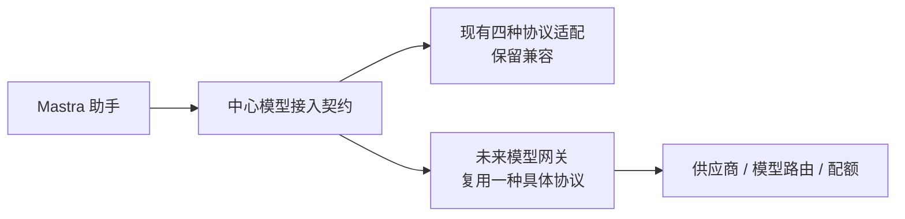
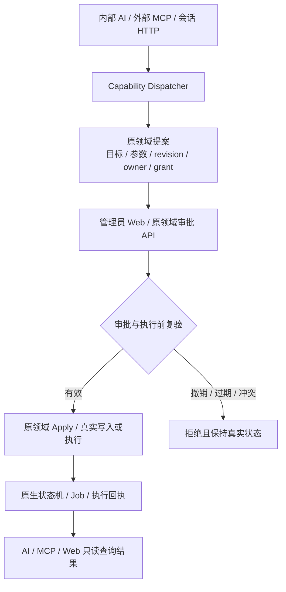

# SDD 152 实施设计：AI 助手模型接入与审批执行边界

**Branch**: `codex/152-assistant-model-execution-boundaries`
**Date**: 2026-11-14
**Spec**: [spec.md](spec.md)
**Type**: 文档/HLD/LLD 修订；无运行时代码变更

## 1. HLD：模型接入保持薄边界

中心保留的是助手运行所必需的稳定契约：配置、真实连接测试、流式文本、工具调用、多轮历史、取消/超时、安全错误及真实用量。现有四协议适配继续可用，但不再是持续扩张供应商功能的产品方向。

未来网关承担供应商协议差异、模型目录与别名、路由/故障切换、配额、供应商秘密和成本治理。LightMoni 不复制这些职责，也不要求外部 MCP 客户端使用中心模型；外部客户端仍自行负责模型调用和计费。

“基本能力”不意味着退化为纯文本：如果网关或协议入口缺少流式工具调用、多轮历史或取消语义，AI 助手不能视为满足基本接入要求。

## 2. HLD：写操作采用提案—审批—原生执行

- **模型边界**：模型可调用 `read/draft/propose/code`，不能直接调用审批或通用执行。
- **产品边界**：审批后允许真实写操作；“不提供 execute 工具”不等于“平台禁止写入”。
- **执行归属**：任务、告警、部署、运维和 Agent 首装继续由原领域服务执行，不在 Dispatcher 中复制业务逻辑。
- **结果语义**：提案接受、审批接受、进入队列、开始执行和最终成功是不同事实；页面与模型必须分别表达。

## 3. LLD：模型配置与网关复用

现有配置字段和接口不变：

- `base_url`、`api_key`/`use_saved_key`、`protocol`、`model`、`enabled`。
- 现有执行预算、思考深度偏好、价格和用量字段保持兼容。
- 目录查询只提供目录/协议建议；保存时必须已有具体协议和模型。
- 连接测试由管理员显式触发，可能产生少量真实费用；目录查询不生成内容。
- 网关接入时选择其实际支持的一种具体协议，不新增 `gateway` 模糊协议，不根据模型名称猜协议。
- API Key 继续加密保存，不进入日志、URL、模型上下文、MCP 响应或文档。
- 供应商未返回 token 时保持 `unpriced/unknown`；网关返回值按原始事实记录，不在中心重复计费。

后续新增供应商特性应先判断能否由网关屏蔽；只有影响中心基本模型契约时才新建独立 SDD。

## 4. LLD：提案、审批和执行契约

### 4.1 提案创建

- 描述符声明稳定 capability ID/version、输入输出 Schema、所需 read/propose scope、effect、目标解析、幂等和结果投影。
- Dispatcher 校验真实 Principal、当前角色/scope/资源范围、输入和限流，然后调用原领域 `plan/propose`。
- 原生记录保存提案 ID、目标快照、参数或 diff/digest、revision、owner、来源、稳定 grant、期限和审阅地址。
- 创建提案不得直接修改目标配置、创建执行 Job、签发 enrollment 或发起安装 SSH，除非原领域明确把某个只读预检作为计划准备且有独立契约。

### 4.2 管理员审批

- 仅有效管理员的人类会话通过原业务页面/API 确认；不向 AI/MCP 注册审批工具。
- 审批重新读取原提案和当前资源，校验目标、内容摘要、revision、期限和 owner。
- 外部提案必须复验稳定 grant 和原 scope/资源授权；授权适配器缺失时 fail closed，不能降级成内部助手提案。
- 内部/历史提案保持原兼容路径，不伪造外部 grant。

### 4.3 真实执行与查询

- 审批通过后由原领域服务执行实际写入或创建原生 Job；Dispatcher 不接管状态机。
- 对需要远端执行的操作，在领取/启动前按原协议再次复验稳定授权；撤销只阻止尚未开始项，已经开始项遵循原取消/恢复协议。
- 同业务键同内容返回原记录，异内容冲突；RPC/HTTP 请求 ID 不替代业务幂等键。
- AI/MCP 使用 read 能力查询原生状态和执行回执；连接中断只中断当前调用，不自动取消已接受业务操作。
- unknown 必须核对，禁止自动重放；真实成功必须来自原领域终态和必要的健康证据。

## 5. 文档修订范围

- `docs/system-design.md`：修正当前 AI HLD、模型边界和审批后执行语义。
- `docs/platform-mcp.md`：修正统一能力 HLD、能力描述符 LLD、当前事实与剩余范围。
- `docs/mcp.md`：明确客户端只创建提案，管理员审批后发生真实业务执行。
- SDD 001/003/046 的 Spec、Plan 和相关契约增加现行修订，保留原始阶段和验证证据。
- 新增 SDD 152 的 Spec、HLD/LLD、契约、任务和文档验证记录。

## 6. 架构影响与验证

适用：本次明确模型网关未来职责和 AI 提案到真实执行的控制/权限边界，因此更新仓库当前系统设计；不引入新组件、接口或运行时代码。

仅执行文档结构、链接、差异和秘密模式检查。未运行代码测试不代表代码行为发生变化，也不新增真实客户端、供应商、网关或生产业务验收声明。
